# 좀비 인 동탄 · EP.01 라크몽의 좀비들 — 스토리보드 · 캐릭터 시트 통합본 (압축본)

작성일 2026-10-09 · 압축 2026-10-10 · 16:9 · 실사 기반 시네마틱 가족 판타지 모험 · 22장면 · 107컷(1~1.5초 하드컷·긴 대사 최대 2초) · 총 02:31

> 반영한 확정 사항: 아들 이름 **진(7살)**, 유튜브 공개용 **캐릭터·무기 시트 연결**, 1번은 **꼬꼬맘**, 좀비는 **평소 느리고 소리에 달려듦**, **해 질 녘 노을**, 프리비즈 영상 도구는 Blender(단순 3D 인물·공간). 촬영은 **새벽의 저주(2004) 스타일**, 앞에 **뉴스·CCTV 프롤로그** 추가.

## 압축 편집 노트

전개 속도를 높이기 위해 원래 38장면·181컷·4분 16초를 **22장면·107컷·02:31**로 줄였습니다. 이야기 순서, 결정적 행동, 확정 설정은 그대로 두고 비슷한 장면을 합쳤습니다. 겹치던 대사와 설명 컷을 덜어 냈고, 대사가 있는 컷만 최대 2초를 허용했습니다. 압축 전 원본은 backups/20261010-before-compress 폴더에 보관했습니다.

| 새 장면 | 합친 원래 장면 | 줄인 내용 |
|---|---|---|
| 01 | 01·02 | 뉴스와 CCTV를 4컷 몽타주로 통합 |
| 02 | 03·04 | 휴대폰 영상과 재난문자·타이틀을 한 장면으로 |
| 03 | 05 | 좀비 소개 컷 1개 축소 |
| 04 | 06·07·08 | 가족 이동·손목 장치 경고·경사로 확인을 하나로, 약 확인 대사 생략 |
| 05 | 09 | 그대로 유지 |
| 06 | 10 | 그대로 유지 |
| 07 | 11·12 | 도망과 급정거를 연결 |
| 08 | 13 | 그대로 유지 |
| 09 | 14·15 | 휴대폰 미끼와 남은 위협을 연결 |
| 10 | 16·17 | 입간판 막기와 아빠의 당부를 연결 |
| 11 | 18·19 | 버튼·피에로 등장·회전을 연결 |
| 12 | 20 | 그대로 유지 |
| 13 | 21 | 그대로 유지 |
| 14 | 22·23 | 아쉬움 대사 정리, 버티기 장면과 연결 |
| 15 | 24·25 | 실패와 발견을 연결, 피에로 농담 1개 생략 |
| 16 | 26·27 | 썰매 준비와 얼음 파도를 연결, 중복 대사 컷 삭제 |
| 17 | 28·29 | 볼링 핀과 출발을 연결 |
| 18 | 30·31 | 질주와 회피를 연결 |
| 19 | 32·33 | 해제·초록 불·여운을 연결 |
| 20 | 34 | 포옹 컷 1개 축소 |
| 21 | 35·36 | 새 무리 등장과 두 번째 룰렛 결심을 연결 |
| 22 | 37·38 | 두 번째 판과 클리프행어를 연결 |

# 룰렛 무기 도감 · 1–9

추첨은 진. 아빠 2·8번, 릴리 6번, 진 1·7번, 가족 공동 3·4·5·9번.

| 번호 | 무기 컨셉 | 사용자 시트 | 무기·장비 | 능력 | 사용자 | 상태 |
|---|---|---|---|---|---|---|
| 1 | 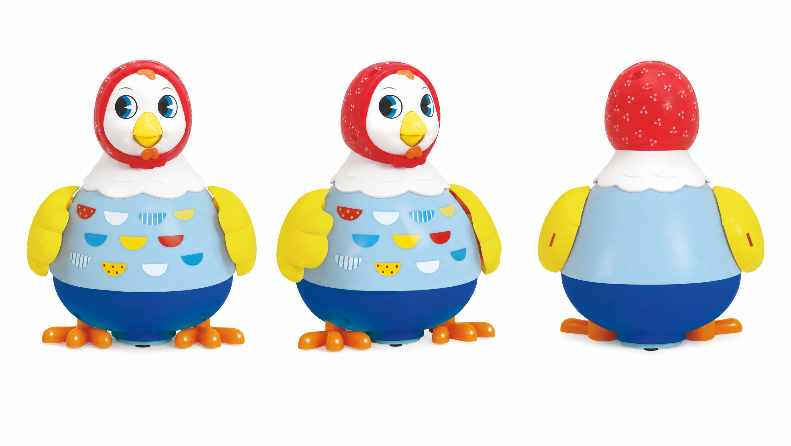 | — | 거대 꼬꼬맘 | 진이 아끼는 꼬꼬맘 인형이 거대화해 좀비를 공격하고 밀쳐 물리친다. | 진 | 확정 |
| 2 | 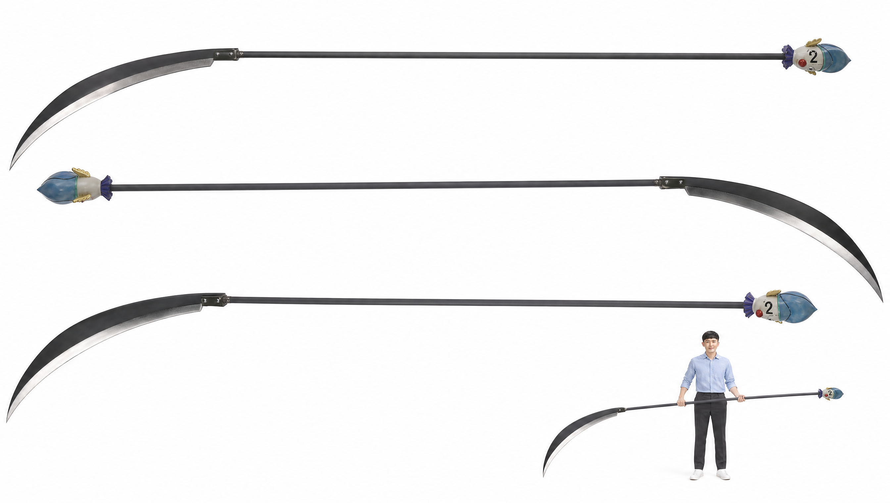 |  | 거대 낫 | 한 바퀴 휘둘러 주변 공격 범위를 한꺼번에 절단한다. 화면은 실루엣과 절단선으로 표현. | 아빠 전용 | 확정 |
| 3 | 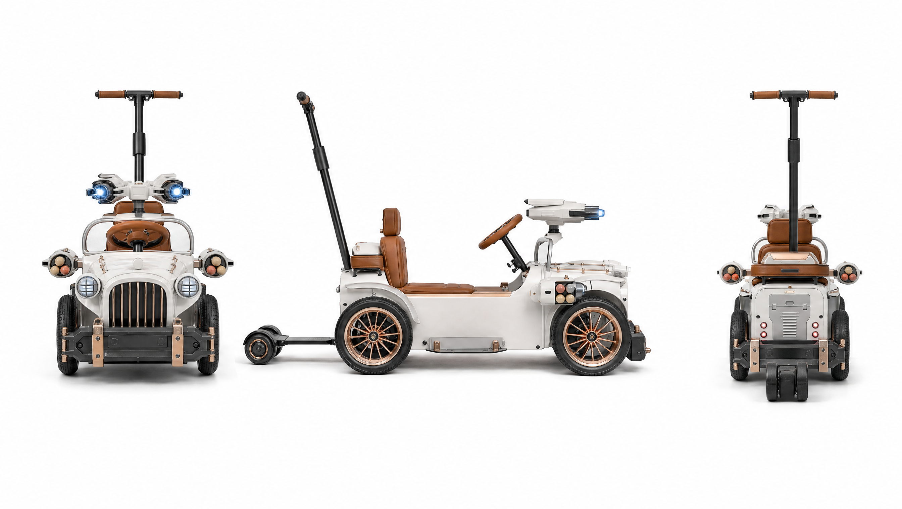 | 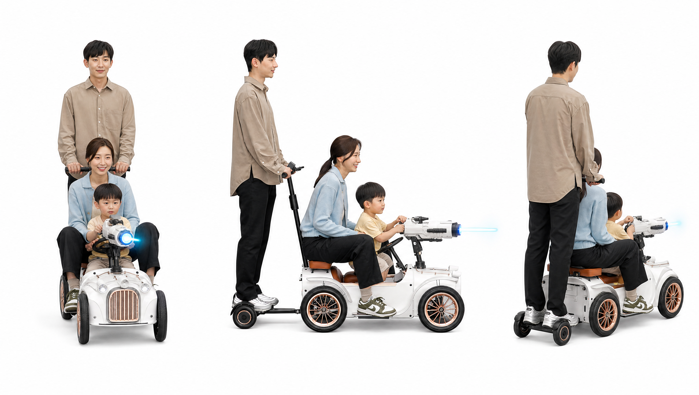 | 완전무장 디트로네 | 전동 유모차가 완전무장한다. 레이저와 폭탄을 발사하며 탄약은 3발. 아빠가 뒤에서 조종하고 릴리·진이 탑승. | 가족 공동 | 확정 |
| 4 | 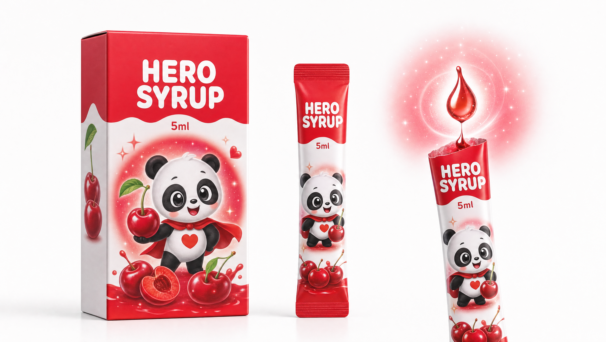 | 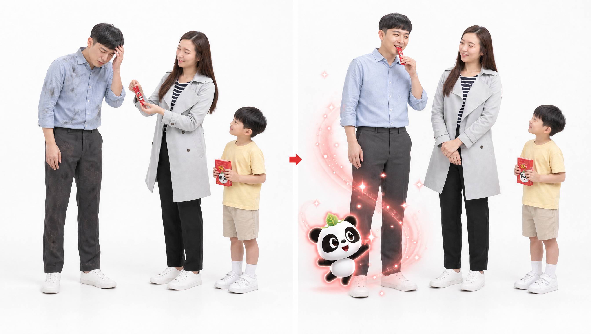 | 챔프풍 히어로 시럽 | 모든 상태 이상과 부상을 회복한다. 체리 향과 판다 응원 연출. 1회 5ml만 사용 가능해 누구에게 쓸지 고민하게 된다. | 가족 공동 | 확정 |
| 5 | 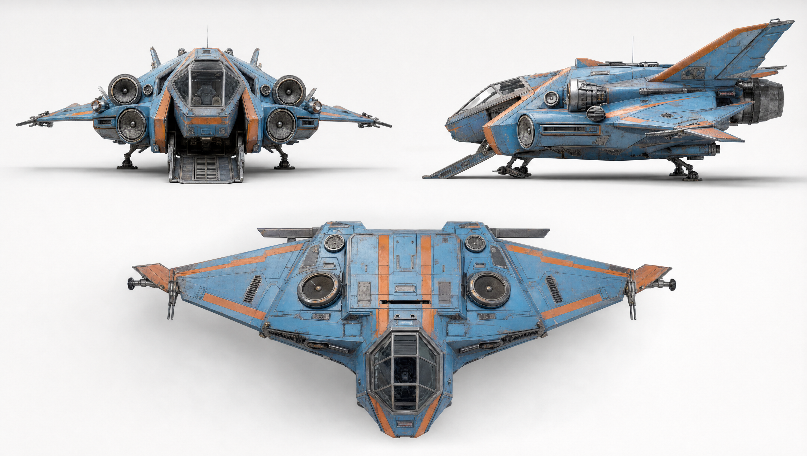 | 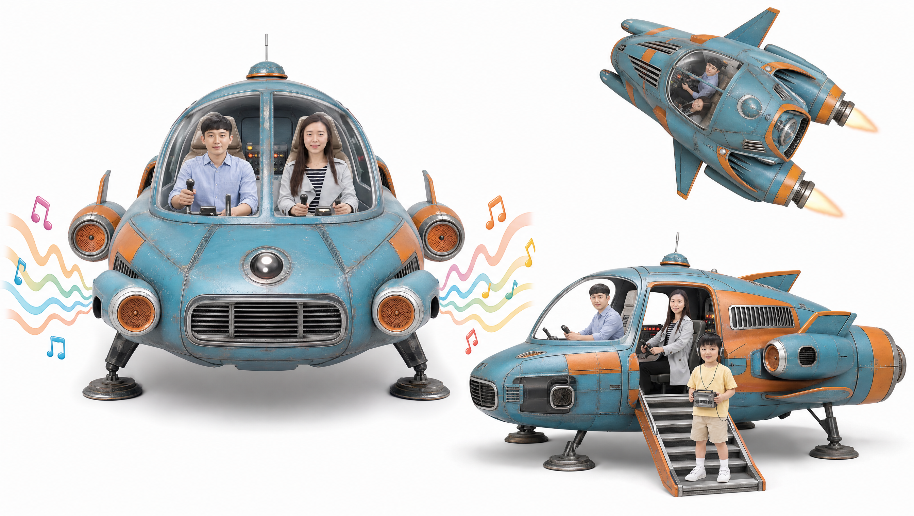 | 가족 우주선 | 가족을 태우고 비행·탈출한다. 80년대 노래를 크게 틀면 소리에 반응하는 좀비들이 몰려와 유인된다. | 가족 전용 | 확정 |
| 6 | 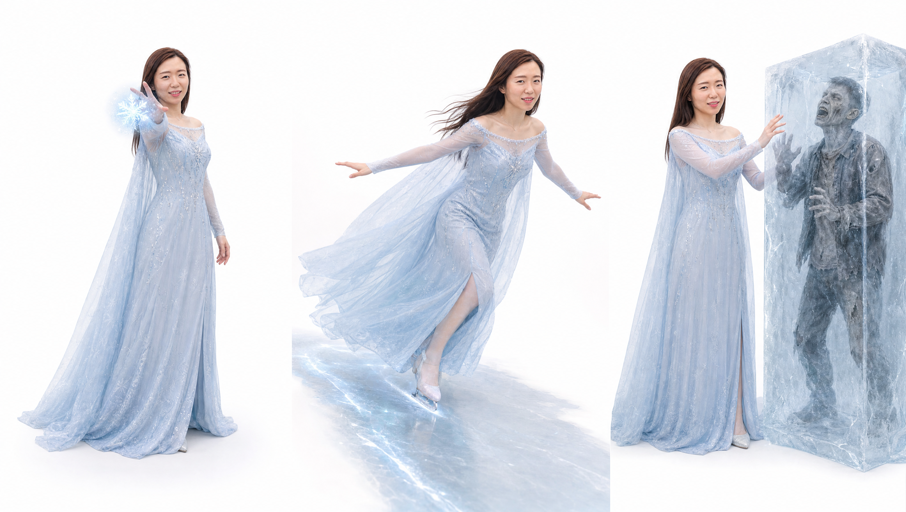 | 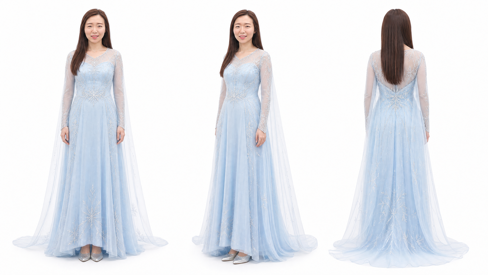 | 얼음 능력 드레스 | 아이스볼 발사, 빙판길을 만들어 미끄러지듯 고속 이동, 좀비 얼리기. | 릴리 | 확정 |
| 7 | 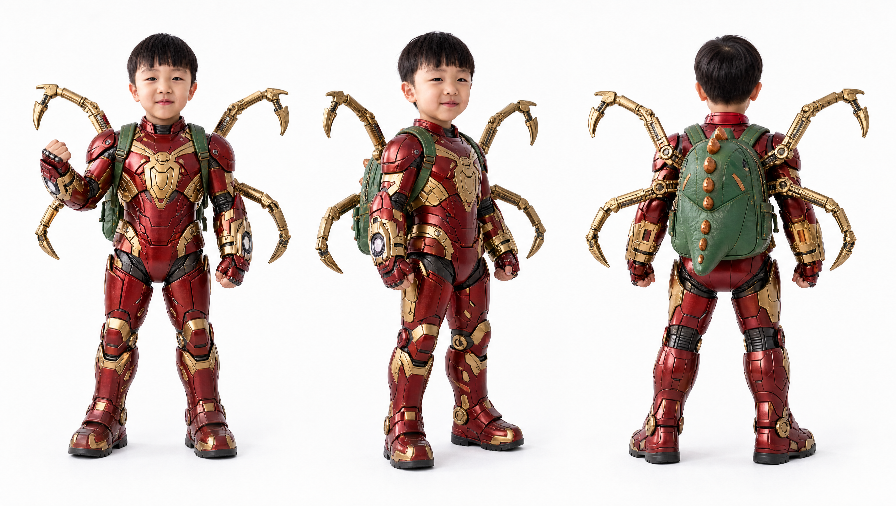 |  | 아이언 스파이더 슈트 | 거미줄 발사·이동·포획과 기계 거미 다리. 처음에는 거미줄이 자꾸 엉키다가 결정적인 순간 성공한다. | 진(서진) 전용 | 확정 |
| 8 | 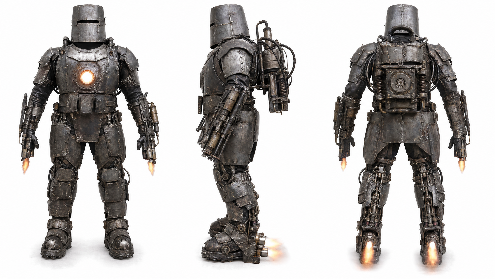 | 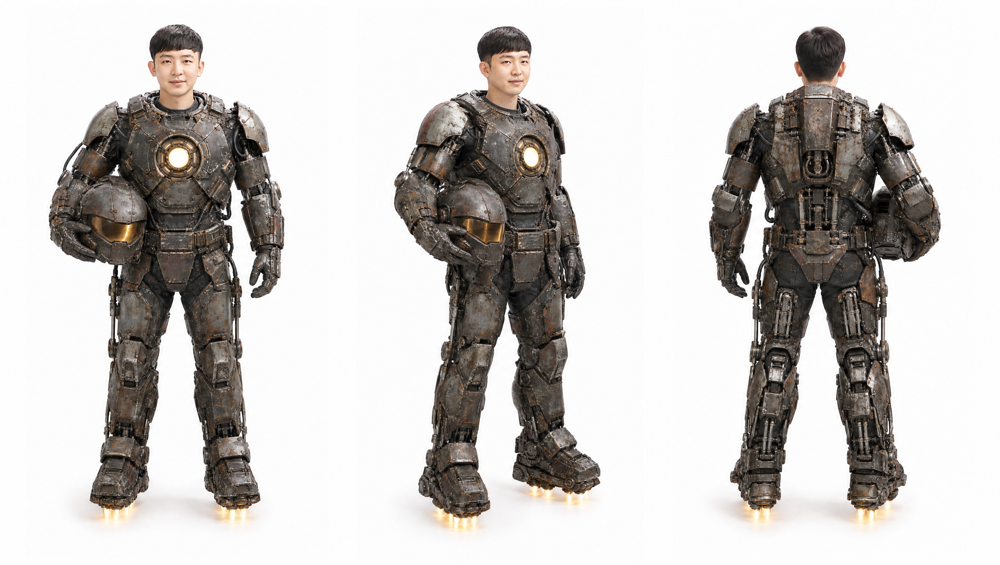 | 마크1풍 메카닉 슈트 | 철판을 덧댄 기계식 장갑, 화염 분사와 짧은 비행, 가슴 빛 에너지. 진이 바라던 슈트를 아빠가 입는 웃음 포인트. | 아빠 전용 | 확정 |
| 9 | 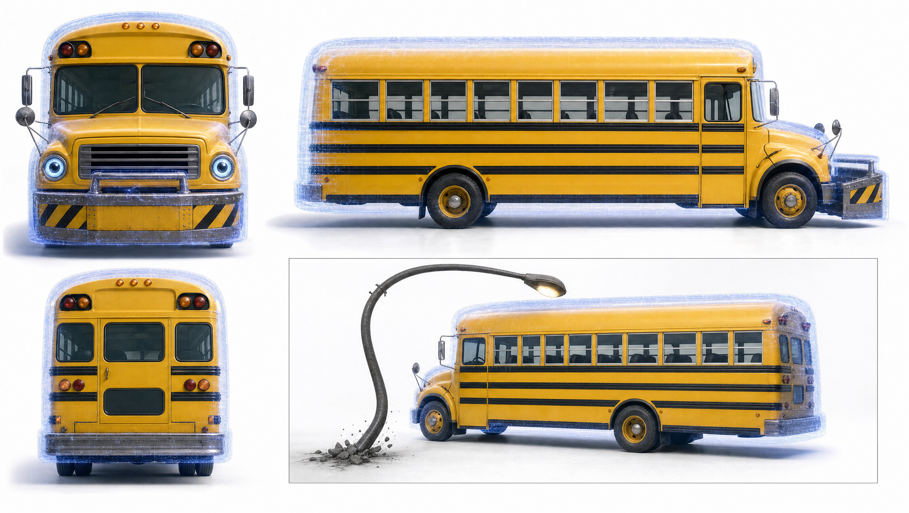 | 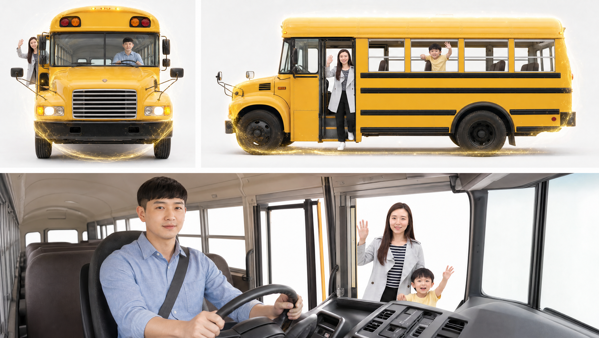 | 부서지지 않는 노란 스쿨버스 | 무엇과 부딪혀도 부서지지 않는다. 좀비 무리를 돌파하고 가족을 실어 나른다. | 가족 | 확정 |
## 캐릭터·장비 시트

- [진 · 7살](assets/seojin-full-sheet.png): 공개 캐릭터 사이트의 서진 시트를 극중 진으로 사용. 룰렛 조작 담당.
- [아빠](assets/cheolmin-full-sheet.png): 공개 사이트의 철민 시트를 아빠로 연결. 유인·썰매 출발 담당.
- [릴리 · 엄마](assets/lily-full-sheet.png): 사용자가 지정한 릴리 시트. 6번 드레스를 입고 얼음길을 만든다.
- [릴리 · 6번 얼음 드레스](assets/lily-ice-sheet.png): 겨울왕국풍 드레스. EP.01 SHOT 13 변신 → 16~18 얼음길 → 19 해제.
- [진 · 8번 강철슈트](assets/jin-steel-sheet.png): 아들의 얼굴과 체형을 유지한 강철슈트. EP.01에서는 희망하는 장비로만 언급.
- [크레이지 슬롯 · 본체](assets/roulette-sheet.png): 카이토의 룰렛을 참고한 현재 생성 시안. 원작과 완전히 동일한 외형은 아니며 입 모양 슬롯을 시각 기준으로 사용.
- [룰렛 · 작동 상태](assets/roulette-states.png): 진이 작동 → 숫자 추첨 → 장비 사용 → 다음 추첨. 결과 선택 불가.
- [1번 · 거대 꼬꼬맘](assets/kkokkomam-sheet.png): 실제 꼬꼬맘 제품을 참고. 거대화하여 좀비를 밀쳐 물리친다.
- [7번 · 거미줄 슈트](assets/equipment-07-sheet.png): 기존 스토리보드 장비 유지. 6번은 릴리 변신 시트, 8번은 진 변신 시트가 최종 착용 기준.
- [좀비 · 3방향 시트](assets/zombie-sheet.png): 새벽의 저주(2004)풍. 창백한 피부·깊은 눈·긴장된 턱, 소리에 반응하는 폭발적 질주. 피와 노출 상처 없이 표현.

- [2번 거대 낫 · 아빠 전용](assets/equipment-02-sheet.png): 원작 참고 무기 3방향과 아빠 크기 비교. 진이 추첨하고 아빠만 사용.

외형 확인: 칼날 곡률·비율 및 피에로 세부는 원작과 차이가 있어, 동일 재현 완료본이 아닌 참고 시안으로 분류.
## PART 1. 에피소드 기획

### 제목 제안

1. 라크몽의 좀비들: 얼음 공주의 미끄럼틀
2. 6번은 드레스였다
3. 스파이더 슈트 말고 얼음 공주

**추천 제목: EP.01 라크몽의 좀비들 — 6번은 드레스였다.** 원래 가제를 살리면서 이번 화의 반전을 제목에 담았습니다.

### 로그라인

좀비에게 포위된 7살 진이 7번 스파이더 슈트를 바라며 룰렛을 돌리지만 얼음 공주 드레스가 나오고, 엄마 릴리가 그 드레스를 입고 가족과 함께 얼음 미끄럼틀을 만들어 첫 포위망을 탈출한다.

### 시놉시스

사흘 전, 뉴스 속보와 편의점 CCTV, 시민의 휴대폰 영상, “큰 소리를 내지 마십시오”라는 재난문자가 동탄의 이상 사태를 알린다. 그리고 사흘 뒤 해 질 녘, 아빠와 엄마 릴리, 7살 아들 진은 라크몽 근처에서 구한 해열제와 물을 들고 호수 건너편 임시 은신처로 돌아가는 중이다. 릴리는 들어올 때 봐 둔 호숫가 경사로로 내려가자고 한다. 그때 돌풍에 큰 입간판이 쓰러지고, 그 소리에 느릿하던 좀비들이 일제히 달려든다. 경사로 아래에서도 좀비 무리가 올라와 가족은 앞뒤로 갇힌다.

아빠는 알람을 맞춘 휴대폰을 멀리 던져 위쪽 무리를 따돌리고, 릴리는 쓰러진 입간판을 세워 경사로 입구를 막는다. 그 사이 진은 아빠가 만들어 준 크레이지 슬롯을 돌린다. 진은 7번 아이언 스파이더 슈트를 간절히 바라지만, 룰렛은 7번을 스쳐 6번에서 멈추고 얼음 공주 드레스가 나온다. 한 번 나온 장비는 써야만 다음 판을 돌릴 수 있다.

첫 시도에서 릴리는 제 발밑만 얼리고 미끄러진다. 얼음이 자신의 손바닥 방향을 따라간다는 것을 발견하자 진이 “엄마! 얼음 미끄럼틀 만들자!”라고 외친다. 아빠는 입간판을 썰매로 바꾸고 밀어 출발시킨다. 릴리가 맨 앞에서 얼음길을 만들고, 가운데 앉은 진은 엄마의 허리를 잡고 방향을 알려 준다. 아빠는 맨 뒤에서 가족을 지탱한다. 마른 데크에 도착해 릴리가 손을 내리면 드레스가 눈꽃으로 흩어지고 진의 손목 장치에 다음 판을 알리는 초록 불이 켜진다.

가족은 서로를 안으며 첫 탈출을 기뻐한다. 그러나 건너편으로 가는 산책로에서 더 큰 좀비 무리가 다가온다. 진은 다시 룰렛을 돌리고, 숫자가 멈추기 직전에 화면이 꺼진다.

### 이번 화의 목표 [추가 제안]

해 지기 전에 해열제와 물을 들고 호수 건너편 임시 은신처로 돌아가는 것. 이번 화에서는 그 첫 관문인 라크몽 앞 포위망을 빠져나가 호숫가 데크에 도착하는 데까지 성공합니다.

### 갈등과 해결

갈등은 두 겹입니다. 밖에서는 소리에 반응하는 좀비가 앞뒤를 막고, 안에서는 진이 원하던 장비가 아닌 드레스를 받아들여야 합니다. 해결은 가족 세 사람이 각자 한 가지씩 맡아 이뤄집니다. 드레스 덕분에 위기를 넘기면서 진은 ‘나온 것을 잘 쓰는 것’이 이 장치의 진짜 힘이라는 걸 몸으로 배웁니다.

### 가족 구성원의 결정적 기여

| 인물 | 결정적 행동 | 해당 컷 |
|---|---|---|
| 아빠 | 휴대폰 알람으로 위쪽 무리를 유인, 규칙을 짧게 일러 줌, 썰매를 밀어 출발 | SHOT 09·10·17 |
| 릴리 | 탈출로(경사로)를 기억, 입간판으로 입구를 막음, 드레스 변신, 얼음길 생성·방향 조절 | SHOT 04·10·13·16·18 |
| 진 | 룰렛 조작, 미끄럼틀 아이디어, 마지막 장애물 발견·방향 지시 | SHOT 15·16·18 |

### 액션 하이라이트와 엔딩

하이라이트는 SHOT 16~18입니다. 릴리가 경사로에 얼음길을 깔고, 좀비들이 볼링 핀처럼 미끄러지며, 가족이 입간판 썰매로 그 위를 내려갑니다. 엔딩은 데크에서의 짧은 포옹 뒤 더 큰 무리가 나타나고, 두 번째 룰렛 결과가 보이기 직전에 블랙으로 끝납니다.

## PART 2. 연출·연속성 기준

### 확정 설정과 작업용 가안 구분

| 구분 | 내용 | 상태 |
|---|---|---|
| 인물 이름 | 아빠, 엄마 릴리, 아들 진(7살) | 확정 |
| 공개 범위 | 사용자 지정 작품·제품을 참고한 캐릭터 및 장비 시트 | 확정 |
| 장비 이름 | 1번 거대 꼬꼬맘(진), 2번 거대 낫(아빠), 3번 완전무장 디트로네(가족), 4번 챔프풍 히어로 시럽(가족), 5번 우주선(가족), 6번 얼음 능력(릴리), 7번 아이언 스파이더 슈트(진), 8번 마크1풍 메카닉 슈트(아빠), 9번 부서지지 않는 노란 스쿨버스(가족) | 확정 |
| 1번 장비 | 거대 꼬꼬맘. 실제 제품을 참고한 시트 제작 완료. 1화에는 등장하지 않음 | 시트 반영 |
| 좀비 | 평소엔 느리게 걷고, 큰 소리를 들으면 갑자기 달려듦 | 확정 |
| 시간대 | 해 질 녘 노을 → 엔딩은 해가 진 직후 보랏빛 저녁 | 확정 |
| 얼굴·체형 | 진=공개 시트 서진, 아빠=철민, 릴리=릴리 시트에 연결 | 반영 |

### 시간대와 날씨

맑은 날의 해 질 녘입니다. 해는 화면 왼쪽 낮은 곳에 두어 모든 야외 컷의 역광 방향을 통일합니다. 바람이 조금 강한 날로 설정해 입간판이 쓰러지는 사고에 이유를 줍니다. SHOT 20에서 해가 수평선에 닿고, SHOT 21부터는 해가 진 뒤의 보랏빛 하늘입니다.

### 기본 의상과 소지품 [작업용 가안]

| 인물 | 의상 | 소지품 |
|---|---|---|
| 아빠 | 아빠(철민) 기본 전신 시트의 의상 | 큰 배낭, 접이식 등산 스틱(SHOT 16 이후 꼭대기에 남김), 휴대폰(SHOT 09에서 던짐) |
| 릴리 | 회색 코트, 남색·흰색 줄무늬 상의, 검정 바지, 흰 운동화 | 크로스백(해열제·물) |
| 진 | 연노랑 티셔츠, 베이지 반바지, 흰 양말·운동화 | 작은 초록 공룡 배낭, 왼쪽 손목의 크레이지 슬롯 |

### 공간 배치와 이동 경로

실제로 확인한 내용은 “동탄호수공원 수변의 상업 공간 라크몽”이라는 장소뿐입니다. 이번 초안은 건물 층수, 매장, 출입구 위치를 실제 정보로 쓰지 않았습니다. 아래 배치는 모두 [가상 공간 구성]이며, 현장 사진을 받으면 실제 외관에 맞춰 조정합니다.

1. 라크몽 바깥 보행로: 문 닫힌 카페 유리창이 늘어선 길. 가족은 화면 왼쪽에서 오른쪽으로 이동.
2. 경사로 위 작은 광장: 한쪽은 화단, 한쪽은 상가 벽. 왼쪽 먼 곳에 금속 벤치.
3. 넓고 완만한 경사 보행로: 광장에서 호숫가로 내려가는 길(화면 오른쪽 아래 방향).
4. 수변 나무 데크: 경사로 끝의 마른 데크. 탈출 도착점.
5. 호숫가 산책로 저편: 건너편으로 가는 유일한 길. 엔딩의 새 무리가 나타나는 곳.

### 좀비의 움직임과 반응 규칙

- 평소에는 느리게 비틀거리며 걷습니다.
- 큰 소리(간판 충격음, 알람, 피에로 팡파르, 진의 외침)를 들으면 소리 쪽으로 고개를 돌리고 새벽의 저주(2004)풍으로 몸을 앞으로 기울여 폭발적으로 질주합니다.
- 얼음 위에서는 달리려다 미끄러지고, 일어나려 해도 다시 넘어집니다.
- 피와 상처는 보이지 않습니다. 회색빛 피부와 찢어진 평상복으로만 좀비임을 표현합니다.
- [추가 제안] 피에로와 룰렛 소리도 좀비에게 들립니다. 장치를 쓸 때마다 위험이 함께 커지는 규칙입니다.

### 룰렛 2번 · 거대 낫 · 아빠 전용 — 사용자 확정 추가 설정

- 번호: 카이토 원작과 같은 **2번**. 룰렛이 2번에 멈추면 거대한 낫을 사용한다.
- 사용자: 아빠(철민) 전용. 진이 2번을 추첨하면 아빠에게 소환되며 진·릴리는 사용할 수 없다.
- 공격: 낫을 한 바퀴 크게 휘둘러 주변 공격 범위의 대상들을 한꺼번에 두 동강 내는 광역 참격.
- 화면 표현: 역광 속 검은 실루엣과 얇은 절단선으로 공격 결과를 전달한다. 피, 상처 단면, 장기, 신체 훼손 클로즈업은 보여 주지 않는다.
- 연출 제안: 원형 궤적의 섬광 → 실루엣에 절단선 → 두 부분이 어긋나는 짧은 실루엣 컷 → 먼지·암전으로 전환.
- 적용 범위: 무기 설정에 추가한다. EP.01의 6번 드레스 탈출 장면은 그대로 유지한다.

### 피에로와 룰렛

| 요소 | 시각 기준 |
|---|---|
| 손목 장치 | 진의 왼쪽 손목 소형 조작부. 본체 소환과 시작 버튼, 상태 표시등 |
| 피에로 | 연결된 룰렛 시트 기준. 보라색·흰색 피에로 머리, 입 안 숫자 슬롯, 아래로 늘어진 손잡이. 공중 소환 |
| 룰렛 | 피에로 입 안 슬롯에서 숫자 1~9가 순환하고 한 숫자로 멈춤 |
| 말투 | 짧고 능청스러운 한마디. 규칙 설명은 하지 않음 |
| 사용 가능 표시 | [추가 제안] 장비를 다 쓰면 다이얼에 초록 불 |

### 얼음 공주 드레스와 얼음 마법

드레스 착용자는 엄마 릴리다. 겨울왕국풍의 연한 얼음빛 드레스, 은색 눈꽃 자수, 반투명 긴소매와 망토, 은색 구두는 릴리 변신 시트를 따른다. 성인 얼굴과 갈색 머리, 해열제 크로스백을 유지한다. 진은 기본 의상과 공룡 배낭을 유지한다.

얼음은 릴리의 손바닥이 향하는 바닥으로 뻗고 손을 내밀고 있는 동안 계속 생긴다. 릴리가 두 손을 내리면 드레스가 눈꽃으로 흩어진다. 6번 능력은 세 가지다. 손에서 아이스볼을 던지고, 빙판길을 만들어 미끄러지듯 빠르게 이동하고, 좀비를 얼려 멈춘다. EP.01에서는 빙판길 능력을 중심으로 쓴다. 진은 룰렛을 조작하며, 7번 아이언 스파이더 슈트를 바란다.

### 효과의 지속 [작업용 가안]

능력이 끝난 뒤에도 얼음길은 몇 분 동안 남아 서서히 녹습니다. 그래서 좀비들이 데크로 바로 내려오지 못하고, 가족이 숨을 돌릴 시간이 생깁니다.

### 가족이 얼음 위에서 안전한 이유

가족은 얼음 위를 걷거나 뛰지 않습니다. 마른 꼭대기 바닥에서 입간판 썰매에 앉은 채 출발하고, 경사로 끝의 마른 데크에서 멈춥니다. 반면 좀비들은 소리를 듣고 얼음 위를 달리려다 넘어집니다.

### 촬영 스타일 — 새벽의 저주(2004) 참고

긴장감은 극장용 좀비 스릴러 수준으로 끌어올리고, 가족 코미디와 무혈 원칙은 유지합니다. 아래 기준은 모든 컷의 카메라와 영어 프롬프트에 반영했습니다.

| 요소 | 기준 | 주로 쓰는 컷 |
|---|---|---|
| 색감 | 채도를 낮춘 블리치 바이패스풍, 강한 대비와 눌린 검정. 노을 하이라이트는 주황, 그림자는 차가운 청록 | 전 컷 |
| 프롤로그 | 가상 방송사 뉴스, 흑백 CCTV, 세로 휴대폰 영상, 재난문자를 거친 질감으로 이어 붙인 몽타주 | SHOT 01~02 |
| 핸드헬드 | 도망·포위 구간은 숄더캠. 정적인 감정 컷은 고정 | SHOT 04~10, 14 |
| 스타카토 셔터 | 셔터 45도로 움직임을 끊어 보이게 해 좀비 질주의 공포를 키움 | SHOT 06, 16, 22 |
| 크래시 줌·스냅 줌 | 충격음과 동시에 0.3초 급줌. 그 뒤 1초 무음 | SHOT 05, 16, 17, 18 |
| 휩 팬 | 시선과 물체를 따라 빠르게 돌림 | SHOT 07, 09 |
| 항공 시점 | 헬기·옥상 높이에서 공간과 포위망을 한눈에 | SHOT 03, 08 |
| 좀비 시점 | 0.5초 낮은 시점 인서트로 쫓기는 압박 | SHOT 07 |
| 플래시 컷 | 좀비 눈 4프레임, 손이 들어오는 순간 4프레임 정지 | SHOT 06, 17 |
| 무혈 원칙 | 충격은 소리·프레임 정지·화면 밖 처리로 전달. 피와 상처는 보이지 않음 | 전 컷 |
| 코미디 박자 | 피에로 대사, 볼링 핀처럼 넘어지는 슬로모션은 그대로 살림 | SHOT 11~14, 17 |

### 편집 리듬 — 1~1.5초 하드컷·긴 대사 최대 2초

기본 컷은 1~1.5초이며 대사가 있는 컷은 최대 2초입니다. 컷이 바뀔 때마다 카메라 무브, 앵글, 프레이밍을 동시에 바꿉니다. 장면 경계를 포함한 107개 컷 모두 바로 앞 컷과 세 요소가 겹치지 않는지 빌드할 때 자동으로 확인합니다. 각 SHOT 카드의 컷 분할표가 촬영·생성 기준입니다.

| 무브 | 쓰는 상황 | 대표 컷 |
|---|---|---|
| 크레인 업·다운 | 공간을 열거나 닫을 때, 변신이 걷힐 때 | SHOT 03, 13, 20 |
| 크래시 줌 | 충격음과 동시에 0.3초 급줌 | SHOT 05, 06, 10 |
| 돌리 인·아웃 | 대사의 감정을 밀어붙이거나 거리감을 줄 때 | SHOT 10, 14 |
| 핸드헬드 | 도망·포위·버티기 | SHOT 07, 08, 14 |
| 헬릭스 오빗 | 나선으로 돌며 포위·변신·포옹을 크게 보여 줄 때 | SHOT 08, 13, 20 |
| 랙포커스 풀백 리빌 | 전경에서 초점이 빠지며 위협이나 공간이 드러날 때 | SHOT 03, 07, 21 |
| 휩팬 | 시선·물체를 따라 장면을 넘길 때 | SHOT 09, 15 |
| 아크샷 → 익스트림 줌 인 → 슬로모션 줌 아웃 | 능력 발동의 정점 | SHOT 16 |

음악은 원작처럼 낮은 기타와 북 리듬의 타이틀 곡을 MiniMax Music으로 오리지널 제작하는 것을 기준으로 합니다.

## PART 3. 전체 컷 구성표

| 컷 | 타임코드 | 길이 | 장소 | 핵심 사건 | 감정 변화 |
|---|---|---|---|---|---|
| **프롤로그 · 그날의 기록** | | | | | |
| 01 | 00:00–00:06 | 6초 | 뉴스 스튜디오 | 앵커가 속보를 읽고, CCTV 속 손님이 종소리에 고개를 꺾고 출입문으로 질주한다. | 인물 감정보다 기록 화면의 불안. |
| 02 | 00:06–00:13 | 7초 | 아파트 베란다 → 호수공원 방향 | 휴대폰 영상 속 촬영자가 “뛰어!”를 외치고, 재난문자 뒤 타이틀과 「사흘 뒤」가 이어진다. | 공포 → 정적. |
| **1막 · 이동과 포위** | | | | | |
| 03 | 00:13–00:20 | 7초 | 동탄호수공원 수변, 호수 너머 라크몽 외관 원경 | 항공 하강 뒤 버려진 산책로에서 좀비 3명이 드러나고 에피소드 제목이 뜬다. | 아름답지만 불안한 정적. |
| 04 | 00:20–00:27 | 7초 | 라크몽 1층 바깥 보행로 | 몸을 낮춘 가족이 이동하고, 아빠가 진의 버튼을 막고, 릴리가 호숫가 경사로를 가리킨다. | 조심스러운 긴장 속 가족의 호흡. |
| 05 | 00:27–00:33 | 6초 | 보행로 끝 지점 | 돌풍에 입간판이 쓰러지고, 1초 무음 속 가족이 굳는다. | 얼어붙은 공포, 진의 작은 탄식. |
| 06 | 00:33–00:39 | 6초 | 라크몽 바깥 보행로 주변 | 좀비들이 일제히 고개를 꺾고 몸을 숙인 채 폭발적으로 달린다. | 공포의 폭발. |
| 07 | 00:39–00:46 | 7초 | 보행로 → 경사로 입구 방향 | 가족이 경사로로 달리다 급정거하고, 아래에서 올라오는 무리를 본다. | 희망 → 막막함. |
| 08 | 00:46–00:53 | 7초 | 경사로 위 작은 광장 | 양쪽 무리가 화단과 벽 사이의 가족을 조여 온다. | 최고조의 압박. |
| 09 | 00:53–01:00 | 7초 | 같은 광장 | 아빠가 알람 휴대폰을 벤치로 던져 위쪽 무리를 끌어내지만 경사로 무리는 그대로다. | 짧은 웃음과 안도 → 다시 긴장. |
| 10 | 01:00–01:07 | 7초 | 경사로 입구 | 부부가 입간판으로 경사로를 막고, 아빠가 무릎을 꿇어 진에게 규칙을 일러 준다. | 버티는 힘과 아빠의 믿음, 진의 간절함. |
| **2막 · 룰렛과 얼음 공주 드레스** | | | | | |
| 11 | 01:07–01:14 | 7초 | 입간판 뒤 | 진이 버튼을 누르자 피에로가 튀어나오고 숫자 슬롯이 돈다. | 황당함과 기대, 진의 간절함. |
| 12 | 01:14–01:20 | 6초 | 룰렛 인서트 | 슬롯이 7에서 멈출 듯하다 6에서 멈춘다. | 기대 → 당황. |
| 13 | 01:20–01:27 | 7초 | 입간판 뒤 | 눈꽃 소용돌이 속에서 릴리가 얼음 드레스로 변신한다. | 경이로움, 진의 어리둥절함. |
| 14 | 01:27–01:34 | 7초 | 입간판 뒤 | 진이 아쉬워하고 릴리가 함께하자고 답하는 사이, 아빠가 간판을 버틴다. | 아쉬움 → 결심, 시간 압박. |
| 15 | 01:34–01:41 | 7초 | 입간판 뒤 | 릴리가 발밑만 얼려 미끄러진 뒤 서리가 손을 따라가는 것을 발견하고, 진이 미끄럼틀을 제안한다. | 당황 → 발견 → 기대. |
| 16 | 01:41–01:49 | 8초 | 경사로 꼭대기 | 아빠가 간판을 썰매로 눕히고, 릴리의 냉기가 경사로를 덮는다. | 결심과 해방감. |
| 17 | 01:49–01:55 | 6초 | 경사로 중간 | 좀비들이 줄줄이 미끄러지고, 아빠가 썰매를 힘껏 밀어 출발시킨다. | 웃음 → 질주의 쾌감. |
| 18 | 01:55–02:03 | 8초 | 얼음 경사로 | 썰매가 얼음길을 내려가고, 길을 막은 좀비를 진의 신호로 왼쪽으로 비켜 간다. | 환호 → 순간 위기 → 성공. |
| 19 | 02:03–02:10 | 7초 | 수변 나무 데크 | 썰매가 데크에 멈추고 드레스가 눈꽃으로 흩어지며 손목 장치에 초록 불이 켜진다. | 안도와 피로. |
| **3막 · 교감과 다음 위기** | | | | | |
| 20 | 02:10–02:18 | 8초 | 수변 데크 | 진이 엄마를 칭찬하고, 세 사람이 노을 앞에서 안는다. | 따뜻함과 자부심. |
| 21 | 02:18–02:24 | 6초 | 호숫가 산책로 저편 | 건너편 길을 메운 무리가 나타나고, 진이 다시 돌려도 되는지 묻는다. | 불안 → 가족의 합의. |
| 22 | 02:24–02:31 | 7초 | 수변 데크 | 피에로가 다시 나오자 무리가 질주하고, 숫자가 멈추기 직전 블랙. | 긴장 최고조, 궁금증. |

**총 러닝타임: 02:31 (151초, 22장면 · 107컷)**

## PART 4. 컷별 상세 스토리보드

공통 조건: 영어 프롬프트의 REF_JIN, REF_DAD, REF_LILY는 상단에 연결된 인물 시트를 뜻합니다. 얼굴 생김새는 프롬프트에 적지 않았습니다. 룰렛 숫자, 피에로, 자막은 후반 합성으로 처리합니다.

### 프롤로그 · 그날의 기록

#### SHOT 01

- **타임코드 / 길이:** 00:00–00:06 / 6초
- **장소 / 시간대:** 뉴스 스튜디오 [가상 방송사] / 사흘 전 저녁
- **이 컷의 목적:** 뉴스 속보와 CCTV로 사태를 한 번에 알린다.
- **시작 화면:** 가상 방송사의 저녁 뉴스. 앵커 뒤 화면에 동탄 지도와 붉은 경보 표시.
- **화면 크기와 구도:** 미디엄 → 인서트 → 와이드 → 풀샷
- **카메라:** 1~1.5초 하드컷 4개. 컷마다 무브·앵글·프레이밍 동시 변경(아래 컷 분할표).
- **핵심 행동:** 앵커가 속보를 읽고, CCTV 속 손님이 종소리에 고개를 꺾고 출입문으로 질주한다.
- **인물 표정과 감정:** 인물 감정보다 기록 화면의 불안.
- **한국어 대사:** 앵커: 속보입니다. 동탄 일대에서 원인을 알 수 없는 집단 공격이 잇따르고 있습니다.
- **사운드:** 뉴스 시그널 음악, 앵커 목소리, 지지직 잡음으로 끊김. 유리문 종소리, 끊기는 디지털 잡음.
- **시각 효과 / 후반 합성:** 가상 방송사 로고와 자막 후반 합성. 실제 방송사 로고 사용 금지. 흑백 CCTV, 타임스탬프 합성. 공격 장면은 화면 밖. 무혈.
- **종료 화면:** 빈 계산대와 흔들리는 문.
- **다음 컷과의 연결:** 빈 화면 → 세로 휴대폰 영상.
- **연속성 주의:** 실존 방송사·인물 사용 금지. 좀비 외형은 좀비 시트 기준.
- **컷 분할 (1~1.5초 하드컷·긴 대사 최대 2초):**

| # | 길이 | 카메라 무브 | 앵글 | 프레이밍 | 화면 |
|---|---|---|---|---|---|
| 1 | 1.5초 | 고정 | 아이레벨 | 미디엄 | 가상 방송사 앵커 “속보입니다. 동탄 일대에서…” |
| 2 | 1.5초 | 크래시 줌 인 | 하이 앵글 | 인서트 | 스튜디오 화면의 붉은 동탄 경보 지도 |
| 3 | 1.5초 | 디지털 줌 | 탑다운 | 와이드 | 흑백 CCTV, 문 종소리에 계산대 손님 고개가 꺾인다 |
| 4 | 1.5초 | 휩팬 | 측면 | 풀샷 | 손님이 출입문으로 폭발적 질주, 신호가 찢어진다 |

- **첫 프레임 이미지용 영어 프롬프트:**

~~~text
Television news broadcast frame of a fictional Korean news channel, female anchor at a desk, a red alert map of a fictional new town behind her, CRT scan lines and signal noise, gritty 2004 fast-zombie thriller cinematography, handheld shoulder camera energy, desaturated bleach-bypass grade with crushed blacks and harsh contrast, golden sunset highlights against cold teal shadows, coarse 35mm film grain, 16:9, no gore, no blood
~~~

- **영상 생성용 영어 프롬프트 (6초):**

~~~text
TV-monitor footage: anchor reads breaking news, the image shakes and dissolves into signal noise. Then: Choppy CCTV footage: the customer jerks his head toward the door chime and bolts out of frame at frightening speed. Nothing violent on screen. EDIT: 4 hard cuts with exact durations 1.5s, 1.5s, 1.5s, 1.5s, every cut changes camera move, angle and framing at once: 1) locked-off, eye level, medium; 2) crash zoom in, high angle, insert; 3) digital zoom, top-down, wide; 4) whip pan, profile side, full shot. Duration: 6 seconds.
~~~

#### SHOT 02

- **타임코드 / 길이:** 00:06–00:13 / 7초
- **장소 / 시간대:** 아파트 베란다 → 호수공원 방향 [가상 시점] / 사흘 전 밤
- **이 컷의 목적:** 시민 영상과 재난문자로 ‘소리 금지’ 규칙을 심고 타이틀로 넘어간다.
- **시작 화면:** 세로 휴대폰 영상. 베란다에서 내려다본 호수공원 앞 도로.
- **화면 크기와 구도:** 와이드 → 클로즈업 → 인서트 → 미디엄 와이드 → 와이드
- **카메라:** 1~1.5초 하드컷 5개. 컷마다 무브·앵글·프레이밍 동시 변경(아래 컷 분할표).
- **핵심 행동:** 휴대폰 영상 속 촬영자가 “뛰어!”를 외치고, 재난문자 뒤 타이틀과 「사흘 뒤」가 이어진다.
- **인물 표정과 감정:** 공포 → 정적.
- **한국어 대사:** 촬영자: 뛰어, 뛰어! / 재난문자: [긴급재난문자] 동탄 일대 외출을 자제하시고, 큰 소리를 내지 마십시오.
- **사운드:** 멀리 차 경적, 비명은 짧고 멀게, 휴대폰이 바닥에 부딪히는 소리. 재난문자 경보음 → 무음 → 낮게 깔리는 기타와 북 리듬의 타이틀 음악.
- **시각 효과 / 후반 합성:** 세로 영상 테두리 블러. 무혈. 재난문자 UI와 타이틀 후반 합성. 타이틀 음악은 MiniMax Music으로 오리지널 제작.
- **종료 화면:** 「사흘 뒤」 자막 → 노을 진 호수.
- **다음 컷과의 연결:** 자막 → 항공 와이드로 본편 시작.
- **연속성 주의:** 구체적 실존 건물 식별 금지. 재난문자 문구가 좀비 소리 반응 규칙의 근거가 된다.
- **컷 분할 (1~1.5초 하드컷·긴 대사 최대 2초):**

| # | 길이 | 카메라 무브 | 앵글 | 프레이밍 | 화면 |
|---|---|---|---|---|---|
| 1 | 1.4초 | 핸드헬드 | 하이 앵글 | 와이드 | 세로 휴대폰 영상, 주차장을 가로지르는 실루엣 무리 |
| 2 | 1.4초 | 휩팬 | 아이레벨 | 클로즈업 | 유리창에 비친 촬영자 “뛰어, 뛰어!” |
| 3 | 1.4초 | 고정 | 탑다운 | 인서트 | 잠금화면 재난문자 “큰 소리를 내지 마십시오” |
| 4 | 1.4초 | 크래시 줌 인 | 로우 앵글 | 미디엄 와이드 | 블랙, 북 타격음과 함께 타이틀 「좀비 인 동탄」 |
| 5 | 1.4초 | 슬로모션 줌 아웃 | 하이 앵글 | 와이드 | 「사흘 뒤」 자막, 노을 호수가 밝아온다 |

- **첫 프레임 이미지용 영어 프롬프트:**

~~~text
Vertical smartphone video frame inside a blurred 16:9 border, shaky night view from an apartment balcony over a lakeside boulevard, people scattering and a distant pack of running silhouettes between cars, streetlights, gritty 2004 fast-zombie thriller cinematography, handheld shoulder camera energy, desaturated bleach-bypass grade with crushed blacks and harsh contrast, golden sunset highlights against cold teal shadows, coarse 35mm film grain, 16:9, no gore, no blood
~~~

- **영상 생성용 영어 프롬프트 (7초):**

~~~text
Shaky vertical phone video: panicked zoom on running silhouettes, the phone tumbles and lands facing the night sky. Then: Emergency alert vibrates onto the lock screen, cut to black, the title slams in with a drum hit, then the caption THREE DAYS LATER. EDIT: 5 hard cuts with exact durations 1.4s, 1.4s, 1.4s, 1.4s, 1.4s, every cut changes camera move, angle and framing at once: 1) handheld, high angle, wide; 2) whip pan, eye level, close-up; 3) locked-off, top-down, insert; 4) crash zoom in, low angle, medium wide; 5) slow-motion zoom out, high angle, wide. Duration: 7 seconds.
~~~

### 1막 · 이동과 포위

#### SHOT 03

- **타임코드 / 길이:** 00:13–00:20 / 7초
- **장소 / 시간대:** 동탄호수공원 수변, 호수 너머 라크몽 외관 원경 [외관은 현장 사진 확인 필요] / 해 질 녘
- **이 컷의 목적:** 노을 호수와 비틀대는 좀비로 무대를 연다.
- **시작 화면:** 노을이 비친 호수 수면이 화면 아래 1/3. 호수 너머로 라크몽 건물 윤곽이 역광 실루엣. 수변 산책로에 버려진 자전거와 쓰러진 의자. 멀리 좀비 3~4명이 천천히 비틀거림.
- **화면 크기와 구도:** 익스트림 와이드 → 미디엄 와이드 → 클로즈업 → 미디엄 → 익스트림 와이드
- **카메라:** 1~1.5초 하드컷 5개. 컷마다 무브·앵글·프레이밍 동시 변경(아래 컷 분할표).
- **핵심 행동:** 항공 하강 뒤 버려진 산책로에서 좀비 3명이 드러나고 에피소드 제목이 뜬다.
- **인물 표정과 감정:** 아름답지만 불안한 정적.
- **한국어 대사:** 없음
- **사운드:** 잔잔한 물결과 낮은 현악 드론, 멀리서 울리는 차 경적 한 번.
- **시각 효과 / 후반 합성:** 후반 자막: 「EP.01 라크몽의 좀비들」(컷 후반 3초, 페이드).
- **종료 화면:** 라크몽 실루엣이 화면 중앙, 좀비들은 화면 오른쪽 아래에서 계속 비틀거림.
- **다음 컷과의 연결:** 공간 연결. 원경의 상가 쪽으로 다음 컷이 들어간다.
- **연속성 주의:** 해의 위치는 화면 왼쪽 낮은 곳. 이후 야외 컷의 역광 방향 기준. 인물 외형은 연결된 시트 기준. 좀비는 새벽의 저주(2004)풍의 빠른 감염자, 피·노출 상처 없음.
- **컷 분할 (1~1.5초 하드컷·긴 대사 최대 2초):**

| # | 길이 | 카메라 무브 | 앵글 | 프레이밍 | 화면 |
|---|---|---|---|---|---|
| 1 | 1.4초 | 드론 하강 | 탑다운 | 익스트림 와이드 | 노을 호수 위로 헬기처럼 하강 |
| 2 | 1.4초 | 트럭 | 아이레벨 | 미디엄 와이드 | 산책로의 버려진 자전거와 쓰러진 의자 |
| 3 | 1.4초 | 랙포커스 풀백 리빌 | 로우 앵글 | 클로즈업 | 자전거 바퀴에서 초점이 빠지며 비틀대는 좀비 3명 |
| 4 | 1.4초 | 돌리 인 | 측면 | 미디엄 | 느리게 걷는 좀비의 탁한 옆얼굴 |
| 5 | 1.4초 | 크레인 업 | 하이 앵글 | 익스트림 와이드 | 라크몽 쪽으로 상승, 자막 「EP.01 라크몽의 좀비들」 |

- **첫 프레임 이미지용 영어 프롬프트:**

~~~text
Extreme wide shot at sunset over Dongtan Lake Park, calm lake surface reflecting orange sky in the lower third, silhouette of the REF_LAKMONT building across the water (match the provided location photo, do not invent architectural details), empty lakeside promenade with an abandoned bicycle and toppled chairs, three distant slow shuffling zombies with ashen skin, sunken eyes, tense jaw and torn everyday clothes, no blood, no exposed wounds, sun low on frame left, gritty 2004 fast-zombie thriller cinematography, handheld shoulder camera energy, desaturated bleach-bypass grade with crushed blacks and harsh contrast, golden sunset highlights against cold teal shadows, coarse 35mm film grain, 16:9, no gore, no blood
~~~

- **영상 생성용 영어 프롬프트 (7초):**

~~~text
Aerial helicopter-style drone shot diving fast over the lake toward the shopping complex, then leveling to reveal shuffling zombies on the promenade. EDIT: 5 hard cuts with exact durations 1.4s, 1.4s, 1.4s, 1.4s, 1.4s, every cut changes camera move, angle and framing at once: 1) drone descent, top-down, extreme wide; 2) truck (lateral dolly), eye level, medium wide; 3) rack-focus pull-back reveal, low angle, close-up; 4) dolly in, profile side, medium; 5) crane up, high angle, extreme wide. Duration: 7 seconds.
~~~

#### SHOT 04

- **타임코드 / 길이:** 00:20–00:27 / 7초
- **장소 / 시간대:** 라크몽 1층 바깥 보행로 [가상 공간 구성: 실제 매장 배치와 무관] / 해 질 녘
- **이 컷의 목적:** 가족 소개, 룰렛 규칙 암시, 탈출로를 한 장면에 담는다.
- **시작 화면:** 문 닫힌 카페 유리창이 늘어선 보행로. 아빠가 앞, 진이 가운데, 릴리가 뒤. 진의 왼손은 릴리 손을, 오른손은 아빠 배낭 끈을 잡음.
- **화면 크기와 구도:** 풀샷 → 익스트림 클로즈업 → 투샷 → 미디엄 → 와이드
- **카메라:** 1~2초 하드컷 (대사 컷 2초 허용) 5개. 컷마다 무브·앵글·프레이밍 동시 변경(아래 컷 분할표).
- **핵심 행동:** 몸을 낮춘 가족이 이동하고, 아빠가 진의 버튼을 막고, 릴리가 호숫가 경사로를 가리킨다.
- **인물 표정과 감정:** 조심스러운 긴장 속 가족의 호흡.
- **한국어 대사:** 아빠: (속삭임) 아직 아니야. 소리 나면 뛰어. / 릴리: (속삭임) 저 내리막만 내려가면 호숫가야.
- **사운드:** 운동화가 바닥을 스치는 작은 소리, 바람, 멀리 좀비 신음. 장치의 작은 ‘틱’ 소리, 숨소리. 바람에 흔들리는 입간판의 삐걱 소리(다음 컷 복선).
- **시각 효과 / 후반 합성:** 소형 상태 표시등 합성. 팔찌는 조작부이며 추첨 화면은 소환된 피에로의 입 슬롯이다.
- **종료 화면:** 경사로가 화면 오른쪽 아래에 선명히 보이고, 가족은 화면 왼쪽 앞.
- **다음 컷과의 연결:** 소리 연결. 삐걱대던 입간판이 다음 컷에서 쓰러진다.
- **연속성 주의:** 이동 방향은 화면 왼쪽→오른쪽으로 고정(SHOT 07까지). 기본 의상·소지품 첫 등장. 인물 외형은 연결된 시트 기준. 좀비는 새벽의 저주(2004)풍의 빠른 감염자, 피·노출 상처 없음. 장치는 항상 진의 왼쪽 손목. 피에로 장식은 꺼진 상태. 경사로=가족 진행 방향의 오른쪽 아래. 탈출 장면과 같은 장소. 릴리 크로스백에 해열제와 물. [추가 제안] 목표: 라크몽 근처에서 구한 해열제와 물을 들고, 해 지기 전에 호수 건너편 임시 은신처로 돌아가기.
- **컷 분할 (1~1.5초 하드컷·긴 대사 최대 2초):**

| # | 길이 | 카메라 무브 | 앵글 | 프레이밍 | 화면 |
|---|---|---|---|---|---|
| 1 | 1.2초 | 핸드헬드 | 아이레벨 | 풀샷 | 몸을 낮춘 가족이 화면 왼쪽에서 들어온다 |
| 2 | 1.2초 | 익스트림 줌 인 | 하이 앵글 | 익스트림 클로즈업 | 버튼으로 향하는 진의 손가락, 꺼진 표시등 |
| 3 | 1.8초 | 아크샷 | 로우 앵글 | 투샷 | 진의 손을 덮는 아빠 “아직 아니야. 소리 나면 뛰어.” |
| 4 | 1.6초 | 휩팬 | 오버숄더 | 미디엄 | 릴리가 오른쪽 아래를 가리킨다 “저 내리막만 내려가면 호숫가야.” |
| 5 | 1.2초 | 랙포커스 풀백 리빌 | 측면 | 와이드 | 손끝에서 경사로로 초점 이동, 프레임 끝에서 삐걱대는 입간판 |

- **첫 프레임 이미지용 영어 프롬프트:**

~~~text
Medium wide shot on an outdoor pedestrian walkway lined with closed cafe glass storefronts [fictional layout], REF_JIN (7-year-old boy, same person as the provided character reference), REF_DAD (father, same person as the provided character reference), REF_LILY (mother, same person as the provided character reference) walking diagonally from frame left toward frame right, dad in front raising a hand to signal slow, Jin in the middle holding Lily's hand and dad's backpack strap, Lily at the back looking around, dad in the exact base outfit from REF_DAD sheet, large backpack; Lily in light gray coat, navy-white striped top, black trousers, white sneakers, cross-body bag; Jin in pale yellow T-shirt, beige shorts, white sneakers, small green dinosaur backpack, round slot-machine bracelet on left wrist, sunset backlight, gritty 2004 fast-zombie thriller cinematography, handheld shoulder camera energy, desaturated bleach-bypass grade with crushed blacks and harsh contrast, golden sunset highlights against cold teal shadows, coarse 35mm film grain, 16:9, no gore, no blood
~~~

- **영상 생성용 영어 프롬프트 (7초):**

~~~text
Handheld shoulder camera backing away in front of the crouching family as they move quietly; slight breathing sway. Then: Start from the first frame on the wrist. Slow tilt up revealing Jin's face and dad crouching beside him; dad whispers, Jin nods. Quiet and subtle. Then: Start from the first frame. Lily points; rack focus from her hand to the ramp below. She pats her cross-body bag. The sidewalk sign wobbles in the wind. EDIT: 5 hard cuts with exact durations 1.2s, 1.2s, 1.8s, 1.6s, 1.2s, every cut changes camera move, angle and framing at once: 1) handheld, eye level, full shot; 2) extreme zoom in, high angle, extreme close-up; 3) arc shot, low angle, two-shot; 4) whip pan, over-the-shoulder, medium; 5) rack-focus pull-back reveal, profile side, wide. Duration: 7 seconds.
~~~

#### SHOT 05

- **타임코드 / 길이:** 00:27–00:33 / 6초
- **장소 / 시간대:** 보행로 끝 지점 / 해 질 녘
- **이 컷의 목적:** 입간판 사고로 고요를 깬다.
- **시작 화면:** 가족 옆, 사람 키만 한 넓은 플라스틱 A형 입간판이 바람에 기울어지고 있음.
- **화면 크기와 구도:** 풀샷 → 익스트림 클로즈업 → 쓰리샷 → 빅 클로즈업
- **카메라:** 1~1.5초 하드컷 4개. 컷마다 무브·앵글·프레이밍 동시 변경(아래 컷 분할표).
- **핵심 행동:** 돌풍에 입간판이 쓰러지고, 1초 무음 속 가족이 굳는다.
- **인물 표정과 감정:** 얼어붙은 공포, 진의 작은 탄식.
- **한국어 대사:** 진: (작게) …어.
- **사운드:** 돌풍, 플라스틱이 돌바닥을 때리는 큰 소리, 이후 1초 완전 무음.
- **시각 효과 / 후반 합성:** 없음
- **종료 화면:** 간판이 바닥에 평평하게 눕고, 가족은 굳은 채 주변을 봄.
- **다음 컷과의 연결:** 소리 연결. 정적 뒤 좀비들이 반응한다.
- **연속성 주의:** 이 입간판(흰 바탕+주황 테두리)이 SHOT 10에서 막이로, SHOT 16에서 썰매로 다시 쓰인다. 인물 외형은 연결된 시트 기준. 좀비는 새벽의 저주(2004)풍의 빠른 감염자, 피·노출 상처 없음.
- **컷 분할 (1~1.5초 하드컷·긴 대사 최대 2초):**

| # | 길이 | 카메라 무브 | 앵글 | 프레이밍 | 화면 |
|---|---|---|---|---|---|
| 1 | 1.5초 | 고정 | 로우 앵글 | 풀샷 | 돌풍에 기우는 입간판 |
| 2 | 1.5초 | 크래시 줌 인 | 바닥 앵글 | 익스트림 클로즈업 | 간판 모서리가 돌바닥을 쾅 때린다(0.3초) |
| 3 | 1.5초 | 슬로모션 줌 아웃 | 하이 앵글 | 쓰리샷 | 얼어붙은 가족, 1초 완전 무음 |
| 4 | 1.5초 | 스냅 줌 | 아이레벨 | 빅 클로즈업 | 숨을 들이켜는 진 “…어.” |

- **첫 프레임 이미지용 영어 프롬프트:**

~~~text
Medium shot of a large white plastic A-frame sidewalk sign with orange border tipping over in a gust of wind next to REF_JIN (7-year-old boy, same person as the provided character reference), REF_DAD (father, same person as the provided character reference), REF_LILY (mother, same person as the provided character reference), dad in the exact base outfit from REF_DAD sheet, large backpack; Lily in light gray coat, navy-white striped top, black trousers, white sneakers, cross-body bag; Jin in pale yellow T-shirt, beige shorts, white sneakers, small green dinosaur backpack, round slot-machine bracelet on left wrist, sunset, gritty 2004 fast-zombie thriller cinematography, handheld shoulder camera energy, desaturated bleach-bypass grade with crushed blacks and harsh contrast, golden sunset highlights against cold teal shadows, coarse 35mm film grain, 16:9, no gore, no blood
~~~

- **영상 생성용 영어 프롬프트 (6초):**

~~~text
Locked shot; as the sign slams down, a 0.3-second crash zoom, then one second of total silence on the frozen family. EDIT: 4 hard cuts with exact durations 1.5s, 1.5s, 1.5s, 1.5s, every cut changes camera move, angle and framing at once: 1) locked-off, low angle, full shot; 2) crash zoom in, ground level, extreme close-up; 3) slow-motion zoom out, high angle, three-shot; 4) snap zoom, eye level, big close-up. Duration: 6 seconds.
~~~

#### SHOT 06

- **타임코드 / 길이:** 00:33–00:39 / 6초
- **장소 / 시간대:** 라크몽 바깥 보행로 주변 [가상 공간 구성] / 해 질 녘
- **이 컷의 목적:** 좀비가 소리에 반응해 질주한다.
- **시작 화면:** 기둥 사이와 화단 너머에 느리게 서 있던 좀비 5~6명.
- **화면 크기와 구도:** 와이드 → 익스트림 클로즈업 → 미디엄 → 익스트림 와이드
- **카메라:** 1~1.5초 하드컷 4개. 컷마다 무브·앵글·프레이밍 동시 변경(아래 컷 분할표).
- **핵심 행동:** 좀비들이 일제히 고개를 꺾고 몸을 숙인 채 폭발적으로 달린다.
- **인물 표정과 감정:** 공포의 폭발.
- **한국어 대사:** 없음
- **사운드:** 짧은 무음 뒤 거친 숨소리 폭발, 운동화가 바닥을 차는 빠른 발소리, 저음 타격음과 함께 음악 진입.
- **시각 효과 / 후반 합성:** 좀비 눈동자 클로즈업 4프레임 플래시 컷. 무혈.
- **종료 화면:** 좀비들이 화면 깊숙한 곳의 작은 가족 실루엣을 향해 달려가기 시작.
- **다음 컷과의 연결:** 움직임 연결. 달려오는 좀비 → 도망치는 가족.
- **연속성 주의:** 이 무리를 ‘위쪽 무리’라 부른다. 가족의 왼쪽 뒤에서 접근. 인물 외형은 연결된 시트 기준. 좀비는 새벽의 저주(2004)풍의 빠른 감염자, 피·노출 상처 없음.
- **컷 분할 (1~1.5초 하드컷·긴 대사 최대 2초):**

| # | 길이 | 카메라 무브 | 앵글 | 프레이밍 | 화면 |
|---|---|---|---|---|---|
| 1 | 1.5초 | 핸드헬드 | 오버숄더 | 와이드 | 좀비 어깨 너머 멀리 작은 가족 |
| 2 | 1.5초 | 크래시 줌 인 | 아이레벨 | 익스트림 클로즈업 | 탁한 좀비 눈동자 4프레임 플래시 |
| 3 | 1.5초 | 휩팬 | 측면 | 미디엄 | 좀비들이 일제히 고개를 꺾는다(스타카토 셔터) |
| 4 | 1.5초 | 크레인 업 | 하이 앵글 | 익스트림 와이드 | 몸을 숙인 채 폭발적으로 질주하는 무리 전체 |

- **첫 프레임 이미지용 영어 프롬프트:**

~~~text
Wide low-angle shot from behind a group of six slow shuffling zombies with ashen skin, sunken eyes, tense jaw and torn everyday clothes, no blood, no exposed wounds standing among pillars and flower beds of a closed shopping walkway [fictional layout], in the far background the small silhouettes of a family of three, sunset backlight, gritty 2004 fast-zombie thriller cinematography, handheld shoulder camera energy, desaturated bleach-bypass grade with crushed blacks and harsh contrast, golden sunset highlights against cold teal shadows, coarse 35mm film grain, 16:9, no gore, no blood
~~~

- **영상 생성용 영어 프롬프트 (6초):**

~~~text
Over-the-shoulder handheld behind the zombies; heads snap toward the noise, footage switches to staccato 45-degree shutter motion, a four-frame flash cut of a sunken eye, then they explode into a forward-leaning sprint as the camera snap-zooms out. EDIT: 4 hard cuts with exact durations 1.5s, 1.5s, 1.5s, 1.5s, every cut changes camera move, angle and framing at once: 1) handheld, over-the-shoulder, wide; 2) crash zoom in, eye level, extreme close-up; 3) whip pan, profile side, medium; 4) crane up, high angle, extreme wide. Duration: 6 seconds.
~~~

#### SHOT 07

- **타임코드 / 길이:** 00:39–00:46 / 7초
- **장소 / 시간대:** 보행로 → 경사로 입구 방향 / 해 질 녘
- **이 컷의 목적:** 도망치던 가족이 경사로에서 막힌다.
- **시작 화면:** 가족이 화면 왼쪽에서 오른쪽으로 뛰기 시작. 아빠가 진의 손을 끌고, 릴리가 진의 등을 받침.
- **화면 크기와 구도:** 미디엄 → 와이드 → 미디엄 와이드 → 와이드 → 클로즈업
- **카메라:** 1~1.5초 하드컷 5개. 컷마다 무브·앵글·프레이밍 동시 변경(아래 컷 분할표).
- **핵심 행동:** 가족이 경사로로 달리다 급정거하고, 아래에서 올라오는 무리를 본다.
- **인물 표정과 감정:** 희망 → 막막함.
- **한국어 대사:** 아빠: 내리막으로! / 릴리: 아래도 있어….
- **사운드:** 세 사람의 발소리, 뒤에서 가까워지는 좀비 발소리, 빨라지는 음악. 아래에서 겹쳐 올라오는 신음, 데크를 밟는 발소리.
- **시각 효과 / 후반 합성:** 0.5초 좀비 POV 인서트(낮은 높이, 흔들리는 시점으로 가족 뒷모습). 무혈.
- **종료 화면:** 좀비 무리가 경사로 중간까지 올라옴.
- **다음 컷과의 연결:** 시선 연결. 가족이 뒤를 돌아본다.
- **연속성 주의:** 아빠 손에 접이식 등산 스틱. 진의 연노랑 티셔츠와 베이지 반바지, 공룡 배낭, 손목 장치 유지. 인물 외형은 연결된 시트 기준. 좀비는 새벽의 저주(2004)풍의 빠른 감염자, 피·노출 상처 없음. 이 무리를 ‘아래쪽 무리’라 부른다. 경사로=화면 오른쪽 아래, SHOT 04와 같은 장소.
- **컷 분할 (1~1.5초 하드컷·긴 대사 최대 2초):**

| # | 길이 | 카메라 무브 | 앵글 | 프레이밍 | 화면 |
|---|---|---|---|---|---|
| 1 | 1.4초 | 핸드헬드 러닝 | 측면 | 미디엄 | 오른쪽으로 달리는 가족, 아빠 “내리막으로!” |
| 2 | 1.4초 | POV 질주 | POV | 와이드 | 0.5초 좀비 시점, 흔들리는 가족 뒷모습 |
| 3 | 1.4초 | 휩팬 | 오버숄더 | 미디엄 와이드 | 경사로 아래로 휩팬, 가족이 급정거 |
| 4 | 1.4초 | 망원 줌 인 | 아이레벨 | 와이드 | 망원으로 압축한, 올라오는 좀비 무리 |
| 5 | 1.4초 | 랙포커스 풀백 리빌 | 로우 앵글 | 클로즈업 | 릴리 “아래도 있어…”, 초점이 빠지며 좁혀 오는 무리 |

- **첫 프레임 이미지용 영어 프롬프트:**

~~~text
Medium side tracking shot of REF_JIN (7-year-old boy, same person as the provided character reference), REF_DAD (father, same person as the provided character reference), REF_LILY (mother, same person as the provided character reference) running from frame left to frame right along the walkway toward the top of a ramp, dad leading Jin by the hand, Lily behind with a hand on Jin's back, dad holding a folding trekking pole, dad in the exact base outfit from REF_DAD sheet, large backpack; Lily in light gray coat, navy-white striped top, black trousers, white sneakers, cross-body bag; Jin in pale yellow T-shirt, beige shorts, white sneakers, small green dinosaur backpack, round slot-machine bracelet on left wrist, sunset, gritty 2004 fast-zombie thriller cinematography, handheld shoulder camera energy, desaturated bleach-bypass grade with crushed blacks and harsh contrast, golden sunset highlights against cold teal shadows, coarse 35mm film grain, 16:9, no gore, no blood
~~~

- **영상 생성용 영어 프롬프트 (7초):**

~~~text
Running handheld side tracking with short shutter stutter; the zombie pack closes in from frame left; a half-second low zombie POV insert chasing the family. Then: Whip pan down the ramp following the family, camera jolts to a stop with them, then a long-lens compression of the zombie crowd surging up the ramp. EDIT: 5 hard cuts with exact durations 1.4s, 1.4s, 1.4s, 1.4s, 1.4s, every cut changes camera move, angle and framing at once: 1) handheld running, profile side, medium; 2) running POV, POV, wide; 3) whip pan, over-the-shoulder, medium wide; 4) long-lens zoom in, eye level, wide; 5) rack-focus pull-back reveal, low angle, close-up. Duration: 7 seconds.
~~~

#### SHOT 08

- **타임코드 / 길이:** 00:46–00:53 / 7초
- **장소 / 시간대:** 경사로 위 작은 광장 [가상 공간 구성] / 해 질 녘
- **이 컷의 목적:** 포위망을 위에서 한눈에 보여 준다.
- **시작 화면:** 가족이 화단과 상가 벽 사이에 등을 맞대고 선 모습을 위에서 봄. 왼쪽 위에서 위쪽 무리, 오른쪽 아래 경사로에서 아래쪽 무리가 다가옴. 왼쪽 먼 곳에 금속 벤치.
- **화면 크기와 구도:** 익스트림 와이드 → 쓰리샷 → 미디엄 → 미디엄 와이드 → 와이드
- **카메라:** 1~1.5초 하드컷 5개. 컷마다 무브·앵글·프레이밍 동시 변경(아래 컷 분할표).
- **핵심 행동:** 양쪽 무리가 화단과 벽 사이의 가족을 조여 온다.
- **인물 표정과 감정:** 최고조의 압박.
- **한국어 대사:** 없음
- **사운드:** 양쪽에서 겹치는 발소리, 음악이 낮게 멈칫.
- **시각 효과 / 후반 합성:** 없음
- **종료 화면:** 양쪽 좀비와 가족 사이가 약 10m.
- **다음 컷과의 연결:** 공간 연결. 이 지도에서 아빠가 왼쪽 먼 벤치를 본다.
- **연속성 주의:** 이 배치가 SHOT 09~18의 기준 지도. 왼쪽 위=위쪽 무리와 벤치, 오른쪽 아래=경사로와 아래쪽 무리, 쓰러진 입간판은 가족 바로 옆. 인물 외형은 연결된 시트 기준. 좀비는 새벽의 저주(2004)풍의 빠른 감염자, 피·노출 상처 없음.
- **컷 분할 (1~1.5초 하드컷·긴 대사 최대 2초):**

| # | 길이 | 카메라 무브 | 앵글 | 프레이밍 | 화면 |
|---|---|---|---|---|---|
| 1 | 1.4초 | 헬릭스 오빗 하강 | 탑다운 | 익스트림 와이드 | 옥상 높이에서 나선 하강, 양쪽 무리가 좁혀 온다 |
| 2 | 1.4초 | 핸드헬드 | 아이레벨 | 쓰리샷 | 화단과 벽 사이에서 등을 맞댄 가족, 아빠 다리에 붙는 진 |
| 3 | 1.4초 | 크래시 줌 인 | 로우 앵글 | 미디엄 | 왼쪽 위 무리의 질주 |
| 4 | 1.4초 | 휩팬 | 측면 | 미디엄 와이드 | 오른쪽 아래 경사로에서 올라오는 무리 |
| 5 | 1.4초 | 헬릭스 오빗 상승 | 탑다운 | 와이드 | 가족 주위를 감아 오르며 포위 완성 |

- **첫 프레임 이미지용 영어 프롬프트:**

~~~text
High-angle wide shot looking down at a small plaza at the top of a pedestrian ramp [fictional layout], REF_JIN (7-year-old boy, same person as the provided character reference), REF_DAD (father, same person as the provided character reference), REF_LILY (mother, same person as the provided character reference) standing back to back between a flower bed and a shop wall, one group of REF_ZOMBIE infected adults sprinting explosively with predatory forward lean, ashen skin, sunken eyes, tense jaw, torn everyday clothes, no blood approaching from upper left, another group climbing the ramp from lower right, a metal bench far to the left, a fallen white sidewalk sign beside the family, long sunset shadows, gritty 2004 fast-zombie thriller cinematography, handheld shoulder camera energy, desaturated bleach-bypass grade with crushed blacks and harsh contrast, golden sunset highlights against cold teal shadows, coarse 35mm film grain, 16:9, no gore, no blood
~~~

- **영상 생성용 영어 프롬프트 (7초):**

~~~text
Rooftop-height aerial looking straight down, slowly rotating as two sprinting zombie groups squeeze the family into the gap between a flower bed and a wall. EDIT: 5 hard cuts with exact durations 1.4s, 1.4s, 1.4s, 1.4s, 1.4s, every cut changes camera move, angle and framing at once: 1) descending helix orbit, top-down, extreme wide; 2) handheld, eye level, three-shot; 3) crash zoom in, low angle, medium; 4) whip pan, profile side, medium wide; 5) rising helix orbit, top-down, wide. Duration: 7 seconds.
~~~

#### SHOT 09

- **타임코드 / 길이:** 00:53–01:00 / 7초
- **장소 / 시간대:** 같은 광장 / 해 질 녘
- **이 컷의 목적:** 아빠의 휴대폰 미끼가 반만 통한다.
- **시작 화면:** 아빠가 휴대폰 알람을 맞추고 있음. 화면 왼쪽 먼 곳에 금속 벤치.
- **화면 크기와 구도:** 인서트 → 미디엄 → 와이드 → 미디엄 → 미디엄 와이드
- **카메라:** 1~2초 하드컷 (대사 컷 2초 허용) 5개. 컷마다 무브·앵글·프레이밍 동시 변경(아래 컷 분할표).
- **핵심 행동:** 아빠가 알람 휴대폰을 벤치로 던져 위쪽 무리를 끌어내지만 경사로 무리는 그대로다.
- **인물 표정과 감정:** 짧은 웃음과 안도 → 다시 긴장.
- **한국어 대사:** 아빠: 잘 가라, 내 폰. / 릴리: 근데 아래는 그대로야!
- **사운드:** 휴대폰 알람음 시작, 휙 하는 바람 소리. 알람음, 몰려드는 발소리, 벤치에 부딪히는 소리.
- **시각 효과 / 후반 합성:** 없음
- **종료 화면:** 좀비들이 벤치 주변에 뭉쳐 있고, 화면 오른쪽 앞에서 릴리가 움직이기 시작.
- **다음 컷과의 연결:** 움직임 연결. 릴리가 쓰러진 입간판으로 향한다.
- **연속성 주의:** 이후 아빠는 휴대폰이 없음. 인물 외형은 연결된 시트 기준. 좀비는 새벽의 저주(2004)풍의 빠른 감염자, 피·노출 상처 없음. 이후 컷에서 알람음은 점점 작게 깔림.
- **컷 분할 (1~1.5초 하드컷·긴 대사 최대 2초):**

| # | 길이 | 카메라 무브 | 앵글 | 프레이밍 | 화면 |
|---|---|---|---|---|---|
| 1 | 1.4초 | 익스트림 줌 인 | 하이 앵글 | 인서트 | 아빠 손 안의 휴대폰 알람 화면 |
| 2 | 1.6초 | 아크샷 | 로우 앵글 | 미디엄 | 몸을 틀어 던지는 아빠 “잘 가라, 내 폰.” |
| 3 | 1.2초 | 휩팬 | 측면 | 와이드 | 벤치로 날아간 휴대폰, 울리는 알람에 몰려드는 좀비 |
| 4 | 1.4초 | 고정 | 탑다운 | 미디엄 | 휴대폰 주위로 엉키는 좀비들 |
| 5 | 1.4초 | 랙포커스 풀백 리빌 | 오버숄더 | 미디엄 와이드 | 굳은 릴리 너머 계속 올라오는 경사로 무리 “아래는 그대로야!” |

- **첫 프레임 이미지용 영어 프롬프트:**

~~~text
Medium close-up of REF_DAD (father, same person as the provided character reference) holding a smartphone showing an alarm, about to throw it toward frame left, a metal bench in the far left background, dad in the exact base outfit from REF_DAD sheet, large backpack; Lily in light gray coat, navy-white striped top, black trousers, white sneakers, cross-body bag; Jin in pale yellow T-shirt, beige shorts, white sneakers, small green dinosaur backpack, round slot-machine bracelet on left wrist, sunset, gritty 2004 fast-zombie thriller cinematography, handheld shoulder camera energy, desaturated bleach-bypass grade with crushed blacks and harsh contrast, golden sunset highlights against cold teal shadows, coarse 35mm film grain, 16:9, no gore, no blood
~~~

- **영상 생성용 영어 프롬프트 (7초):**

~~~text
Close on dad’s hand, then a whip pan following the alarming phone through the air toward the bench. Then: Long-lens compression of zombies piling onto the ringing phone, then rack focus to the second pack still climbing the ramp. EDIT: 5 hard cuts with exact durations 1.4s, 1.6s, 1.2s, 1.4s, 1.4s, every cut changes camera move, angle and framing at once: 1) extreme zoom in, high angle, insert; 2) arc shot, low angle, medium; 3) whip pan, profile side, wide; 4) locked-off, top-down, medium; 5) rack-focus pull-back reveal, over-the-shoulder, medium wide. Duration: 7 seconds.
~~~

#### SHOT 10

- **타임코드 / 길이:** 01:00–01:07 / 7초
- **장소 / 시간대:** 경사로 입구 / 해 질 녘
- **이 컷의 목적:** 입간판으로 시간을 벌고 진에게 룰렛을 맡긴다.
- **시작 화면:** 릴리와 아빠가 쓰러진 입간판 양쪽을 잡고 경사로 입구에 세우려는 중.
- **화면 크기와 구도:** 미디엄 → 빅 클로즈업 → 투샷 → 미디엄 클로즈업 → 익스트림 클로즈업
- **카메라:** 1~2초 하드컷 (대사 컷 2초 허용) 5개. 컷마다 무브·앵글·프레이밍 동시 변경(아래 컷 분할표).
- **핵심 행동:** 부부가 입간판으로 경사로를 막고, 아빠가 무릎을 꿇어 진에게 규칙을 일러 준다.
- **인물 표정과 감정:** 버티는 힘과 아빠의 믿음, 진의 간절함.
- **한국어 대사:** 아빠: 뭐가 나와도 그거 꼭 써야 돼. / 진: 7번… 스파이더 슈트 나와라.
- **사운드:** 플라스틱 긁히는 소리, 숨소리, 가까워지는 신음. 음악이 잠시 낮아지고 심장 박동 같은 저음. 뒤에서 간판을 두드리는 소리.
- **시각 효과 / 후반 합성:** 없음
- **종료 화면:** 진이 손목 장치 버튼 위에 손가락을 올림.
- **다음 컷과의 연결:** 동작 연결. 버튼을 누르는 손이 다음 컷 첫 동작.
- **연속성 주의:** 입간판은 경사로 입구에 세워진 상태. 등산 스틱이 받침. 인물 외형은 연결된 시트 기준. 좀비는 새벽의 저주(2004)풍의 빠른 감염자, 피·노출 상처 없음. 진은 번호를 고르지 않고 기대만 말한다(규칙 준수).
- **컷 분할 (1~1.5초 하드컷·긴 대사 최대 2초):**

| # | 길이 | 카메라 무브 | 앵글 | 프레이밍 | 화면 |
|---|---|---|---|---|---|
| 1 | 1.4초 | 핸드헬드 | 로우 앵글 | 미디엄 | 두 사람이 입간판을 경사로 입구에 세운다 |
| 2 | 1초 | 크래시 줌 인 | 아이레벨 | 빅 클로즈업 | 간판 너머에서 좀비 손바닥이 탕(4프레임) |
| 3 | 1초 | 돌리 인 | 측면 | 투샷 | 무릎을 꿇어 진과 눈높이를 맞추는 아빠 |
| 4 | 1.8초 | 아크샷 | 로우 앵글 | 미디엄 클로즈업 | 아빠 “뭐가 나와도 그거 꼭 써야 돼.” |
| 5 | 1.8초 | 스냅 줌 | 아이레벨 | 익스트림 클로즈업 | 진의 눈 “7번… 스파이더 슈트 나와라.” |

- **첫 프레임 이미지용 영어 프롬프트:**

~~~text
Low-angle medium shot from the ramp side looking up at a white plastic sidewalk sign with orange border being set upright across the ramp entrance by REF_LILY (mother, same person as the provided character reference) and REF_DAD (father, same person as the provided character reference), dad bracing it with a trekking pole, dad in the exact base outfit from REF_DAD sheet, large backpack; Lily in light gray coat, navy-white striped top, black trousers, white sneakers, cross-body bag; Jin in pale yellow T-shirt, beige shorts, white sneakers, small green dinosaur backpack, round slot-machine bracelet on left wrist, sunset sky behind, gritty 2004 fast-zombie thriller cinematography, handheld shoulder camera energy, desaturated bleach-bypass grade with crushed blacks and harsh contrast, golden sunset highlights against cold teal shadows, coarse 35mm film grain, 16:9, no gore, no blood
~~~

- **영상 생성용 영어 프롬프트 (7초):**

~~~text
Low handheld angle; as the sign is set upright, zombie palms slap the far side of the sign into frame. No blood. Then: Start from the first frame. Very slow push-in. Dad speaks, Jin nods with determination and places his finger on the bracelet button. Background: Lily straining against the sign. EDIT: 5 hard cuts with exact durations 1.4s, 1s, 1s, 1.8s, 1.8s, every cut changes camera move, angle and framing at once: 1) handheld, low angle, medium; 2) crash zoom in, eye level, big close-up; 3) dolly in, profile side, two-shot; 4) arc shot, low angle, medium close-up; 5) snap zoom, eye level, extreme close-up. Duration: 7 seconds.
~~~

### 2막 · 룰렛과 얼음 공주 드레스

#### SHOT 11

- **타임코드 / 길이:** 01:07–01:14 / 7초
- **장소 / 시간대:** 입간판 뒤 / 해 질 녘
- **이 컷의 목적:** 피에로 룰렛이 등장하고 돌아간다.
- **시작 화면:** 진이 버튼을 누르자 보라색·흰색 피에로 본체가 손목 앞 공중으로 소환된다.
- **화면 크기와 구도:** 인서트 → 미디엄 → 와이드 → 미디엄 → 클로즈업
- **카메라:** 1~2초 하드컷 (대사 컷 2초 허용) 5개. 컷마다 무브·앵글·프레이밍 동시 변경(아래 컷 분할표).
- **핵심 행동:** 진이 버튼을 누르자 피에로가 튀어나오고 숫자 슬롯이 돈다.
- **인물 표정과 감정:** 황당함과 기대, 진의 간절함.
- **한국어 대사:** 피에로: 짜잔! 불렀어요, 꼬마 손님? / 진: 7번, 7번….
- **사운드:** 장난감 팡파르와 탭댄스 효과음(크게). 직후 벤치 쪽 좀비들이 이쪽으로 고개를 돌리는 신음. 룰렛 회전음(따르르르), 박자가 빨라지는 음악.
- **시각 효과 / 후반 합성:** roulette-sheet.png 기준의 보라색·흰색 피에로 머리와 매달린 손잡이. 공중에 떠 있는 본체를 합성. 입 안 숫자만 후반 합성. 장비 그림은 표시하지 않는다.
- **종료 화면:** 룰렛이 여전히 빠르게 도는 중.
- **다음 컷과의 연결:** 움직임 연결. 회전이 느려지는 다음 컷.
- **연속성 주의:** 피에로 위치=진 왼쪽 손목 위. [추가 제안] 피에로와 룰렛 소리는 좀비에게도 들린다. 인물 외형은 연결된 시트 기준. 좀비는 새벽의 저주(2004)풍의 빠른 감염자, 피·노출 상처 없음. 진이 룰렛을 손으로 멈추거나 고르지 않음.
- **컷 분할 (1~1.5초 하드컷·긴 대사 최대 2초):**

| # | 길이 | 카메라 무브 | 앵글 | 프레이밍 | 화면 |
|---|---|---|---|---|---|
| 1 | 1.2초 | 익스트림 줌 인 | 하이 앵글 | 인서트 | 버튼을 누르는 진의 손가락 |
| 2 | 1.6초 | 크레인 업 | 로우 앵글 | 미디엄 | 보라·흰 피에로 머리 “짜잔! 불렀어요, 꼬마 손님?” |
| 3 | 1.2초 | 휩팬 | 측면 | 와이드 | 팡파르에 벤치 쪽 좀비들이 고개를 돌린다 |
| 4 | 1.4초 | 돌리 인 | 오버숄더 | 미디엄 | 진 어깨 너머 피에로 입 슬롯이 따르르 돈다 |
| 5 | 1.6초 | 헬릭스 오빗 상승 | 로우 앵글 | 클로즈업 | 눈을 감은 진 주위를 나선 회전 “7번, 7번….” |

- **첫 프레임 이미지용 영어 프롬프트:**

~~~text
REF_JIN raises his left wrist controller. The purple-white jester head with hanging handle from REF_ROULETTE floats ahead, mouth slot opening. Dad and Lily stand behind, sunset. gritty 2004 fast-zombie thriller cinematography, handheld shoulder camera energy, desaturated bleach-bypass grade with crushed blacks and harsh contrast, golden sunset highlights against cold teal shadows, coarse 35mm film grain, 16:9, no gore, no blood.
~~~

- **영상 생성용 영어 프롬프트 (7초):**

~~~text
The reference jester head materializes in front of Jin and greets him; its mouth slot opens. Then: Numbers 1 through 9 cycle inside the jester mouth. Jin closes his eyes and hopes for eight. EDIT: 5 hard cuts with exact durations 1.2s, 1.6s, 1.2s, 1.4s, 1.6s, every cut changes camera move, angle and framing at once: 1) extreme zoom in, high angle, insert; 2) crane up, low angle, medium; 3) whip pan, profile side, wide; 4) dolly in, over-the-shoulder, medium; 5) rising helix orbit, low angle, close-up. Duration: 7 seconds.
~~~

#### SHOT 12

- **타임코드 / 길이:** 01:14–01:20 / 6초
- **장소 / 시간대:** 룰렛 인서트 / 해 질 녘
- **이 컷의 목적:** 7번을 스쳐 6번에 멈추는 반전.
- **시작 화면:** 입 안 슬롯에서 숫자 5와 7이 느리게 지나간다.
- **화면 크기와 구도:** 익스트림 클로즈업 → 빅 클로즈업 → 인서트 → 미디엄 클로즈업
- **카메라:** 1~1.5초 하드컷 4개. 컷마다 무브·앵글·프레이밍 동시 변경(아래 컷 분할표).
- **핵심 행동:** 슬롯이 7에서 멈출 듯하다 6에서 멈춘다.
- **인물 표정과 감정:** 기대 → 당황.
- **한국어 대사:** 진: 칠… 칠…!
- **사운드:** 딸깍, 딸깍 느려지는 소리. 6에서 ‘딱!’ 후 0.5초 정적.
- **시각 효과 / 후반 합성:** 전체 후반 합성 컷. 숫자 6에 빛이 번쩍.
- **종료 화면:** 입 안에 숫자 6이 고정되고 빛난다.
- **다음 컷과의 연결:** 정적 → 피에로의 발표로 소리 연결.
- **연속성 주의:** 결정 번호=6. 이후 바뀌지 않음. 인물 외형은 연결된 시트 기준. 좀비는 새벽의 저주(2004)풍의 빠른 감염자, 피·노출 상처 없음.
- **컷 분할 (1~1.5초 하드컷·긴 대사 최대 2초):**

| # | 길이 | 카메라 무브 | 앵글 | 프레이밍 | 화면 |
|---|---|---|---|---|---|
| 1 | 1.5초 | 고정 | 아이레벨 | 익스트림 클로즈업 | 슬롯에 5와 7이 느리게 지나간다 |
| 2 | 1.5초 | 돌리 인 | 로우 앵글 | 빅 클로즈업 | 7에서 멈출 듯… 진 “칠… 칠…!” |
| 3 | 1.5초 | 크래시 줌 인 | 하이 앵글 | 인서트 | 다시 돌아 6에서 ‘딱!’ |
| 4 | 1.5초 | 슬로모션 줌 아웃 | 측면 | 미디엄 클로즈업 | 0.5초 정적, 숫자 6이 빛난다 |

- **첫 프레임 이미지용 영어 프롬프트:**

~~~text
Extreme closeup of REF_ROULETTE mouth reel, number seven approaching center, no circular wheel. gritty 2004 fast-zombie thriller cinematography, handheld shoulder camera energy, desaturated bleach-bypass grade with crushed blacks and harsh contrast, golden sunset highlights against cold teal shadows, coarse 35mm film grain, 16:9, no gore, no blood.
~~~

- **영상 생성용 영어 프롬프트 (6초):**

~~~text
Mouth reel almost stops at seven, cycles again, then locks on six. Six glows. EDIT: 4 hard cuts with exact durations 1.5s, 1.5s, 1.5s, 1.5s, every cut changes camera move, angle and framing at once: 1) locked-off, eye level, extreme close-up; 2) dolly in, low angle, big close-up; 3) crash zoom in, high angle, insert; 4) slow-motion zoom out, profile side, medium close-up. Duration: 6 seconds.
~~~

#### SHOT 13

- **타임코드 / 길이:** 01:20–01:27 / 7초
- **장소 / 시간대:** 입간판 뒤 / 해 질 녘
- **이 컷의 목적:** 6번 얼음 공주 드레스가 릴리에게 간다.
- **시작 화면:** 진의 룰렛이 6번에 멈춘다. 회색 코트 차림의 릴리에게 눈꽃이 날아간다.
- **화면 크기와 구도:** 미디엄 → 풀샷 → 익스트림 클로즈업 → 풀샷 → 클로즈업
- **카메라:** 1~2초 하드컷 (대사 컷 2초 허용) 5개. 컷마다 무브·앵글·프레이밍 동시 변경(아래 컷 분할표).
- **핵심 행동:** 눈꽃 소용돌이 속에서 릴리가 얼음 드레스로 변신한다.
- **인물 표정과 감정:** 경이로움, 진의 어리둥절함.
- **한국어 대사:** 피에로: 6번! 얼음 공주! 이번 주인공은 엄마~! / 진: 엄마한테 갔어?
- **사운드:** 얼음 결정이 맺히는 맑은 소리, 짧은 하프 글리산도.
- **시각 효과 / 후반 합성:** 눈꽃이 몸을 완전히 가린 뒤 의상 전환. 진의 손목 장치와 배낭은 진에게 남는다.
- **종료 화면:** 릴리가 드레스를 내려다보고 진과 눈을 마주친다.
- **다음 컷과의 연결:** 릴리의 변신을 본 가족 반응으로 연결.
- **연속성 주의:** SHOT 13~19 드레스 착용자는 릴리. 진은 기본 의상 유지. 해열제 크로스백도 릴리에게 유지. 인물 외형은 연결된 시트 기준. 좀비는 새벽의 저주(2004)풍의 빠른 감염자, 피·노출 상처 없음.
- **컷 분할 (1~1.5초 하드컷·긴 대사 최대 2초):**

| # | 길이 | 카메라 무브 | 앵글 | 프레이밍 | 화면 |
|---|---|---|---|---|---|
| 1 | 1.6초 | 휩팬 | 아이레벨 | 미디엄 | 피에로 “6번! 얼음 공주! 이번 주인공은 엄마~!” 눈꽃이 릴리에게 |
| 2 | 1.4초 | 헬릭스 오빗 상승 | 로우 앵글 | 풀샷 | 눈꽃 소용돌이에 감싸이는 릴리 주위를 나선 상승 |
| 3 | 1초 | 크래시 줌 인 | 하이 앵글 | 익스트림 클로즈업 | 눈꽃이 화면을 덮는 화이트 와이프 |
| 4 | 1.5초 | 크레인 다운 | 아이레벨 | 풀샷 | 눈꽃이 걷히며 얼음 드레스 차림의 릴리 |
| 5 | 1.5초 | 스냅 줌 | 오버숄더 | 클로즈업 | 진 “엄마한테 갔어?” |

- **첫 프레임 이미지용 영어 프롬프트:**

~~~text
Full body REF_JIN (boy, same person as the attached identity sheet, pale yellow T-shirt, beige shorts, white sneakers, green dinosaur backpack, controller on left wrist), REF_DAD (father, same person as the attached identity sheet, base outfit matched to his sheet), REF_LILY (mother, same person as the attached identity sheet, gray coat, navy-white striped top, black trousers, white sneakers, crossbody bag). Snowflakes begin wrapping Lily; Jin watches beside her. gritty 2004 fast-zombie thriller cinematography, handheld shoulder camera energy, desaturated bleach-bypass grade with crushed blacks and harsh contrast, golden sunset highlights against cold teal shadows, coarse 35mm film grain, 16:9, no gore, no blood.
~~~

- **영상 생성용 영어 프롬프트 (7초):**

~~~text
Snowflakes fully obscure Lily then reveal REF_LILY_ICE: Lily with her unchanged adult face and brown hair, Frozen-inspired pale ice-blue silver gown, snowflake embroidery, long translucent sleeves and cape, silver shoes, crossbody medicine bag kept. Jin remains in his base outfit. No undressing. EDIT: 5 hard cuts with exact durations 1.6s, 1.4s, 1s, 1.5s, 1.5s, every cut changes camera move, angle and framing at once: 1) whip pan, eye level, medium; 2) rising helix orbit, low angle, full shot; 3) crash zoom in, high angle, extreme close-up; 4) crane down, eye level, full shot; 5) snap zoom, over-the-shoulder, close-up. Duration: 7 seconds.
~~~

#### SHOT 14

- **타임코드 / 길이:** 01:27–01:34 / 7초
- **장소 / 시간대:** 입간판 뒤 / 해 질 녘
- **이 컷의 목적:** 아쉬움을 웃음으로 넘기고 다시 압박한다.
- **시작 화면:** 드레스 차림 릴리와 놀란 진, 간판을 받치는 아빠.
- **화면 크기와 구도:** 빅 클로즈업 → 미디엄 클로즈업 → 클로즈업 → 미디엄 → 풀샷
- **카메라:** 1~2초 하드컷 (대사 컷 2초 허용) 5개. 컷마다 무브·앵글·프레이밍 동시 변경(아래 컷 분할표).
- **핵심 행동:** 진이 아쉬워하고 릴리가 함께하자고 답하는 사이, 아빠가 간판을 버틴다.
- **인물 표정과 감정:** 아쉬움 → 결심, 시간 압박.
- **한국어 대사:** 진: 내 스파이더 슈트는…? / 릴리: 이번엔 엄마 차례네. 같이 해보자. / 피에로: 교환·환불은 안 돼요~ / 아빠: 오래 못 버텨!
- **사운드:** 쿵, 쿵 입간판을 두드리는 소리가 커짐. 플라스틱 삐걱, 신음, 뒤쪽 달리는 발소리.
- **시각 효과 / 후반 합성:** 피에로 본체가 진 손목 앞 공중에서 표정으로 반응.
- **종료 화면:** 앞뒤 좀비 모두 몇 미터 앞.
- **다음 컷과의 연결:** 릴리가 결심하고 두 손을 든다.
- **연속성 주의:** 변신자는 릴리, 룰렛 사용자는 진. 코미디는 기대와 결과의 차이에서 나온다. 인물 외형은 연결된 시트 기준. 좀비는 새벽의 저주(2004)풍의 빠른 감염자, 피·노출 상처 없음. 위쪽 무리는 화면 왼쪽에서 접근.
- **컷 분할 (1~1.5초 하드컷·긴 대사 최대 2초):**

| # | 길이 | 카메라 무브 | 앵글 | 프레이밍 | 화면 |
|---|---|---|---|---|---|
| 1 | 1.2초 | 고정 | 로우 앵글 | 빅 클로즈업 | 진 “내 스파이더 슈트는…?” |
| 2 | 1.8초 | 휩팬 | 측면 | 미디엄 클로즈업 | 릴리 “이번엔 엄마 차례네. 같이 해보자.” |
| 3 | 1.4초 | 크래시 줌 인 | 하이 앵글 | 클로즈업 | 팔짱 낀 피에로 “교환·환불은 안 돼요~” |
| 4 | 1.4초 | 핸드헬드 | 로우 앵글 | 미디엄 | 어깨로 간판을 버티는 아빠 “오래 못 버텨!” |
| 5 | 1.2초 | 고정 | 하이 앵글 | 풀샷 | 앞뒤 좀비가 몇 미터 앞 |

- **첫 프레임 이미지용 영어 프롬프트:**

~~~text
REF_JIN (boy, same person as the attached identity sheet, pale yellow T-shirt, beige shorts, white sneakers, green dinosaur backpack, controller on left wrist), REF_DAD (father, same person as the attached identity sheet, base outfit matched to his sheet), REF_LILY (mother, same person as the attached identity sheet, ice gown from REF_LILY_ICE, crossbody bag). REF_LILY_ICE: Lily with her unchanged adult face and brown hair, Frozen-inspired pale ice-blue silver gown, snowflake embroidery, long translucent sleeves and cape, silver shoes, crossbody medicine bag kept. Jin looks surprised while Lily inspects frost on her palm, dad braces a sign. Identity and costume lock: REF_LILY_ICE: Lily with her unchanged adult face and brown hair, Frozen-inspired pale ice-blue silver gown, snowflake embroidery, long translucent sleeves and cape, silver shoes, crossbody medicine bag kept; Jin NEVER wears the gown and keeps his base outfit. Jin retains the wrist controller. Warm sunset from left, gritty 2004 fast-zombie thriller cinematography, handheld shoulder camera energy, desaturated bleach-bypass grade with crushed blacks and harsh contrast, golden sunset highlights against cold teal shadows, coarse 35mm film grain, 16:9, no gore, no blood.
~~~

- **영상 생성용 영어 프롬프트 (7초):**

~~~text
Jin reacts with disappointment; Lily raises her frosty palm calmly; dad reminds them to use the result. Then: Wide-angle handheld pressed against the sign, jolting with every shove from the zombies on the other side. EDIT: 5 hard cuts with exact durations 1.2s, 1.8s, 1.4s, 1.4s, 1.2s, every cut changes camera move, angle and framing at once: 1) locked-off, low angle, big close-up; 2) whip pan, profile side, medium close-up; 3) crash zoom in, high angle, close-up; 4) handheld, low angle, medium; 5) locked-off, high angle, full shot. Duration: 7 seconds.
~~~

#### SHOT 15

- **타임코드 / 길이:** 01:34–01:41 / 7초
- **장소 / 시간대:** 입간판 뒤 / 해 질 녘
- **이 컷의 목적:** 첫 실패에서 얼음의 원리와 탈출 아이디어를 찾는다.
- **시작 화면:** 릴리가 두 손을 앞으로 내밀고 힘을 준다.
- **화면 크기와 구도:** 미디엄 → 인서트 → 미디엄 클로즈업 → 와이드 → 미디엄
- **카메라:** 1~2초 하드컷 (대사 컷 2초 허용) 5개. 컷마다 무브·앵글·프레이밍 동시 변경(아래 컷 분할표).
- **핵심 행동:** 릴리가 발밑만 얼려 미끄러진 뒤 서리가 손을 따라가는 것을 발견하고, 진이 미끄럼틀을 제안한다.
- **인물 표정과 감정:** 당황 → 발견 → 기대.
- **한국어 대사:** 릴리: 얼어라! …어어? / 릴리: 내 손을 따라가네…! / 진: 엄마! 얼음 미끄럼틀 만들자!
- **사운드:** ‘치익’ 작은 서리 소리, 미끄러지는 소리. 음악이 잠시 빠지고 반짝이는 효과음(아이디어 순간).
- **시각 효과 / 후반 합성:** 손에서 작은 서리 입자, 발밑 지름 50cm 얼음 원. 손 방향을 따라 바닥에 폭 30cm 서리 줄.
- **종료 화면:** 진이 경사로를 가리키고 릴리가 고개를 끄덕인다.
- **다음 컷과의 연결:** 진의 아이디어를 가족이 실행하는 다음 컷.
- **연속성 주의:** 발밑 얼음 원은 다음 컷까지 남아 있음. 인물 외형은 연결된 시트 기준. 좀비는 새벽의 저주(2004)풍의 빠른 감염자, 피·노출 상처 없음. 얼음은 릴리 손바닥 방향으로 뻗는다. 진은 아이디어와 룰렛 조작을 맡는다.
- **컷 분할 (1~1.5초 하드컷·긴 대사 최대 2초):**

| # | 길이 | 카메라 무브 | 앵글 | 프레이밍 | 화면 |
|---|---|---|---|---|---|
| 1 | 1.2초 | 돌리 인 | 아이레벨 | 미디엄 | 두 손을 내민 릴리 “얼어라!” |
| 2 | 1.2초 | 틸트 다운 | 하이 앵글 | 인서트 | 발밑만 얼어붙는 얼음 원, 미끄러지는 릴리를 잡는 아빠 |
| 3 | 1.6초 | 랙포커스 풀백 리빌 | 아이레벨 | 미디엄 클로즈업 | 손을 따라가는 서리 줄에서 릴리 얼굴로 “내 손을 따라가네…!” |
| 4 | 1.4초 | 휩팬 | 오버숄더 | 와이드 | 커진 진의 눈, 시선을 따라 경사로로 |
| 5 | 1.6초 | 돌리 인 | 측면 | 미디엄 | 진 “엄마! 얼음 미끄럼틀 만들자!” |

- **첫 프레임 이미지용 영어 프롬프트:**

~~~text
REF_LILY_ICE: Lily with her unchanged adult face and brown hair, Frozen-inspired pale ice-blue silver gown, snowflake embroidery, long translucent sleeves and cape, silver shoes, crossbody medicine bag kept. Lily slips slightly on a tiny ice circle, dad reaches to steady her, Jin watches. Identity and costume lock: REF_LILY_ICE: Lily with her unchanged adult face and brown hair, Frozen-inspired pale ice-blue silver gown, snowflake embroidery, long translucent sleeves and cape, silver shoes, crossbody medicine bag kept; Jin NEVER wears the gown and keeps his base outfit. Jin retains the wrist controller. Warm sunset from left, gritty 2004 fast-zombie thriller cinematography, handheld shoulder camera energy, desaturated bleach-bypass grade with crushed blacks and harsh contrast, golden sunset highlights against cold teal shadows, coarse 35mm film grain, 16:9, no gore, no blood.
~~~

- **영상 생성용 영어 프롬프트 (7초):**

~~~text
A frost puff emerges from Lily’s palms; camera tilts to ice forming under her shoes. Dad steadies her arm. Then: Frost follows Lily’s hand. Jin notices the ramp, points excitedly and suggests an ice slide. EDIT: 5 hard cuts with exact durations 1.2s, 1.2s, 1.6s, 1.4s, 1.6s, every cut changes camera move, angle and framing at once: 1) dolly in, eye level, medium; 2) tilt down, high angle, insert; 3) rack-focus pull-back reveal, eye level, medium close-up; 4) whip pan, over-the-shoulder, wide; 5) dolly in, profile side, medium. Duration: 7 seconds.
~~~

#### SHOT 16

- **타임코드 / 길이:** 01:41–01:49 / 8초
- **장소 / 시간대:** 경사로 꼭대기 / 해 질 녘
- **이 컷의 목적:** 입간판 썰매와 얼음 파도로 반격을 시작한다.
- **시작 화면:** 아빠가 간판을 마른 바닥에 눕힌다. 릴리가 앞쪽에 앉을 준비를 한다.
- **화면 크기와 구도:** 와이드 → 빅 클로즈업 → 익스트림 클로즈업 → 와이드 → 익스트림 와이드 → 미디엄
- **카메라:** 1~1.5초 하드컷 6개. 컷마다 무브·앵글·프레이밍 동시 변경(아래 컷 분할표).
- **핵심 행동:** 아빠가 간판을 썰매로 눕히고, 릴리의 냉기가 경사로를 덮는다.
- **인물 표정과 감정:** 결심과 해방감.
- **한국어 대사:** 릴리: 다 앉아, 발 올려! … 얼어라!
- **사운드:** 간판이 좀비들을 밀어내는 둔탁한 소리. 얼음이 퍼지는 큰 결정음, 음악 폭발.
- **시각 효과 / 후반 합성:** 얼음길: 반투명 푸른 얼음, 표면에 눈꽃 무늬, 노을 반사. 시작점은 썰매 바로 앞. 폭 약 2m, 경사로 끝 데크 직전까지.
- **종료 화면:** 얼음길 완성, 위에 있던 좀비들의 발이 미끄러지기 시작.
- **다음 컷과의 연결:** 움직임 연결. 미끄러지는 좀비들의 결과 컷으로.
- **연속성 주의:** 착석 순서 릴리→진→아빠. 등산 스틱은 꼭대기에 남긴다. 진은 릴리 허리를 잡는다. 인물 외형은 연결된 시트 기준. 좀비는 새벽의 저주(2004)풍의 빠른 감염자, 피·노출 상처 없음. 썰매 아래 꼭대기 바닥은 마른 상태. 얼음은 경사로 위에만.
- **컷 분할 (1~1.5초 하드컷·긴 대사 최대 2초):**

| # | 길이 | 카메라 무브 | 앵글 | 프레이밍 | 화면 |
|---|---|---|---|---|---|
| 1 | 1.3초 | 고정 | 탑다운 | 와이드 | 간판을 마른 바닥에 눕혀 썰매로, 셋이 올라탄다 |
| 2 | 1.4초 | 아크샷 | 로우 앵글 | 빅 클로즈업 | 릴리 얼굴을 돌며 손을 내뻗는다 “얼어라!” |
| 3 | 1.3초 | 익스트림 줌 인 | 아이레벨 | 익스트림 클로즈업 | 손바닥에서 터지는 냉기 |
| 4 | 1.3초 | 슬로모션 줌 아웃 | 하이 앵글 | 와이드 | 슬로모션으로 뻗어 나가는 얼음 파도 |
| 5 | 1.3초 | FPV 질주 | 탑다운 | 익스트림 와이드 | 드론이 얼음 파도를 따라 경사로를 저공 질주 |
| 6 | 1.4초 | 휩팬 | 측면 | 미디엄 | 얼음 위 좀비 발이 미끄러지기 시작 |

- **첫 프레임 이미지용 영어 프롬프트:**

~~~text
Dad lays a white sidewalk sign on dry pavement. REF_LILY_ICE: Lily with her unchanged adult face and brown hair, Frozen-inspired pale ice-blue silver gown, snowflake embroidery, long translucent sleeves and cape, silver shoes, crossbody medicine bag kept. Lily sits at its front, Jin behind her and dad at the rear. Identity and costume lock: REF_LILY_ICE: Lily with her unchanged adult face and brown hair, Frozen-inspired pale ice-blue silver gown, snowflake embroidery, long translucent sleeves and cape, silver shoes, crossbody medicine bag kept; Jin NEVER wears the gown and keeps his base outfit. Jin retains the wrist controller. Warm sunset from left, gritty 2004 fast-zombie thriller cinematography, handheld shoulder camera energy, desaturated bleach-bypass grade with crushed blacks and harsh contrast, golden sunset highlights against cold teal shadows, coarse 35mm film grain, 16:9, no gore, no blood.
~~~

- **영상 생성용 영어 프롬프트 (8초):**

~~~text
High angle; as the sign shoves two zombies back, snap zoom with staccato shutter, then the family seats itself fast. Then: An FPV drone launches from behind Lily and races low down the ramp, chasing the ice wave as zombies lose footing. EDIT: 6 hard cuts with exact durations 1.3s, 1.4s, 1.3s, 1.3s, 1.3s, 1.4s, every cut changes camera move, angle and framing at once: 1) locked-off, top-down, wide; 2) arc shot, low angle, big close-up; 3) extreme zoom in, eye level, extreme close-up; 4) slow-motion zoom out, high angle, wide; 5) FPV drone rush, top-down, extreme wide; 6) whip pan, profile side, medium. Duration: 8 seconds.
~~~

#### SHOT 17

- **타임코드 / 길이:** 01:49–01:55 / 6초
- **장소 / 시간대:** 경사로 중간 / 해 질 녘
- **이 컷의 목적:** 좀비가 볼링 핀처럼 쓰러지고 썰매가 출발한다.
- **시작 화면:** 좀비들이 릴리의 외침을 듣고 얼음길 위로 달려든다.
- **화면 크기와 구도:** 와이드 → 미디엄 클로즈업 → 클로즈업 → 와이드
- **카메라:** 1~1.5초 하드컷 4개. 컷마다 무브·앵글·프레이밍 동시 변경(아래 컷 분할표).
- **핵심 행동:** 좀비들이 줄줄이 미끄러지고, 아빠가 썰매를 힘껏 밀어 출발시킨다.
- **인물 표정과 감정:** 웃음 → 질주의 쾌감.
- **한국어 대사:** 피에로: (화면 밖) 스트라이크~! / 아빠: 꽉 잡아!
- **사운드:** 미끄러지는 소리, 둔탁하게 넘어지는 소리, 볼링 핀 같은 경쾌한 효과음. 발 구르는 소리, 썰매가 긁히며 출발하는 소리.
- **시각 효과 / 후반 합성:** 얼음 파편 반짝임. 부상·유혈 없음.
- **종료 화면:** 썰매가 화면 오른쪽 밖으로 사라지고, 좀비 손만 남음.
- **다음 컷과의 연결:** 움직임 연결. 내려가는 썰매를 따라간다.
- **연속성 주의:** 좀비 규칙 유지: 소리를 듣고 뛰려다 미끄러짐. 인물 외형은 연결된 시트 기준. 좀비는 새벽의 저주(2004)풍의 빠른 감염자, 피·노출 상처 없음. 릴리는 두 손을 앞으로 내밀고 능력을 유지. 진의 손목 장치는 진에게 남아 있다.
- **컷 분할 (1~1.5초 하드컷·긴 대사 최대 2초):**

| # | 길이 | 카메라 무브 | 앵글 | 프레이밍 | 화면 |
|---|---|---|---|---|---|
| 1 | 1.5초 | 슬로모션 줌 아웃 | 하이 앵글 | 와이드 | 짧은 슬로모션, 볼링 핀처럼 엉켜 쓸려 가는 좀비들 |
| 2 | 1.5초 | 스냅 줌 | 아이레벨 | 미디엄 클로즈업 | 피에로 “스트라이크~!” |
| 3 | 1.5초 | 크래시 줌 인 | 로우 앵글 | 클로즈업 | 힘껏 밀어내는 아빠 “꽉 잡아!” |
| 4 | 1.5초 | 휩팬 | 측면 | 와이드 | 튀어 나가는 썰매, 허공을 긁는 좀비 손 |

- **첫 프레임 이미지용 영어 프롬프트:**

~~~text
Medium wide side shot of the middle of an icy ramp, several REF_ZOMBIE infected adults sprinting explosively with predatory forward lean, ashen skin, sunken eyes, tense jaw, torn everyday clothes, no blood trying to run on glowing blue ice and losing their footing, comedic slapstick, sunset, gritty 2004 fast-zombie thriller cinematography, handheld shoulder camera energy, desaturated bleach-bypass grade with crushed blacks and harsh contrast, golden sunset highlights against cold teal shadows, coarse 35mm film grain, 16:9, no gore, no blood
~~~

- **영상 생성용 영어 프롬프트 (6초):**

~~~text
Start from the first frame. Zombies sprint onto the ice and slip one after another, tumbling like bowling pins to the sides and bottom of the ramp, with two seconds of slow motion. No injuries. Then: Ground-level locked camera; crash zoom as the sled launches; a zombie hand snaps into frame and the image freezes for four frames. EDIT: 4 hard cuts with exact durations 1.5s, 1.5s, 1.5s, 1.5s, every cut changes camera move, angle and framing at once: 1) slow-motion zoom out, high angle, wide; 2) snap zoom, eye level, medium close-up; 3) crash zoom in, low angle, close-up; 4) whip pan, profile side, wide. Duration: 6 seconds.
~~~

#### SHOT 18

- **타임코드 / 길이:** 01:55–02:03 / 8초
- **장소 / 시간대:** 얼음 경사로 / 해 질 녘
- **이 컷의 목적:** 얼음 썰매 질주와 마지막 장애물 회피.
- **시작 화면:** 내려오는 썰매를 정면에서 마주 보는 위치.
- **화면 크기와 구도:** 쓰리샷 → 빅 클로즈업 → 와이드 → 클로즈업 → 쓰리샷 → 와이드
- **카메라:** 1~1.5초 하드컷 6개. 컷마다 무브·앵글·프레이밍 동시 변경(아래 컷 분할표).
- **핵심 행동:** 썰매가 얼음길을 내려가고, 길을 막은 좀비를 진의 신호로 왼쪽으로 비켜 간다.
- **인물 표정과 감정:** 환호 → 순간 위기 → 성공.
- **한국어 대사:** 진: 와아아! 엄마, 계속! / 진: 엄마! 왼쪽!
- **사운드:** 썰매가 얼음을 가르는 소리, 바람, 히어로풍 음악 절정. 썰매 방향이 꺾이는 마찰음, 좀비가 털썩 앉는 소리.
- **시각 효과 / 후반 합성:** 릴리 손바닥 앞 1m에서 얼음길 생성. 지나간 얼음 유지. 얼음길이 왼쪽으로 부드럽게 휘어짐.
- **종료 화면:** 썰매가 경사로를 벗어나 데크 쪽으로 미끄러짐.
- **다음 컷과의 연결:** 움직임 연결. 데크 위 정지.
- **연속성 주의:** 가족은 썰매에 앉아 있고 얼음을 밟지 않음. 인물 외형은 연결된 시트 기준. 좀비는 새벽의 저주(2004)풍의 빠른 감염자, 피·노출 상처 없음. 세 사람의 행동이 동시에 보여야 함.
- **컷 분할 (1~1.5초 하드컷·긴 대사 최대 2초):**

| # | 길이 | 카메라 무브 | 앵글 | 프레이밍 | 화면 |
|---|---|---|---|---|---|
| 1 | 1.4초 | 차량 리그 트래킹 | 아이레벨 | 쓰리샷 | 정면에서 내려오는 썰매, 렌즈 플레어 |
| 2 | 1.3초 | 아크샷 | 로우 앵글 | 빅 클로즈업 | 환호하는 진 “와아아! 엄마, 계속!” |
| 3 | 1.3초 | 핸드헬드 | POV | 와이드 | 썰매 시점, 경사로 끝에 좀비가 일어선다 |
| 4 | 1.3초 | 크래시 줌 인 | 로우 앵글 | 클로즈업 | 진 “엄마! 왼쪽!” |
| 5 | 1.3초 | 아크샷 | 더치 앵글 | 쓰리샷 | 셋이 왼쪽으로 기울며 화면도 기운다 |
| 6 | 1.4초 | 슬로모션 줌 아웃 | 하이 앵글 | 와이드 | 왼쪽으로 휘는 얼음길, 좀비를 비켜 간다 |

- **첫 프레임 이미지용 영어 프롬프트:**

~~~text
Tracking front shot of REF_LILY_ICE: Lily with her unchanged adult face and brown hair, Frozen-inspired pale ice-blue silver gown, snowflake embroidery, long translucent sleeves and cape, silver shoes, crossbody medicine bag kept at front of sled forming ice. Jin holds her waist behind, dad at rear. Zombies slip on both sides. Identity and costume lock: REF_LILY_ICE: Lily with her unchanged adult face and brown hair, Frozen-inspired pale ice-blue silver gown, snowflake embroidery, long translucent sleeves and cape, silver shoes, crossbody medicine bag kept; Jin NEVER wears the gown and keeps his base outfit. Jin retains the wrist controller. Warm sunset from left, gritty 2004 fast-zombie thriller cinematography, handheld shoulder camera energy, desaturated bleach-bypass grade with crushed blacks and harsh contrast, golden sunset highlights against cold teal shadows, coarse 35mm film grain, 16:9, no gore, no blood.
~~~

- **영상 생성용 영어 프롬프트 (8초):**

~~~text
Vehicle-rig tracking ahead of the sled with short shutter, flare and vibration; zombie silhouettes whip past on both sides, slipping. Then: Sled POV handheld; snap zoom onto the zombie blocking the ramp, then the frame tilts into a Dutch angle as the family leans and Lily bends the ice road. EDIT: 6 hard cuts with exact durations 1.4s, 1.3s, 1.3s, 1.3s, 1.3s, 1.4s, every cut changes camera move, angle and framing at once: 1) vehicle-rig tracking, eye level, three-shot; 2) arc shot, low angle, big close-up; 3) handheld, POV, wide; 4) crash zoom in, low angle, close-up; 5) arc shot, Dutch angle, three-shot; 6) slow-motion zoom out, high angle, wide. Duration: 8 seconds.
~~~

#### SHOT 19

- **타임코드 / 길이:** 02:03–02:10 / 7초
- **장소 / 시간대:** 수변 나무 데크 [가상 공간 구성] / 해 질 녘
- **이 컷의 목적:** 도착, 드레스 해제, 다음 판 준비.
- **시작 화면:** 얼음길이 끝나는 데크의 마른 바닥에서 썰매가 천천히 멈춤.
- **화면 크기와 구도:** 풀샷 → 미디엄 → 인서트 → 와이드 → 미디엄 클로즈업
- **카메라:** 1~2초 하드컷 (대사 컷 2초 허용) 5개. 컷마다 무브·앵글·프레이밍 동시 변경(아래 컷 분할표).
- **핵심 행동:** 썰매가 데크에 멈추고 드레스가 눈꽃으로 흩어지며 손목 장치에 초록 불이 켜진다.
- **인물 표정과 감정:** 안도와 피로.
- **한국어 대사:** 피에로: 6번 사용 완료! / 아빠: (숨차게) …한동안은 못 내려오겠다.
- **사운드:** 눈꽃이 흩어지는 맑은 소리, 장치 ‘띵’. 버둥대는 소리, 물방울 소리, 음악이 잦아듦.
- **시각 효과 / 후반 합성:** 드레스가 2초간 눈꽃 가루로 흩어짐. [추가 제안] 손목 장치 다이얼에 초록 불이 켜지면 다음 룰렛 사용 가능. 얼음 가장자리 녹는 물방울. [추가 제안] 얼음은 능력이 끝난 뒤에도 몇 분 동안 남아 서서히 녹는다.
- **종료 화면:** 경사로 위 좀비들이 계속 미끄러지는 모습.
- **다음 컷과의 연결:** 감정 연결. 가족에게 돌아간다.
- **연속성 주의:** 능력 종료 주체는 릴리. 다음 추첨 권한은 진에게 돌아온다. 인물 외형은 연결된 시트 기준. 좀비는 새벽의 저주(2004)풍의 빠른 감염자, 피·노출 상처 없음. 데크는 마른 상태. 얼음은 경사로에만.
- **컷 분할 (1~1.5초 하드컷·긴 대사 최대 2초):**

| # | 길이 | 카메라 무브 | 앵글 | 프레이밍 | 화면 |
|---|---|---|---|---|---|
| 1 | 1.4초 | 돌리 아웃 | 측면 | 풀샷 | 데크 위에서 멈추는 썰매 |
| 2 | 1.4초 | 헬릭스 오빗 상승 | 로우 앵글 | 미디엄 | 두 손을 내리자 드레스가 눈꽃으로 흩어지며 회색 코트로 |
| 3 | 1.2초 | 익스트림 줌 인 | 하이 앵글 | 인서트 | 진의 손목 장치에 초록 불 ‘띵’, 피에로 “6번 사용 완료!” |
| 4 | 1.4초 | 틸트 업 | 바닥 앵글 | 와이드 | 데크에서 올려다본 얼음 경사로, 다시 넘어지는 좀비들 |
| 5 | 1.6초 | 돌리 인 | 측면 | 미디엄 클로즈업 | 숨찬 아빠 “…한동안은 못 내려오겠다.” |

- **첫 프레임 이미지용 영어 프롬프트:**

~~~text
Sled stopped on dry deck. REF_LILY_ICE: Lily with her unchanged adult face and brown hair, Frozen-inspired pale ice-blue silver gown, snowflake embroidery, long translucent sleeves and cape, silver shoes, crossbody medicine bag kept at front lowers hands; Jin in base outfit and dad behind. Snowflakes begin to dissolve Lily’s gown. Identity and costume lock: REF_LILY_ICE: Lily with her unchanged adult face and brown hair, Frozen-inspired pale ice-blue silver gown, snowflake embroidery, long translucent sleeves and cape, silver shoes, crossbody medicine bag kept; Jin NEVER wears the gown and keeps his base outfit. Jin retains the wrist controller. Warm sunset from left, gritty 2004 fast-zombie thriller cinematography, handheld shoulder camera energy, desaturated bleach-bypass grade with crushed blacks and harsh contrast, golden sunset highlights against cold teal shadows, coarse 35mm film grain, 16:9, no gore, no blood.
~~~

- **영상 생성용 영어 프롬프트 (7초):**

~~~text
Lily lowers hands. Gown dissolves over two seconds to reveal her gray coat and striped top. Jin’s wrist controller glows green. Then: Start from the first frame. Slow tilt up the ramp; zombies try to stand and slip again. The ice slowly drips. EDIT: 5 hard cuts with exact durations 1.4s, 1.4s, 1.2s, 1.4s, 1.6s, every cut changes camera move, angle and framing at once: 1) dolly out, profile side, full shot; 2) rising helix orbit, low angle, medium; 3) extreme zoom in, high angle, insert; 4) tilt up, ground level, wide; 5) dolly in, profile side, medium close-up. Duration: 7 seconds.
~~~

### 3막 · 교감과 다음 위기

#### SHOT 20

- **타임코드 / 길이:** 02:10–02:18 / 8초
- **장소 / 시간대:** 수변 데크 / 해가 수평선에 닿는 순간
- **이 컷의 목적:** 가족의 교감.
- **시작 화면:** 세 사람이 데크 위에 일어서서 서로를 확인함. 뒤로 노을 지는 호수.
- **화면 크기와 구도:** 쓰리샷 → 클로즈업 → 미디엄 클로즈업 → 빅 클로즈업 → 익스트림 와이드
- **카메라:** 1~2초 하드컷 (대사 컷 2초 허용) 5개. 컷마다 무브·앵글·프레이밍 동시 변경(아래 컷 분할표).
- **핵심 행동:** 진이 엄마를 칭찬하고, 세 사람이 노을 앞에서 안는다.
- **인물 표정과 감정:** 따뜻함과 자부심.
- **한국어 대사:** 진: 엄마, 진짜 얼음 공주 같았어! / 릴리: 네 미끄럼틀 아이디어 덕분이지. / 진: 다음엔 내가 스파이더 슈트 입을 거야!
- **사운드:** 잔잔한 피아노 테마, 물결 소리.
- **시각 효과 / 후반 합성:** 릴리 어깨에 작은 눈꽃 하나.
- **종료 화면:** 세 사람이 안은 채 호수 쪽을 봄.
- **다음 컷과의 연결:** 시선 연결. 그들이 바라본 산책로 저편.
- **연속성 주의:** 모두 기본 의상. 릴리는 크로스백, 진은 공룡 배낭·손목 장치 유지. 아빠 휴대폰과 스틱은 없음. 인물 외형은 연결된 시트 기준. 좀비는 새벽의 저주(2004)풍의 빠른 감염자, 피·노출 상처 없음.
- **컷 분할 (1~1.5초 하드컷·긴 대사 최대 2초):**

| # | 길이 | 카메라 무브 | 앵글 | 프레이밍 | 화면 |
|---|---|---|---|---|---|
| 1 | 1.2초 | 크레인 다운 | 하이 앵글 | 쓰리샷 | 노을 진 호수 앞 세 사람 |
| 2 | 2초 | 아크샷 | 아이레벨 | 클로즈업 | 릴리 어깨의 눈꽃을 털어 주는 진 “엄마, 진짜 얼음 공주 같았어!” |
| 3 | 1.8초 | 돌리 인 | 로우 앵글 | 미디엄 클로즈업 | 릴리 “네 미끄럼틀 아이디어 덕분이지.” |
| 4 | 1.8초 | 스냅 줌 | 측면 | 빅 클로즈업 | 진 “다음엔 내가 스파이더 슈트 입을 거야!” |
| 5 | 1.2초 | 헬릭스 오빗 상승 | 하이 앵글 | 익스트림 와이드 | 안은 세 사람 주위를 감아 오르고, 해가 수평선에 닿는다 |

- **첫 프레임 이미지용 영어 프롬프트:**

~~~text
REF_JIN (boy, same person as the attached identity sheet, pale yellow T-shirt, beige shorts, white sneakers, green dinosaur backpack, controller on left wrist), REF_DAD (father, same person as the attached identity sheet, base outfit matched to his sheet), REF_LILY (mother, same person as the attached identity sheet, gray coat, navy-white striped top, black trousers, white sneakers, crossbody bag). Jin brushes one snowflake off Lily’s shoulder; dad hugs them, sunset lake behind. gritty 2004 fast-zombie thriller cinematography, handheld shoulder camera energy, desaturated bleach-bypass grade with crushed blacks and harsh contrast, golden sunset highlights against cold teal shadows, coarse 35mm film grain, 16:9, no gore, no blood.
~~~

- **영상 생성용 영어 프롬프트 (8초):**

~~~text
Jin brushes the snowflake off Lily; dad draws both into a hug. They smile together. EDIT: 5 hard cuts with exact durations 1.2s, 2s, 1.8s, 1.8s, 1.2s, every cut changes camera move, angle and framing at once: 1) crane down, high angle, three-shot; 2) arc shot, eye level, close-up; 3) dolly in, low angle, medium close-up; 4) snap zoom, profile side, big close-up; 5) rising helix orbit, high angle, extreme wide. Duration: 8 seconds.
~~~

#### SHOT 21

- **타임코드 / 길이:** 02:18–02:24 / 6초
- **장소 / 시간대:** 호숫가 산책로 저편 [가상 공간 구성] / 해가 진 직후, 보랏빛 저녁
- **이 컷의 목적:** 더 큰 무리와 두 번째 룰렛 결심.
- **시작 화면:** 데크 끝 너머 산책로. 쓰러진 그늘막 뒤에서 좀비 20여 명이 천천히 걸어 나옴.
- **화면 크기와 구도:** 와이드 → 미디엄 와이드 → 클로즈업 → 미디엄 클로즈업 → 미디엄
- **카메라:** 1~1.5초 하드컷 5개. 컷마다 무브·앵글·프레이밍 동시 변경(아래 컷 분할표).
- **핵심 행동:** 건너편 길을 메운 무리가 나타나고, 진이 다시 돌려도 되는지 묻는다.
- **인물 표정과 감정:** 불안 → 가족의 합의.
- **한국어 대사:** 진: 아빠, 한 번 더 해도 돼? / 아빠: 뭐가 나오든, 같이 쓰자.
- **사운드:** 음악이 뚝 끊김, 낮은 바람, 멀리 겹치는 신음. 심장 박동 저음, 멀리 신음.
- **시각 효과 / 후반 합성:** 장치 초록 불 합성.
- **종료 화면:** 진이 버튼에 손을 올림.
- **다음 컷과의 연결:** 동작 연결. 버튼 누름.
- **연속성 주의:** 하늘이 주황에서 보라로. 좀비는 아직 느림(소리 없음). 인물 외형은 연결된 시트 기준. 좀비는 새벽의 저주(2004)풍의 빠른 감염자, 피·노출 상처 없음. 진은 번호를 고르지 않는다.
- **컷 분할 (1~1.5초 하드컷·긴 대사 최대 2초):**

| # | 길이 | 카메라 무브 | 앵글 | 프레이밍 | 화면 |
|---|---|---|---|---|---|
| 1 | 1.2초 | 고정 | 아이레벨 | 와이드 | 가족 뒷모습 너머 보랏빛 산책로 |
| 2 | 1.2초 | 망원 줌 인 | 로우 앵글 | 미디엄 와이드 | 그늘막 뒤에서 걸어 나와 유일한 길을 메운 20여 명 |
| 3 | 1.2초 | 랙포커스 풀백 리빌 | 오버숄더 | 클로즈업 | 초록 불이 켜진 손목 장치에서 무리로 초점 이동 |
| 4 | 1.2초 | 틸트 업 | 로우 앵글 | 미디엄 클로즈업 | 아빠를 올려다보는 진 “한 번 더 해도 돼?” |
| 5 | 1.2초 | 돌리 인 | 아이레벨 | 미디엄 | 아빠 “뭐가 나오든, 같이 쓰자.” |

- **첫 프레임 이미지용 영어 프롬프트:**

~~~text
Long shot from behind REF_JIN (7-year-old boy, same person as the provided character reference), REF_DAD (father, same person as the provided character reference), REF_LILY (mother, same person as the provided character reference) on a lakeside deck, far down the promenade beyond a toppled shade tent a crowd of about twenty slow shuffling zombies with ashen skin, sunken eyes, tense jaw and torn everyday clothes, no blood, no exposed wounds slowly walking toward them, sky turning from orange to purple just after sunset, gritty 2004 fast-zombie thriller cinematography, handheld shoulder camera energy, desaturated bleach-bypass grade with crushed blacks and harsh contrast, golden sunset highlights against cold teal shadows, coarse 35mm film grain, 16:9, no gore, no blood
~~~

- **영상 생성용 영어 프롬프트 (6초):**

~~~text
Long-lens compressed long shot, a purple-dusk crowd wavering in the heat haze, very slow zoom in. Then: Start from the first frame. Rack focus from the glowing bracelet to Jin's face; dad nods, Lily touches his shoulder, Jin places his finger on the button. EDIT: 5 hard cuts with exact durations 1.2s, 1.2s, 1.2s, 1.2s, 1.2s, every cut changes camera move, angle and framing at once: 1) locked-off, eye level, wide; 2) long-lens zoom in, low angle, medium wide; 3) rack-focus pull-back reveal, over-the-shoulder, close-up; 4) tilt up, low angle, medium close-up; 5) dolly in, eye level, medium. Duration: 6 seconds.
~~~

#### SHOT 22

- **타임코드 / 길이:** 02:24–02:31 / 7초
- **장소 / 시간대:** 수변 데크 / 초저녁
- **이 컷의 목적:** 두 번째 판과 클리프행어.
- **시작 화면:** 진이 버튼을 누르자 피에로와 룰렛이 다시 펼쳐짐. 원경에 좀비 무리.
- **화면 크기와 구도:** 풀샷 → 와이드 → 풀샷 → 빅 클로즈업 → 와이드
- **카메라:** 1~2초 하드컷 (대사 컷 2초 허용) 5개. 컷마다 무브·앵글·프레이밍 동시 변경(아래 컷 분할표).
- **핵심 행동:** 피에로가 다시 나오자 무리가 질주하고, 숫자가 멈추기 직전 블랙.
- **인물 표정과 감정:** 긴장 최고조, 궁금증.
- **한국어 대사:** 피에로: 두 번째 판! 이번엔 뭘까요~? / 아빠: (작게) 또 시끄럽네…. / 피에로: (블랙 화면 위) 과연~ 몇 번일까요?
- **사운드:** 팡파르, 룰렛 회전음, 멀리서 달려오는 발소리. 딸깍… 딸깍… 마지막 ‘딸—’에서 소리 끊김. 블랙에서 피에로 웃음 짧게.
- **시각 효과 / 후반 합성:** 피에로·룰렛·숫자 후반 합성. 숫자는 흐리게 처리. 블랙 직전 흰 플래시 1프레임. 블랙 화면에 「다음 화에 계속」(2초).
- **종료 화면:** 블랙 + 「다음 화에 계속」.
- **다음 컷과의 연결:** 에피소드 종료.
- **연속성 주의:** 좀비 규칙 일관(소리 → 달림). 인물 외형은 연결된 시트 기준. 좀비는 새벽의 저주(2004)풍의 빠른 감염자, 피·노출 상처 없음. 결과 번호는 비공개.
- **컷 분할 (1~1.5초 하드컷·긴 대사 최대 2초):**

| # | 길이 | 카메라 무브 | 앵글 | 프레이밍 | 화면 |
|---|---|---|---|---|---|
| 1 | 1.4초 | 크레인 업 | 로우 앵글 | 풀샷 | 다시 튀어나오는 피에로 “두 번째 판! 이번엔 뭘까요~?” |
| 2 | 1.2초 | 스냅 줌 | 아이레벨 | 와이드 | 원경 무리가 일제히 고개를 돌린다 |
| 3 | 1.2초 | 크래시 줌 인 | 하이 앵글 | 풀샷 | 스타카토로 질주해 오는 무리, 아빠 “또 시끄럽네….” |
| 4 | 1.2초 | 아크샷 | 측면 | 빅 클로즈업 | 느리게 도는 입 슬롯에 비친 진의 눈동자 |
| 5 | 2초 | 고정 | 아이레벨 | 와이드 | 흰 플래시 1프레임 뒤 블랙 「다음 화에 계속」, 피에로 “과연~ 몇 번일까요?” |

- **첫 프레임 이미지용 영어 프롬프트:**

~~~text
Medium wide handheld shot, the floating purple-white jester head from REF_ROULETTE with its mouth slot spinning in the foreground above Jin’s wrist, dad and Lily beside him on the deck, a distant crowd of zombies turning their heads at once. gritty 2004 fast-zombie thriller cinematography, handheld shoulder camera energy, desaturated bleach-bypass grade with crushed blacks and harsh contrast, golden sunset highlights against cold teal shadows, coarse 35mm film grain, 16:9, no gore, no blood.
~~~

- **영상 생성용 영어 프롬프트 (7초):**

~~~text
Handheld; the jester fanfare blares, snap zoom to the distant crowd snapping their heads around, then they burst into a staccato sprint toward the family. Then: The mouth reel slows toward a result; cut to black before a readable number appears. EDIT: 5 hard cuts with exact durations 1.4s, 1.2s, 1.2s, 1.2s, 2s, every cut changes camera move, angle and framing at once: 1) crane up, low angle, full shot; 2) snap zoom, eye level, wide; 3) crash zoom in, high angle, full shot; 4) arc shot, profile side, big close-up; 5) locked-off, eye level, wide. Duration: 7 seconds.
~~~

## PART 5. 핵심 장면 집중 연출

### 1. 포위와 시간 벌기 (SHOT 05~10)

관객은 처음에 가족이 조용히 빠져나가기를 기대합니다. 긴장은 입간판이 쓰러진 뒤의 1초 정적에서 시작해, 하이 앵글로 앞뒤가 막히는 SHOT 08에서 가장 커집니다. 아빠의 휴대폰 작전이 반만 통하는 SHOT 09에서 짧게 안도했다가 곧바로 다시 조여야 합니다. 웃음은 “잘 가라, 내 폰.” 한마디로 한 번만 주고, 나머지는 긴장을 유지합니다.

### 2. 스파이더 슈트 대신 얼음 공주 드레스 (SHOT 11~14)

진이 기대하던 7번 스파이더 슈트 대신 6번이 나오고 눈꽃이 엄마 릴리에게 향한다. 릴리가 변신한 뒤 진은 “내 스파이더 슈트는…?”이라고 아쉬워한다. 릴리는 “이번엔 엄마 차례네. 같이 해보자.”라고 답한다. 웃음은 급박한 상황에서 예상과 다른 장비가 나온 데서 생긴다.

### 3. 얼음 마법과 가족의 탈출 (SHOT 14~19)

관객은 처음엔 드레스로 무엇을 할 수 있을지 의심합니다. SHOT 15 앞부분의 실패로 그 의심을 한 번 키우고, 같은 장면 뒷부분에서 릴리가 원리를 발견하고 진이 미끄럼틀을 제안하는 순간 기대로 바꿉니다. 긴장은 썰매 출발 직전 좀비 손이 허공을 긁는 SHOT 17과 마지막 좀비가 길을 막는 SHOT 18에 둡니다. 웃음은 좀비들이 볼링 핀처럼 넘어지는 SHOT 17에서, 안도는 드레스가 눈꽃으로 흩어지는 SHOT 19에서 옵니다.

## PART 6. 제작 준비 및 미정 사항

### 필요한 레퍼런스 이미지

| 분류 | 필요한 자료 | 쓰이는 곳 |
|---|---|---|
| 인물 | 완료: 아빠·릴리·진의 전신·얼굴 시트 | 모든 인물 컷 |
| 인물 | 완료: 릴리 얼음 드레스, 3~9번 무기 컨셉과 사용자 시트 | 의상 연속성 |
| 장소 | 호수 건너편에서 본 라크몽 외관, 노을 시간대 | SHOT 03 |
| 장소 | 라크몽 바깥 보행로·광장·호숫가로 내려가는 길 사진 | SHOT 04~10, 16~18 |
| 장소 | 호숫가 데크와 산책로 사진 | SHOT 19~22 |
| 장비 | 완료: 실물 참고 꼬꼬맘 시트 | 2화 이후 |
| 장비 | 완료: 룰렛·상태·릴리 드레스 시트 / 2번 아빠 전용 낫 시트 완료 | SHOT 04, 11~19 |
| 소품 | 흰 바탕 주황 테두리 A형 입간판 | SHOT 04~05, 10, 16~19 |

### 제작 난도가 높은 컷과 대체 연출

| 컷 | 어려운 이유 | 대체 연출 |
|---|---|---|
| SHOT 08 | 두 무리와 가족의 위치를 하이 앵글로 동시에 보여 줘야 함 | 간단한 지도형 인서트 그래픽 + 가족 클로즈업 |
| SHOT 13 | 한 컷 안의 의상 변신 | 눈꽃이 화면을 가득 덮는 ‘화이트 와이프’로 앞뒤 두 컷을 연결 |
| SHOT 16 | 긴 얼음길이 퍼지는 대규모 효과 | 릴리의 손 → 얼음이 바닥을 타는 클로즈업 → 완성된 얼음길 와이드, 세 컷으로 분리 |
| SHOT 17 | 여러 좀비가 동시에 미끄러지는 물리 동작 | 좀비 2~3명만 전경에서 넘어지고 나머지는 실루엣 |
| SHOT 18 | 빠르게 움직이는 썰매 위 세 인물의 얼굴 유지 | 가족 클로즈업(배경 흐림) + 와이드 실루엣 컷으로 분리 |
| SHOT 19 | 드레스 해제와 원래 복장 복귀 | 눈꽃 가루가 화면을 덮었다 걷히는 방식으로 두 컷 연결 |

### 이번 초안에서 추가한 설정

1. 이번 화의 목표: 해열제와 물을 들고 호수 건너편 임시 은신처로 돌아가기.
2. 피에로와 룰렛 소리도 좀비에게 들린다.
3. 얼음은 릴리의 손바닥이 향하는 쪽으로 뻗고, 손을 내밀고 있는 동안 계속 생긴다.
4. 릴리가 손을 내리면 능력 사용이 끝나고 드레스가 눈꽃으로 흩어진다.
5. 장비를 다 쓰면 다이얼에 초록 불이 켜진다.
6. 얼음은 능력이 끝난 뒤 몇 분 동안 남아 서서히 녹는다.
7. 흰 바탕 주황 테두리 입간판이 막이와 썰매로 쓰인다.
8. 가족의 기본 의상, 소지품, 피에로 외형.

### 아직 정하지 않은 설정

좀비 발생 원인, 사태 이후 흐른 시간, 다른 지역 상황, 크레이지 슬롯의 작동 원리, 사용 횟수와 대기시간 같은 추가 제한, 라크몽의 실제 공간 배치, 엔딩에서 나올 다음 번호.

### 확인이 필요한 질문

1. 장비를 다 쓰면 다이얼에 초록 불이 켜져 다음 판을 알리는 표시를 그대로 써도 될까요?
2. 피에로 소리가 좀비를 부르는 규칙을 시리즈 전체 규칙으로 정해도 될까요?
3. 이번 화의 목표를 ‘해열제와 물을 은신처로 가져가기’로 정해도 될까요?
4. 엔딩의 두 번째 룰렛에서 2화에 나올 번호를 생각해 두신 것이 있나요?
5. 라크몽 주변 사진을 직접 찍어 주실 수 있나요, 아니면 공개 사진을 찾아 참고할까요?

## 제출 전 점검

| 점검 항목 | 결과 |
|---|---|
| 이름이 ‘진’과 ‘릴리’로 일관되는가 | 예. 사용자 확정에 따라 ‘지인’을 ‘진’으로 바꿨습니다. |
| 룰렛 사용자는 진인가 | 예 (SHOT 11, 22) |
| 원하는 번호를 고르는 장면이 없는가 | 예. 진은 바라기만 하고 고르지 않습니다. |
| 현재 장비를 쓰기 전에 다음 장비를 뽑지 않는가 | 예. 두 번째 룰렛은 SHOT 19 해제 뒤입니다. |
| 드레스 등장 → 능력 사용 → 해제 순서가 명확한가 | 예. SHOT 13 착용, SHOT 16~18 사용, SHOT 19 해제 |
| 아빠와 릴리가 탈출에 실질적으로 기여하는가 | 예. PART 1 기여표 참고 |
| 가족이 얼음 위에서 안전한 이유가 보이는가 | 예. 마른 바닥에서 썰매로 출발해 마른 데크에서 멈춥니다. |
| 실제 라크몽 정보와 창작 공간을 구분했는가 | 예. 공간 배치는 모두 [가상 공간 구성] |
| 1~9번 무기의 사용자와 능력이 도감과 일치하는가 | 예 |
| 장면 수와 길이가 기준 안에 있는가 | 22장면, 총 02:31 (기준 20~24장면, 약 2분 30초 · 프롤로그 2장면 포함) |
| 모든 컷이 1~1.5초 하드컷·긴 대사 최대 2초이며 컷마다 무브·앵글·프레이밍이 바뀌는가 | 예. 107개 컷 자동 확인 |
| 첫 위기 해결과 다음 화의 궁금증이 모두 있는가 | 예 |
