# 좀비 인 동탄 · EP.01 라크몽의 좀비들 — 스토리보드 · 캐릭터 시트 통합본 (압축본)

작성일 2026-10-09 · 압축 2026-10-10 · 16:9 · 실사 기반 시네마틱 가족 판타지 모험 · 22장면 · 107컷(1~1.5초 하드컷·긴 대사 최대 2초) · 총 02:31

> 반영한 확정 사항: 아들 이름 **진(7살)**, 유튜브 공개용 **캐릭터·무기 시트 연결**, 1번은 **꼬꼬맘**, 좀비는 **평소 느리고 소리에 달려듦**, **해 질 녘 노을**, 프리비즈 영상 도구는 Blender(단순 3D 인물·공간). 촬영은 **새벽의 저주(2004) 스타일**, 앞에 **뉴스·CCTV 프롤로그** 추가.

## EP.01 영화풍 컬러 콘티 — 웹소설 기준

대표 콘티 24컷을 22장면에 연결했습니다. H3 2K 약 184초 개연성 편집본: [재생](production/h3-2k-continuity-v2/index.html). 원본 대사·효과음 유지. 출발과 약 발견 사이 이동·도착 설명 5초와 탐색 2초 추가. 휴대폰 유인 결과와 줄타기 출발 순서 보강. 설명 화면 총 6장. 필요한 5구간에만 BGM 사용, 나레이션 없음.

### CUT 01 · SHOT 01 · 동탄 긴급 속보

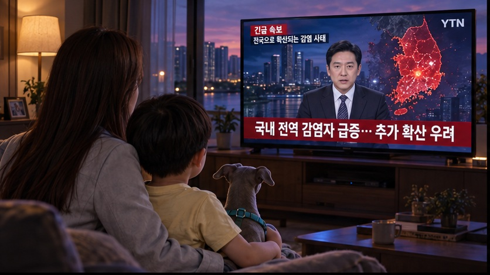

속보입니다. 동탄 일대에서 원인을 알 수 없는 집단 공격이…

### CUT 02 · SHOT 02 · 소리에 반응하는 감염자

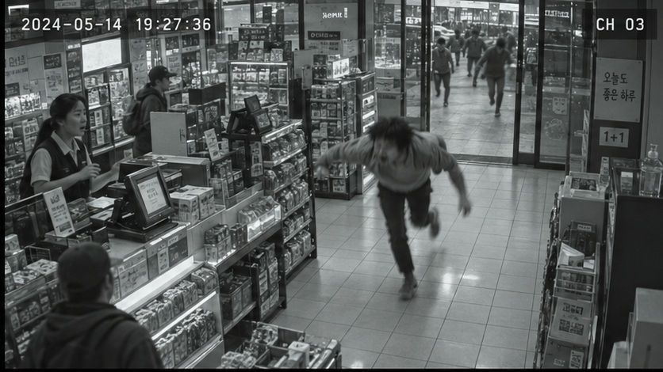

출입문 종소리에 고개를 돌리고 달린다.

### CUT 03 · SHOT 03 · 큰 소리를 내지 마십시오

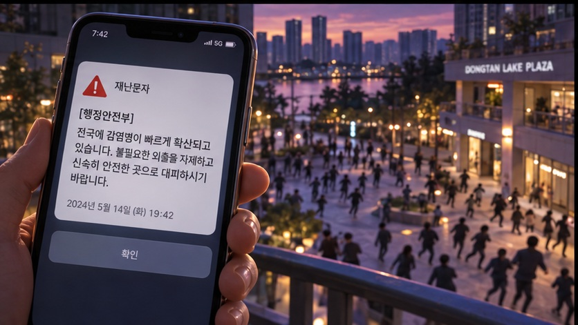

긴급재난문자: 큰 소리를 내지 마십시오.

### CUT 04 · SHOT 04 · 아빠의 빈 해열제

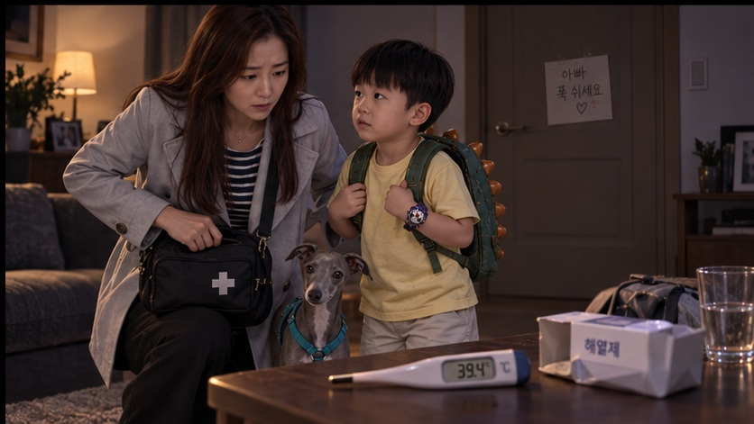

엄마: 아빠 약만 구해서 바로 오자.

### CUT 05 · SHOT 04 · 라크몽 약국에서 약 확보

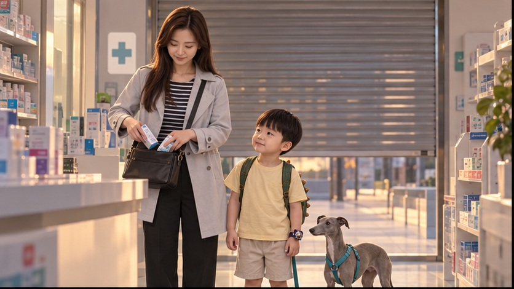

엄마: 찾았다. 이제 집에 가자.

### CUT 06 · SHOT 05 · 입간판의 굉음

진: …어.

### CUT 07 · SHOT 06 · 고개를 돌리는 무리

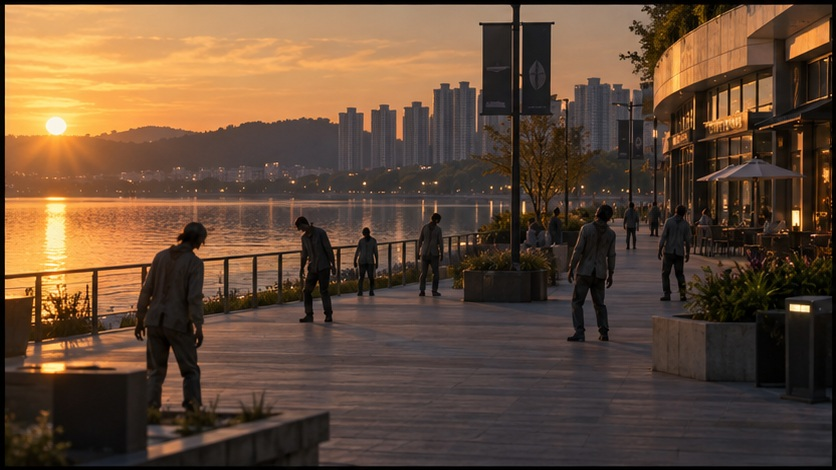

소리에 맞춰 일제히 질주한다.

### CUT 08 · SHOT 07 · 경사로 아래도 막혔다

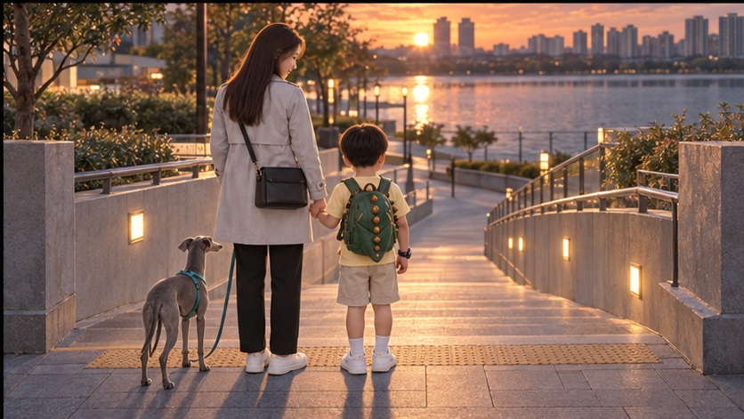

진: 엄마, 아래도 있어….

### CUT 09 · SHOT 08 · 앞뒤로 포위

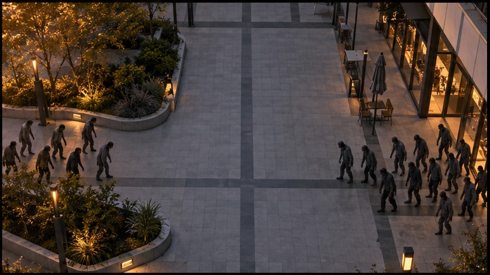

화단과 벽 사이로 몰리는 세 식구.

### CUT 10 · SHOT 09 · 엄마의 휴대폰 미끼

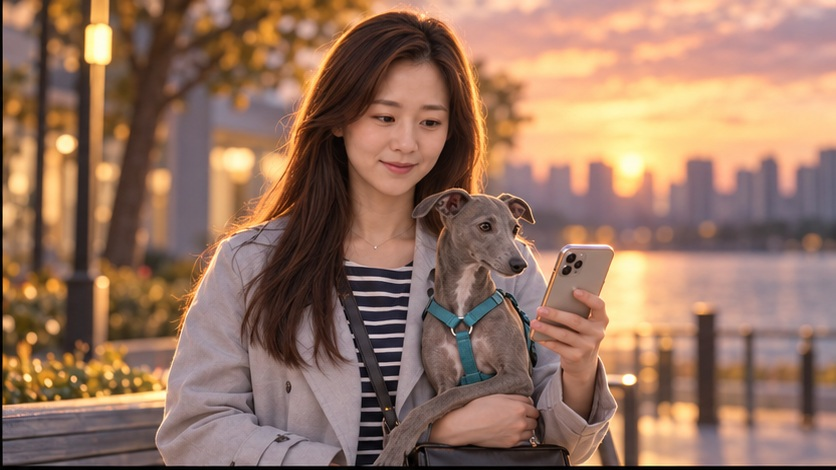

엄마: 잘 가라, 내 폰.

### CUT 11 · SHOT 10 · 뭐가 나와도 꼭 써야 돼

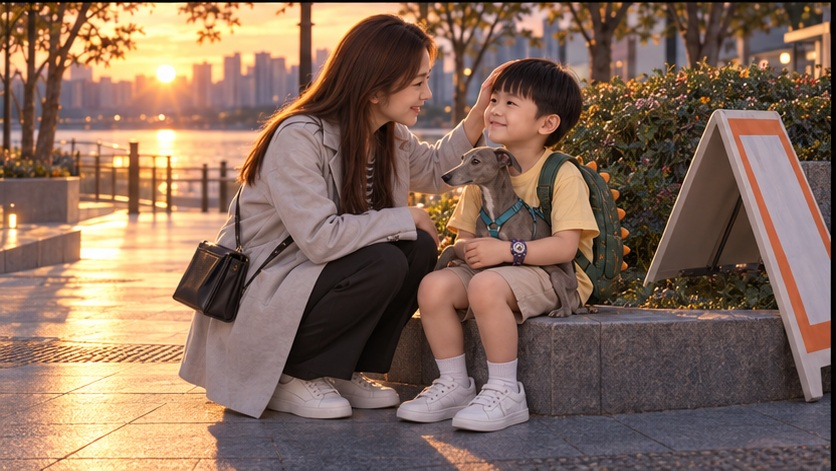

엄마: 서진아, 뭐가 나와도 그거 꼭 써야 돼.

### CUT 12 · SHOT 11 · 시계에서 튀어나온 크레이지 슬롯

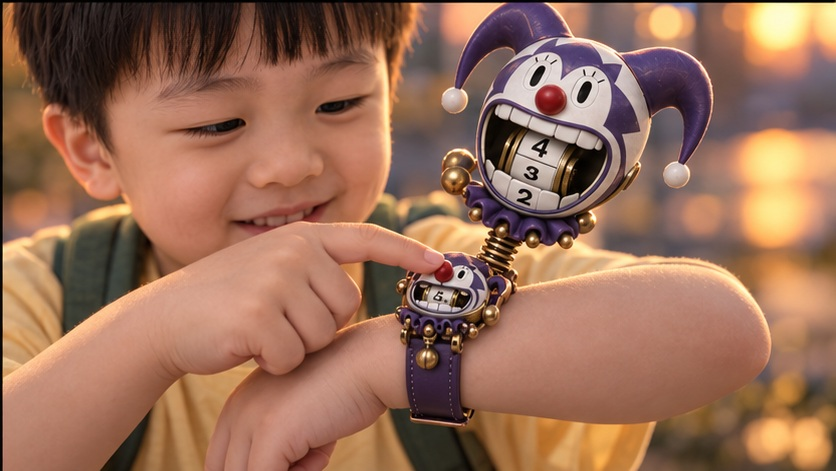

삐에로: 짜잔! 불렀어요, 꼬마 손님?

### CUT 13 · SHOT 12 · 7번이 나왔다

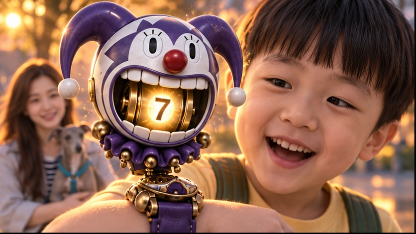

진: 칠… 칠…!

### CUT 14 · SHOT 13 · 서진이의 슈트 변신

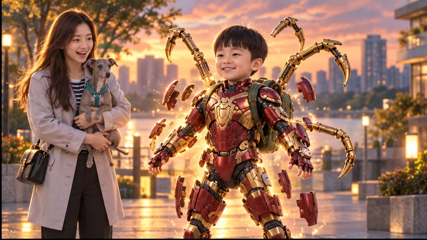

진: 엄마! 진짜 나왔어!

### CUT 15 · SHOT 14 · 사용설명서는 없어요

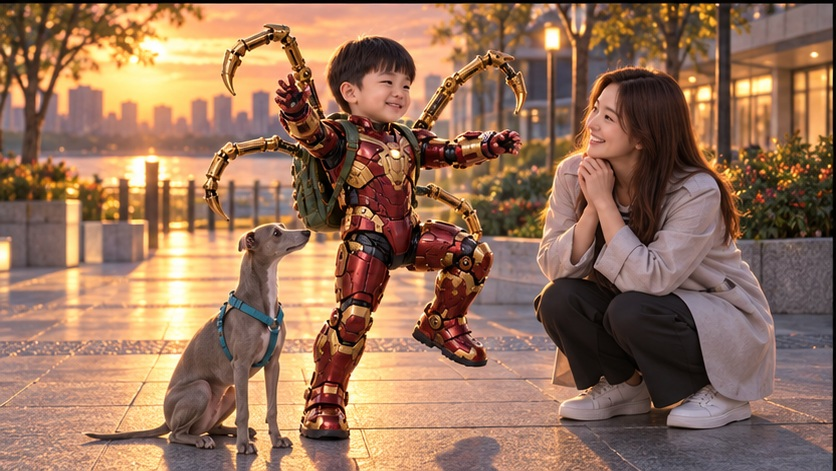

엄마: 엄마 옆에서, 같이 하는 거야.

### CUT 16 · SHOT 15 · 첫 거미줄은 실패

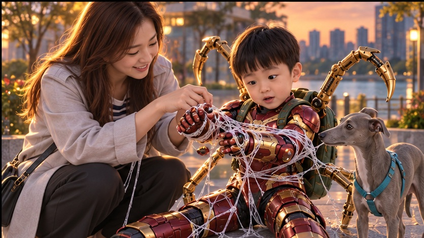

진: 으악!

### CUT 17 · SHOT 15 · 손바닥 펴고, 천천히

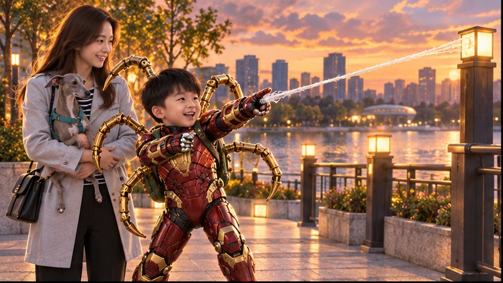

엄마: 손바닥 펴고. 천천히.

### CUT 18 · SHOT 16 · 경사로 거미줄 그물

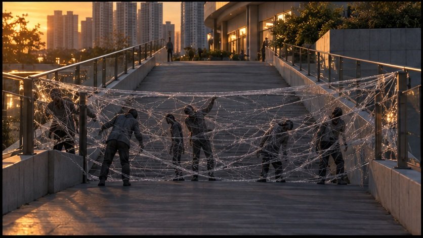

진: 그물 발사!

### CUT 19 · SHOT 17 · 엄마·루나와 줄타기

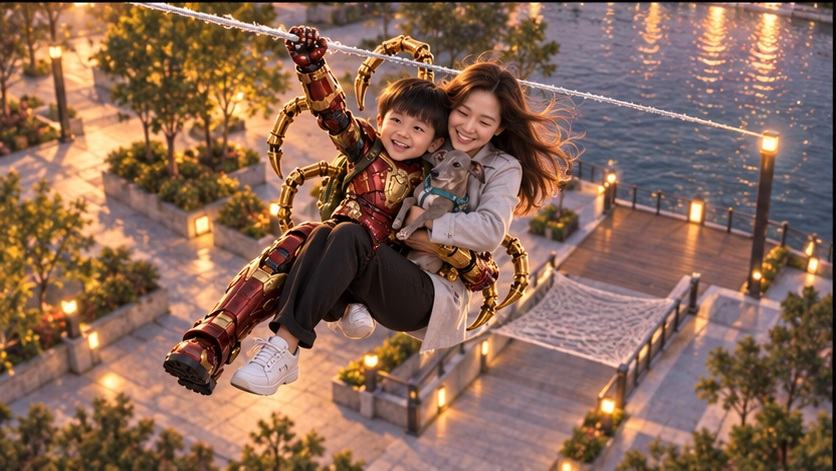

진: 엄마, 꽉 잡아!

### CUT 20 · SHOT 18 · 엄마의 신호, 왼쪽!

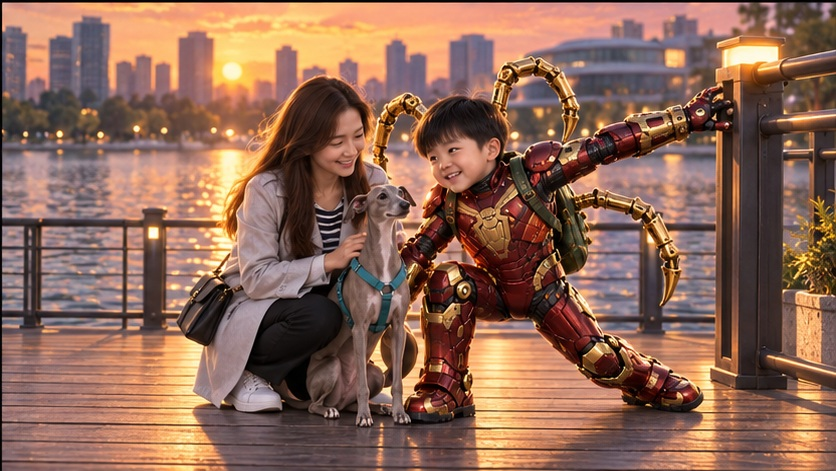

엄마: 서진아, 왼쪽!

### CUT 21 · SHOT 19 · 착지와 슈트 회수

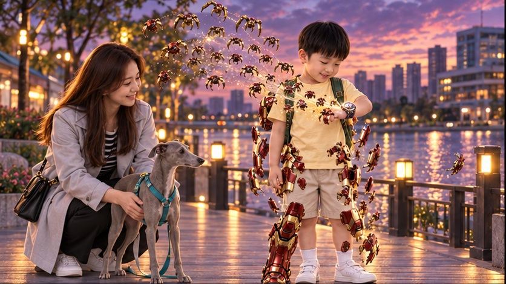

삐에로: 7번, 사용 완료!

### CUT 22 · SHOT 20 · 약도 무사해

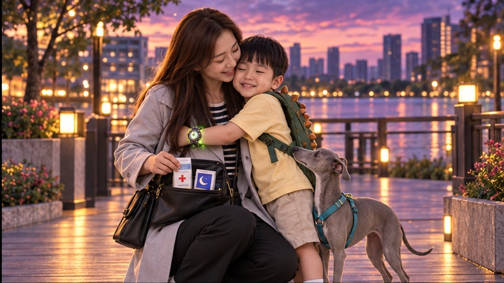

엄마: 아빠 약도 무사해.

### CUT 23 · SHOT 21 · 집으로 가는 길의 새 무리

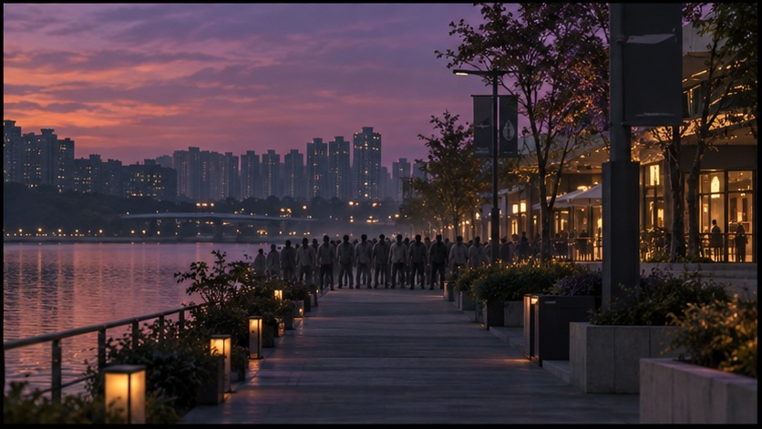

진: 한 번 더 해도 돼?

### CUT 24 · SHOT 22 · 두 번째 룰렛, 암전

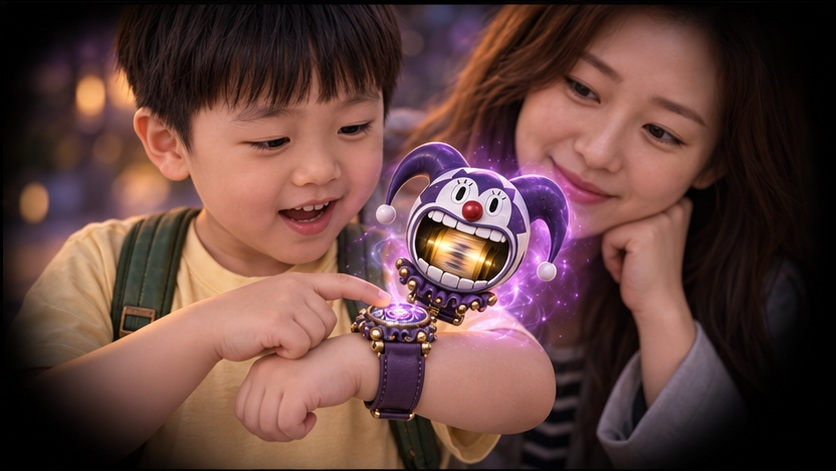

엄마: 아빠한테 가야지. / 삐에로: 과연~ 몇 번일까요?
## 압축 편집 노트

전개 속도를 높이기 위해 원래 38장면·181컷·4분 16초를 **22장면·107컷·02:31**로 줄였습니다. 이야기 순서, 결정적 행동, 확정 설정은 그대로 두고 비슷한 장면을 합쳤습니다. 겹치던 대사와 설명 컷을 덜어 냈고, 대사가 있는 컷만 최대 2초를 허용했습니다. 압축 전 원본은 backups/20261010-before-compress 폴더에 보관했습니다.

| 새 장면 | 합친 원래 장면 | 줄인 내용 |
|---|---|---|
| 01 | 01·02 | 뉴스와 CCTV를 4컷 몽타주로 통합 |
| 02 | 03·04 | 휴대폰 영상과 재난문자·타이틀을 한 장면으로 |
| 03 | 05 | 좀비 소개 컷 1개 축소 |
| 04 | 06·07·08 | 은신처 출발·시계 경고·약국 도착을 하나로 |
| 05 | 09 | 그대로 유지 |
| 06 | 10 | 그대로 유지 |
| 07 | 11·12 | 도망과 급정거를 연결 |
| 08 | 13 | 그대로 유지 |
| 09 | 14·15 | 휴대폰 미끼와 남은 위협을 연결 |
| 10 | 16·17 | 입간판 막기와 아빠의 당부를 연결 |
| 11 | 18·19 | 버튼·피에로 등장·회전을 연결 |
| 12 | 20 | 그대로 유지 |
| 13 | 21 | 그대로 유지 |
| 14 | 22·23 | 기쁨 대사 정리, 버티기 장면과 연결 |
| 15 | 24·25 | 실패와 발견을 연결, 피에로 농담 1개 생략 |
| 16 | 26·27 | 그물 준비와 발사를 연결, 중복 대사 컷 삭제 |
| 17 | 28·29 | 그물에 걸린 좀비와 줄타기 출발을 연결 |
| 18 | 30·31 | 질주와 회피를 연결 |
| 19 | 32·33 | 해제·초록 불·여운을 연결 |
| 20 | 34 | 포옹 컷 1개 축소 |
| 21 | 35·36 | 새 무리 등장과 두 번째 룰렛 결심을 연결 |
| 22 | 37·38 | 두 번째 판과 클리프행어를 연결 |

# 룰렛 무기 도감 · 1–10

추첨은 진. 제레미 2·8번, 릴리 6번, 진 1·7번, 가족 공동 3·4·5·9번, 루나 변신 10번.

| 번호 | 무기 컨셉 | 사용자 시트 | 무기·장비 | 능력 | 사용자 | 상태 |
|---|---|---|---|---|---|---|
| 1 |  |  | 거대 꼬꼬맘 | 헐크버스터 크기(3.35m)로 거대화한 꼬꼬맘. 쪼기, 날개 치기, 파이어블라스터(부리 속 노즐에서 불꽃 덩어리 3발)로 좀비를 물리친다. | 진 | 확정 |
| 2 |  |  | 거대 낫 | 자루 2.4m·날 1.6m의 원작형 거대 낫. 한 바퀴 휘두르면 반경 50m 안의 모든 것이 같은 높이에서 절반으로 잘린다. 1회 한정, 가족은 먼저 엎드려야 한다. 화면은 실루엣과 절단선으로 표현. | 제레미 전용 | 확정 |
| 3 |  |  | 완전무장 디트로네 | 전동 유모차가 완전무장한다. 레이저와 폭탄을 발사하며 탄약은 3발. 아빠가 뒤에서 조종하고 릴리·진이 탑승. | 가족 공동 | 확정 |
| 4 |  |  | 챔프풍 히어로 시럽 | 모든 상태 이상과 부상을 회복한다. 체리 향과 판다 응원 연출. 1회 5ml만 사용 가능해 누구에게 쓸지 고민하게 된다. | 가족 공동 | 확정 |
| 5 |  |  | 가족 우주선 | 가족을 태우고 비행·탈출한다. 80년대 노래를 크게 틀면 소리에 반응하는 좀비들이 몰려와 유인된다. | 가족 전용 | 확정 |
| 6 |  |  | 얼음 능력 드레스 | 아이스볼 발사, 빙판길을 만들어 미끄러지듯 고속 이동, 좀비 얼리기. | 릴리 | 확정 |
| 7 |  |  | 아이언 스파이더 슈트 | 거미줄 발사·이동·포획과 기계 거미 다리. 처음에는 거미줄이 자꾸 엉키다가 결정적인 순간 성공한다. | 진 전용 | 확정 |
| 8 |  |  | 마크1풍 메카닉 슈트 | 철판을 덧댄 기계식 장갑, 화염 분사와 짧은 비행, 가슴 빛 에너지. 진이 바라던 슈트를 아빠가 입는 웃음 포인트. | 제레미 전용 | 확정 |
| 9 |  |  | 부서지지 않는 노란 스쿨버스 | 무엇과 부딪혀도 부서지지 않는다. 좀비 무리를 돌파하고 가족을 실어 나른다. | 가족 | 확정 |
| 10 |  | 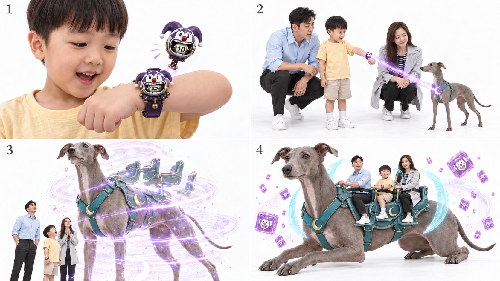 | 거대 수호견 루나 | 10번 당첨 시 보라색 슬롯 빛이 청록 하네스에 연결된다. 루나가 어깨 높이 약 4m로 커져 달 모양 보호막과 돌진으로 길을 열고, 보호 안장에 가족을 태워 탈출한다. | 루나 · 가족 탑승 | 확정 |

# 좀비 인 동탄 · 룰렛 무기 상세 스펙 (1–10)
작성 2026-10-11. 크기와 성능 수치는 연출 일관성을 위한 작업용 설정입니다. 인물 기준 키: 제레미 1.80m, 릴리 1.63m, 진 1.22m. 모든 장비는 진이 크레이지 슬롯을 돌려 무작위로 나오며, 나온 장비를 다 써야 다음 판을 돌릴 수 있습니다.

## 01. 거대 꼬꼬맘 · 진

| 항목 | 스펙 |
|---|---|
| 전체 높이 | 3.35m (아이언맨 마크 44 헐크버스터 약 11피트와 같은 크기) |
| 폭 · 깊이 | 약 2.4m · 2.0m |
| 날개 | 좌우 각 1.5m, 어깨 관절에서 위아래 120도 회전 |
| 부리 | 길이 60cm, 위아래로 열리는 2단 구조 |
| 무게 (설정) | 약 1톤. 걸을 때마다 바닥이 울림 |
| 비교 | 진(1.22m)의 약 2.7배, 엄마(1.63m)의 약 2배 |

**디자인:** 진이 아끼는 꼬꼬맘 장난감을 그대로 키운 모습입니다. 흰 점이 박힌 빨간 보닛과 주황 볏, 흰 얼굴, 파란 큰 눈, 노란 부리, 빨간 나비넥타이, 흰 주름 깃이 머리를 이룹니다. 몸통은 하늘색 달걀형이고 빨강·노랑·흰색·파란색 조각 무늬가 붙어 있으며, 아래는 짙은 파란 둥근 받침, 다리는 주황색 짧은 발입니다. 재질은 두꺼운 광택 장난감 플라스틱이며 이음매와 나사 머리가 보여 장난감이 커졌다는 느낌을 줍니다.

**기술:**

- **쪼기 (PECK):** 노란 부리로 앞쪽 1.5m를 내리찍어 좀비를 튕겨 냅니다. 0.5초에 한 번, 연속 3회까지.
- **날개 치기 (WING SMASH):** 한쪽 날개를 크게 휘둘러 반경 3m 안의 좀비 여러 명을 옆으로 날려 보냅니다. 휘두르기 전 몸을 반대쪽으로 비트는 예비 동작이 보입니다.
- **파이어블라스터 (FIRE BLASTER):** 부리가 활짝 열리고 안쪽의 지름 25cm 원형 노즐에서 주황 불꽃 덩어리를 쏩니다. 사거리 15m, 한 번 소환에 3발, 발사 뒤 노즐 냉각 10초.

**사용 규칙과 화면 표현:** 기술마다 장난감 소리 “꼬꼬댁!”이 함께 납니다. 소리가 커서 주변 좀비를 더 부르는 약점이 됩니다. 좀비는 밀려 넘어지거나 날아갈 뿐 화상·피 표현은 쓰지 않습니다.

## 02. 거대 낫 · 제레미 전용

| 항목 | 스펙 |
|---|---|
| 자루 길이 | 2.4m, 곧은 짙은 강철 봉, 지름 4cm |
| 날 길이 | 1.6m 초승달형 외날 |
| 날 최대 폭 | 28cm, 끝으로 갈수록 가늘어짐 |
| 날과 자루 각도 | 이음부에서 80도로 고정. 날은 자루 위 끝에서 한쪽 바깥으로 뻗은 뒤 끝이 아래로 휘어 내려옴 |
| 삐에로 장식 | 날과 자루가 만나는 이음부, 폭 28cm, 보라·아이보리 얼굴, 빨간 코, 벌린 입 안에 숫자 2 |
| 전체 높이 | 약 2.6m. 제레미(1.80m)보다 80cm 큼 |
| 공격 범위 | 휘두른 지점을 중심으로 반경 50m 원 |

**디자인:** 원작 카이토의 크레이지 슬롯 2번처럼 사신이 드는 거대한 전쟁용 낫 형태입니다. 자루 아래 끝은 장식 없는 강철 마개입니다. 모든 이미지에서 날의 곡선, 80도 각도, 삐에로 장식 위치를 똑같이 유지합니다.

**기술:**

- **회전 참격 · 반경 50m:** 낫을 한 바퀴 휘두르면 날 끝에서 보이지 않는 참격이 원형으로 퍼져, 제레미를 중심으로 반경 50m 안의 모든 것이 같은 높이에서 절반으로 잘립니다. 좀비, 가로등, 나무, 벤치, 자동차, 건물 기둥까지 예외가 없습니다. 원작의 ‘사신의 원무’를 참고한 동작입니다.
- **높이 조절:** 휘두르는 높이가 곧 자르는 높이입니다. 허리 높이로 휘두르면 약 1m 높이에서 잘립니다. 가족은 반드시 낫보다 낮게 엎드려야 합니다.

**사용 규칙과 화면 표현:** 진이 2번을 뽑으면 제레미 손에 소환됩니다. 진과 릴리는 들 수 없습니다. 한 번 소환에 단 한 번만 휘두를 수 있고, 휘두르면 사용 완료입니다. 범위 안의 아군도 잘릴 수 있어 쓰기 전 “엎드려!” 신호가 필수입니다. 화면은 1) 낫이 원을 그리는 순간 정적 2) 50m까지 퍼지는 얇은 빛의 원 3) 가로등·나무·차가 같은 높이에서 미끄러지듯 어긋나며 쓰러지는 와이드 순서로 보여 줍니다. 좀비는 역광 실루엣의 절단선과 먼지로만 처리하고 피·단면·신체 훼손은 보여 주지 않습니다.

## 03. 완전무장 디트로네 · 가족 공동

| 항목 | 스펙 |
|---|---|
| 길이 · 폭 · 높이 | 2.1m · 1.2m · 손잡이 포함 1.6m |
| 좌석 | 앞뒤 2석(릴리·진) + 루나 자리, 뒤쪽 조종 발판 1 |
| 바퀴 | 4개, 지름 55cm 오프로드 타이어 |
| 무장 | 광선 발사기 2문(앞 양쪽), 3연장 캡슐 런처 1문(앞 중앙) |
| 속도 (설정) | 시속 약 25km |

**디자인:** 가족의 전동 유모차가 흰색 장갑판으로 덮인 소형 장갑차가 됩니다. 앞 그릴 양쪽에 파란 빛을 내는 원통형 광선 발사기, 가운데에 캡슐 런처가 있고 손잡이 화면에 남은 탄약 3칸이 표시됩니다. 조종자는 뒤 발판에 서서 손잡이로 운전합니다.

**기술:**

- **광선 발사:** 파란 광선으로 앞을 막은 좀비를 밀어냅니다.
- **캡슐 폭탄:** 캡슐을 던져 소리와 빛으로 좀비를 흩어 놓습니다. 3발이 전부입니다.

**사용 규칙과 화면 표현:** 탄약 3발을 모두 쓰면 사용 완료입니다. 3번 다음에 9번이 나오면 버스 지붕 포탑으로 합체합니다.

## 04. 챔프풍 히어로 시럽 · 가족 공동

| 항목 | 스펙 |
|---|---|
| 병 | 높이 9cm, 지름 4cm, 호박색 유리병, 빨간 뚜껑 |
| 상자 | 12 × 6 × 4cm 빨간 종이 상자 |
| 용량 | 5mL 단 1회분 |
| 부속 | 10mL 계량컵, 5mL 계량 스포이트 |

**디자인:** 판다와 체리가 그려진 빨간 상자와 라벨의 오리지널 어린이 시럽입니다. 실제 제품 포장은 쓰지 않습니다.

**기술:**

- **완전 회복:** 마신 한 명의 상태 이상과 부상을 즉시 회복합니다. 체리 향 회오리와 응원하는 판다 연출이 나옵니다.

**사용 규칙과 화면 표현:** 5mL를 한 사람에게만 쓸 수 있어 누구에게 줄지 고민하게 만드는 장치입니다.

## 05. 가족 우주선 · 가족 전용

| 항목 | 스펙 |
|---|---|
| 길이 · 날개폭 · 높이 | 14m · 12m · 4.2m |
| 탑승 | 4명 + 루나 (조종석 2, 뒷좌석 2) |
| 스피커 | 앞면 4개, 위 갑판 2개, 지름 약 80cm |
| 탑승 램프 | 기수 아래로 내려오는 길이 3.5m 경사 램프 |
| 착륙 다리 | 3개 |

**디자인:** 첫 번째 컨셉 이미지의 각진 델타익 전투 셔틀이 기준입니다. 낡은 하늘색 동체에 녹슨 주황 줄무늬, 기수의 육각형 격자 조종석 창, 앞면 대형 스피커 4개, 높이 솟은 꼬리날개, 옆면 흡입 터빈, 날개 끝 소형 포가 특징입니다. 둥근 만화풍 비행접시로 바꾸지 않습니다.

**기술:**

- **비행 탈출:** 가족을 태우고 하늘로 빠져나갑니다.
- **80년대 노래 유인:** 스피커로 노래를 크게 틀어 소리에 반응하는 좀비를 원하는 쪽으로 몰아갑니다.

**사용 규칙과 화면 표현:** 노래가 끝나거나 착륙하면 사용 완료입니다.

## 06. 얼음 능력 드레스 · 릴리

| 항목 | 스펙 |
|---|---|
| 드레스 길이 | 어깨에서 바닥까지 약 1.45m, 바닥에 10cm 끌림 |
| 망토 | 길이 2.2m 반투명, 뒤로 60cm 끌림 |
| 소매 | 손등까지 덮는 반투명 긴소매 |
| 신발 | 은색 구두, 굽 3cm |

**디자인:** 연한 얼음빛 드레스에 은색 눈꽃 자수가 가슴과 치마에 퍼져 있습니다. 릴리의 얼굴, 갈색 머리, 크로스백은 그대로입니다.

**기술:**

- **아이스볼:** 지름 20cm 얼음 공, 사거리 10m
- **빙판길:** 손바닥이 향하는 바닥에 폭 2m 얼음길을 만들어 미끄러지듯 이동
- **얼리기:** 좀비에 2초 손을 대면 얼려 멈춤

**사용 규칙과 화면 표현:** 두 손을 내리면 드레스가 눈꽃으로 흩어지며 사용 완료입니다. EP.01에는 나오지 않습니다.

## 07. 아이언 스파이더 슈트 · 진 전용

| 항목 | 스펙 |
|---|---|
| 착용자 키 | 진 1.22m에 맞춘 어린이 체형 |
| 기계 다리 | 등딱지 배낭에서 4개, 각각 펼치면 1.1m |
| 거미줄 사거리 | 최대 30m (EP.01 경사로 꼭대기~데크 가로등 약 25m) |
| 그물 | 최대 폭 6m |

**디자인:** 빨강과 금색 장갑에 초록 등딱지 배낭이 붙어 있고, 배낭에서 금빛 기계 거미 다리 4개가 펼쳐집니다. 얼굴은 가리지 않고 보라색 삐에로 시계는 손목 위에 그대로 보입니다.

**기술:**

- **거미줄 발사:** 손바닥을 펴고 겨누면 곧게 날아가고, 서두르면 엉킵니다.
- **거미줄 그물:** 통로를 가로막아 좀비를 붙잡아 둡니다. 해제 뒤에도 몇 분 남습니다.
- **줄타기 · 기계 다리:** 줄을 타고 이동하며 기계 다리로 엄마와 루나를 감싸 받치고 난간을 차서 방향을 바꿉니다.

**사용 규칙과 화면 표현:** 착지하면 슈트가 작은 금속 거미들로 흩어져 시계로 돌아가며 사용 완료입니다. EP.01의 탈출 장비입니다.

## 08. 마크1풍 메카닉 슈트 · 제레미 전용

| 항목 | 스펙 |
|---|---|
| 착용 높이 | 약 2.0m (제레미 1.80m + 장갑) |
| 무게 (설정) | 약 90kg, 걸을 때 쇳소리 |
| 가슴 빛 | 지름 15cm 원형 에너지 코어 |
| 부츠 분사 | 짧은 비행 최대 30초, 높이 약 10m |
| 팔 화염 분사 | 사거리 약 5m |

**디자인:** 녹슨 철판을 리벳으로 덧댄 투박한 기계식 장갑입니다. 금색 얼굴 가리개가 달린 헬멧을 열면 제레미 얼굴이 보입니다. 진이 바라던 슈트를 아빠가 입게 되는 웃음 포인트가 있습니다.

**기술:**

- **짧은 비행:** 부츠 분사로 뛰어오르듯 날아 위기를 넘깁니다. 착지가 서툽니다.
- **화염 분사:** 팔에서 불꽃을 뿜어 바닥과 벽을 막고 좀비를 물러서게 합니다.

**사용 규칙과 화면 표현:** 가슴 빛이 꺼지면 사용 완료입니다. 좀비에게 직접 불을 붙이는 장면은 쓰지 않습니다.

## 09. 부서지지 않는 노란 스쿨버스 · 가족

| 항목 | 스펙 |
|---|---|
| 길이 · 폭 · 높이 | 11m · 2.5m · 3.2m |
| 좌석 | 표준 48석 |
| 강화 범퍼 | 폭 2.6m 검은 쟁기형, 노랑·검정 경고 줄무늬 |

**디자인:** 미국 노란 스쿨버스를 기본으로, 앞에 쟁기형 강화 범퍼를 달았습니다. 무엇과 부딪혀도 찌그러지지 않습니다.

**기술:**

- **돌파:** 좀비 무리와 장애물을 밀어내며 지나갑니다.
- **합체:** 3번 다음에 나오면 디트로네가 지붕 포탑으로 붙습니다.

**사용 규칙과 화면 표현:** 목적지에 도착해 문이 열리면 사용 완료입니다.

## 10. 거대 수호견 루나 · 루나 · 가족 탑승

| 항목 | 스펙 |
|---|---|
| 어깨 높이 | 약 4m |
| 몸길이 | 코에서 엉덩이까지 약 6m, 꼬리 3m |
| 안장 | 청록 3인석, 등받이·손잡이·안전벨트·반투명 발판 |
| 보호막 | 초승달 모양, 반경 약 5m |

**디자인:** 회색 단모, 접힌 귀, 길고 가는 다리, 가는 꼬리를 그대로 키운 이탈리안 그레이하운드입니다. 청록 Y하네스가 금색 초승달 장식이 달린 3인석 안장으로 커집니다.

**기술:**

- **달 보호막:** 가족을 감싸는 초승달 보호막을 펼칩니다.
- **돌진:** 몸을 낮춰 길을 막은 무리를 밀어냅니다.
- **탑승 탈출:** 제레미 앞·진 가운데·릴리 뒤 순서로 태우고 달립니다.

**사용 규칙과 화면 표현:** 멈춘 뒤 가족이 모두 내리면 작아지며 사용 완료입니다.
## 캐릭터·장비 시트

- [진 · 7살](assets/jin-sheet-v3.png): 기존 진의 얼굴을 더 동글동글하고 귀엽게 수정. 곤의 호기심·곧은 마음이 성격 기준. 보라색 삐에로 시계 착용.
- [제레미 · 아빠](assets/jeremy-sheet-v4.png): 30대 초중반의 젊은 하정우 느낌으로 수정한 제레미 얼굴 시트. 기존 파란 셔츠·체형 유지. EP.01에서는 고열로 은신처에 남아 화면에 나오지 않는다.
- [릴리 · 엄마](assets/lily-sheet-v4.png): 정유미 느낌을 유지하며 피부·헤어·메이크업을 화사하게 정돈한 릴리 얼굴 시트. 기존 회색 재킷·체형 유지. EP.01에서 아픈 아빠를 위해 진과 해열제를 구하러 간다. 길을 기억하고 시간을 벌며 진에게 거미줄 요령을 알려 준다.
- [릴리 · 6번 얼음 드레스](assets/equipment-06-v5.png): 최신 릴리 얼굴. EP.01에는 등장하지 않으며 이후 화에서 사용한다.
- [크레이지 슬롯 · 본체](assets/roulette-sheet.png): 카이토의 룰렛을 참고한 현재 생성 시안. 원작과 완전히 동일한 외형은 아니며 입 모양 슬롯을 시각 기준으로 사용.
- [룰렛 · 작동 상태](assets/roulette-states.png): 진이 작동 → 숫자 추첨 → 장비 사용 → 다음 추첨. 결과 선택 불가.
- [1번 · 거대 꼬꼬맘](assets/equipment-01-v6.png): 헐크버스터 크기(3.35m)로 거대화. 쪼기·날개 치기·파이어블라스터로 좀비를 물리친다.
- [진 · 7번 거미줄 슈트](assets/equipment-07-v5.png): 최신 진 얼굴·7살 체형. 거미줄과 기계 다리로 이동·포획. EP.01 S13 착용 → S15~18 그물·줄타기 탈출 → S19 해제.
- [제레미 · 8번 메카닉 슈트](assets/equipment-08-v5.png): 제레미 전용 성인 기계식 장갑. 최신 얼굴 기준.
- [좀비 · 3방향 시트](assets/zombie-sheet.png): 새벽의 저주(2004)풍. 창백한 피부·깊은 눈·긴장된 턱, 소리에 반응하는 폭발적 질주. 피와 노출 상처 없이 표현.

- [2번 거대 낫 · 제레미 전용](assets/equipment-02-v6.png): 원작 카이토 2번과 같은 거대한 낫. 자루 2.4m·날 1.6m·날 각도 80도 고정. 한 번 휘두르면 반경 50m 안의 모든 것이 절반으로 잘린다. 진이 추첨하고 제레미만 사용.

외형 확인: 칼날 곡률·비율 및 피에로 세부는 원작과 차이가 있어, 동일 재현 완료본이 아닌 참고 시안으로 분류.

## 캐릭터 DNA · 루나 추가 (2026-10-10)

부모 얼굴은 2026-10-11 새 시트를 따르고, 진은 둥근 얼굴 새 시트를 따르며, 루나와 기존 의상은 유지합니다. 참고 캐릭터의 성격과 행동을 연출에 반영하며 능력과 배경 설정을 이식하지 않습니다. 릴리만 얼음 능력을 사용합니다.

| 인물 | DNA 참고 | 연기와 행동 |
|---|---|---|
| 아빠 제레미 | 하정우 배역 5편 | 겁을 느끼면서도 버티는 생활형 생존력, 건조한 유머, 가족을 먼저 보내는 책임감. 통제에서 협력으로 성장. |
| 엄마 릴리 | 부산행 성경(정유미) | 가족의 감정을 먼저 읽는 공감, 위기에서 숨을 고르는 침착함, 실패해도 다시 시도하는 단단함. 외형은 정유미 스타일, 성격은 성경. 임신 설정은 추가하지 않음. |
| 아들 진 | 헌터헌터 곤 | 호기심을 행동으로 옮기고 실패에도 다시 도전. 루나와 가족을 두고 가지 않는 동료애. 7살의 체력과 판단 범위 유지. |

### 루나 캐릭터 시트

- 이름: 루나 / 1살 / 암컷 / 이탈리안 그레이하운드.
- 외형: 매끈한 회색 단모, 날씬한 몸통, 깊은 가슴과 잘록한 허리, 길고 가는 다리, 길쭉한 주둥이, 접힌 장미귀, 가느다란 꼬리.
- 식별 소품: 청록색 Y형 하네스와 같은 색 짧은 리드줄.
- 성격: 낯선 소리에 움찔하지만 가족에게 붙으면 안정을 찾는 호기심 많은 어린 개.
- 역할: 진의 배려를 드러내고 가족이 함께 탈출해야 한다는 감정선을 강화. 짖음으로 사고를 일으키는 장치로 쓰지 않음.
- 표정·자세: 평상시 접힌 귀와 편안한 꼬리 / 경계할 때 귀를 들고 멈춤 / 안심할 때 진에게 몸을 기댐.
- 동선: S04 도보 → S06 릴리 품 → S10 진의 무릎 → S16 엄마 품 → S17~18 기계 다리와 엄마 팔 사이 → S19 마른 데크에서 릴리 곁.
- 능력: 평상시에는 초능력 없음. 10번 당첨 때만 거대 수호견으로 변신해 보호막·돌진·가족 탑승 탈출을 담당. 얼음은 릴리만 생성.

웹소설 기준 최신 컬러 콘티 24컷에 현재 인물 디자인과 루나를 반영했습니다. 기존 생성 영상은 이전 이야기이며 이번 콘티 갱신에 포함되지 않습니다.

## 루나 이미지와 개별 DNA 문서

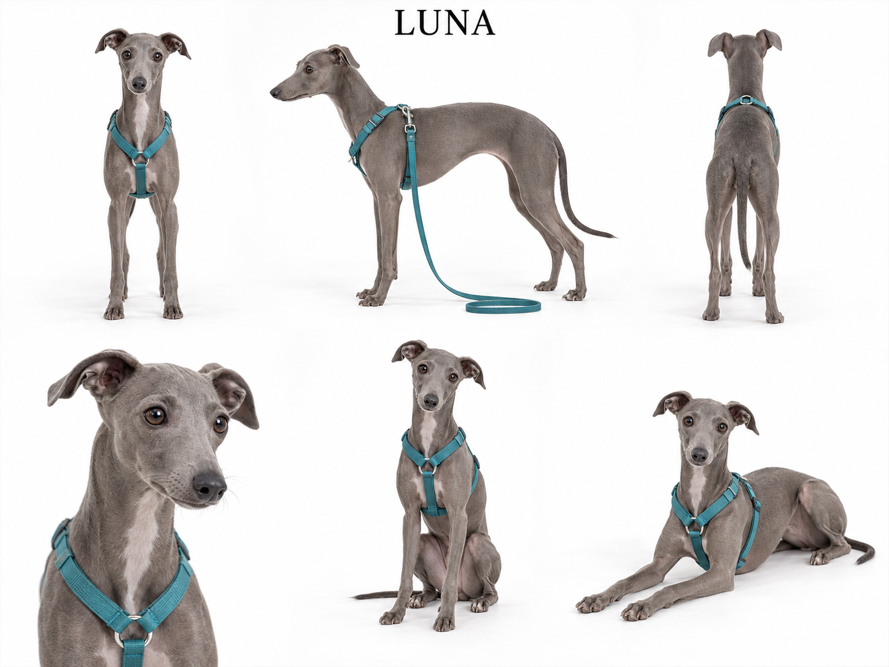

- [제레미 DNA](characters/jeremy-dna.md)
- [릴리 DNA](characters/lily-dna.md)
- [진 DNA](characters/jin-dna.md)
- [루나 DNA](characters/luna-dna.md)

## 진의 보라색 삐에로 시계 · 상세 디자인

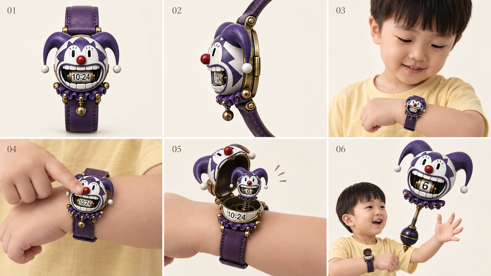

- 크레이지 슬롯과 같은 보라·아이보리 얼굴, 빨간 코, 양갈래 모자, 보라색 러플, 황동 장식. 진의 왼손목에 착용.
- 빨간 코 누름 → 케이스 열림 → 작은 실물 슬롯 돌출 → 본체 확대·손잡이 전개 → 입 안 숫자 추첨. 시계는 손목에 남음.
- 01 정면 / 02 측면 / 03 착용 / 04 누름 / 05 돌출 / 06 확대 완료.
- 반영 장면: 04 시계 소개, 11 첫 소환, 22 두 번째 소환.
- 디자인 기준 시트이며 기존 캐릭터 전신 원본과 완성 영상은 별도.

### 가족 얼굴 기준 · 2026-10-11
아빠는 하정우 얼굴을 더 닮도록 수정, 엄마는 부산행 정유미 스타일, 진은 둥근 볼과 부드러운 턱선. 기존 의상·체형 유지. 기존 변신·장비 시트는 의상과 장비 참고용이며 얼굴은 새 부모 시트를 우선합니다. 기존 만화·영상 자체는 재생성하지 않았습니다.

## 최신 가족 DNA

- 아빠: 하정우 배역 5편을 참고한 생활형 보호자. [5편 성격 조사](characters/ha-jungwoo-five-films.md) · [디자인·DNA](characters/jeremy-dna.md)
- 엄마: 부산행 성경(정유미). [DNA](characters/lily-dna.md)
- 진: 헌터×헌터 곤. 둥근 볼·부드러운 턱선·보라색 시계. [DNA](characters/jin-dna.md)

## 10번 · 거대 수호견 루나

기존 1~9번 뒤에 마지막 번호로 추가. 10번 당첨 → 보라 슬롯 빛이 청록 하네스에 연결 → 달빛 고리와 함께 어깨 높이 약 4m로 거대화 → 몸을 낮춰 가족 탑승. 달 모양 보호막과 돌진으로 탈출한다. 작은 루나의 회색 단모·접힌 귀·긴 다리는 유지한다.
## PART 1. 에피소드 기획

### 제목 제안

1. 라크몽의 좀비들: 아빠의 해열제
2. 7번이 나왔다
3. 엄마와 서진이의 첫 탈출

**추천 제목: EP.01 라크몽의 좀비들 — 7번이 나왔다.** 아빠의 약을 구하러 간 엄마와 아들이 서진이가 바라던 7번 슈트로 첫 위기를 넘기는 이야기를 제목에 담았습니다.

### 로그라인

고열로 쓰러진 아빠를 위해 엄마 릴리와 7살 서진이가 라크몽 약국에서 해열제를 구해 오다 좀비에게 포위되고, 크레이지 슬롯에서 나온 7번 아이언 스파이더 슈트로 거미줄 그물과 줄타기를 만들어 탈출한다.

### 시놉시스

사흘 전, 뉴스 속보와 편의점 CCTV, 시민의 휴대폰 영상, “큰 소리를 내지 마십시오”라는 재난문자가 동탄의 이상 사태를 알린다. 사흘 뒤 해 질 녘, 호수 건너편 임시 은신처. 아빠 제레미는 39.4℃ 고열로 방 안에 누워 있고, 해열제는 다 떨어졌다. 엄마 릴리와 서진이는 반려견 루나를 데리고 동탄호수공원 라크몽 1층 약국으로 향한다.

해열제를 크로스백에 넣고 약국을 나서는 순간, 돌풍에 큰 입간판이 쓰러진다. 그 소리에 느릿하던 좀비들이 일제히 달려들고, 경사로 아래에서도 무리가 올라와 두 사람은 앞뒤로 갇힌다. 릴리는 알람을 맞춘 휴대폰을 던져 위쪽 무리를 따돌리고, 쓰러진 입간판을 혼자 세워 경사로 입구를 막는다. 그리고 서진이에게 말한다. “뭐가 나와도 그거 꼭 써야 돼.”

서진이는 시계의 빨간 코를 누른다. 크레이지 슬롯이 7을 지나 8로 넘어가다 덜컥 한 칸 되돌아 7에서 멈춘다. 서진이가 바라던 7번 아이언 스파이더 슈트다. 하지만 첫 거미줄은 서진이 몸에 칭칭 감긴다. 릴리가 “손바닥 펴고, 천천히”라고 알려 주자 거미줄이 곧게 날아가고, 서진이는 경사로 끝 데크의 가로등을 보며 “놀이터 줄타기처럼 내려가자!”고 외친다.

서진이는 경사로를 가로지르는 거미줄 그물로 올라오던 좀비들을 붙잡아 두고, 데크 가로등까지 긴 줄을 쏜다. 기계 거미 다리로 엄마와 루나를 감싸 안고 줄을 타고 내려가다, 뛰어오른 좀비를 엄마의 “왼쪽!” 신호에 맞춰 비켜 간다. 데크에 내려앉자 슈트는 작은 금속 거미들로 흩어져 시계로 돌아가고 다음 판을 알리는 초록 불이 켜진다.

엄마는 서진이를 꼭 안고 크로스백 속 해열제가 무사한지 확인한다. 그러나 은신처로 가는 유일한 산책로를 더 큰 무리가 메운다. “아빠한테 가야지.” 서진이는 다시 룰렛을 돌리고, 숫자가 멈추기 직전 화면이 꺼진다.

### 이번 화의 목표

해 지기 전에 해열제를 들고 호수 건너편 은신처의 아빠에게 돌아가는 것. 이번 화에서는 라크몽 앞 포위망을 빠져나가 호숫가 데크에 도착하는 데까지 성공합니다.

### 갈등과 해결

밖에서는 소리에 반응하는 좀비가 앞뒤를 막고, 안에서는 7살 서진이가 처음 받은 힘을 다루지 못해 실패합니다. 아빠가 없는 상황에서 엄마는 힘으로 해결하는 대신 길을 기억하고, 시간을 벌고, 아들에게 요령을 알려 줍니다. 서진이는 놀이터에서 배운 줄타기를 떠올려 엄마와 루나를 함께 데려갑니다. 원하던 힘이 나와도 혼자가 아니라 함께 써야 한다는 것이 이번 화의 성장입니다.

### 인물별 결정적 기여

| 인물 | 결정적 행동 | 해당 장면 |
|---|---|---|
| 릴리 | 약국에서 해열제 확보, 휴대폰 미끼, 입간판으로 시간 벌기, 거미줄 요령 코치, 마지막 방향 지시 | SHOT 04·09·10·15·18 |
| 진(서진) | 룰렛 조작, 줄타기 아이디어, 거미줄 그물, 엄마와 루나를 안고 줄타기 탈출 | SHOT 11·15~18 |
| 루나 | 엄마 품과 서진이 무릎을 오가며 함께 이동. 능력은 쓰지 않음 | 전 장면 |
| 아빠(제레미) | 고열로 은신처에 남음. 화면에 나오지 않고 이야기의 목적이 됨 | SHOT 04·20~22 |

### 액션 하이라이트와 엔딩

하이라이트는 SHOT 16~18입니다. 경사로를 가로지른 거미줄 그물에 좀비들이 줄줄이 달라붙고, 서진이가 엄마와 루나를 기계 다리로 감싼 채 좀비들 머리 위로 줄타기를 합니다. 엔딩은 데크에서의 포옹과 해열제 확인 뒤, 집으로 가는 길을 막은 더 큰 무리 앞에서 두 번째 룰렛 결과가 보이기 직전에 블랙으로 끝납니다.

## PART 2. 연출·연속성 기준

### 확정 설정과 작업용 가안 구분

| 구분 | 내용 | 상태 |
|---|---|---|
| 인물 이름 | 엄마 릴리, 아들 진(서진·7살), 반려견 루나. 아빠 제레미는 고열로 은신처에 남아 화면에 나오지 않음 | 확정 |
| 공개 범위 | 사용자 지정 작품·제품을 참고한 캐릭터 및 장비 시트 | 확정 |
| 장비 이름 | 1번 거대 꼬꼬맘(진), 2번 거대 낫(아빠), 3번 완전무장 디트로네(가족), 4번 챔프풍 히어로 시럽(가족), 5번 우주선(가족), 6번 얼음 능력(릴리), 7번 아이언 스파이더 슈트(진), 8번 마크1풍 메카닉 슈트(아빠), 9번 부서지지 않는 노란 스쿨버스(가족), 10번 거대 수호견 루나(가족 탑승) | 확정 |
| 1번 장비 | 거대 꼬꼬맘. 실제 제품을 참고한 시트 제작 완료. 1화에는 등장하지 않음 | 시트 반영 |
| 좀비 | 평소엔 느리게 걷고, 큰 소리를 들으면 갑자기 달려듦 | 확정 |
| 시간대 | 해 질 녘 노을 → 엔딩은 해가 진 직후 보랏빛 저녁 | 확정 |
| 얼굴·체형 | 진=둥근 얼굴 새 시트, 릴리=부산행 정유미 스타일 새 시트, 진의 슈트=7번 사용자 시트에 연결 | 반영 |

### 시간대와 날씨

맑은 날의 해 질 녘입니다. 해는 화면 왼쪽 낮은 곳에 두어 모든 야외 컷의 역광 방향을 통일합니다. 바람이 조금 강한 날로 설정해 입간판이 쓰러지는 사고에 이유를 줍니다. SHOT 20에서 해가 수평선에 닿고, SHOT 21부터는 해가 진 뒤의 보랏빛 하늘입니다.

### 기본 의상과 소지품 [작업용 가안]

| 인물 | 의상 | 소지품 |
|---|---|---|
| 릴리 | 회색 코트, 남색·흰색 줄무늬 상의, 검정 바지, 흰 운동화 | 크로스백(약국에서 구한 해열제), 휴대폰(미끼로 던짐), 루나 리드줄 |
| 진 | 연노랑 티셔츠, 베이지 반바지, 흰 양말·운동화 | 작은 초록 공룡 배낭, 왼쪽 손목의 크레이지 슬롯 |

### 공간 배치와 이동 경로

실제로 확인한 내용은 “동탄호수공원 수변의 상업 공간 라크몽”이라는 장소뿐입니다. 이번 초안은 건물 층수, 매장, 출입구 위치를 실제 정보로 쓰지 않았습니다. 아래 배치는 모두 [가상 공간 구성]이며, 현장 사진을 받으면 실제 외관에 맞춰 조정합니다.

1. 라크몽 바깥 보행로: 문 닫힌 카페 유리창이 늘어선 길. 가족은 화면 왼쪽에서 오른쪽으로 이동.
2. 경사로 위 작은 광장: 한쪽은 화단, 한쪽은 상가 벽. 왼쪽 먼 곳에 금속 벤치.
3. 넓고 완만한 경사 보행로: 광장에서 호숫가로 내려가는 길(화면 오른쪽 아래 방향).
4. 수변 나무 데크: 경사로 끝의 마른 데크. 탈출 도착점.
5. 호숫가 산책로 저편: 건너편으로 가는 유일한 길. 엔딩의 새 무리가 나타나는 곳.

### 좀비의 움직임과 반응 규칙

- 평소에는 느리게 비틀거리며 걷습니다.
- 큰 소리(간판 충격음, 알람, 피에로 팡파르, 진의 외침)를 들으면 소리 쪽으로 고개를 돌리고 새벽의 저주(2004)풍으로 몸을 앞으로 기울여 폭발적으로 질주합니다.
- 거미줄에 닿으면 달라붙어 버둥댈 뿐 빠져나오지 못합니다.
- 피와 상처는 보이지 않습니다. 회색빛 피부와 찢어진 평상복으로만 좀비임을 표현합니다.
- [추가 제안] 피에로와 룰렛 소리도 좀비에게 들립니다. 장치를 쓸 때마다 위험이 함께 커지는 규칙입니다.

### 룰렛 2번 · 거대 낫 · 아빠 전용 — 사용자 확정 추가 설정

- 번호: 카이토 원작과 같은 **2번**. 룰렛이 2번에 멈추면 거대한 낫을 사용한다.
- 사용자: 아빠(제레미) 전용. 진이 2번을 추첨하면 아빠에게 소환되며 진·릴리는 사용할 수 없다.
- 공격: 낫을 한 바퀴 휘두르면 반경 50m 안의 모든 것(좀비·가로등·나무·차량·기둥)이 같은 높이에서 절반으로 잘리는 광역 참격. 한 번 소환에 1회만 휘두를 수 있고, 아군도 잘릴 수 있어 가족은 먼저 엎드린다.
- 화면 표현: 역광 속 검은 실루엣과 얇은 절단선으로 공격 결과를 전달한다. 피, 상처 단면, 장기, 신체 훼손 클로즈업은 보여 주지 않는다.
- 연출 제안: 정적 속 원형 궤적 → 50m까지 퍼지는 얇은 빛의 원 → 가로등·나무·차가 같은 높이에서 어긋나며 쓰러지는 와이드 → 좀비는 실루엣 절단선 → 먼지·암전.
- 적용 범위: 무기 설정에 추가한다. EP.01은 7번 슈트 탈출로 진행하며 2번은 등장하지 않는다.

### 피에로와 룰렛

| 요소 | 시각 기준 |
|---|---|
| 손목 장치 | 진의 왼쪽 손목 소형 조작부. 본체 소환과 시작 버튼, 상태 표시등 |
| 피에로 | 연결된 룰렛 시트 기준. 보라색·흰색 피에로 머리, 입 안 숫자 슬롯, 아래로 늘어진 손잡이. 공중 소환 |
| 룰렛 | 피에로 입 안 슬롯에서 숫자 1~10가 순환하고 한 숫자로 멈춤 |
| 말투 | 짧고 능청스러운 한마디. 규칙 설명은 하지 않음 |
| 사용 가능 표시 | [추가 제안] 장비를 다 쓰면 다이얼에 초록 불 |

### 7번 아이언 스파이더 슈트와 거미줄

착용자는 진(서진)이다. 붉은색과 금색 장갑, 초록 등딱지 배낭에서 펼쳐지는 금빛 기계 거미 다리 4개는 7번 사용자 시트를 따른다. 얼굴을 가리지 않고 7살의 체형과 팔 길이를 유지한다. 보라색 삐에로 시계는 슈트 손목 위에 그대로 보인다.

거미줄은 손바닥을 펴고 손목을 겨눌 때 곧게 날아가고, 주먹을 쥔 채 서두르면 엉킨다. 그래서 첫 시도는 실패하고, 엄마의 한마디로 요령을 찾는다. EP.01에서는 경사로를 가로지르는 그물과 데크 가로등까지 잇는 줄타기 두 가지로 쓴다. 기계 다리는 엄마의 허리와 루나의 몸통을 감싸 받치고, 난간을 차서 방향을 바꾸는 데 쓴다.

### 효과의 지속 [작업용 가안]

슈트가 해제된 뒤에도 거미줄 그물은 몇 분 동안 남습니다. 그래서 좀비들이 데크로 바로 내려오지 못하고, 엄마와 서진이가 숨을 돌릴 시간이 생깁니다.

### 줄타기가 안전한 이유

엄마와 루나는 기계 다리와 엄마의 팔로 함께 받쳐지고, 하네스 끈이나 털만으로 매달리지 않습니다. 줄은 경사로 꼭대기 난간에서 데크 가로등까지 이어지고, 마른 데크에 사뿐히 내려앉습니다. 좀비는 그물에 붙어 있거나 줄 아래에서 손을 뻗을 뿐 닿지 않습니다.

### 촬영 스타일 — 새벽의 저주(2004) 참고

긴장감은 극장용 좀비 스릴러 수준으로 끌어올리고, 가족 코미디와 무혈 원칙은 유지합니다. 아래 기준은 모든 컷의 카메라와 영어 프롬프트에 반영했습니다.

| 요소 | 기준 | 주로 쓰는 컷 |
|---|---|---|
| 색감 | 채도를 낮춘 블리치 바이패스풍, 강한 대비와 눌린 검정. 노을 하이라이트는 주황, 그림자는 차가운 청록 | 전 컷 |
| 프롤로그 | 가상 방송사 뉴스, 흑백 CCTV, 세로 휴대폰 영상, 재난문자를 거친 질감으로 이어 붙인 몽타주 | SHOT 01~02 |
| 핸드헬드 | 도망·포위 구간은 숄더캠. 정적인 감정 컷은 고정 | SHOT 04~10, 14 |
| 스타카토 셔터 | 셔터 45도로 움직임을 끊어 보이게 해 좀비 질주의 공포를 키움 | SHOT 06, 16, 22 |
| 크래시 줌·스냅 줌 | 충격음과 동시에 0.3초 급줌. 그 뒤 1초 무음 | SHOT 05, 16, 17, 18 |
| 휩 팬 | 시선과 물체를 따라 빠르게 돌림 | SHOT 07, 09 |
| 항공 시점 | 헬기·옥상 높이에서 공간과 포위망을 한눈에 | SHOT 03, 08 |
| 좀비 시점 | 0.5초 낮은 시점 인서트로 쫓기는 압박 | SHOT 07 |
| 플래시 컷 | 좀비 눈 4프레임, 손이 들어오는 순간 4프레임 정지 | SHOT 06, 17 |
| 무혈 원칙 | 충격은 소리·프레임 정지·화면 밖 처리로 전달. 피와 상처는 보이지 않음 | 전 컷 |
| 코미디 박자 | 피에로 대사, 볼링 핀처럼 넘어지는 슬로모션은 그대로 살림 | SHOT 11~14, 17 |

### 편집 리듬 — 1~1.5초 하드컷·긴 대사 최대 2초

기본 컷은 1~1.5초이며 대사가 있는 컷은 최대 2초입니다. 컷이 바뀔 때마다 카메라 무브, 앵글, 프레이밍을 동시에 바꿉니다. 장면 경계를 포함한 107개 컷 모두 바로 앞 컷과 세 요소가 겹치지 않는지 빌드할 때 자동으로 확인합니다. 각 SHOT 카드의 컷 분할표가 촬영·생성 기준입니다.

| 무브 | 쓰는 상황 | 대표 컷 |
|---|---|---|
| 크레인 업·다운 | 공간을 열거나 닫을 때, 변신이 걷힐 때 | SHOT 03, 13, 20 |
| 크래시 줌 | 충격음과 동시에 0.3초 급줌 | SHOT 05, 06, 10 |
| 돌리 인·아웃 | 대사의 감정을 밀어붙이거나 거리감을 줄 때 | SHOT 10, 14 |
| 핸드헬드 | 도망·포위·버티기 | SHOT 07, 08, 14 |
| 헬릭스 오빗 | 나선으로 돌며 포위·변신·포옹을 크게 보여 줄 때 | SHOT 08, 13, 20 |
| 랙포커스 풀백 리빌 | 전경에서 초점이 빠지며 위협이나 공간이 드러날 때 | SHOT 03, 07, 21 |
| 휩팬 | 시선·물체를 따라 장면을 넘길 때 | SHOT 09, 15 |
| 아크샷 → 익스트림 줌 인 → 슬로모션 줌 아웃 | 능력 발동의 정점 | SHOT 16 |

음악은 원작처럼 낮은 기타와 북 리듬의 타이틀 곡을 MiniMax Music으로 오리지널 제작하는 것을 기준으로 합니다.

## PART 3. 전체 컷 구성표

| 컷 | 타임코드 | 길이 | 장소 | 핵심 사건 | 감정 변화 |
|---|---|---|---|---|---|
| **프롤로그 · 그날의 기록** | | | | | |
| 01 | 00:00–00:06 | 6초 | 뉴스 스튜디오 | 앵커가 속보를 읽고, CCTV 속 손님이 종소리에 고개를 꺾고 출입문으로 질주한다.
가족과 루나 미등장. 뉴스 기록 화면만 유지. | 인물 감정보다 기록 화면의 불안. |
| 02 | 00:06–00:13 | 7초 | 아파트 베란다 → 호수공원 방향 | 휴대폰 영상 속 촬영자가 “뛰어!”를 외치고, 재난문자 뒤 타이틀과 「사흘 뒤」가 이어진다.
가족과 루나 미등장. 재난문자와 타이틀만 유지. | 공포 → 정적. |
| **1막 · 아빠의 약을 구하러** | | | | | |
| 03 | 00:13–00:20 | 7초 | 동탄호수공원 수변, 호수 너머 라크몽 외관 원경 | 항공 하강 뒤 버려진 산책로에서 좀비 3명이 드러나고 에피소드 제목이 뜬다.
루나 미등장. 좀비와 공간 소개에 집중. | 아름답지만 불안한 정적. |
| 04 | 00:20–00:27 | 7초 | 호수 건너편 임시 은신처 → 라크몽 1층 약국 | 릴리와 진이 은신처를 나서고, 라크몽 약국에서 해열제를 크로스백에 담은 뒤 집으로 향한다.
루나는 청록 하네스와 짧은 리드줄로 릴리 왼쪽에 붙어 걷는다. 은신처를 나설 때 진이 루나 머리를 쓰다듬는다. | 아빠를 걱정하는 조급함과 조심스러운 긴장. |
| 05 | 00:27–00:33 | 6초 | 라크몽 약국 앞 보행로 | 돌풍에 입간판이 쓰러지고, 1초 무음 속 릴리와 진이 굳는다.
간판 소리에 루나가 움찔해 릴리 발뒤로 붙는다. 릴리가 리드줄을 짧게 잡는다. 짖음은 넣지 않는다. | 얼어붙은 공포, 진의 작은 탄식. |
| 06 | 00:33–00:39 | 6초 | 라크몽 바깥 보행로 주변 | 좀비들이 일제히 고개를 꺾고 몸을 숙인 채 폭발적으로 달린다.
릴리는 뛰기 전에 루나를 가슴과 엉덩이 아래를 받쳐 안는다. | 공포의 폭발. |
| 07 | 00:39–00:46 | 7초 | 보행로 → 경사로 입구 방향 | 릴리가 루나를 안고 진과 경사로로 달리다 급정거하고, 아래에서 올라오는 무리를 본다.
릴리가 루나를 안고 달리고, 진은 엄마 옆에서 보폭을 맞춘다. | 희망 → 막막함. |
| 08 | 00:46–00:53 | 7초 | 경사로 위 작은 광장 | 양쪽 무리가 화단과 벽 사이의 릴리와 진을 조여 온다.
릴리 품의 루나와 진을 벽 쪽 안쪽에 두고 릴리가 바깥쪽에 선다. | 최고조의 압박. |
| 09 | 00:53–01:00 | 7초 | 같은 광장 | 릴리가 알람을 맞춘 휴대폰을 벤치로 던져 위쪽 무리를 끌어내지만 경사로 무리는 그대로다.
릴리는 루나를 한 팔로 안은 채 휴대폰을 던진다. | 작은 안도 → 다시 긴장. |
| 10 | 01:00–01:07 | 7초 | 경사로 입구 | 릴리가 루나를 진의 무릎에 옮기고 입간판으로 경사로를 막은 뒤, 무릎을 꿇어 진에게 규칙을 일러 준다.
간판을 세우기 전 릴리가 벽 안쪽에 앉은 진의 무릎에 루나를 옮긴다. 리드줄은 손목에 감지 않는다. | 다급함 속 신뢰. |
| **2막 · 룰렛과 7번 스파이더 슈트** | | | | | |
| 11 | 01:07–01:14 | 7초 | 입간판 뒤 | 빨간 코를 누르면 케이스가 열리고 작은 실물 크레이지 슬롯이 튀어나온다. 손목 앞에서 기존 본체 크기로 커지며 황동 손잡이가 펼쳐지고 입 안 숫자 슬롯이 돈다. 시계는 손목에 남는다.
진은 무릎의 루나를 한 팔로 감싸고 다른 손으로 시계를 누른다. | 황당함과 기대, 진의 간절함. |
| 12 | 01:14–01:20 | 6초 | 룰렛 인서트 | 슬롯이 7을 지나 8로 가다 덜컥 한 칸 되돌아 7에서 멈춘다.
루나는 진의 무릎 안쪽에 그대로 있다. | 숨죽인 기대 → 폭발하는 기쁨. |
| 13 | 01:20–01:27 | 7초 | 입간판 뒤 | 금속 조각이 진의 몸을 감싸며 조립되고, 기계 거미 다리 4개가 펼쳐진다.
변신 직전 릴리가 루나를 받아 안는다. 슈트 조각은 루나를 피해 진에게만 붙는다. | 경이로움, 진의 벅찬 기쁨, 릴리의 놀람. |
| 14 | 01:27–01:34 | 7초 | 입간판 뒤 | 진이 신나 하고 릴리가 함께 하자고 다독이는 사이, 릴리가 어깨로 간판을 버틴다.
릴리는 루나를 안은 채 어깨로 간판을 버틴다. | 들뜸 → 책임감 → 다급함. |
| 15 | 01:34–01:41 | 7초 | 입간판 뒤 | 거미줄이 엉켜 진이 넘어지고, 릴리가 손바닥을 펴는 요령을 알려 준다. 진이 데크 가로등을 보고 줄타기를 떠올린다.
루나는 릴리 곁, 엉킨 거미줄에서 떨어진 곳에 있다. | 당황 → 발견 → 기대. |
| 16 | 01:41–01:49 | 8초 | 경사로 꼭대기 | 진이 경사로 양쪽 난간 사이로 큰 거미줄 그물을 치고, 올라오던 좀비들이 그물에 달라붙는다.
그물을 치는 동안 루나는 릴리 품에 있다. | 집중 → 자신감. |
| 17 | 01:49–01:55 | 6초 | 경사로 꼭대기 → 줄 위 | 진이 데크 가로등으로 긴 거미줄을 쏘고, 기계 다리로 엄마와 루나를 감싸 안은 채 줄을 타고 출발한다.
진의 기계 다리 두 개가 엄마의 허리를, 한 개가 루나의 몸통을 하네스 위로 감싼다. 하네스 끈만 잡아 들지 않는다. | 웃음 → 결단. |
| 18 | 01:55–02:03 | 8초 | 경사로 위 거미줄 줄 | 셋이 줄을 타고 경사로 위를 내려가고, 뛰어오른 좀비를 릴리의 신호로 왼쪽으로 비켜 간다.
루나는 기계 다리와 릴리 팔 사이에 낮게 안긴다. 발이 허공에서 버둥대지 않는다. | 환호 → 순간 위기 → 성공. |
| 19 | 02:03–02:10 | 7초 | 수변 나무 데크 | 데크에 착지하자 슈트가 작은 금속 거미들로 흩어져 시계로 돌아가고 초록 불이 켜진다.
착지 후 릴리가 루나를 마른 데크에 내려놓고 리드줄을 잡는다. | 안도와 피로. |
| **3막 · 귀갓길과 다음 위기** | | | | | |
| 20 | 02:10–02:18 | 8초 | 수변 데크 | 릴리가 진을 칭찬하고, 크로스백 속 해열제가 무사한지 확인한 뒤 함께 안는다.
진이 루나의 등을 쓰다듬고 셋이 낮게 모여 안도한다. | 따뜻함과 자부심. |
| 21 | 02:18–02:24 | 6초 | 호숫가 산책로 저편 | 은신처로 가는 유일한 길을 무리가 메우고, 진이 다시 돌려도 되는지 묻는다.
루나가 멀리 다가오는 무리를 보고 귀를 세운다. 릴리가 짧은 리드줄로 곁에 붙인다. 초감각이 아닌 시선 반응이다. | 불안 → 엄마와 아들의 합의. |
| 22 | 02:24–02:31 | 7초 | 수변 데크 | 진이 같은 보라색 삐에로 시계의 빨간 코를 누른다. 작은 실물 슬롯이 튀어나와 커지자 무리가 질주하고, 숫자가 멈추기 직전 블랙.
진은 엄마 곁의 루나를 확인한 뒤 두 번째 룰렛을 누른다. 릴리가 진의 어깨에 손을 얹는다. | 긴장 최고조, 궁금증. |

**총 러닝타임: 02:31 (151초, 22장면 · 107컷)**

## PART 4. 컷별 상세 스토리보드

공통 조건: 영어 프롬프트의 REF_JIN, REF_JIN_SUIT, REF_LILY는 상단에 연결된 인물·슈트 시트를 뜻합니다. 아빠는 EP.01 화면에 나오지 않습니다. 얼굴 생김새는 프롬프트에 적지 않았습니다. 룰렛 숫자, 피에로, 자막은 후반 합성으로 처리합니다.

### 프롤로그 · 그날의 기록

#### SHOT 01

- **타임코드 / 길이:** 00:00–00:06 / 6초
- **장소 / 시간대:** 뉴스 스튜디오 [가상 방송사] / 사흘 전 저녁
- **이 컷의 목적:** 뉴스 속보와 CCTV로 사태를 한 번에 알린다.
- **시작 화면:** 가상 방송사의 저녁 뉴스. 앵커 뒤 화면에 동탄 지도와 붉은 경보 표시.
- **화면 크기와 구도:** 미디엄 → 인서트 → 와이드 → 풀샷
- **카메라:** 1~1.5초 하드컷 4개. 컷마다 무브·앵글·프레이밍 동시 변경(아래 컷 분할표).
- **핵심 행동:** 앵커가 속보를 읽고, CCTV 속 손님이 종소리에 고개를 꺾고 출입문으로 질주한다.
가족과 루나 미등장. 뉴스 기록 화면만 유지.
- **인물 표정과 감정:** 인물 감정보다 기록 화면의 불안.
- **한국어 대사:** 앵커: 속보입니다. 동탄 일대에서 원인을 알 수 없는 집단 공격이 잇따르고 있습니다.
- **사운드:** 뉴스 시그널 음악, 앵커 목소리, 지지직 잡음으로 끊김. 유리문 종소리, 끊기는 디지털 잡음.
- **시각 효과 / 후반 합성:** 가상 방송사 로고와 자막 후반 합성. 실제 방송사 로고 사용 금지. 흑백 CCTV, 타임스탬프 합성. 공격 장면은 화면 밖. 무혈.
- **종료 화면:** 빈 계산대와 흔들리는 문.
- **다음 컷과의 연결:** 빈 화면 → 세로 휴대폰 영상.
- **연속성 주의:** 실존 방송사·인물 사용 금지. 좀비 외형은 좀비 시트 기준.
루나 연속성: 가족과 루나 미등장. 뉴스 기록 화면만 유지.
- **컷 분할 (1~1.5초 하드컷·긴 대사 최대 2초):**

| # | 길이 | 카메라 무브 | 앵글 | 프레이밍 | 화면 |
|---|---|---|---|---|---|
| 1 | 1.5초 | 고정 | 아이레벨 | 미디엄 | 가상 방송사 앵커 “속보입니다. 동탄 일대에서…” [추가 콘티: 가족과 루나 미등장. 뉴스 기록 화면만 유지.] |
| 2 | 1.5초 | 크래시 줌 인 | 하이 앵글 | 인서트 | 스튜디오 화면의 붉은 동탄 경보 지도 |
| 3 | 1.5초 | 디지털 줌 | 탑다운 | 와이드 | 흑백 CCTV, 문 종소리에 계산대 손님 고개가 꺾인다 |
| 4 | 1.5초 | 휩팬 | 측면 | 풀샷 | 손님이 출입문으로 폭발적 질주, 신호가 찢어진다 |

- **첫 프레임 이미지용 영어 프롬프트:**

~~~text
Television news broadcast frame of a fictional Korean news channel, female anchor at a desk, a red alert map of a fictional new town behind her, CRT scan lines and signal noise, gritty 2004 fast-zombie thriller cinematography, handheld shoulder camera energy, desaturated bleach-bypass grade with crushed blacks and harsh contrast, golden sunset highlights against cold teal shadows, coarse 35mm film grain, 16:9, no gore, no blood Face references: father Jeremy is sick at the shelter and does not appear; mother uses lily-sheet-v4.png (Jung Yu-mi of Train to Busan, polished natural actress makeup and hair). Preserve existing wardrobe and body proportions. Jin uses jin-sheet-v3.png with round cheeks and his purple jester watch. Use equipment-07-v5.png for Jin in the number 7 Iron Spider suit; updated equipment-01-v5.png through equipment-10-v5.png define current equipment-user appearance. Luna stays small unless number 10 is confirmed.
~~~

- **영상 생성용 영어 프롬프트 (6초):**

~~~text
TV-monitor footage: anchor reads breaking news, the image shakes and dissolves into signal noise. Then: Choppy CCTV footage: the customer jerks his head toward the door chime and bolts out of frame at frightening speed. Nothing violent on screen. EDIT: 4 hard cuts with exact durations 1.5s, 1.5s, 1.5s, 1.5s, every cut changes camera move, angle and framing at once: 1) locked-off, eye level, medium; 2) crash zoom in, high angle, insert; 3) digital zoom, top-down, wide; 4) whip pan, profile side, full shot. Match faces to lily-sheet-v4.png and jin-sheet-v3.png; the father never appears; preserve existing costumes and bodies. Duration: 6 seconds.
~~~

#### SHOT 02

- **타임코드 / 길이:** 00:06–00:13 / 7초
- **장소 / 시간대:** 아파트 베란다 → 호수공원 방향 [가상 시점] / 사흘 전 밤
- **이 컷의 목적:** 시민 영상과 재난문자로 ‘소리 금지’ 규칙을 심고 타이틀로 넘어간다.
- **시작 화면:** 세로 휴대폰 영상. 베란다에서 내려다본 호수공원 앞 도로.
- **화면 크기와 구도:** 와이드 → 클로즈업 → 인서트 → 미디엄 와이드 → 와이드
- **카메라:** 1~1.5초 하드컷 5개. 컷마다 무브·앵글·프레이밍 동시 변경(아래 컷 분할표).
- **핵심 행동:** 휴대폰 영상 속 촬영자가 “뛰어!”를 외치고, 재난문자 뒤 타이틀과 「사흘 뒤」가 이어진다.
가족과 루나 미등장. 재난문자와 타이틀만 유지.
- **인물 표정과 감정:** 공포 → 정적.
- **한국어 대사:** 촬영자: 뛰어, 뛰어! / 재난문자: [긴급재난문자] 동탄 일대 외출을 자제하시고, 큰 소리를 내지 마십시오.
- **사운드:** 멀리 차 경적, 비명은 짧고 멀게, 휴대폰이 바닥에 부딪히는 소리. 재난문자 경보음 → 무음 → 낮게 깔리는 기타와 북 리듬의 타이틀 음악.
- **시각 효과 / 후반 합성:** 세로 영상 테두리 블러. 무혈. 재난문자 UI와 타이틀 후반 합성. 타이틀 음악은 MiniMax Music으로 오리지널 제작.
- **종료 화면:** 「사흘 뒤」 자막 → 노을 진 호수.
- **다음 컷과의 연결:** 자막 → 항공 와이드로 본편 시작.
- **연속성 주의:** 구체적 실존 건물 식별 금지. 재난문자 문구가 좀비 소리 반응 규칙의 근거가 된다.
루나 연속성: 가족과 루나 미등장. 재난문자와 타이틀만 유지.
- **컷 분할 (1~1.5초 하드컷·긴 대사 최대 2초):**

| # | 길이 | 카메라 무브 | 앵글 | 프레이밍 | 화면 |
|---|---|---|---|---|---|
| 1 | 1.4초 | 핸드헬드 | 하이 앵글 | 와이드 | 세로 휴대폰 영상, 주차장을 가로지르는 실루엣 무리 [추가 콘티: 가족과 루나 미등장. 재난문자와 타이틀만 유지.] |
| 2 | 1.4초 | 휩팬 | 아이레벨 | 클로즈업 | 유리창에 비친 촬영자 “뛰어, 뛰어!” |
| 3 | 1.4초 | 고정 | 탑다운 | 인서트 | 잠금화면 재난문자 “큰 소리를 내지 마십시오” |
| 4 | 1.4초 | 크래시 줌 인 | 로우 앵글 | 미디엄 와이드 | 블랙, 북 타격음과 함께 타이틀 「좀비 인 동탄」 |
| 5 | 1.4초 | 슬로모션 줌 아웃 | 하이 앵글 | 와이드 | 「사흘 뒤」 자막, 노을 호수가 밝아온다 |

- **첫 프레임 이미지용 영어 프롬프트:**

~~~text
Vertical smartphone video frame inside a blurred 16:9 border, shaky night view from an apartment balcony over a lakeside boulevard, people scattering and a distant pack of running silhouettes between cars, streetlights, gritty 2004 fast-zombie thriller cinematography, handheld shoulder camera energy, desaturated bleach-bypass grade with crushed blacks and harsh contrast, golden sunset highlights against cold teal shadows, coarse 35mm film grain, 16:9, no gore, no blood Face references: father Jeremy is sick at the shelter and does not appear; mother uses lily-sheet-v4.png (Jung Yu-mi of Train to Busan, polished natural actress makeup and hair). Preserve existing wardrobe and body proportions. Jin uses jin-sheet-v3.png with round cheeks and his purple jester watch. Use equipment-07-v5.png for Jin in the number 7 Iron Spider suit; updated equipment-01-v5.png through equipment-10-v5.png define current equipment-user appearance. Luna stays small unless number 10 is confirmed.
~~~

- **영상 생성용 영어 프롬프트 (7초):**

~~~text
Shaky vertical phone video: panicked zoom on running silhouettes, the phone tumbles and lands facing the night sky. Then: Emergency alert vibrates onto the lock screen, cut to black, the title slams in with a drum hit, then the caption THREE DAYS LATER. EDIT: 5 hard cuts with exact durations 1.4s, 1.4s, 1.4s, 1.4s, 1.4s, every cut changes camera move, angle and framing at once: 1) handheld, high angle, wide; 2) whip pan, eye level, close-up; 3) locked-off, top-down, insert; 4) crash zoom in, low angle, medium wide; 5) slow-motion zoom out, high angle, wide. Match faces to lily-sheet-v4.png and jin-sheet-v3.png; the father never appears; preserve existing costumes and bodies. Duration: 7 seconds.
~~~

### 1막 · 아빠의 약을 구하러

#### SHOT 03

- **타임코드 / 길이:** 00:13–00:20 / 7초
- **장소 / 시간대:** 동탄호수공원 수변, 호수 너머 라크몽 외관 원경 [외관은 현장 사진 확인 필요] / 해 질 녘
- **이 컷의 목적:** 노을 호수와 비틀대는 좀비로 무대를 연다.
- **시작 화면:** 노을이 비친 호수 수면이 화면 아래 1/3. 호수 너머로 라크몽 건물 윤곽이 역광 실루엣. 수변 산책로에 버려진 자전거와 쓰러진 의자. 멀리 좀비 3~4명이 천천히 비틀거림.
- **화면 크기와 구도:** 익스트림 와이드 → 미디엄 와이드 → 클로즈업 → 미디엄 → 익스트림 와이드
- **카메라:** 1~1.5초 하드컷 5개. 컷마다 무브·앵글·프레이밍 동시 변경(아래 컷 분할표).
- **핵심 행동:** 항공 하강 뒤 버려진 산책로에서 좀비 3명이 드러나고 에피소드 제목이 뜬다.
루나 미등장. 좀비와 공간 소개에 집중.
- **인물 표정과 감정:** 아름답지만 불안한 정적.
- **한국어 대사:** 없음
- **사운드:** 잔잔한 물결과 낮은 현악 드론, 멀리서 울리는 차 경적 한 번.
- **시각 효과 / 후반 합성:** 후반 자막: 「EP.01 라크몽의 좀비들」(컷 후반 3초, 페이드).
- **종료 화면:** 라크몽 실루엣이 화면 중앙, 좀비들은 화면 오른쪽 아래에서 계속 비틀거림.
- **다음 컷과의 연결:** 공간 연결. 원경의 상가 쪽으로 다음 컷이 들어간다.
- **연속성 주의:** 해의 위치는 화면 왼쪽 낮은 곳. 이후 야외 컷의 역광 방향 기준. 인물 외형은 연결된 시트 기준. 좀비는 새벽의 저주(2004)풍의 빠른 감염자, 피·노출 상처 없음.
루나 연속성: 루나 미등장. 좀비와 공간 소개에 집중.
- **컷 분할 (1~1.5초 하드컷·긴 대사 최대 2초):**

| # | 길이 | 카메라 무브 | 앵글 | 프레이밍 | 화면 |
|---|---|---|---|---|---|
| 1 | 1.4초 | 드론 하강 | 탑다운 | 익스트림 와이드 | 노을 호수 위로 헬기처럼 하강 [추가 콘티: 루나 미등장. 좀비와 공간 소개에 집중.] |
| 2 | 1.4초 | 트럭 | 아이레벨 | 미디엄 와이드 | 산책로의 버려진 자전거와 쓰러진 의자 |
| 3 | 1.4초 | 랙포커스 풀백 리빌 | 로우 앵글 | 클로즈업 | 자전거 바퀴에서 초점이 빠지며 비틀대는 좀비 3명 |
| 4 | 1.4초 | 돌리 인 | 측면 | 미디엄 | 느리게 걷는 좀비의 탁한 옆얼굴 |
| 5 | 1.4초 | 크레인 업 | 하이 앵글 | 익스트림 와이드 | 라크몽 쪽으로 상승, 자막 「EP.01 라크몽의 좀비들」 |

- **첫 프레임 이미지용 영어 프롬프트:**

~~~text
Extreme wide shot at sunset over Dongtan Lake Park, calm lake surface reflecting orange sky in the lower third, silhouette of the REF_LAKMONT building across the water (match the provided location photo, do not invent architectural details), empty lakeside promenade with an abandoned bicycle and toppled chairs, three distant slow shuffling zombies with ashen skin, sunken eyes, tense jaw and torn everyday clothes, no blood, no exposed wounds, sun low on frame left, gritty 2004 fast-zombie thriller cinematography, handheld shoulder camera energy, desaturated bleach-bypass grade with crushed blacks and harsh contrast, golden sunset highlights against cold teal shadows, coarse 35mm film grain, 16:9, no gore, no blood Face references: father Jeremy is sick at the shelter and does not appear; mother uses lily-sheet-v4.png (Jung Yu-mi of Train to Busan, polished natural actress makeup and hair). Preserve existing wardrobe and body proportions. Jin uses jin-sheet-v3.png with round cheeks and his purple jester watch. Use equipment-07-v5.png for Jin in the number 7 Iron Spider suit; updated equipment-01-v5.png through equipment-10-v5.png define current equipment-user appearance. Luna stays small unless number 10 is confirmed.
~~~

- **영상 생성용 영어 프롬프트 (7초):**

~~~text
Aerial helicopter-style drone shot diving fast over the lake toward the shopping complex, then leveling to reveal shuffling zombies on the promenade. EDIT: 5 hard cuts with exact durations 1.4s, 1.4s, 1.4s, 1.4s, 1.4s, every cut changes camera move, angle and framing at once: 1) drone descent, top-down, extreme wide; 2) truck (lateral dolly), eye level, medium wide; 3) rack-focus pull-back reveal, low angle, close-up; 4) dolly in, profile side, medium; 5) crane up, high angle, extreme wide. Match faces to lily-sheet-v4.png and jin-sheet-v3.png; the father never appears; preserve existing costumes and bodies. Duration: 7 seconds.
~~~

#### SHOT 04

- **타임코드 / 길이:** 00:20–00:27 / 7초
- **장소 / 시간대:** 호수 건너편 임시 은신처 → 라크몽 1층 약국 [가상 공간 구성: 실제 매장 배치와 무관] / 해 질 녘
- **이 컷의 목적:** 아빠가 아파 엄마와 진이 약을 구하러 나선 이유, 시계 규칙, 약국 도착을 한 장면에 담는다.
- **시작 화면:** 은신처 거실. 닫힌 방문 앞 탁자에 빈 해열제 상자와 39.4℃ 체온계.
- **화면 크기와 구도:** 풀샷 → 익스트림 클로즈업 → 투샷 → 미디엄 → 와이드
- **카메라:** 1~2초 하드컷 (대사 컷 2초 허용) 5개. 컷마다 무브·앵글·프레이밍 동시 변경(아래 컷 분할표).
- **핵심 행동:** 릴리와 진이 은신처를 나서고, 라크몽 약국에서 해열제를 크로스백에 담은 뒤 집으로 향한다.
루나는 청록 하네스와 짧은 리드줄로 릴리 왼쪽에 붙어 걷는다. 은신처를 나설 때 진이 루나 머리를 쓰다듬는다.
- **인물 표정과 감정:** 아빠를 걱정하는 조급함과 조심스러운 긴장.
- **한국어 대사:** 릴리: (속삭임) 아빠 약만 구해서 바로 오자. 소리 나면 뛰어. / 릴리: (속삭임) 찾았다. 이제 집에 가자.
- **사운드:** 방 안쪽에서 들리는 아빠의 작은 기침, 문 닫히는 소리. 약국 안 정적, 약 상자 바스락.
- **시각 효과 / 후반 합성:** 없음. 아빠는 방문 너머 기침 소리로만 존재한다.
- **종료 화면:** 약국 유리문 밖 경사로와 삐걱대는 입간판.
- **다음 컷과의 연결:** 소리 연결. 입간판이 바람에 흔들리는 소리.
- **연속성 주의:** 아빠는 화면에 등장하지 않는다. 방문은 닫혀 있다. 릴리의 크로스백에 해열제가 들어가는 순간을 보여 준다.
루나 연속성: 루나는 청록 하네스와 짧은 리드줄로 릴리 왼쪽에 붙어 걷는다. 은신처를 나설 때 진이 루나 머리를 쓰다듬는다. 진의 왼손목 시계는 jin-watch-sheet.png 기준: 짙은 보라 스트랩, 보라·아이보리 삐에로 얼굴, 빨간 코 버튼, 작은 시간 표시창. 기존 의상과 얼굴 유지.
- **컷 분할 (1~1.5초 하드컷·긴 대사 최대 2초):**

| # | 길이 | 카메라 무브 | 앵글 | 프레이밍 | 화면 |
|---|---|---|---|---|---|
| 1 | 1.2초 | 핸드헬드 | 아이레벨 | 풀샷 | 임시 은신처 거실, 닫힌 방문 앞 빈 해열제 상자와 39.4℃ 체온계, 가방을 메는 릴리와 진 [추가 콘티: 루나는 청록 하네스와 짧은 리드줄로 릴리 왼쪽에 붙어 걷는다. 은신처를 나설 때 진이 루나 머리를 쓰다듬는다.] |
| 2 | 1.2초 | 익스트림 줌 인 | 하이 앵글 | 익스트림 클로즈업 | 보라색 삐에로 시계 정면 상세. 작은 시간 표시창과 빨간 코 버튼으로 향하는 진의 손가락, 꺼진 표시등 |
| 3 | 1.8초 | 아크샷 | 로우 앵글 | 투샷 | 진의 손을 잡는 릴리 “아빠 약만 구해서 바로 오자. 소리 나면 뛰어.” |
| 4 | 1.6초 | 휩팬 | 오버숄더 | 미디엄 | 라크몽 약국 선반에서 해열제를 크로스백에 넣는 릴리 “찾았다. 이제 집에 가자.” |
| 5 | 1.2초 | 랙포커스 풀백 리빌 | 측면 | 와이드 | 손끝에서 약국 유리문 밖 경사로로 초점 이동, 프레임 끝에서 삐걱대는 입간판 |

- **첫 프레임 이미지용 영어 프롬프트:**

~~~text
Quiet makeshift shelter living room at sunset, closed bedroom door, empty fever-medicine box and thermometer reading 39.4 on a table, REF_LILY and REF_JIN putting on bags, Luna on a short teal leash. REF_LILY: Lily, Korean mother, grey coat, navy-white striped top, black trousers, white sneakers, crossbody bag holding fever medicine. REF_JIN: Jin (Seojin), round-cheeked 7-year-old Korean boy, pale yellow T-shirt, beige shorts, small green dinosaur backpack, purple jester watch on left wrist. Luna: small grey Italian Greyhound with teal Y harness. Father Jeremy is sick at the shelter and never appears on screen. Warm sunset from left, gritty 2004 fast-zombie thriller cinematography, handheld shoulder camera energy, desaturated bleach-bypass grade with crushed blacks, golden highlights against cold teal shadows, coarse 35mm film grain, 16:9, no gore, no blood. Luna: one-year-old female grey Italian Greyhound, short smooth grey coat, slim long legs, folded rose ears, teal Y harness. Preserve existing family faces and costumes. Only Lily has ice powers. Face references: father Jeremy is sick at the shelter and does not appear; mother uses lily-sheet-v4.png (Jung Yu-mi of Train to Busan, polished natural actress makeup and hair). Preserve existing wardrobe and body proportions. Jin uses jin-sheet-v3.png with round cheeks and his purple jester watch. Use equipment-07-v5.png for Jin in the number 7 Iron Spider suit; updated equipment-01-v5.png through equipment-10-v5.png define current equipment-user appearance. Luna stays small unless number 10 is confirmed.
~~~

- **영상 생성용 영어 프롬프트 (7초):**

~~~text
Lily and Jin prepare to leave the shelter while a faint cough comes from behind a closed door. Then: inside a dim pharmacy at Lakemong, Lily slips fever medicine into her crossbody bag and points toward the exit ramp. EDIT: 5 hard cuts with exact durations 1.2s, 1.2s, 1.8s, 1.6s, 1.2s, every cut changes camera move, angle and framing at once: 1) handheld, eye level, full shot; 2) extreme zoom in, high angle, extreme close-up; 3) arc shot, low angle, two-shot; 4) whip pan, over-the-shoulder, medium; 5) rack-focus pull-back reveal, profile side, wide. CHARACTER DIRECTION: father Jeremy is sick at the shelter and never appears; mother follows Seong-kyeong from Train to Busan: compassionate, frightened yet resourceful; son follows Gon from Hunter x Hunter: curious, direct, loyal, within realistic seven-year-old abilities. In these EP01 scenes Luna stays small; her giant guardian form activates only on a confirmed number 10 result, which is not shown in these scenes. Follow the Korean Luna continuity notes for blocking. Match faces to lily-sheet-v4.png and jin-sheet-v3.png; the father never appears; preserve existing costumes and bodies. Duration: 7 seconds.
~~~

#### SHOT 05

- **타임코드 / 길이:** 00:27–00:33 / 6초
- **장소 / 시간대:** 라크몽 약국 앞 보행로 / 해 질 녘
- **이 컷의 목적:** 입간판 사고로 귀갓길의 고요를 깬다.
- **시작 화면:** 약국 문을 나서는 릴리와 진. 루나가 릴리 곁을 걷는다.
- **화면 크기와 구도:** 풀샷 → 익스트림 클로즈업 → 쓰리샷 → 빅 클로즈업
- **카메라:** 1~1.5초 하드컷 4개. 컷마다 무브·앵글·프레이밍 동시 변경(아래 컷 분할표).
- **핵심 행동:** 돌풍에 입간판이 쓰러지고, 1초 무음 속 릴리와 진이 굳는다.
간판 소리에 루나가 움찔해 릴리 발뒤로 붙는다. 릴리가 리드줄을 짧게 잡는다. 짖음은 넣지 않는다.
- **인물 표정과 감정:** 얼어붙은 공포, 진의 작은 탄식.
- **한국어 대사:** 진: (작게) …어.
- **사운드:** 바람, 간판 모서리가 돌바닥을 때리는 굉음, 1초 완전 무음.
- **시각 효과 / 후반 합성:** 없음.
- **종료 화면:** 숨을 들이켜는 진.
- **다음 컷과의 연결:** 소리 연결. 좀비들의 고개가 꺾인다.
- **연속성 주의:** 릴리 크로스백 안 해열제 유지.
루나 연속성: 간판 소리에 루나가 움찔해 릴리 발뒤로 붙는다. 릴리가 리드줄을 짧게 잡는다. 짖음은 넣지 않는다.
- **컷 분할 (1~1.5초 하드컷·긴 대사 최대 2초):**

| # | 길이 | 카메라 무브 | 앵글 | 프레이밍 | 화면 |
|---|---|---|---|---|---|
| 1 | 1.5초 | 고정 | 로우 앵글 | 풀샷 | 약국 문을 나서는 릴리와 진, 돌풍에 기우는 입간판 [추가 콘티: 간판 소리에 루나가 움찔해 릴리 발뒤로 붙는다. 릴리가 리드줄을 짧게 잡는다. 짖음은 넣지 않는다.] |
| 2 | 1.5초 | 크래시 줌 인 | 바닥 앵글 | 익스트림 클로즈업 | 간판 모서리가 돌바닥을 쾅 때린다(0.3초) |
| 3 | 1.5초 | 슬로모션 줌 아웃 | 하이 앵글 | 쓰리샷 | 얼어붙은 릴리·진·루나, 1초 완전 무음 |
| 4 | 1.5초 | 스냅 줌 | 아이레벨 | 빅 클로즈업 | 숨을 들이켜는 진 “…어.” |

- **첫 프레임 이미지용 영어 프롬프트:**

~~~text
Low angle on a white A-frame sign with orange border tipping in the wind outside a closed pharmacy, REF_LILY and REF_JIN stepping out behind it. REF_LILY: Lily, Korean mother, grey coat, navy-white striped top, black trousers, white sneakers, crossbody bag holding fever medicine. REF_JIN: Jin (Seojin), round-cheeked 7-year-old Korean boy, pale yellow T-shirt, beige shorts, small green dinosaur backpack, purple jester watch on left wrist. Luna: small grey Italian Greyhound with teal Y harness. Father Jeremy is sick at the shelter and never appears on screen. Warm sunset from left, gritty 2004 fast-zombie thriller cinematography, handheld shoulder camera energy, desaturated bleach-bypass grade with crushed blacks, golden highlights against cold teal shadows, coarse 35mm film grain, 16:9, no gore, no blood. Luna: one-year-old female grey Italian Greyhound, short smooth grey coat, slim long legs, folded rose ears, teal Y harness. Preserve existing family faces and costumes. Only Lily has ice powers. Face references: father Jeremy is sick at the shelter and does not appear; mother uses lily-sheet-v4.png (Jung Yu-mi of Train to Busan, polished natural actress makeup and hair). Preserve existing wardrobe and body proportions. Jin uses jin-sheet-v3.png with round cheeks and his purple jester watch. Use equipment-07-v5.png for Jin in the number 7 Iron Spider suit; updated equipment-01-v5.png through equipment-10-v5.png define current equipment-user appearance. Luna stays small unless number 10 is confirmed.
~~~

- **영상 생성용 영어 프롬프트 (6초):**

~~~text
Wind topples the A-frame sign with a loud crash. Lily, Jin and Luna freeze in total silence. EDIT: 4 hard cuts with exact durations 1.5s, 1.5s, 1.5s, 1.5s, every cut changes camera move, angle and framing at once: 1) locked-off, low angle, full shot; 2) crash zoom in, ground level, extreme close-up; 3) slow-motion zoom out, high angle, three-shot; 4) snap zoom, eye level, big close-up. CHARACTER DIRECTION: father Jeremy is sick at the shelter and never appears; mother follows Seong-kyeong from Train to Busan: compassionate, frightened yet resourceful; son follows Gon from Hunter x Hunter: curious, direct, loyal, within realistic seven-year-old abilities. In these EP01 scenes Luna stays small; her giant guardian form activates only on a confirmed number 10 result, which is not shown in these scenes. Follow the Korean Luna continuity notes for blocking. Match faces to lily-sheet-v4.png and jin-sheet-v3.png; the father never appears; preserve existing costumes and bodies. Duration: 6 seconds.
~~~

#### SHOT 06

- **타임코드 / 길이:** 00:33–00:39 / 6초
- **장소 / 시간대:** 라크몽 바깥 보행로 주변 [가상 공간 구성] / 해 질 녘
- **이 컷의 목적:** 좀비가 소리에 반응해 질주한다.
- **시작 화면:** 기둥 사이와 화단 너머에 느리게 서 있던 좀비 5~6명.
- **화면 크기와 구도:** 와이드 → 익스트림 클로즈업 → 미디엄 → 익스트림 와이드
- **카메라:** 1~1.5초 하드컷 4개. 컷마다 무브·앵글·프레이밍 동시 변경(아래 컷 분할표).
- **핵심 행동:** 좀비들이 일제히 고개를 꺾고 몸을 숙인 채 폭발적으로 달린다.
릴리는 뛰기 전에 루나를 가슴과 엉덩이 아래를 받쳐 안는다.
- **인물 표정과 감정:** 공포의 폭발.
- **한국어 대사:** 없음
- **사운드:** 짧은 무음 뒤 거친 숨소리 폭발, 운동화가 바닥을 차는 빠른 발소리, 저음 타격음과 함께 음악 진입.
- **시각 효과 / 후반 합성:** 좀비 눈동자 클로즈업 4프레임 플래시 컷. 무혈.
- **종료 화면:** 좀비들이 화면 깊숙한 곳의 작은 릴리와 진 실루엣을 향해 달려가기 시작.
- **다음 컷과의 연결:** 움직임 연결. 달려오는 좀비 → 도망치는 릴리와 진.
- **연속성 주의:** 이 무리를 ‘위쪽 무리’라 부른다. 릴리와 진의 왼쪽 뒤에서 접근. 인물 외형은 연결된 시트 기준. 좀비는 새벽의 저주(2004)풍의 빠른 감염자, 피·노출 상처 없음.
루나 연속성: 릴리는 뛰기 전에 루나를 가슴과 엉덩이 아래를 받쳐 안는다.
- **컷 분할 (1~1.5초 하드컷·긴 대사 최대 2초):**

| # | 길이 | 카메라 무브 | 앵글 | 프레이밍 | 화면 |
|---|---|---|---|---|---|
| 1 | 1.5초 | 핸드헬드 | 오버숄더 | 와이드 | 좀비 어깨 너머 멀리 작은 릴리와 진 [추가 콘티: 릴리는 뛰기 전에 루나를 가슴과 엉덩이 아래를 받쳐 안는다.] |
| 2 | 1.5초 | 크래시 줌 인 | 아이레벨 | 익스트림 클로즈업 | 탁한 좀비 눈동자 4프레임 플래시 |
| 3 | 1.5초 | 휩팬 | 측면 | 미디엄 | 좀비들이 일제히 고개를 꺾는다(스타카토 셔터) |
| 4 | 1.5초 | 크레인 업 | 하이 앵글 | 익스트림 와이드 | 몸을 숙인 채 폭발적으로 질주하는 무리 전체 |

- **첫 프레임 이미지용 영어 프롬프트:**

~~~text
Over a pale zombie's shoulder toward tiny REF_LILY and REF_JIN far away on the walkway. REF_LILY: Lily, Korean mother, grey coat, navy-white striped top, black trousers, white sneakers, crossbody bag holding fever medicine. REF_JIN: Jin (Seojin), round-cheeked 7-year-old Korean boy, pale yellow T-shirt, beige shorts, small green dinosaur backpack, purple jester watch on left wrist. Luna: small grey Italian Greyhound with teal Y harness. Father Jeremy is sick at the shelter and never appears on screen. Warm sunset from left, gritty 2004 fast-zombie thriller cinematography, handheld shoulder camera energy, desaturated bleach-bypass grade with crushed blacks, golden highlights against cold teal shadows, coarse 35mm film grain, 16:9, no gore, no blood. Luna: one-year-old female grey Italian Greyhound, short smooth grey coat, slim long legs, folded rose ears, teal Y harness. Preserve existing family faces and costumes. Only Lily has ice powers. Face references: father Jeremy is sick at the shelter and does not appear; mother uses lily-sheet-v4.png (Jung Yu-mi of Train to Busan, polished natural actress makeup and hair). Preserve existing wardrobe and body proportions. Jin uses jin-sheet-v3.png with round cheeks and his purple jester watch. Use equipment-07-v5.png for Jin in the number 7 Iron Spider suit; updated equipment-01-v5.png through equipment-10-v5.png define current equipment-user appearance. Luna stays small unless number 10 is confirmed.
~~~

- **영상 생성용 영어 프롬프트 (6초):**

~~~text
Zombies snap their heads toward the sound and sprint forward, bodies hunched. EDIT: 4 hard cuts with exact durations 1.5s, 1.5s, 1.5s, 1.5s, every cut changes camera move, angle and framing at once: 1) handheld, over-the-shoulder, wide; 2) crash zoom in, eye level, extreme close-up; 3) whip pan, profile side, medium; 4) crane up, high angle, extreme wide. CHARACTER DIRECTION: father Jeremy is sick at the shelter and never appears; mother follows Seong-kyeong from Train to Busan: compassionate, frightened yet resourceful; son follows Gon from Hunter x Hunter: curious, direct, loyal, within realistic seven-year-old abilities. In these EP01 scenes Luna stays small; her giant guardian form activates only on a confirmed number 10 result, which is not shown in these scenes. Follow the Korean Luna continuity notes for blocking. Match faces to lily-sheet-v4.png and jin-sheet-v3.png; the father never appears; preserve existing costumes and bodies. Duration: 6 seconds.
~~~

#### SHOT 07

- **타임코드 / 길이:** 00:39–00:46 / 7초
- **장소 / 시간대:** 보행로 → 경사로 입구 방향 / 해 질 녘
- **이 컷의 목적:** 도망치던 릴리와 진이 경사로에서 막힌다.
- **시작 화면:** 릴리와 진이 화면 왼쪽에서 오른쪽으로 뛰기 시작. 릴리가 진의 손을 끌고, 릴리가 진의 등을 받침.
- **화면 크기와 구도:** 미디엄 → 와이드 → 미디엄 와이드 → 와이드 → 클로즈업
- **카메라:** 1~1.5초 하드컷 5개. 컷마다 무브·앵글·프레이밍 동시 변경(아래 컷 분할표).
- **핵심 행동:** 릴리가 루나를 안고 진과 경사로로 달리다 급정거하고, 아래에서 올라오는 무리를 본다.
릴리가 루나를 안고 달리고, 진은 엄마 옆에서 보폭을 맞춘다.
- **인물 표정과 감정:** 희망 → 막막함.
- **한국어 대사:** 릴리: 내리막으로! / 진: 엄마, 아래도 있어….
- **사운드:** 릴리와 진의 발소리, 뒤에서 가까워지는 좀비 발소리, 빨라지는 음악. 아래에서 겹쳐 올라오는 신음, 데크를 밟는 발소리.
- **시각 효과 / 후반 합성:** 0.5초 좀비 POV 인서트(낮은 높이, 흔들리는 시점으로 릴리와 진 뒷모습). 무혈.
- **종료 화면:** 좀비 무리가 경사로 중간까지 올라옴.
- **다음 컷과의 연결:** 시선 연결. 릴리와 진이 뒤를 돌아본다.
- **연속성 주의:** 릴리 손에 접이식 등산 스틱. 진의 연노랑 티셔츠와 베이지 반바지, 공룡 배낭, 보라색 삐에로 시계 유지. 인물 외형은 연결된 시트 기준. 좀비는 새벽의 저주(2004)풍의 빠른 감염자, 피·노출 상처 없음. 이 무리를 ‘아래쪽 무리’라 부른다. 경사로=화면 오른쪽 아래, SHOT 04와 같은 장소.
루나 연속성: 릴리가 루나를 안고 달리고, 진은 엄마 옆에서 보폭을 맞춘다.
- **컷 분할 (1~1.5초 하드컷·긴 대사 최대 2초):**

| # | 길이 | 카메라 무브 | 앵글 | 프레이밍 | 화면 |
|---|---|---|---|---|---|
| 1 | 1.4초 | 핸드헬드 러닝 | 측면 | 미디엄 | 오른쪽으로 달리는 릴리와 진, 릴리 “내리막으로!” [추가 콘티: 릴리가 루나를 안고 달리고, 진은 엄마 옆에서 보폭을 맞춘다.] |
| 2 | 1.4초 | POV 질주 | POV | 와이드 | 0.5초 좀비 시점, 흔들리는 두 사람의 뒷모습 |
| 3 | 1.4초 | 휩팬 | 오버숄더 | 미디엄 와이드 | 경사로 아래로 휩팬, 급정거하는 둘 |
| 4 | 1.4초 | 망원 줌 인 | 아이레벨 | 와이드 | 망원으로 압축한, 올라오는 좀비 무리 |
| 5 | 1.4초 | 랙포커스 풀백 리빌 | 로우 앵글 | 클로즈업 | 진 “엄마, 아래도 있어…”, 초점이 빠지며 좁혀 오는 무리 |

- **첫 프레임 이미지용 영어 프롬프트:**

~~~text
Handheld side shot of REF_LILY carrying Luna and running with REF_JIN toward a ramp. REF_LILY: Lily, Korean mother, grey coat, navy-white striped top, black trousers, white sneakers, crossbody bag holding fever medicine. REF_JIN: Jin (Seojin), round-cheeked 7-year-old Korean boy, pale yellow T-shirt, beige shorts, small green dinosaur backpack, purple jester watch on left wrist. Luna: small grey Italian Greyhound with teal Y harness. Father Jeremy is sick at the shelter and never appears on screen. Warm sunset from left, gritty 2004 fast-zombie thriller cinematography, handheld shoulder camera energy, desaturated bleach-bypass grade with crushed blacks, golden highlights against cold teal shadows, coarse 35mm film grain, 16:9, no gore, no blood. Luna: one-year-old female grey Italian Greyhound, short smooth grey coat, slim long legs, folded rose ears, teal Y harness. Preserve existing family faces and costumes. Only Lily has ice powers. Face references: father Jeremy is sick at the shelter and does not appear; mother uses lily-sheet-v4.png (Jung Yu-mi of Train to Busan, polished natural actress makeup and hair). Preserve existing wardrobe and body proportions. Jin uses jin-sheet-v3.png with round cheeks and his purple jester watch. Use equipment-07-v5.png for Jin in the number 7 Iron Spider suit; updated equipment-01-v5.png through equipment-10-v5.png define current equipment-user appearance. Luna stays small unless number 10 is confirmed.
~~~

- **영상 생성용 영어 프롬프트 (7초):**

~~~text
Lily, holding Luna, runs with Jin toward the ramp, then stops hard as another horde climbs up from below. EDIT: 5 hard cuts with exact durations 1.4s, 1.4s, 1.4s, 1.4s, 1.4s, every cut changes camera move, angle and framing at once: 1) handheld running, profile side, medium; 2) running POV, POV, wide; 3) whip pan, over-the-shoulder, medium wide; 4) long-lens zoom in, eye level, wide; 5) rack-focus pull-back reveal, low angle, close-up. CHARACTER DIRECTION: father Jeremy is sick at the shelter and never appears; mother follows Seong-kyeong from Train to Busan: compassionate, frightened yet resourceful; son follows Gon from Hunter x Hunter: curious, direct, loyal, within realistic seven-year-old abilities. In these EP01 scenes Luna stays small; her giant guardian form activates only on a confirmed number 10 result, which is not shown in these scenes. Follow the Korean Luna continuity notes for blocking. Match faces to lily-sheet-v4.png and jin-sheet-v3.png; the father never appears; preserve existing costumes and bodies. Duration: 7 seconds.
~~~

#### SHOT 08

- **타임코드 / 길이:** 00:46–00:53 / 7초
- **장소 / 시간대:** 경사로 위 작은 광장 [가상 공간 구성] / 해 질 녘
- **이 컷의 목적:** 포위망을 위에서 한눈에 보여 준다.
- **시작 화면:** 릴리와 진이 화단과 상가 벽 사이에 등을 맞대고 선 모습을 위에서 봄. 왼쪽 위에서 위쪽 무리, 오른쪽 아래 경사로에서 아래쪽 무리가 다가옴. 왼쪽 먼 곳에 금속 벤치.
- **화면 크기와 구도:** 익스트림 와이드 → 쓰리샷 → 미디엄 → 미디엄 와이드 → 와이드
- **카메라:** 1~1.5초 하드컷 5개. 컷마다 무브·앵글·프레이밍 동시 변경(아래 컷 분할표).
- **핵심 행동:** 양쪽 무리가 화단과 벽 사이의 릴리와 진을 조여 온다.
릴리 품의 루나와 진을 벽 쪽 안쪽에 두고 릴리가 바깥쪽에 선다.
- **인물 표정과 감정:** 최고조의 압박.
- **한국어 대사:** 없음
- **사운드:** 양쪽에서 겹치는 발소리, 음악이 낮게 멈칫.
- **시각 효과 / 후반 합성:** 없음
- **종료 화면:** 양쪽 좀비와 릴리와 진 사이가 약 10m.
- **다음 컷과의 연결:** 공간 연결. 이 지도에서 릴리가 왼쪽 먼 벤치를 본다.
- **연속성 주의:** 이 배치가 SHOT 09~18의 기준 지도. 왼쪽 위=위쪽 무리와 벤치, 오른쪽 아래=경사로와 아래쪽 무리, 쓰러진 입간판은 릴리와 진 바로 옆. 인물 외형은 연결된 시트 기준. 좀비는 새벽의 저주(2004)풍의 빠른 감염자, 피·노출 상처 없음.
루나 연속성: 릴리 품의 루나와 진을 벽 쪽 안쪽에 두고 릴리가 바깥쪽에 선다.
- **컷 분할 (1~1.5초 하드컷·긴 대사 최대 2초):**

| # | 길이 | 카메라 무브 | 앵글 | 프레이밍 | 화면 |
|---|---|---|---|---|---|
| 1 | 1.4초 | 헬릭스 오빗 하강 | 탑다운 | 익스트림 와이드 | 옥상 높이에서 나선 하강, 양쪽 무리가 좁혀 온다 [추가 콘티: 릴리 품의 루나와 진을 벽 쪽 안쪽에 두고 릴리가 바깥쪽에 선다.] |
| 2 | 1.4초 | 핸드헬드 | 아이레벨 | 쓰리샷 | 화단과 벽 사이에서 등을 맞댄 릴리와 진, 엄마 다리에 붙는 진 |
| 3 | 1.4초 | 크래시 줌 인 | 로우 앵글 | 미디엄 | 왼쪽 위 무리의 질주 |
| 4 | 1.4초 | 휩팬 | 측면 | 미디엄 와이드 | 오른쪽 아래 경사로에서 올라오는 무리 |
| 5 | 1.4초 | 헬릭스 오빗 상승 | 탑다운 | 와이드 | 두 사람 주위를 감아 오르며 포위 완성 |

- **첫 프레임 이미지용 영어 프롬프트:**

~~~text
High aerial view of a small plaza, REF_LILY holding Luna and REF_JIN pressed between planter and wall, two hordes closing in. REF_LILY: Lily, Korean mother, grey coat, navy-white striped top, black trousers, white sneakers, crossbody bag holding fever medicine. REF_JIN: Jin (Seojin), round-cheeked 7-year-old Korean boy, pale yellow T-shirt, beige shorts, small green dinosaur backpack, purple jester watch on left wrist. Luna: small grey Italian Greyhound with teal Y harness. Father Jeremy is sick at the shelter and never appears on screen. Warm sunset from left, gritty 2004 fast-zombie thriller cinematography, handheld shoulder camera energy, desaturated bleach-bypass grade with crushed blacks, golden highlights against cold teal shadows, coarse 35mm film grain, 16:9, no gore, no blood. Luna: one-year-old female grey Italian Greyhound, short smooth grey coat, slim long legs, folded rose ears, teal Y harness. Preserve existing family faces and costumes. Only Lily has ice powers. Face references: father Jeremy is sick at the shelter and does not appear; mother uses lily-sheet-v4.png (Jung Yu-mi of Train to Busan, polished natural actress makeup and hair). Preserve existing wardrobe and body proportions. Jin uses jin-sheet-v3.png with round cheeks and his purple jester watch. Use equipment-07-v5.png for Jin in the number 7 Iron Spider suit; updated equipment-01-v5.png through equipment-10-v5.png define current equipment-user appearance. Luna stays small unless number 10 is confirmed.
~~~

- **영상 생성용 영어 프롬프트 (7초):**

~~~text
Spiraling aerial view as two hordes close in on Lily and Jin between the planter and the wall. EDIT: 5 hard cuts with exact durations 1.4s, 1.4s, 1.4s, 1.4s, 1.4s, every cut changes camera move, angle and framing at once: 1) descending helix orbit, top-down, extreme wide; 2) handheld, eye level, three-shot; 3) crash zoom in, low angle, medium; 4) whip pan, profile side, medium wide; 5) rising helix orbit, top-down, wide. CHARACTER DIRECTION: father Jeremy is sick at the shelter and never appears; mother follows Seong-kyeong from Train to Busan: compassionate, frightened yet resourceful; son follows Gon from Hunter x Hunter: curious, direct, loyal, within realistic seven-year-old abilities. In these EP01 scenes Luna stays small; her giant guardian form activates only on a confirmed number 10 result, which is not shown in these scenes. Follow the Korean Luna continuity notes for blocking. Match faces to lily-sheet-v4.png and jin-sheet-v3.png; the father never appears; preserve existing costumes and bodies. Duration: 7 seconds.
~~~

#### SHOT 09

- **타임코드 / 길이:** 00:53–01:00 / 7초
- **장소 / 시간대:** 같은 광장 / 해 질 녘
- **이 컷의 목적:** 릴리의 휴대폰 미끼가 반만 통한다.
- **시작 화면:** 릴리가 휴대폰 알람을 맞추고 있음. 화면 왼쪽 먼 곳에 금속 벤치.
- **화면 크기와 구도:** 인서트 → 미디엄 → 와이드 → 미디엄 → 미디엄 와이드
- **카메라:** 1~2초 하드컷 (대사 컷 2초 허용) 5개. 컷마다 무브·앵글·프레이밍 동시 변경(아래 컷 분할표).
- **핵심 행동:** 릴리가 알람을 맞춘 휴대폰을 벤치로 던져 위쪽 무리를 끌어내지만 경사로 무리는 그대로다.
릴리는 루나를 한 팔로 안은 채 휴대폰을 던진다.
- **인물 표정과 감정:** 작은 안도 → 다시 긴장.
- **한국어 대사:** 릴리: 잘 가라, 내 폰. / 진: 엄마, 아래는 그대로야!
- **사운드:** 휴대폰 알람음 시작, 휙 하는 바람 소리. 알람음, 몰려드는 발소리, 벤치에 부딪히는 소리.
- **시각 효과 / 후반 합성:** 없음
- **종료 화면:** 좀비들이 벤치 주변에 뭉쳐 있고, 화면 오른쪽 앞에서 릴리가 움직이기 시작.
- **다음 컷과의 연결:** 움직임 연결. 릴리가 쓰러진 입간판으로 향한다.
- **연속성 주의:** 이후 릴리는 휴대폰이 없음. 인물 외형은 연결된 시트 기준. 좀비는 새벽의 저주(2004)풍의 빠른 감염자, 피·노출 상처 없음. 이후 컷에서 알람음은 점점 작게 깔림.
루나 연속성: 릴리는 루나를 한 팔로 안은 채 휴대폰을 던진다.
- **컷 분할 (1~1.5초 하드컷·긴 대사 최대 2초):**

| # | 길이 | 카메라 무브 | 앵글 | 프레이밍 | 화면 |
|---|---|---|---|---|---|
| 1 | 1.4초 | 익스트림 줌 인 | 하이 앵글 | 인서트 | 릴리 손 안의 휴대폰 알람 화면 [추가 콘티: 릴리는 루나를 한 팔로 안은 채 휴대폰을 던진다.] |
| 2 | 1.6초 | 아크샷 | 로우 앵글 | 미디엄 | 루나를 안은 채 몸을 틀어 던지는 릴리 “잘 가라, 내 폰.” |
| 3 | 1.2초 | 휩팬 | 측면 | 와이드 | 벤치로 날아간 휴대폰, 울리는 알람에 몰려드는 좀비 |
| 4 | 1.4초 | 고정 | 탑다운 | 미디엄 | 휴대폰 주위로 엉키는 좀비들 |
| 5 | 1.4초 | 랙포커스 풀백 리빌 | 오버숄더 | 미디엄 와이드 | 굳은 진 너머 계속 올라오는 경사로 무리 “엄마, 아래는 그대로야!” |

- **첫 프레임 이미지용 영어 프롬프트:**

~~~text
Close on REF_LILY's hand setting a phone alarm, Luna tucked under her other arm. REF_LILY: Lily, Korean mother, grey coat, navy-white striped top, black trousers, white sneakers, crossbody bag holding fever medicine. REF_JIN: Jin (Seojin), round-cheeked 7-year-old Korean boy, pale yellow T-shirt, beige shorts, small green dinosaur backpack, purple jester watch on left wrist. Luna: small grey Italian Greyhound with teal Y harness. Father Jeremy is sick at the shelter and never appears on screen. Warm sunset from left, gritty 2004 fast-zombie thriller cinematography, handheld shoulder camera energy, desaturated bleach-bypass grade with crushed blacks, golden highlights against cold teal shadows, coarse 35mm film grain, 16:9, no gore, no blood. Luna: one-year-old female grey Italian Greyhound, short smooth grey coat, slim long legs, folded rose ears, teal Y harness. Preserve existing family faces and costumes. Only Lily has ice powers. Face references: father Jeremy is sick at the shelter and does not appear; mother uses lily-sheet-v4.png (Jung Yu-mi of Train to Busan, polished natural actress makeup and hair). Preserve existing wardrobe and body proportions. Jin uses jin-sheet-v3.png with round cheeks and his purple jester watch. Use equipment-07-v5.png for Jin in the number 7 Iron Spider suit; updated equipment-01-v5.png through equipment-10-v5.png define current equipment-user appearance. Luna stays small unless number 10 is confirmed.
~~~

- **영상 생성용 영어 프롬프트 (7초):**

~~~text
Lily throws her ringing phone onto a far bench; the upper horde swarms it, but the ramp horde keeps climbing. EDIT: 5 hard cuts with exact durations 1.4s, 1.6s, 1.2s, 1.4s, 1.4s, every cut changes camera move, angle and framing at once: 1) extreme zoom in, high angle, insert; 2) arc shot, low angle, medium; 3) whip pan, profile side, wide; 4) locked-off, top-down, medium; 5) rack-focus pull-back reveal, over-the-shoulder, medium wide. CHARACTER DIRECTION: father Jeremy is sick at the shelter and never appears; mother follows Seong-kyeong from Train to Busan: compassionate, frightened yet resourceful; son follows Gon from Hunter x Hunter: curious, direct, loyal, within realistic seven-year-old abilities. In these EP01 scenes Luna stays small; her giant guardian form activates only on a confirmed number 10 result, which is not shown in these scenes. Follow the Korean Luna continuity notes for blocking. Match faces to lily-sheet-v4.png and jin-sheet-v3.png; the father never appears; preserve existing costumes and bodies. Duration: 7 seconds.
~~~

#### SHOT 10

- **타임코드 / 길이:** 01:00–01:07 / 7초
- **장소 / 시간대:** 경사로 입구 / 해 질 녘
- **이 컷의 목적:** 릴리가 입간판으로 시간을 벌고 진에게 룰렛을 맡긴다.
- **시작 화면:** 릴리와 릴리가 쓰러진 입간판 양쪽을 잡고 경사로 입구에 세우려는 중.
- **화면 크기와 구도:** 미디엄 → 빅 클로즈업 → 투샷 → 미디엄 클로즈업 → 익스트림 클로즈업
- **카메라:** 1~2초 하드컷 (대사 컷 2초 허용) 5개. 컷마다 무브·앵글·프레이밍 동시 변경(아래 컷 분할표).
- **핵심 행동:** 릴리가 루나를 진의 무릎에 옮기고 입간판으로 경사로를 막은 뒤, 무릎을 꿇어 진에게 규칙을 일러 준다.
간판을 세우기 전 릴리가 벽 안쪽에 앉은 진의 무릎에 루나를 옮긴다. 리드줄은 손목에 감지 않는다.
- **인물 표정과 감정:** 다급함 속 신뢰.
- **한국어 대사:** 릴리: 서진아, 뭐가 나와도 그거 꼭 써야 돼. / 진: 7번… 스파이더 슈트 나와라.
- **사운드:** 플라스틱 긁히는 소리, 숨소리, 가까워지는 신음. 음악이 잠시 낮아지고 심장 박동 같은 저음. 뒤에서 간판을 두드리는 소리.
- **시각 효과 / 후반 합성:** 없음
- **종료 화면:** 진이 보라색 삐에로 시계 버튼 위에 손가락을 올림.
- **다음 컷과의 연결:** 동작 연결. 버튼을 누르는 손이 다음 컷 첫 동작.
- **연속성 주의:** 입간판은 경사로 입구에 세워진 상태. 등산 스틱이 받침. 인물 외형은 연결된 시트 기준. 좀비는 새벽의 저주(2004)풍의 빠른 감염자, 피·노출 상처 없음. 진은 번호를 고르지 않고 기대만 말한다(규칙 준수).
루나 연속성: 간판을 세우기 전 릴리가 벽 안쪽에 앉은 진의 무릎에 루나를 옮긴다. 리드줄은 손목에 감지 않는다.
- **컷 분할 (1~1.5초 하드컷·긴 대사 최대 2초):**

| # | 길이 | 카메라 무브 | 앵글 | 프레이밍 | 화면 |
|---|---|---|---|---|---|
| 1 | 1.4초 | 핸드헬드 | 로우 앵글 | 미디엄 | 릴리가 혼자 입간판을 끌어 경사로 입구에 세운다 [추가 콘티: 간판을 세우기 전 릴리가 벽 안쪽에 앉은 진의 무릎에 루나를 옮긴다. 리드줄은 손목에 감지 않는다.] |
| 2 | 1초 | 크래시 줌 인 | 아이레벨 | 빅 클로즈업 | 간판 너머에서 좀비 손바닥이 탕(4프레임) |
| 3 | 1초 | 돌리 인 | 측면 | 투샷 | 무릎을 꿇어 진과 눈높이를 맞추는 릴리 |
| 4 | 1.8초 | 아크샷 | 로우 앵글 | 미디엄 클로즈업 | 릴리 “서진아, 뭐가 나와도 그거 꼭 써야 돼.” |
| 5 | 1.8초 | 스냅 줌 | 아이레벨 | 익스트림 클로즈업 | 진의 눈 “7번… 스파이더 슈트 나와라.” |

- **첫 프레임 이미지용 영어 프롬프트:**

~~~text
REF_LILY dragging the A-frame sign to block the ramp entrance, REF_JIN sitting against the wall holding Luna. REF_LILY: Lily, Korean mother, grey coat, navy-white striped top, black trousers, white sneakers, crossbody bag holding fever medicine. REF_JIN: Jin (Seojin), round-cheeked 7-year-old Korean boy, pale yellow T-shirt, beige shorts, small green dinosaur backpack, purple jester watch on left wrist. Luna: small grey Italian Greyhound with teal Y harness. Father Jeremy is sick at the shelter and never appears on screen. Warm sunset from left, gritty 2004 fast-zombie thriller cinematography, handheld shoulder camera energy, desaturated bleach-bypass grade with crushed blacks, golden highlights against cold teal shadows, coarse 35mm film grain, 16:9, no gore, no blood. Luna: one-year-old female grey Italian Greyhound, short smooth grey coat, slim long legs, folded rose ears, teal Y harness. Preserve existing family faces and costumes. Only Lily has ice powers. Face references: father Jeremy is sick at the shelter and does not appear; mother uses lily-sheet-v4.png (Jung Yu-mi of Train to Busan, polished natural actress makeup and hair). Preserve existing wardrobe and body proportions. Jin uses jin-sheet-v3.png with round cheeks and his purple jester watch. Use equipment-07-v5.png for Jin in the number 7 Iron Spider suit; updated equipment-01-v5.png through equipment-10-v5.png define current equipment-user appearance. Luna stays small unless number 10 is confirmed.
~~~

- **영상 생성용 영어 프롬프트 (7초):**

~~~text
Lily blocks the ramp with the sign, kneels to Jin's eye level and tells him to use whatever comes out. EDIT: 5 hard cuts with exact durations 1.4s, 1s, 1s, 1.8s, 1.8s, every cut changes camera move, angle and framing at once: 1) handheld, low angle, medium; 2) crash zoom in, eye level, big close-up; 3) dolly in, profile side, two-shot; 4) arc shot, low angle, medium close-up; 5) snap zoom, eye level, extreme close-up. CHARACTER DIRECTION: father Jeremy is sick at the shelter and never appears; mother follows Seong-kyeong from Train to Busan: compassionate, frightened yet resourceful; son follows Gon from Hunter x Hunter: curious, direct, loyal, within realistic seven-year-old abilities. In these EP01 scenes Luna stays small; her giant guardian form activates only on a confirmed number 10 result, which is not shown in these scenes. Follow the Korean Luna continuity notes for blocking. Match faces to lily-sheet-v4.png and jin-sheet-v3.png; the father never appears; preserve existing costumes and bodies. Duration: 7 seconds.
~~~

### 2막 · 룰렛과 7번 스파이더 슈트

#### SHOT 11

- **타임코드 / 길이:** 01:07–01:14 / 7초
- **장소 / 시간대:** 입간판 뒤 / 해 질 녘
- **이 컷의 목적:** 피에로 룰렛이 등장하고 돌아간다.
- **시작 화면:** 진의 왼손목에 찬 보라색 삐에로 시계. 오른손 검지가 빨간 코 버튼에 닿는다.
- **화면 크기와 구도:** 인서트 → 미디엄 → 와이드 → 미디엄 → 클로즈업
- **카메라:** 1~2초 하드컷 (대사 컷 2초 허용) 5개. 컷마다 무브·앵글·프레이밍 동시 변경(아래 컷 분할표).
- **핵심 행동:** 빨간 코를 누르면 케이스가 열리고 작은 실물 크레이지 슬롯이 튀어나온다. 손목 앞에서 기존 본체 크기로 커지며 황동 손잡이가 펼쳐지고 입 안 숫자 슬롯이 돈다. 시계는 손목에 남는다.
진은 무릎의 루나를 한 팔로 감싸고 다른 손으로 시계를 누른다.
- **인물 표정과 감정:** 황당함과 기대, 진의 간절함.
- **한국어 대사:** 피에로: 짜잔! 불렀어요, 꼬마 손님? / 진: 7번, 7번….
- **사운드:** 장난감 팡파르와 탭댄스 효과음(크게). 직후 벤치 쪽 좀비들이 이쪽으로 고개를 돌리는 신음. 룰렛 회전음(따르르르), 박자가 빨라지는 음악.
- **시각 효과 / 후반 합성:** jin-watch-sheet.png와 roulette-sheet.png 기준. 작은 실물 본체가 케이스에서 솟아 손목 앞에서 커지는 연속 동작. 불투명 재질·그림자·황동 손잡이 유지. 홀로그램 없음. 손목의 시계는 유지.
- **종료 화면:** 룰렛이 여전히 빠르게 도는 중.
- **다음 컷과의 연결:** 움직임 연결. 회전이 느려지는 다음 컷.
- **연속성 주의:** 피에로 위치=진 왼쪽 손목 위. [추가 제안] 피에로와 룰렛 소리는 좀비에게도 들린다. 인물 외형은 연결된 시트 기준. 좀비는 새벽의 저주(2004)풍의 빠른 감염자, 피·노출 상처 없음. 진이 룰렛을 손으로 멈추거나 고르지 않음.
루나 연속성: 진은 무릎의 루나를 한 팔로 감싸고 다른 손으로 시계를 누른다. 시계 디자인과 실물 소환은 상세 시트 기준. 진의 무릎 위 루나 위치 유지.
- **컷 분할 (1~1.5초 하드컷·긴 대사 최대 2초):**

| # | 길이 | 카메라 무브 | 앵글 | 프레이밍 | 화면 |
|---|---|---|---|---|---|
| 1 | 1.2초 | 익스트림 줌 인 | 하이 앵글 | 인서트 | 진의 오른손 검지가 보라색 삐에로 시계의 빨간 코 버튼을 누른다. 케이스가 열리며 작은 실물 슬롯이 솟는다 [추가 콘티: 진은 무릎의 루나를 한 팔로 감싸고 다른 손으로 시계를 누른다.] |
| 2 | 1.6초 | 크레인 업 | 로우 앵글 | 미디엄 | 손목에서 튀어나온 보라·흰 실물 피에로가 커지고 황동 손잡이가 펼쳐진다. 시계는 손목에 남는다. “짜잔! 불렀어요, 꼬마 손님?” |
| 3 | 1.2초 | 휩팬 | 측면 | 와이드 | 팡파르에 벤치 쪽 좀비들이 고개를 돌린다 |
| 4 | 1.4초 | 돌리 인 | 오버숄더 | 미디엄 | 진 어깨 너머 피에로 입 슬롯이 따르르 돈다 |
| 5 | 1.6초 | 헬릭스 오빗 상승 | 로우 앵글 | 클로즈업 | 눈을 감은 진 주위를 나선 회전 “7번, 7번….” |

- **첫 프레임 이미지용 영어 프롬프트:**

~~~text
Closeup of REF_JIN left wrist wearing REF_JIN_WATCH, purple ivory jester watch with red nose button. Right index finger presses the nose. Preserve original child identity and clothing. Reference jin-watch-sheet.png. Luna, a grey Italian Greyhound wearing a teal harness, stays on Jin’s lap. Preserve family faces and clothing. Face references: father Jeremy is sick at the shelter and does not appear; mother uses lily-sheet-v4.png (Jung Yu-mi of Train to Busan, polished natural actress makeup and hair). Preserve existing wardrobe and body proportions. Jin uses jin-sheet-v3.png with round cheeks and his purple jester watch. Use equipment-07-v5.png for Jin in the number 7 Iron Spider suit; updated equipment-01-v5.png through equipment-10-v5.png define current equipment-user appearance. Luna stays small unless number 10 is confirmed.
~~~

- **영상 생성용 영어 프롬프트 (7초):**

~~~text
Jin presses the red nose on his purple ivory jester wristwatch. The case opens and a miniature solid physical REF_ROULETTE pops out, enlarges ahead of his wrist and unfolds its brass handle. The watch stays on his wrist. The mouth number reel spins. Preserve the existing five cuts and their timing: 1.2s, 1.6s, 1.2s, 1.4s, 1.6s. No hologram. Luna stays on Jin’s lap throughout; preserve family blocking. Match faces to lily-sheet-v4.png and jin-sheet-v3.png; the father never appears; preserve existing costumes and bodies. Duration: 7 seconds.
~~~

#### SHOT 12

- **타임코드 / 길이:** 01:14–01:20 / 6초
- **장소 / 시간대:** 룰렛 인서트 / 해 질 녘
- **이 컷의 목적:** 8번을 스치고 7번에 멈추는 반전.
- **시작 화면:** 입 안 슬롯에서 숫자 5와 6이 느리게 지나간다.
- **화면 크기와 구도:** 익스트림 클로즈업 → 빅 클로즈업 → 인서트 → 미디엄 클로즈업
- **카메라:** 1~1.5초 하드컷 4개. 컷마다 무브·앵글·프레이밍 동시 변경(아래 컷 분할표).
- **핵심 행동:** 슬롯이 7을 지나 8로 가다 덜컥 한 칸 되돌아 7에서 멈춘다.
루나는 진의 무릎 안쪽에 그대로 있다.
- **인물 표정과 감정:** 숨죽인 기대 → 폭발하는 기쁨.
- **한국어 대사:** 진: 칠… 칠…!
- **사운드:** 딸깍, 딸깍 느려지는 소리. 6에서 ‘딱!’ 후 0.5초 정적.
- **시각 효과 / 후반 합성:** 전체 후반 합성 컷. 숫자 6에 빛이 번쩍.
- **종료 화면:** 빛나는 숫자 7.
- **다음 컷과의 연결:** 빛 연결. 7의 빛이 진에게 향한다.
- **연속성 주의:** 결정 번호는 7번이다. 다음 장면에서 진에게 7번 슈트가 장착되며, 엔딩 두 번째 추첨의 번호는 공개하지 않는다.
루나 연속성: 루나는 진의 무릎 안쪽에 그대로 있다.
- **컷 분할 (1~1.5초 하드컷·긴 대사 최대 2초):**

| # | 길이 | 카메라 무브 | 앵글 | 프레이밍 | 화면 |
|---|---|---|---|---|---|
| 1 | 1.5초 | 고정 | 아이레벨 | 익스트림 클로즈업 | 슬롯에 5와 6이 느리게 지나간다 [추가 콘티: 루나는 진의 무릎 안쪽에 그대로 있다.] |
| 2 | 1.5초 | 돌리 인 | 로우 앵글 | 빅 클로즈업 | 7을 지나쳐 8로… 진 “칠… 칠…!” |
| 3 | 1.5초 | 크래시 줌 인 | 하이 앵글 | 인서트 | 8에서 덜컥 한 칸 되돌아 7에서 ‘딱!’ |
| 4 | 1.5초 | 슬로모션 줌 아웃 | 측면 | 미디엄 클로즈업 | 0.5초 정적, 숫자 7이 빛나고 진의 눈이 커진다 |

- **첫 프레임 이미지용 영어 프롬프트:**

~~~text
Extreme closeup of the jester mouth reel, number eight sliding past, no circular wheel. REF_LILY: Lily, Korean mother, grey coat, navy-white striped top, black trousers, white sneakers, crossbody bag holding fever medicine. REF_JIN: Jin (Seojin), round-cheeked 7-year-old Korean boy, pale yellow T-shirt, beige shorts, small green dinosaur backpack, purple jester watch on left wrist. Luna: small grey Italian Greyhound with teal Y harness. Father Jeremy is sick at the shelter and never appears on screen. Warm sunset from left, gritty 2004 fast-zombie thriller cinematography, handheld shoulder camera energy, desaturated bleach-bypass grade with crushed blacks, golden highlights against cold teal shadows, coarse 35mm film grain, 16:9, no gore, no blood. Luna: one-year-old female grey Italian Greyhound, short smooth grey coat, slim long legs, folded rose ears, teal Y harness. Preserve existing family faces and costumes. Only Lily has ice powers. Face references: father Jeremy is sick at the shelter and does not appear; mother uses lily-sheet-v4.png (Jung Yu-mi of Train to Busan, polished natural actress makeup and hair). Preserve existing wardrobe and body proportions. Jin uses jin-sheet-v3.png with round cheeks and his purple jester watch. Use equipment-07-v5.png for Jin in the number 7 Iron Spider suit; updated equipment-01-v5.png through equipment-10-v5.png define current equipment-user appearance. Luna stays small unless number 10 is confirmed.
~~~

- **영상 생성용 영어 프롬프트 (6초):**

~~~text
The reel slides past seven toward eight, clicks back one step and locks on seven. Seven glows. EDIT: 4 hard cuts with exact durations 1.5s, 1.5s, 1.5s, 1.5s, every cut changes camera move, angle and framing at once: 1) locked-off, eye level, extreme close-up; 2) dolly in, low angle, big close-up; 3) crash zoom in, high angle, insert; 4) slow-motion zoom out, profile side, medium close-up. CHARACTER DIRECTION: father Jeremy is sick at the shelter and never appears; mother follows Seong-kyeong from Train to Busan: compassionate, frightened yet resourceful; son follows Gon from Hunter x Hunter: curious, direct, loyal, within realistic seven-year-old abilities. In these EP01 scenes Luna stays small; her giant guardian form activates only on a confirmed number 10 result, which is not shown in these scenes. Follow the Korean Luna continuity notes for blocking. Match faces to lily-sheet-v4.png and jin-sheet-v3.png; the father never appears; preserve existing costumes and bodies. Duration: 6 seconds.
~~~

#### SHOT 13

- **타임코드 / 길이:** 01:20–01:27 / 7초
- **장소 / 시간대:** 입간판 뒤 / 해 질 녘
- **이 컷의 목적:** 7번 아이언 스파이더 슈트가 진에게 장착된다.
- **시작 화면:** 피에로 입에서 붉은 금속 조각들이 쏟아져 나온다. 릴리가 루나를 받아 안는다.
- **화면 크기와 구도:** 미디엄 → 풀샷 → 익스트림 클로즈업 → 풀샷 → 클로즈업
- **카메라:** 1~2초 하드컷 (대사 컷 2초 허용) 5개. 컷마다 무브·앵글·프레이밍 동시 변경(아래 컷 분할표).
- **핵심 행동:** 금속 조각이 진의 몸을 감싸며 조립되고, 기계 거미 다리 4개가 펼쳐진다.
변신 직전 릴리가 루나를 받아 안는다. 슈트 조각은 루나를 피해 진에게만 붙는다.
- **인물 표정과 감정:** 경이로움, 진의 벅찬 기쁨, 릴리의 놀람.
- **한국어 대사:** 피에로: 7번! 아이언 스파이더! 이번 주인공은 꼬마 손님~! / 진: 엄마! 진짜 나왔어!
- **사운드:** 금속 조각이 맞물리는 철컥 소리 연속, 가슴판이 닫히는 묵직한 소리, 짧은 금속 공명.
- **시각 효과 / 후반 합성:** 금속 조각 조립은 3D 합성. 가슴판이 닫힐 때 금빛 섬광 1프레임으로 전환. 얼굴은 가리지 않는다.
- **종료 화면:** 기계 다리 4개를 펼친 슈트 차림의 진.
- **다음 컷과의 연결:** 시선 연결. 진이 엄마를 돌아본다.
- **연속성 주의:** 슈트는 equipment-07-v5.png 기준. 진의 얼굴과 7살 체형 유지. 보라색 삐에로 시계는 슈트 손목 위에 그대로 보인다.
루나 연속성: 변신 직전 릴리가 루나를 받아 안는다. 슈트 조각은 루나를 피해 진에게만 붙는다.
- **컷 분할 (1~1.5초 하드컷·긴 대사 최대 2초):**

| # | 길이 | 카메라 무브 | 앵글 | 프레이밍 | 화면 |
|---|---|---|---|---|---|
| 1 | 1.6초 | 휩팬 | 아이레벨 | 미디엄 | 피에로 “7번! 아이언 스파이더! 이번 주인공은 꼬마 손님~!” 붉은 금속 조각이 진에게 [추가 콘티: 변신 직전 릴리가 루나를 받아 안는다. 슈트 조각은 루나를 피해 진에게만 붙는다.] |
| 2 | 1.4초 | 헬릭스 오빗 상승 | 로우 앵글 | 풀샷 | 금속 조각이 진의 몸을 감싸며 조립되는 주위를 나선 상승 |
| 3 | 1초 | 크래시 줌 인 | 하이 앵글 | 익스트림 클로즈업 | 가슴판이 ‘철컥’ 닫히며 금빛 섬광이 화면을 덮는다 |
| 4 | 1.5초 | 크레인 다운 | 아이레벨 | 풀샷 | 섬광이 걷히며 기계 거미 다리 4개를 펼친 슈트 차림의 진 |
| 5 | 1.5초 | 스냅 줌 | 오버숄더 | 클로즈업 | 놀란 릴리 어깨 너머 진 “엄마! 진짜 나왔어!” |

- **첫 프레임 이미지용 영어 프롬프트:**

~~~text
REF_JIN_SUIT: Jin in the number 7 Iron Spider suit from equipment-07-v5.png, child proportions, red and gold armor, green backpack housing four golden mechanical spider legs, face visible. Red and gold metal pieces fly from the jester's mouth and wrap around Jin; Lily holds Luna and stares in surprise. REF_LILY: Lily, Korean mother, grey coat, navy-white striped top, black trousers, white sneakers, crossbody bag holding fever medicine. REF_JIN: Jin (Seojin), round-cheeked 7-year-old Korean boy, pale yellow T-shirt, beige shorts, small green dinosaur backpack, purple jester watch on left wrist. Luna: small grey Italian Greyhound with teal Y harness. Father Jeremy is sick at the shelter and never appears on screen. Warm sunset from left, gritty 2004 fast-zombie thriller cinematography, handheld shoulder camera energy, desaturated bleach-bypass grade with crushed blacks, golden highlights against cold teal shadows, coarse 35mm film grain, 16:9, no gore, no blood. Luna: one-year-old female grey Italian Greyhound, short smooth grey coat, slim long legs, folded rose ears, teal Y harness. Preserve existing family faces and costumes. Only Lily has ice powers. Face references: father Jeremy is sick at the shelter and does not appear; mother uses lily-sheet-v4.png (Jung Yu-mi of Train to Busan, polished natural actress makeup and hair). Preserve existing wardrobe and body proportions. Jin uses jin-sheet-v3.png with round cheeks and his purple jester watch. Use equipment-07-v5.png for Jin in the number 7 Iron Spider suit; updated equipment-01-v5.png through equipment-10-v5.png define current equipment-user appearance. Luna stays small unless number 10 is confirmed.
~~~

- **영상 생성용 영어 프롬프트 (7초):**

~~~text
Metal pieces assemble around Jin into the Iron Spider suit; four golden mechanical legs unfold from his backpack. EDIT: 5 hard cuts with exact durations 1.6s, 1.4s, 1s, 1.5s, 1.5s, every cut changes camera move, angle and framing at once: 1) whip pan, eye level, medium; 2) rising helix orbit, low angle, full shot; 3) crash zoom in, high angle, extreme close-up; 4) crane down, eye level, full shot; 5) snap zoom, over-the-shoulder, close-up. CHARACTER DIRECTION: father Jeremy is sick at the shelter and never appears; mother follows Seong-kyeong from Train to Busan: compassionate, frightened yet resourceful; son follows Gon from Hunter x Hunter: curious, direct, loyal, within realistic seven-year-old abilities. In these EP01 scenes Luna stays small; her giant guardian form activates only on a confirmed number 10 result, which is not shown in these scenes. Follow the Korean Luna continuity notes for blocking. Match faces to lily-sheet-v4.png and jin-sheet-v3.png; the father never appears; preserve existing costumes and bodies. Duration: 7 seconds.
~~~

#### SHOT 14

- **타임코드 / 길이:** 01:27–01:34 / 7초
- **장소 / 시간대:** 입간판 뒤 / 해 질 녘
- **이 컷의 목적:** 기쁨을 웃음으로 넘기고 다시 압박한다.
- **시작 화면:** 슈트를 입고 들뜬 진. 간판이 덜컹인다.
- **화면 크기와 구도:** 빅 클로즈업 → 미디엄 클로즈업 → 클로즈업 → 미디엄 → 풀샷
- **카메라:** 1~2초 하드컷 (대사 컷 2초 허용) 5개. 컷마다 무브·앵글·프레이밍 동시 변경(아래 컷 분할표).
- **핵심 행동:** 진이 신나 하고 릴리가 함께 하자고 다독이는 사이, 릴리가 어깨로 간판을 버틴다.
릴리는 루나를 안은 채 어깨로 간판을 버틴다.
- **인물 표정과 감정:** 들뜸 → 책임감 → 다급함.
- **한국어 대사:** 진: 진짜 스파이더 슈트야! / 릴리: 좋아. 대신 엄마 옆에서 같이 하는 거야. / 피에로: 사용설명서는 없어요~ / 릴리: 오래 못 버텨!
- **사운드:** 쿵, 쿵 입간판을 두드리는 소리가 커짐. 플라스틱 삐걱, 신음, 뒤쪽 달리는 발소리.
- **시각 효과 / 후반 합성:** 피에로 본체가 진 손목 앞 공중에서 표정으로 반응.
- **종료 화면:** 앞뒤 좀비가 몇 미터 앞.
- **다음 컷과의 연결:** 동작 연결. 진이 손목을 든다.
- **연속성 주의:** 릴리는 루나를 안은 채 간판을 버틴다. 아빠는 등장하지 않는다.
루나 연속성: 릴리는 루나를 안은 채 어깨로 간판을 버틴다.
- **컷 분할 (1~1.5초 하드컷·긴 대사 최대 2초):**

| # | 길이 | 카메라 무브 | 앵글 | 프레이밍 | 화면 |
|---|---|---|---|---|---|
| 1 | 1.2초 | 고정 | 로우 앵글 | 빅 클로즈업 | 신난 진 “진짜 스파이더 슈트야!” [추가 콘티: 릴리는 루나를 안은 채 어깨로 간판을 버틴다.] |
| 2 | 1.8초 | 휩팬 | 측면 | 미디엄 클로즈업 | 릴리 “좋아. 대신 엄마 옆에서 같이 하는 거야.” |
| 3 | 1.4초 | 크래시 줌 인 | 하이 앵글 | 클로즈업 | 팔짱 낀 피에로 “사용설명서는 없어요~” |
| 4 | 1.4초 | 핸드헬드 | 로우 앵글 | 미디엄 | 루나를 안고 어깨로 간판을 버티는 릴리 “오래 못 버텨!” |
| 5 | 1.2초 | 고정 | 하이 앵글 | 풀샷 | 앞뒤 좀비가 몇 미터 앞 |

- **첫 프레임 이미지용 영어 프롬프트:**

~~~text
REF_JIN_SUIT: Jin in the number 7 Iron Spider suit from equipment-07-v5.png, child proportions, red and gold armor, green backpack housing four golden mechanical spider legs, face visible. Jin beams in his suit while Lily braces the sign with her shoulder, holding Luna. REF_LILY: Lily, Korean mother, grey coat, navy-white striped top, black trousers, white sneakers, crossbody bag holding fever medicine. REF_JIN: Jin (Seojin), round-cheeked 7-year-old Korean boy, pale yellow T-shirt, beige shorts, small green dinosaur backpack, purple jester watch on left wrist. Luna: small grey Italian Greyhound with teal Y harness. Father Jeremy is sick at the shelter and never appears on screen. Warm sunset from left, gritty 2004 fast-zombie thriller cinematography, handheld shoulder camera energy, desaturated bleach-bypass grade with crushed blacks, golden highlights against cold teal shadows, coarse 35mm film grain, 16:9, no gore, no blood. Luna: one-year-old female grey Italian Greyhound, short smooth grey coat, slim long legs, folded rose ears, teal Y harness. Preserve existing family faces and costumes. Only Lily has ice powers. Face references: father Jeremy is sick at the shelter and does not appear; mother uses lily-sheet-v4.png (Jung Yu-mi of Train to Busan, polished natural actress makeup and hair). Preserve existing wardrobe and body proportions. Jin uses jin-sheet-v3.png with round cheeks and his purple jester watch. Use equipment-07-v5.png for Jin in the number 7 Iron Spider suit; updated equipment-01-v5.png through equipment-10-v5.png define current equipment-user appearance. Luna stays small unless number 10 is confirmed.
~~~

- **영상 생성용 영어 프롬프트 (7초):**

~~~text
Jin celebrates his suit; Lily braces the shaking sign with her shoulder as zombies close in. EDIT: 5 hard cuts with exact durations 1.2s, 1.8s, 1.4s, 1.4s, 1.2s, every cut changes camera move, angle and framing at once: 1) locked-off, low angle, big close-up; 2) whip pan, profile side, medium close-up; 3) crash zoom in, high angle, close-up; 4) handheld, low angle, medium; 5) locked-off, high angle, full shot. CHARACTER DIRECTION: father Jeremy is sick at the shelter and never appears; mother follows Seong-kyeong from Train to Busan: compassionate, frightened yet resourceful; son follows Gon from Hunter x Hunter: curious, direct, loyal, within realistic seven-year-old abilities. In these EP01 scenes Luna stays small; her giant guardian form activates only on a confirmed number 10 result, which is not shown in these scenes. Follow the Korean Luna continuity notes for blocking. Match faces to lily-sheet-v4.png and jin-sheet-v3.png; the father never appears; preserve existing costumes and bodies. Duration: 7 seconds.
~~~

#### SHOT 15

- **타임코드 / 길이:** 01:34–01:41 / 7초
- **장소 / 시간대:** 입간판 뒤 / 해 질 녘
- **이 컷의 목적:** 첫 실패에서 거미줄 요령과 탈출 아이디어를 찾는다.
- **시작 화면:** 진이 손목을 앞으로 내민다.
- **화면 크기와 구도:** 미디엄 → 인서트 → 미디엄 클로즈업 → 와이드 → 미디엄
- **카메라:** 1~2초 하드컷 (대사 컷 2초 허용) 5개. 컷마다 무브·앵글·프레이밍 동시 변경(아래 컷 분할표).
- **핵심 행동:** 거미줄이 엉켜 진이 넘어지고, 릴리가 손바닥을 펴는 요령을 알려 준다. 진이 데크 가로등을 보고 줄타기를 떠올린다.
루나는 릴리 곁, 엉킨 거미줄에서 떨어진 곳에 있다.
- **인물 표정과 감정:** 당황 → 발견 → 기대.
- **한국어 대사:** 진: 발사! …으악! / 릴리: 손바닥 펴고, 천천히. / 진: 엄마! 놀이터 줄타기처럼 내려가자!
- **사운드:** 거미줄 발사음 ‘슉’, 엉키는 소리, 진의 짧은 비명.
- **시각 효과 / 후반 합성:** 거미줄은 은빛 반투명. 첫 발사는 진의 팔과 다리에 감긴다.
- **종료 화면:** 경사로 끝 데크 가로등을 가리키는 진.
- **다음 컷과의 연결:** 시선 연결. 경사로 끝 가로등.
- **연속성 주의:** 릴리는 실패를 탓하지 않고 요령만 짧게 알려 준다. 진은 7살답게 놀이에서 해법을 찾는다.
루나 연속성: 루나는 릴리 곁, 엉킨 거미줄에서 떨어진 곳에 있다.
- **컷 분할 (1~1.5초 하드컷·긴 대사 최대 2초):**

| # | 길이 | 카메라 무브 | 앵글 | 프레이밍 | 화면 |
|---|---|---|---|---|---|
| 1 | 1.2초 | 돌리 인 | 아이레벨 | 미디엄 | 손목을 내미는 진 “발사!” [추가 콘티: 루나는 릴리 곁, 엉킨 거미줄에서 떨어진 곳에 있다.] |
| 2 | 1.2초 | 틸트 다운 | 하이 앵글 | 인서트 | 엉킨 거미줄이 진의 팔다리를 칭칭, 넘어지는 진을 잡는 릴리 |
| 3 | 1.6초 | 랙포커스 풀백 리빌 | 아이레벨 | 미디엄 클로즈업 | 진의 손목을 펴 주는 릴리 “손바닥 펴고, 천천히.” |
| 4 | 1.4초 | 휩팬 | 오버숄더 | 와이드 | 진의 시선을 따라 경사로 끝 데크 가로등으로 |
| 5 | 1.6초 | 돌리 인 | 측면 | 미디엄 | 진 “엄마! 놀이터 줄타기처럼 내려가자!” |

- **첫 프레임 이미지용 영어 프롬프트:**

~~~text
REF_JIN_SUIT: Jin in the number 7 Iron Spider suit from equipment-07-v5.png, child proportions, red and gold armor, green backpack housing four golden mechanical spider legs, face visible. Jin tangled in his own silver web, Lily catching him, Luna safely at her side. REF_LILY: Lily, Korean mother, grey coat, navy-white striped top, black trousers, white sneakers, crossbody bag holding fever medicine. REF_JIN: Jin (Seojin), round-cheeked 7-year-old Korean boy, pale yellow T-shirt, beige shorts, small green dinosaur backpack, purple jester watch on left wrist. Luna: small grey Italian Greyhound with teal Y harness. Father Jeremy is sick at the shelter and never appears on screen. Warm sunset from left, gritty 2004 fast-zombie thriller cinematography, handheld shoulder camera energy, desaturated bleach-bypass grade with crushed blacks, golden highlights against cold teal shadows, coarse 35mm film grain, 16:9, no gore, no blood. Luna: one-year-old female grey Italian Greyhound, short smooth grey coat, slim long legs, folded rose ears, teal Y harness. Preserve existing family faces and costumes. Only Lily has ice powers. Face references: father Jeremy is sick at the shelter and does not appear; mother uses lily-sheet-v4.png (Jung Yu-mi of Train to Busan, polished natural actress makeup and hair). Preserve existing wardrobe and body proportions. Jin uses jin-sheet-v3.png with round cheeks and his purple jester watch. Use equipment-07-v5.png for Jin in the number 7 Iron Spider suit; updated equipment-01-v5.png through equipment-10-v5.png define current equipment-user appearance. Luna stays small unless number 10 is confirmed.
~~~

- **영상 생성용 영어 프롬프트 (7초):**

~~~text
Jin's first web shot tangles around him. Lily opens his palm; his second line flies straight. Jin spots the lamp post on the deck below. EDIT: 5 hard cuts with exact durations 1.2s, 1.2s, 1.6s, 1.4s, 1.6s, every cut changes camera move, angle and framing at once: 1) dolly in, eye level, medium; 2) tilt down, high angle, insert; 3) rack-focus pull-back reveal, eye level, medium close-up; 4) whip pan, over-the-shoulder, wide; 5) dolly in, profile side, medium. CHARACTER DIRECTION: father Jeremy is sick at the shelter and never appears; mother follows Seong-kyeong from Train to Busan: compassionate, frightened yet resourceful; son follows Gon from Hunter x Hunter: curious, direct, loyal, within realistic seven-year-old abilities. In these EP01 scenes Luna stays small; her giant guardian form activates only on a confirmed number 10 result, which is not shown in these scenes. Follow the Korean Luna continuity notes for blocking. Match faces to lily-sheet-v4.png and jin-sheet-v3.png; the father never appears; preserve existing costumes and bodies. Duration: 7 seconds.
~~~

#### SHOT 16

- **타임코드 / 길이:** 01:41–01:49 / 8초
- **장소 / 시간대:** 경사로 꼭대기 / 해 질 녘
- **이 컷의 목적:** 거미줄 그물로 올라오는 무리를 막는다.
- **시작 화면:** 경사로 꼭대기, 양쪽 난간 사이.
- **화면 크기와 구도:** 와이드 → 빅 클로즈업 → 익스트림 클로즈업 → 와이드 → 익스트림 와이드 → 미디엄
- **카메라:** 1~1.5초 하드컷 6개. 컷마다 무브·앵글·프레이밍 동시 변경(아래 컷 분할표).
- **핵심 행동:** 진이 경사로 양쪽 난간 사이로 큰 거미줄 그물을 치고, 올라오던 좀비들이 그물에 달라붙는다.
그물을 치는 동안 루나는 릴리 품에 있다.
- **인물 표정과 감정:** 집중 → 자신감.
- **한국어 대사:** 진: 그물 발사!
- **사운드:** 연속 거미줄 발사음, 그물이 팽팽해지는 소리, 버둥대는 좀비들의 신음.
- **시각 효과 / 후반 합성:** 거미줄 그물: 은빛 반투명, 노을 반사. 좀비는 달라붙어 버둥대기만 한다. 피·상처 없음.
- **종료 화면:** 그물에 매달린 좀비들.
- **다음 컷과의 연결:** 동작 연결.
- **연속성 주의:** 그물을 치는 동안 릴리는 루나를 안고 진 바로 뒤에 선다.
루나 연속성: 그물을 치는 동안 루나는 릴리 품에 있다.
- **컷 분할 (1~1.5초 하드컷·긴 대사 최대 2초):**

| # | 길이 | 카메라 무브 | 앵글 | 프레이밍 | 화면 |
|---|---|---|---|---|---|
| 1 | 1.3초 | 고정 | 탑다운 | 와이드 | 경사로 꼭대기, 양쪽 난간 사이로 손목을 겨누는 진 [추가 콘티: 그물을 치는 동안 루나는 릴리 품에 있다.] |
| 2 | 1.4초 | 아크샷 | 로우 앵글 | 빅 클로즈업 | 진 얼굴을 돌며 손목을 내뻗는다 “그물 발사!” |
| 3 | 1.3초 | 익스트림 줌 인 | 아이레벨 | 익스트림 클로즈업 | 손목 발사구에서 터지는 은빛 거미줄 |
| 4 | 1.3초 | 슬로모션 줌 아웃 | 하이 앵글 | 와이드 | 경사로를 가로질러 펼쳐지는 커다란 거미줄 그물 |
| 5 | 1.3초 | FPV 질주 | 탑다운 | 익스트림 와이드 | 드론이 그물 위를 저공 질주, 올라오던 좀비들이 그물에 달라붙는다 |
| 6 | 1.4초 | 휩팬 | 측면 | 미디엄 | 그물에 달라붙어 버둥대는 좀비들 |

- **첫 프레임 이미지용 영어 프롬프트:**

~~~text
REF_JIN_SUIT: Jin in the number 7 Iron Spider suit from equipment-07-v5.png, child proportions, red and gold armor, green backpack housing four golden mechanical spider legs, face visible. At the top of the ramp Jin aims his wrist between the two railings, Lily behind him holding Luna. REF_LILY: Lily, Korean mother, grey coat, navy-white striped top, black trousers, white sneakers, crossbody bag holding fever medicine. REF_JIN: Jin (Seojin), round-cheeked 7-year-old Korean boy, pale yellow T-shirt, beige shorts, small green dinosaur backpack, purple jester watch on left wrist. Luna: small grey Italian Greyhound with teal Y harness. Father Jeremy is sick at the shelter and never appears on screen. Warm sunset from left, gritty 2004 fast-zombie thriller cinematography, handheld shoulder camera energy, desaturated bleach-bypass grade with crushed blacks, golden highlights against cold teal shadows, coarse 35mm film grain, 16:9, no gore, no blood. Luna: one-year-old female grey Italian Greyhound, short smooth grey coat, slim long legs, folded rose ears, teal Y harness. Preserve existing family faces and costumes. Only Lily has ice powers. Face references: father Jeremy is sick at the shelter and does not appear; mother uses lily-sheet-v4.png (Jung Yu-mi of Train to Busan, polished natural actress makeup and hair). Preserve existing wardrobe and body proportions. Jin uses jin-sheet-v3.png with round cheeks and his purple jester watch. Use equipment-07-v5.png for Jin in the number 7 Iron Spider suit; updated equipment-01-v5.png through equipment-10-v5.png define current equipment-user appearance. Luna stays small unless number 10 is confirmed.
~~~

- **영상 생성용 영어 프롬프트 (8초):**

~~~text
Jin fires a wide silver web net across the ramp. Climbing zombies stick to it and struggle. EDIT: 6 hard cuts with exact durations 1.3s, 1.4s, 1.3s, 1.3s, 1.3s, 1.4s, every cut changes camera move, angle and framing at once: 1) locked-off, top-down, wide; 2) arc shot, low angle, big close-up; 3) extreme zoom in, eye level, extreme close-up; 4) slow-motion zoom out, high angle, wide; 5) FPV drone rush, top-down, extreme wide; 6) whip pan, profile side, medium. CHARACTER DIRECTION: father Jeremy is sick at the shelter and never appears; mother follows Seong-kyeong from Train to Busan: compassionate, frightened yet resourceful; son follows Gon from Hunter x Hunter: curious, direct, loyal, within realistic seven-year-old abilities. In these EP01 scenes Luna stays small; her giant guardian form activates only on a confirmed number 10 result, which is not shown in these scenes. Follow the Korean Luna continuity notes for blocking. Match faces to lily-sheet-v4.png and jin-sheet-v3.png; the father never appears; preserve existing costumes and bodies. Duration: 8 seconds.
~~~

#### SHOT 17

- **타임코드 / 길이:** 01:49–01:55 / 6초
- **장소 / 시간대:** 경사로 꼭대기 → 줄 위 / 해 질 녘
- **이 컷의 목적:** 거미줄 줄타기로 출발한다.
- **시작 화면:** 그물에 매달린 좀비들.
- **화면 크기와 구도:** 와이드 → 미디엄 클로즈업 → 클로즈업 → 와이드
- **카메라:** 1~1.5초 하드컷 4개. 컷마다 무브·앵글·프레이밍 동시 변경(아래 컷 분할표).
- **핵심 행동:** 진이 데크 가로등으로 긴 거미줄을 쏘고, 기계 다리로 엄마와 루나를 감싸 안은 채 줄을 타고 출발한다.
진의 기계 다리 두 개가 엄마의 허리를, 한 개가 루나의 몸통을 하네스 위로 감싼다. 하네스 끈만 잡아 들지 않는다.
- **인물 표정과 감정:** 웃음 → 결단.
- **한국어 대사:** 피에로: (화면 밖) 스트라이크~! / 진: 엄마, 꽉 잡아!
- **사운드:** 좀비들이 줄줄이 그물에 붙는 소리, 거미줄이 팽팽해지는 ‘팅’, 바람 가르는 소리.
- **시각 효과 / 후반 합성:** 긴 거미줄은 경사로 꼭대기 난간에서 데크 가로등까지. 기계 다리가 릴리 허리와 루나 몸통을 하네스 위로 감싼다.
- **종료 화면:** 줄을 타고 미끄러져 나가는 세 식구.
- **다음 컷과의 연결:** 동작 연결. 줄타기 질주.
- **연속성 주의:** 사람을 하네스나 털로 매달지 않는다. 기계 다리와 릴리의 팔이 함께 받친다.
루나 연속성: 진의 기계 다리 두 개가 엄마의 허리를, 한 개가 루나의 몸통을 하네스 위로 감싼다. 하네스 끈만 잡아 들지 않는다.
- **컷 분할 (1~1.5초 하드컷·긴 대사 최대 2초):**

| # | 길이 | 카메라 무브 | 앵글 | 프레이밍 | 화면 |
|---|---|---|---|---|---|
| 1 | 1.5초 | 슬로모션 줌 아웃 | 하이 앵글 | 와이드 | 짧은 슬로모션, 그물에 줄줄이 붙어 매달리는 좀비들 [추가 콘티: 진의 기계 다리 두 개가 엄마의 허리를, 한 개가 루나의 몸통을 하네스 위로 감싼다. 하네스 끈만 잡아 들지 않는다.] |
| 2 | 1.5초 | 스냅 줌 | 아이레벨 | 미디엄 클로즈업 | 피에로 “스트라이크~!” |
| 3 | 1.5초 | 크래시 줌 인 | 로우 앵글 | 클로즈업 | 기계 다리로 엄마와 루나를 감싸 안는 진 “엄마, 꽉 잡아!” |
| 4 | 1.5초 | 휩팬 | 측면 | 와이드 | 데크 가로등으로 쏜 긴 거미줄을 타고 출발, 허공을 긁는 좀비 손 |

- **첫 프레임 이미지용 영어 프롬프트:**

~~~text
REF_JIN_SUIT: Jin in the number 7 Iron Spider suit from equipment-07-v5.png, child proportions, red and gold armor, green backpack housing four golden mechanical spider legs, face visible. Jin fires a long web line down to a lamp post on the lakeside deck while his mechanical legs wrap Lily's waist and Luna. REF_LILY: Lily, Korean mother, grey coat, navy-white striped top, black trousers, white sneakers, crossbody bag holding fever medicine. REF_JIN: Jin (Seojin), round-cheeked 7-year-old Korean boy, pale yellow T-shirt, beige shorts, small green dinosaur backpack, purple jester watch on left wrist. Luna: small grey Italian Greyhound with teal Y harness. Father Jeremy is sick at the shelter and never appears on screen. Warm sunset from left, gritty 2004 fast-zombie thriller cinematography, handheld shoulder camera energy, desaturated bleach-bypass grade with crushed blacks, golden highlights against cold teal shadows, coarse 35mm film grain, 16:9, no gore, no blood. Luna: one-year-old female grey Italian Greyhound, short smooth grey coat, slim long legs, folded rose ears, teal Y harness. Preserve existing family faces and costumes. Only Lily has ice powers. Face references: father Jeremy is sick at the shelter and does not appear; mother uses lily-sheet-v4.png (Jung Yu-mi of Train to Busan, polished natural actress makeup and hair). Preserve existing wardrobe and body proportions. Jin uses jin-sheet-v3.png with round cheeks and his purple jester watch. Use equipment-07-v5.png for Jin in the number 7 Iron Spider suit; updated equipment-01-v5.png through equipment-10-v5.png define current equipment-user appearance. Luna stays small unless number 10 is confirmed.
~~~

- **영상 생성용 영어 프롬프트 (6초):**

~~~text
Zombies stack up on the web net. Jin shoots a long line to the deck lamp post, wraps Lily and Luna with his mechanical legs and zips off. EDIT: 4 hard cuts with exact durations 1.5s, 1.5s, 1.5s, 1.5s, every cut changes camera move, angle and framing at once: 1) slow-motion zoom out, high angle, wide; 2) snap zoom, eye level, medium close-up; 3) crash zoom in, low angle, close-up; 4) whip pan, profile side, wide. CHARACTER DIRECTION: father Jeremy is sick at the shelter and never appears; mother follows Seong-kyeong from Train to Busan: compassionate, frightened yet resourceful; son follows Gon from Hunter x Hunter: curious, direct, loyal, within realistic seven-year-old abilities. In these EP01 scenes Luna stays small; her giant guardian form activates only on a confirmed number 10 result, which is not shown in these scenes. Follow the Korean Luna continuity notes for blocking. Match faces to lily-sheet-v4.png and jin-sheet-v3.png; the father never appears; preserve existing costumes and bodies. Duration: 6 seconds.
~~~

#### SHOT 18

- **타임코드 / 길이:** 01:55–02:03 / 8초
- **장소 / 시간대:** 경사로 위 거미줄 줄 / 해 질 녘
- **이 컷의 목적:** 줄타기 질주와 마지막 장애물 회피.
- **시작 화면:** 줄을 타고 내려오는 셋을 정면에서 마주 보는 위치.
- **화면 크기와 구도:** 쓰리샷 → 빅 클로즈업 → 와이드 → 클로즈업 → 쓰리샷 → 와이드
- **카메라:** 1~1.5초 하드컷 6개. 컷마다 무브·앵글·프레이밍 동시 변경(아래 컷 분할표).
- **핵심 행동:** 셋이 줄을 타고 경사로 위를 내려가고, 뛰어오른 좀비를 릴리의 신호로 왼쪽으로 비켜 간다.
루나는 기계 다리와 릴리 팔 사이에 낮게 안긴다. 발이 허공에서 버둥대지 않는다.
- **인물 표정과 감정:** 환호 → 순간 위기 → 성공.
- **한국어 대사:** 진: 와아아! 된다! / 릴리: 서진아, 왼쪽!
- **사운드:** 바람, 줄이 떨리는 소리, 진의 환호, 아래에서 뛰어오르는 좀비의 신음.
- **시각 효과 / 후반 합성:** 줄이 왼쪽으로 크게 흔들리며 좀비 머리 위를 넘어간다.
- **종료 화면:** 좀비 머리 위를 넘어가는 줄타기.
- **다음 컷과의 연결:** 동작 연결. 데크 착지.
- **연속성 주의:** 릴리가 방향을 알리고 진이 기계 다리로 난간을 차서 방향을 바꾼다.
루나 연속성: 루나는 기계 다리와 릴리 팔 사이에 낮게 안긴다. 발이 허공에서 버둥대지 않는다.
- **컷 분할 (1~1.5초 하드컷·긴 대사 최대 2초):**

| # | 길이 | 카메라 무브 | 앵글 | 프레이밍 | 화면 |
|---|---|---|---|---|---|
| 1 | 1.4초 | 차량 리그 트래킹 | 아이레벨 | 쓰리샷 | 정면에서 내려오는 줄타기 세 식구, 렌즈 플레어 [추가 콘티: 루나는 기계 다리와 릴리 팔 사이에 낮게 안긴다. 발이 허공에서 버둥대지 않는다.] |
| 2 | 1.3초 | 아크샷 | 로우 앵글 | 빅 클로즈업 | 환호하는 진 “와아아! 된다!” |
| 3 | 1.3초 | 핸드헬드 | POV | 와이드 | 줄 아래 시점, 경사로 끝에서 좀비가 뛰어오른다 |
| 4 | 1.3초 | 크래시 줌 인 | 로우 앵글 | 클로즈업 | 릴리 “서진아, 왼쪽!” |
| 5 | 1.3초 | 아크샷 | 더치 앵글 | 쓰리샷 | 기계 다리로 난간을 차고 왼쪽으로 크게 흔들리는 셋 |
| 6 | 1.4초 | 슬로모션 줌 아웃 | 하이 앵글 | 와이드 | 좀비 머리 위로 휘어 넘어가는 줄타기 |

- **첫 프레임 이미지용 영어 프롬프트:**

~~~text
REF_JIN_SUIT: Jin in the number 7 Iron Spider suit from equipment-07-v5.png, child proportions, red and gold armor, green backpack housing four golden mechanical spider legs, face visible. Front tracking shot of Jin zip-lining down a web line above the ramp, Lily and Luna held safely by his mechanical legs. REF_LILY: Lily, Korean mother, grey coat, navy-white striped top, black trousers, white sneakers, crossbody bag holding fever medicine. REF_JIN: Jin (Seojin), round-cheeked 7-year-old Korean boy, pale yellow T-shirt, beige shorts, small green dinosaur backpack, purple jester watch on left wrist. Luna: small grey Italian Greyhound with teal Y harness. Father Jeremy is sick at the shelter and never appears on screen. Warm sunset from left, gritty 2004 fast-zombie thriller cinematography, handheld shoulder camera energy, desaturated bleach-bypass grade with crushed blacks, golden highlights against cold teal shadows, coarse 35mm film grain, 16:9, no gore, no blood. Luna: one-year-old female grey Italian Greyhound, short smooth grey coat, slim long legs, folded rose ears, teal Y harness. Preserve existing family faces and costumes. Only Lily has ice powers. Face references: father Jeremy is sick at the shelter and does not appear; mother uses lily-sheet-v4.png (Jung Yu-mi of Train to Busan, polished natural actress makeup and hair). Preserve existing wardrobe and body proportions. Jin uses jin-sheet-v3.png with round cheeks and his purple jester watch. Use equipment-07-v5.png for Jin in the number 7 Iron Spider suit; updated equipment-01-v5.png through equipment-10-v5.png define current equipment-user appearance. Luna stays small unless number 10 is confirmed.
~~~

- **영상 생성용 영어 프롬프트 (8초):**

~~~text
They zip down above the ramp. A zombie leaps; Lily shouts left; Jin kicks off the railing and they swing over it. EDIT: 6 hard cuts with exact durations 1.4s, 1.3s, 1.3s, 1.3s, 1.3s, 1.4s, every cut changes camera move, angle and framing at once: 1) vehicle-rig tracking, eye level, three-shot; 2) arc shot, low angle, big close-up; 3) handheld, POV, wide; 4) crash zoom in, low angle, close-up; 5) arc shot, Dutch angle, three-shot; 6) slow-motion zoom out, high angle, wide. CHARACTER DIRECTION: father Jeremy is sick at the shelter and never appears; mother follows Seong-kyeong from Train to Busan: compassionate, frightened yet resourceful; son follows Gon from Hunter x Hunter: curious, direct, loyal, within realistic seven-year-old abilities. In these EP01 scenes Luna stays small; her giant guardian form activates only on a confirmed number 10 result, which is not shown in these scenes. Follow the Korean Luna continuity notes for blocking. Match faces to lily-sheet-v4.png and jin-sheet-v3.png; the father never appears; preserve existing costumes and bodies. Duration: 8 seconds.
~~~

#### SHOT 19

- **타임코드 / 길이:** 02:03–02:10 / 7초
- **장소 / 시간대:** 수변 나무 데크 [가상 공간 구성] / 해 질 녘
- **이 컷의 목적:** 착지, 슈트 해제, 다음 판 준비.
- **시작 화면:** 데크 가로등 앞에 사뿐히 내려앉는 세 식구.
- **화면 크기와 구도:** 풀샷 → 미디엄 → 인서트 → 와이드 → 미디엄 클로즈업
- **카메라:** 1~2초 하드컷 (대사 컷 2초 허용) 5개. 컷마다 무브·앵글·프레이밍 동시 변경(아래 컷 분할표).
- **핵심 행동:** 데크에 착지하자 슈트가 작은 금속 거미들로 흩어져 시계로 돌아가고 초록 불이 켜진다.
착지 후 릴리가 루나를 마른 데크에 내려놓고 리드줄을 잡는다.
- **인물 표정과 감정:** 안도와 피로.
- **한국어 대사:** 피에로: 7번 사용 완료! / 릴리: (숨차게) …엄마 심장 떨어지는 줄 알았어.
- **사운드:** 착지음, 금속 거미들이 사각사각 흩어지는 소리, 장치 ‘띵’.
- **시각 효과 / 후반 합성:** 슈트가 작은 금속 거미 떼로 흩어져 시계 안으로 빨려 들어감. 경사로 그물은 몇 분 동안 남는다.
- **종료 화면:** 그물에 붙은 채 버둥대는 경사로 위 좀비들.
- **다음 컷과의 연결:** 감정 연결. 둘이 서로를 확인한다.
- **연속성 주의:** 착지 후 릴리가 루나를 마른 데크에 내려놓고 리드줄을 잡는다. 진은 기본 의상으로 돌아온다.
루나 연속성: 착지 후 릴리가 루나를 마른 데크에 내려놓고 리드줄을 잡는다.
- **컷 분할 (1~1.5초 하드컷·긴 대사 최대 2초):**

| # | 길이 | 카메라 무브 | 앵글 | 프레이밍 | 화면 |
|---|---|---|---|---|---|
| 1 | 1.4초 | 돌리 아웃 | 측면 | 풀샷 | 데크에 사뿐히 내려앉는 세 식구 [추가 콘티: 착지 후 릴리가 루나를 마른 데크에 내려놓고 리드줄을 잡는다.] |
| 2 | 1.4초 | 헬릭스 오빗 상승 | 로우 앵글 | 미디엄 | 슈트가 작은 금속 거미들로 흩어져 시계로 돌아가며 기본 옷으로 |
| 3 | 1.2초 | 익스트림 줌 인 | 하이 앵글 | 인서트 | 진의 보라색 삐에로 시계에 초록 불 ‘띵’, 피에로 “7번 사용 완료!” |
| 4 | 1.4초 | 틸트 업 | 바닥 앵글 | 와이드 | 데크에서 올려다본 경사로, 그물에 붙은 채 버둥대는 좀비들 |
| 5 | 1.6초 | 돌리 인 | 측면 | 미디엄 클로즈업 | 숨찬 릴리 “…엄마 심장 떨어지는 줄 알았어.” |

- **첫 프레임 이미지용 영어 프롬프트:**

~~~text
REF_JIN landing on a dry lakeside deck as his suit breaks into tiny metal spiders returning to his purple jester watch; REF_LILY setting Luna down. REF_LILY: Lily, Korean mother, grey coat, navy-white striped top, black trousers, white sneakers, crossbody bag holding fever medicine. REF_JIN: Jin (Seojin), round-cheeked 7-year-old Korean boy, pale yellow T-shirt, beige shorts, small green dinosaur backpack, purple jester watch on left wrist. Luna: small grey Italian Greyhound with teal Y harness. Father Jeremy is sick at the shelter and never appears on screen. Warm sunset from left, gritty 2004 fast-zombie thriller cinematography, handheld shoulder camera energy, desaturated bleach-bypass grade with crushed blacks, golden highlights against cold teal shadows, coarse 35mm film grain, 16:9, no gore, no blood. Luna: one-year-old female grey Italian Greyhound, short smooth grey coat, slim long legs, folded rose ears, teal Y harness. Preserve existing family faces and costumes. Only Lily has ice powers. Face references: father Jeremy is sick at the shelter and does not appear; mother uses lily-sheet-v4.png (Jung Yu-mi of Train to Busan, polished natural actress makeup and hair). Preserve existing wardrobe and body proportions. Jin uses jin-sheet-v3.png with round cheeks and his purple jester watch. Use equipment-07-v5.png for Jin in the number 7 Iron Spider suit; updated equipment-01-v5.png through equipment-10-v5.png define current equipment-user appearance. Luna stays small unless number 10 is confirmed.
~~~

- **영상 생성용 영어 프롬프트 (7초):**

~~~text
They land on the deck. The suit scatters into tiny metal spiders that return to the watch, which glows green. EDIT: 5 hard cuts with exact durations 1.4s, 1.4s, 1.2s, 1.4s, 1.6s, every cut changes camera move, angle and framing at once: 1) dolly out, profile side, full shot; 2) rising helix orbit, low angle, medium; 3) extreme zoom in, high angle, insert; 4) tilt up, ground level, wide; 5) dolly in, profile side, medium close-up. CHARACTER DIRECTION: father Jeremy is sick at the shelter and never appears; mother follows Seong-kyeong from Train to Busan: compassionate, frightened yet resourceful; son follows Gon from Hunter x Hunter: curious, direct, loyal, within realistic seven-year-old abilities. In these EP01 scenes Luna stays small; her giant guardian form activates only on a confirmed number 10 result, which is not shown in these scenes. Follow the Korean Luna continuity notes for blocking. Match faces to lily-sheet-v4.png and jin-sheet-v3.png; the father never appears; preserve existing costumes and bodies. Duration: 7 seconds.
~~~

### 3막 · 귀갓길과 다음 위기

#### SHOT 20

- **타임코드 / 길이:** 02:10–02:18 / 8초
- **장소 / 시간대:** 수변 데크 / 해가 수평선에 닿는 순간
- **이 컷의 목적:** 엄마와 아들의 교감, 아빠 약 확인.
- **시작 화면:** 노을 진 호수 앞에 선 릴리와 진, 루나.
- **화면 크기와 구도:** 쓰리샷 → 클로즈업 → 미디엄 클로즈업 → 빅 클로즈업 → 익스트림 와이드
- **카메라:** 1~2초 하드컷 (대사 컷 2초 허용) 5개. 컷마다 무브·앵글·프레이밍 동시 변경(아래 컷 분할표).
- **핵심 행동:** 릴리가 진을 칭찬하고, 크로스백 속 해열제가 무사한지 확인한 뒤 함께 안는다.
진이 루나의 등을 쓰다듬고 셋이 낮게 모여 안도한다.
- **인물 표정과 감정:** 따뜻함과 자부심.
- **한국어 대사:** 릴리: 우리 서진이, 진짜 스파이더맨이네! / 진: 엄마가 손바닥 펴라고 해서 된 거야. / 릴리: 아빠 약도 무사해.
- **사운드:** 잔잔한 물결 소리, 멀리 바람.
- **시각 효과 / 후반 합성:** 진의 머리에 남은 거미줄 한 가닥.
- **종료 화면:** 안은 채 호수 쪽을 보는 둘.
- **다음 컷과의 연결:** 시선 연결. 그들이 바라본 산책로 저편.
- **연속성 주의:** 모두 기본 의상. 릴리는 크로스백, 진은 공룡 배낭·보라색 삐에로 시계 유지. 휴대폰은 없음.
루나 연속성: 진이 루나의 등을 쓰다듬고 셋이 낮게 모여 안도한다.
- **컷 분할 (1~1.5초 하드컷·긴 대사 최대 2초):**

| # | 길이 | 카메라 무브 | 앵글 | 프레이밍 | 화면 |
|---|---|---|---|---|---|
| 1 | 1.2초 | 크레인 다운 | 하이 앵글 | 쓰리샷 | 노을 진 호수 앞 릴리·진·루나 [추가 콘티: 진이 루나의 등을 쓰다듬고 셋이 낮게 모여 안도한다.] |
| 2 | 2초 | 아크샷 | 아이레벨 | 클로즈업 | 진 머리에 묻은 거미줄을 떼어 주는 릴리 “우리 서진이, 진짜 스파이더맨이네!” |
| 3 | 1.8초 | 돌리 인 | 로우 앵글 | 미디엄 클로즈업 | 진 “엄마가 손바닥 펴라고 해서 된 거야.” |
| 4 | 1.8초 | 스냅 줌 | 측면 | 빅 클로즈업 | 크로스백 속 해열제를 확인하는 릴리 “아빠 약도 무사해.” |
| 5 | 1.2초 | 헬릭스 오빗 상승 | 하이 앵글 | 익스트림 와이드 | 꼭 안은 둘과 루나 주위를 감아 오르고, 해가 수평선에 닿는다 |

- **첫 프레임 이미지용 영어 프롬프트:**

~~~text
REF_LILY picking a strand of web from REF_JIN's hair on the lakeside deck at sunset, Luna leaning on Jin. REF_LILY: Lily, Korean mother, grey coat, navy-white striped top, black trousers, white sneakers, crossbody bag holding fever medicine. REF_JIN: Jin (Seojin), round-cheeked 7-year-old Korean boy, pale yellow T-shirt, beige shorts, small green dinosaur backpack, purple jester watch on left wrist. Luna: small grey Italian Greyhound with teal Y harness. Father Jeremy is sick at the shelter and never appears on screen. Warm sunset from left, gritty 2004 fast-zombie thriller cinematography, handheld shoulder camera energy, desaturated bleach-bypass grade with crushed blacks, golden highlights against cold teal shadows, coarse 35mm film grain, 16:9, no gore, no blood. Luna: one-year-old female grey Italian Greyhound, short smooth grey coat, slim long legs, folded rose ears, teal Y harness. Preserve existing family faces and costumes. Only Lily has ice powers. Face references: father Jeremy is sick at the shelter and does not appear; mother uses lily-sheet-v4.png (Jung Yu-mi of Train to Busan, polished natural actress makeup and hair). Preserve existing wardrobe and body proportions. Jin uses jin-sheet-v3.png with round cheeks and his purple jester watch. Use equipment-07-v5.png for Jin in the number 7 Iron Spider suit; updated equipment-01-v5.png through equipment-10-v5.png define current equipment-user appearance. Luna stays small unless number 10 is confirmed.
~~~

- **영상 생성용 영어 프롬프트 (8초):**

~~~text
Lily praises Jin, checks the medicine in her bag and hugs him as the sun touches the horizon. EDIT: 5 hard cuts with exact durations 1.2s, 2s, 1.8s, 1.8s, 1.2s, every cut changes camera move, angle and framing at once: 1) crane down, high angle, three-shot; 2) arc shot, eye level, close-up; 3) dolly in, low angle, medium close-up; 4) snap zoom, profile side, big close-up; 5) rising helix orbit, high angle, extreme wide. CHARACTER DIRECTION: father Jeremy is sick at the shelter and never appears; mother follows Seong-kyeong from Train to Busan: compassionate, frightened yet resourceful; son follows Gon from Hunter x Hunter: curious, direct, loyal, within realistic seven-year-old abilities. In these EP01 scenes Luna stays small; her giant guardian form activates only on a confirmed number 10 result, which is not shown in these scenes. Follow the Korean Luna continuity notes for blocking. Match faces to lily-sheet-v4.png and jin-sheet-v3.png; the father never appears; preserve existing costumes and bodies. Duration: 8 seconds.
~~~

#### SHOT 21

- **타임코드 / 길이:** 02:18–02:24 / 6초
- **장소 / 시간대:** 호숫가 산책로 저편 [가상 공간 구성] / 해가 진 직후, 보랏빛 저녁
- **이 컷의 목적:** 집으로 가는 길을 막은 더 큰 무리와 두 번째 룰렛 결심.
- **시작 화면:** 데크 끝 너머 은신처로 가는 산책로. 쓰러진 그늘막 뒤에서 좀비 20여 명이 걸어 나옴.
- **화면 크기와 구도:** 와이드 → 미디엄 와이드 → 클로즈업 → 미디엄 클로즈업 → 미디엄
- **카메라:** 1~1.5초 하드컷 5개. 컷마다 무브·앵글·프레이밍 동시 변경(아래 컷 분할표).
- **핵심 행동:** 은신처로 가는 유일한 길을 무리가 메우고, 진이 다시 돌려도 되는지 묻는다.
루나가 멀리 다가오는 무리를 보고 귀를 세운다. 릴리가 짧은 리드줄로 곁에 붙인다. 초감각이 아닌 시선 반응이다.
- **인물 표정과 감정:** 불안 → 엄마와 아들의 합의.
- **한국어 대사:** 진: 엄마, 한 번 더 해도 돼? / 릴리: 뭐가 나오든, 같이 쓰자. 아빠한테 가야지.
- **사운드:** 음악이 뚝 끊김, 낮은 바람, 멀리 겹치는 신음. 심장 박동 저음, 멀리 신음.
- **시각 효과 / 후반 합성:** 장치 초록 불 합성.
- **종료 화면:** 진이 버튼에 손을 올림.
- **다음 컷과의 연결:** 동작 연결. 버튼 누름.
- **연속성 주의:** 하늘이 주황에서 보라로. 좀비는 아직 느림(소리 없음). 진은 번호를 고르지 않는다.
루나 연속성: 루나가 멀리 다가오는 무리를 보고 귀를 세운다. 릴리가 짧은 리드줄로 곁에 붙인다. 초감각이 아닌 시선 반응이다.
- **컷 분할 (1~1.5초 하드컷·긴 대사 최대 2초):**

| # | 길이 | 카메라 무브 | 앵글 | 프레이밍 | 화면 |
|---|---|---|---|---|---|
| 1 | 1.2초 | 고정 | 아이레벨 | 와이드 | 두 사람과 루나의 뒷모습 너머 보랏빛 산책로 [추가 콘티: 루나가 멀리 다가오는 무리를 보고 귀를 세운다. 릴리가 짧은 리드줄로 곁에 붙인다. 초감각이 아닌 시선 반응이다.] |
| 2 | 1.2초 | 망원 줌 인 | 로우 앵글 | 미디엄 와이드 | 그늘막 뒤에서 걸어 나와 은신처 가는 길을 메운 20여 명 |
| 3 | 1.2초 | 랙포커스 풀백 리빌 | 오버숄더 | 클로즈업 | 초록 불이 켜진 보라색 삐에로 시계에서 무리로 초점 이동 |
| 4 | 1.2초 | 틸트 업 | 로우 앵글 | 미디엄 클로즈업 | 엄마를 올려다보는 진 “엄마, 한 번 더 해도 돼?” |
| 5 | 1.2초 | 돌리 인 | 아이레벨 | 미디엄 | 릴리 “뭐가 나오든, 같이 쓰자. 아빠한테 가야지.” |

- **첫 프레임 이미지용 영어 프롬프트:**

~~~text
From behind REF_LILY and REF_JIN with Luna, a purple dusk path to the shelter blocked by a slow horde. REF_LILY: Lily, Korean mother, grey coat, navy-white striped top, black trousers, white sneakers, crossbody bag holding fever medicine. REF_JIN: Jin (Seojin), round-cheeked 7-year-old Korean boy, pale yellow T-shirt, beige shorts, small green dinosaur backpack, purple jester watch on left wrist. Luna: small grey Italian Greyhound with teal Y harness. Father Jeremy is sick at the shelter and never appears on screen. Warm sunset from left, gritty 2004 fast-zombie thriller cinematography, handheld shoulder camera energy, desaturated bleach-bypass grade with crushed blacks, golden highlights against cold teal shadows, coarse 35mm film grain, 16:9, no gore, no blood. Luna: one-year-old female grey Italian Greyhound, short smooth grey coat, slim long legs, folded rose ears, teal Y harness. Preserve existing family faces and costumes. Only Lily has ice powers. Face references: father Jeremy is sick at the shelter and does not appear; mother uses lily-sheet-v4.png (Jung Yu-mi of Train to Busan, polished natural actress makeup and hair). Preserve existing wardrobe and body proportions. Jin uses jin-sheet-v3.png with round cheeks and his purple jester watch. Use equipment-07-v5.png for Jin in the number 7 Iron Spider suit; updated equipment-01-v5.png through equipment-10-v5.png define current equipment-user appearance. Luna stays small unless number 10 is confirmed.
~~~

- **영상 생성용 영어 프롬프트 (6초):**

~~~text
A larger horde fills the only path home. Jin asks to spin again; Lily agrees for Dad's sake. EDIT: 5 hard cuts with exact durations 1.2s, 1.2s, 1.2s, 1.2s, 1.2s, every cut changes camera move, angle and framing at once: 1) locked-off, eye level, wide; 2) long-lens zoom in, low angle, medium wide; 3) rack-focus pull-back reveal, over-the-shoulder, close-up; 4) tilt up, low angle, medium close-up; 5) dolly in, eye level, medium. CHARACTER DIRECTION: father Jeremy is sick at the shelter and never appears; mother follows Seong-kyeong from Train to Busan: compassionate, frightened yet resourceful; son follows Gon from Hunter x Hunter: curious, direct, loyal, within realistic seven-year-old abilities. In these EP01 scenes Luna stays small; her giant guardian form activates only on a confirmed number 10 result, which is not shown in these scenes. Follow the Korean Luna continuity notes for blocking. Match faces to lily-sheet-v4.png and jin-sheet-v3.png; the father never appears; preserve existing costumes and bodies. Duration: 6 seconds.
~~~

#### SHOT 22

- **타임코드 / 길이:** 02:24–02:31 / 7초
- **장소 / 시간대:** 수변 데크 / 초저녁
- **이 컷의 목적:** 두 번째 판과 클리프행어.
- **시작 화면:** 진이 버튼을 누르자 피에로와 룰렛이 다시 펼쳐짐. 원경에 좀비 무리.
- **화면 크기와 구도:** 풀샷 → 와이드 → 풀샷 → 빅 클로즈업 → 와이드
- **카메라:** 1~2초 하드컷 (대사 컷 2초 허용) 5개. 컷마다 무브·앵글·프레이밍 동시 변경(아래 컷 분할표).
- **핵심 행동:** 진이 같은 보라색 삐에로 시계의 빨간 코를 누른다. 작은 실물 슬롯이 튀어나와 커지자 무리가 질주하고, 숫자가 멈추기 직전 블랙.
진은 엄마 곁의 루나를 확인한 뒤 두 번째 룰렛을 누른다. 릴리가 진의 어깨에 손을 얹는다.
- **인물 표정과 감정:** 긴장 최고조, 궁금증.
- **한국어 대사:** 피에로: 두 번째 판! 이번엔 뭘까요~? / 릴리: (작게) 아빠, 조금만 기다려. / 피에로: (블랙 화면 위) 과연~ 몇 번일까요?
- **사운드:** 팡파르, 룰렛 회전음, 멀리서 달려오는 발소리. 딸깍… 딸깍… 마지막 ‘딸—’에서 소리 끊김. 블랙에서 피에로 웃음 짧게.
- **시각 효과 / 후반 합성:** 피에로·룰렛·숫자 후반 합성. 숫자는 흐리게 처리. 블랙 직전 흰 플래시 1프레임. 블랙 화면에 「다음 화에 계속」(2초).
- **종료 화면:** 블랙 + 「다음 화에 계속」.
- **다음 컷과의 연결:** 에피소드 종료.
- **연속성 주의:** 좀비 규칙 일관(소리 → 달림). 인물 외형은 연결된 시트 기준. 결과 번호는 비공개.
루나 연속성: 진은 엄마 곁의 루나를 확인한 뒤 두 번째 룰렛을 누른다. 릴리가 진의 어깨에 손을 얹는다. 첫 소환과 동일한 빨간 코 버튼·팝업·실물 확대 동작. 시계는 왼손목에 남는다.
- **컷 분할 (1~1.5초 하드컷·긴 대사 최대 2초):**

| # | 길이 | 카메라 무브 | 앵글 | 프레이밍 | 화면 |
|---|---|---|---|---|---|
| 1 | 1.4초 | 크레인 업 | 로우 앵글 | 풀샷 | 빨간 코를 누른 시계에서 작은 실물 피에로가 다시 튀어나와 커진다. “두 번째 판! 이번엔 뭘까요~?” [추가 콘티: 진은 엄마 곁의 루나를 확인한 뒤 두 번째 룰렛을 누른다. 릴리가 진의 어깨에 손을 얹는다.] |
| 2 | 1.2초 | 스냅 줌 | 아이레벨 | 와이드 | 원경 무리가 일제히 고개를 돌린다 |
| 3 | 1.2초 | 크래시 줌 인 | 하이 앵글 | 풀샷 | 스타카토로 질주해 오는 무리, 릴리 “(작게) 아빠, 조금만 기다려.” |
| 4 | 1.2초 | 아크샷 | 측면 | 빅 클로즈업 | 느리게 도는 입 슬롯에 비친 진의 눈동자 |
| 5 | 2초 | 고정 | 아이레벨 | 와이드 | 흰 플래시 1프레임 뒤 블랙 「다음 화에 계속」, 피에로 “과연~ 몇 번일까요?” |

- **첫 프레임 이미지용 영어 프롬프트:**

~~~text
REF_JIN on the dusk deck with REF_LILY's hand on his shoulder, Luna beside them. REF_LILY: Lily, Korean mother, grey coat, navy-white striped top, black trousers, white sneakers, crossbody bag holding fever medicine. REF_JIN: Jin (Seojin), round-cheeked 7-year-old Korean boy, pale yellow T-shirt, beige shorts, small green dinosaur backpack, purple jester watch on left wrist. Luna: small grey Italian Greyhound with teal Y harness. Father Jeremy is sick at the shelter and never appears on screen. Warm sunset from left, gritty 2004 fast-zombie thriller cinematography, handheld shoulder camera energy, desaturated bleach-bypass grade with crushed blacks, golden highlights against cold teal shadows, coarse 35mm film grain, 16:9, no gore, no blood. Luna: one-year-old female grey Italian Greyhound, short smooth grey coat, slim long legs, folded rose ears, teal Y harness. Preserve existing family faces and costumes. Only Lily has ice powers. Face references: father Jeremy is sick at the shelter and does not appear; mother uses lily-sheet-v4.png (Jung Yu-mi of Train to Busan, polished natural actress makeup and hair). Preserve existing wardrobe and body proportions. Jin uses jin-sheet-v3.png with round cheeks and his purple jester watch. Use equipment-07-v5.png for Jin in the number 7 Iron Spider suit; updated equipment-01-v5.png through equipment-10-v5.png define current equipment-user appearance. Luna stays small unless number 10 is confirmed.
~~~

- **영상 생성용 영어 프롬프트 (7초):**

~~~text
The jester pops out again; the horde sprints; the number stops just as the screen cuts to black. EDIT: 5 hard cuts with exact durations 1.4s, 1.2s, 1.2s, 1.2s, 2s, every cut changes camera move, angle and framing at once: 1) crane up, low angle, full shot; 2) snap zoom, eye level, wide; 3) crash zoom in, high angle, full shot; 4) arc shot, profile side, big close-up; 5) locked-off, eye level, wide. CHARACTER DIRECTION: father Jeremy is sick at the shelter and never appears; mother follows Seong-kyeong from Train to Busan: compassionate, frightened yet resourceful; son follows Gon from Hunter x Hunter: curious, direct, loyal, within realistic seven-year-old abilities. In these EP01 scenes Luna stays small; her giant guardian form activates only on a confirmed number 10 result, which is not shown in these scenes. Follow the Korean Luna continuity notes for blocking. Use the same purple jester watch and physical pop-out enlargement as scene 11; keep the watch on the wrist, no hologram. Match faces to lily-sheet-v4.png and jin-sheet-v3.png; the father never appears; preserve existing costumes and bodies. Duration: 7 seconds.
~~~

## PART 5. 핵심 장면 집중 연출

### 1. 아빠의 약과 포위 (SHOT 04~10)

관객은 먼저 닫힌 방문과 39.4℃ 체온계로 이번 외출이 왜 급한지 압니다. 아빠는 보이지 않고 기침 소리로만 존재합니다. 약을 손에 넣은 안도감이 입간판 굉음과 1초 정적으로 무너지고, 하이 앵글로 앞뒤가 막히는 SHOT 08에서 긴장이 가장 커집니다. 엄마의 휴대폰 미끼가 반만 통하는 SHOT 09 뒤, 엄마가 혼자 간판을 끌어 세우는 SHOT 10에서 아빠가 없는 빈자리를 몸으로 느끼게 합니다.

### 2. 드디어 7번 (SHOT 11~14)

슬롯이 7을 지나 8로 가는 순간 실망을, 덜컥 되돌아 7에 멈추는 순간 폭발하는 기쁨을 줍니다. 변신은 금속 조각이 맞물리는 소리로 무게감을 주고, 얼굴은 끝까지 가리지 않습니다. 웃음은 “사용설명서는 없어요~” 한마디로 주고, 곧바로 엄마가 간판을 버티는 압박으로 돌아갑니다.

### 3. 거미줄 그물과 줄타기 탈출 (SHOT 15~19)

관객은 첫 거미줄이 서진이 몸에 감기는 SHOT 15에서 “7살이 이걸 쓸 수 있을까” 의심합니다. 엄마가 손바닥을 펴 주는 순간 의심이 기대로 바뀌고, 서진이의 “놀이터 줄타기처럼!”이 해법이 됩니다. 웃음은 좀비들이 그물에 줄줄이 붙는 SHOT 17의 “스트라이크~!”, 긴장은 줄 아래에서 좀비가 뛰어오르는 SHOT 18, 안도는 슈트가 금속 거미로 흩어지는 SHOT 19에 둡니다.

## PART 6. 제작 준비 및 미정 사항

### 필요한 레퍼런스 이미지

| 분류 | 필요한 자료 | 쓰이는 곳 |
|---|---|---|
| 인물 | 완료: 릴리·진의 전신·얼굴 시트, 루나 시트 | 모든 인물 컷 |
| 인물 | 완료: 7번 아이언 스파이더 슈트 사용자 시트(진) | SHOT 13~19 |
| 장소 | 임시 은신처 거실(닫힌 방문, 탁자) | SHOT 04 |
| 장소 | 호수 건너편에서 본 라크몽 외관, 1층 약국 내부 | SHOT 03~05 |
| 장소 | 라크몽 바깥 보행로·광장·호숫가로 내려가는 경사로와 난간 | SHOT 05~18 |
| 장소 | 호숫가 데크와 가로등, 산책로 | SHOT 17~22 |
| 장비 | 완료: 룰렛·작동 상태·보라색 삐에로 시계 시트 | SHOT 04, 11~12, 19~22 |
| 소품 | 흰 바탕 주황 테두리 A형 입간판, 해열제 상자, 체온계 | SHOT 04~05, 10, 14 |

### 제작 난도가 높은 컷과 대체 연출

| 컷 | 어려운 이유 | 대체 연출 |
|---|---|---|
| SHOT 08 | 두 무리와 두 사람의 위치를 하이 앵글로 동시에 보여 줘야 함 | 간단한 지도형 인서트 그래픽 + 클로즈업 |
| SHOT 13 | 금속 조각이 몸에 조립되는 변신 | 조각이 날아오는 컷 → 금빛 섬광 와이프 → 완성 컷, 세 단계로 분리 |
| SHOT 16 | 넓게 펼쳐지는 거미줄 그물 | 손목 발사구 클로즈업 → 그물 와이드 → 붙은 좀비 2~3명 전경 |
| SHOT 17~18 | 줄타기 중 세 생명체의 얼굴과 자세 유지 | 얼굴 클로즈업(배경 흐림) + 와이드 실루엣 컷으로 분리 |
| SHOT 19 | 슈트가 금속 거미로 흩어지는 해제 | 섬광 속 작은 거미 떼가 시계로 빨려 드는 짧은 합성 컷 |

### 이번 초안에서 추가한 설정

1. 이번 화의 목표: 고열로 쓰러진 아빠를 위해 라크몽 약국에서 해열제를 구해 은신처로 돌아가기.
2. 아빠 제레미는 EP.01 화면에 나오지 않고, 기침 소리와 체온계로만 존재한다.
3. 피에로와 룰렛 소리도 좀비에게 들린다.
4. 거미줄은 손바닥을 펴고 겨눌 때 곧게 날아가고, 서두르면 엉킨다.
5. 착지하면 슈트가 작은 금속 거미로 흩어져 시계로 돌아가고, 다음 판을 알리는 초록 불이 켜진다.
6. 거미줄 그물은 해제 후 몇 분 동안 남는다.
7. 흰 바탕 주황 테두리 입간판이 경사로 막이로 쓰인다.

### 아직 정하지 않은 설정

좀비 발생 원인, 아빠의 병이 단순 고열인지 여부, 다른 지역 상황, 크레이지 슬롯의 작동 원리, 사용 횟수와 대기시간 같은 추가 제한, 라크몽의 실제 공간 배치, 엔딩에서 나올 다음 번호.

### 확인이 필요한 질문

1. 아빠가 2화에서 회복해 합류하는 흐름으로 갈까요?
2. 피에로 소리가 좀비를 부르는 규칙을 시리즈 전체 규칙으로 정해도 될까요?
3. 엔딩의 두 번째 룰렛에서 2화에 나올 번호를 생각해 두신 것이 있나요?
4. 라크몽 주변 사진을 직접 찍어 주실 수 있나요, 아니면 공개 사진을 찾아 참고할까요?

## 제출 전 점검

| 점검 항목 | 결과 |
|---|---|
| 이름이 ‘릴리’와 ‘진(서진)’으로 일관되는가 | 예 |
| 아빠가 화면에 등장하지 않는가 | 예. 기침 소리·체온계·대사로만 언급 (SHOT 04·20~22) |
| 이번 화의 목표(아빠 해열제)가 처음과 끝에 연결되는가 | 예. SHOT 04 확보 → SHOT 20 확인 → SHOT 21~22 귀갓길 |
| 룰렛 사용자는 진인가 | 예 (SHOT 11, 22) |
| 원하는 번호를 고르는 장면이 없는가 | 예. 진은 바라기만 하고 슬롯이 무작위로 7에 멈춥니다. |
| 현재 장비를 쓰기 전에 다음 장비를 뽑지 않는가 | 예. 두 번째 룰렛은 SHOT 19 해제 뒤입니다. |
| 슈트 등장 → 능력 사용 → 해제 순서가 명확한가 | 예. SHOT 13 착용, SHOT 15~18 사용, SHOT 19 해제 |
| 엄마 릴리가 탈출에 실질적으로 기여하는가 | 예. PART 1 기여표 참고 |
| 줄타기에서 엄마와 루나가 안전한 이유가 보이는가 | 예. 기계 다리와 엄마의 팔로 받치고 마른 데크에 착지합니다. |
| 실제 라크몽 정보와 창작 공간을 구분했는가 | 예. 공간 배치는 모두 [가상 공간 구성] |
| 1~10번 무기의 사용자와 능력이 도감과 일치하는가 | 예 |
| 장면 수와 길이가 기준 안에 있는가 | 22장면, 총 02:31 (기준 20~24장면, 약 2분 30초 · 프롤로그 2장면 포함) |
| 모든 컷이 1~1.5초 하드컷·긴 대사 최대 2초이며 컷마다 무브·앵글·프레이밍이 바뀌는가 | 예. 107개 컷 |
| 첫 위기 해결과 다음 화의 궁금증이 모두 있는가 | 예 |
