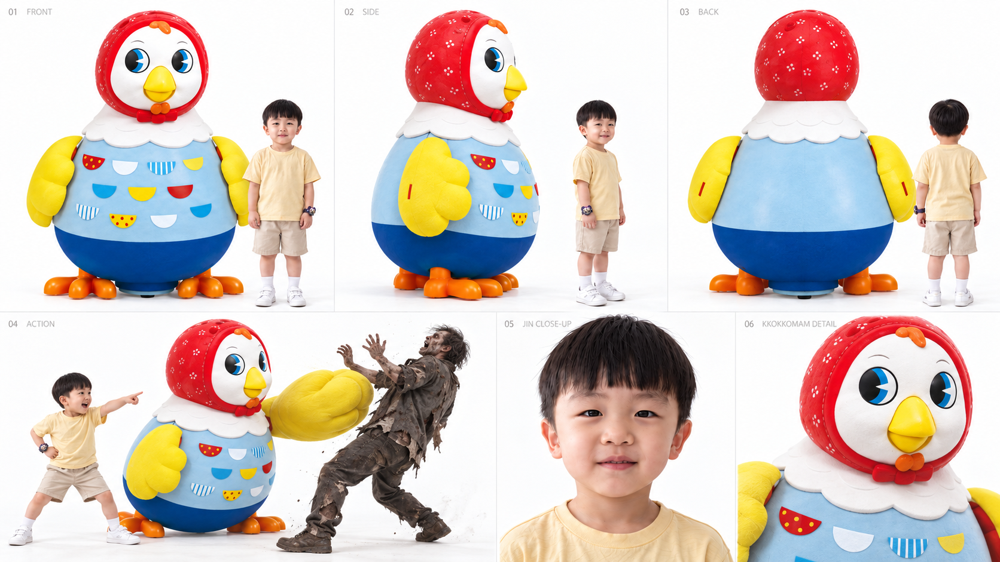
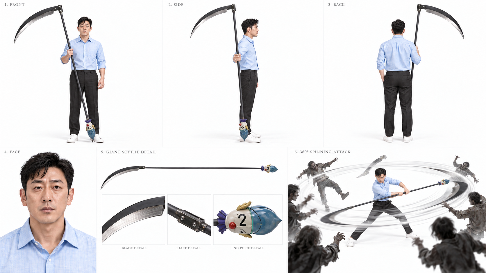
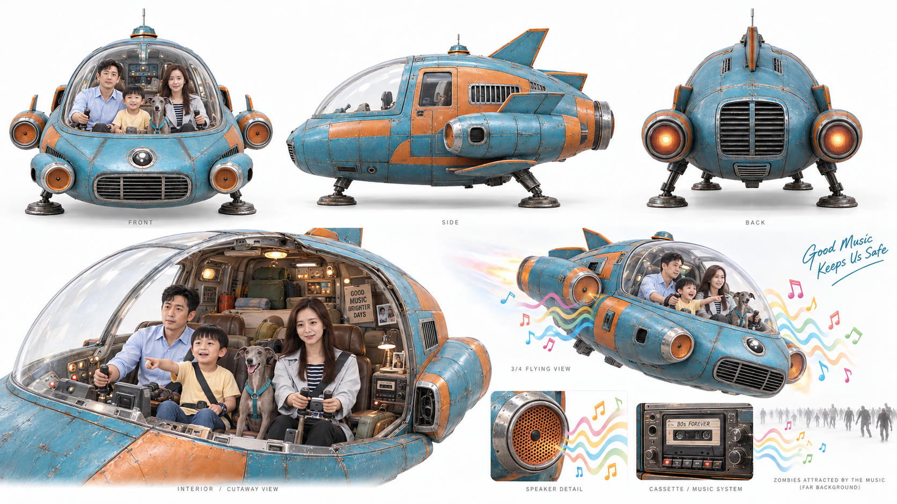

# 룰렛 무기 도감 · 1–10

추첨은 진. 제레미 2·8번, 릴리 6번, 진 1·7번, 가족 공동 3·4·5·9번, 루나 변신 10번.

| 번호 | 무기 컨셉 | 사용자 시트 | 무기·장비 | 능력 | 사용자 | 상태 |
|---|---|---|---|---|---|---|
| 1 |  |  | 거대 꼬꼬맘 | 진이 아끼는 꼬꼬맘 인형이 거대화해 좀비를 공격하고 밀쳐 물리친다. | 진 | 확정 |
| 2 |  |  | 거대 낫 | 한 바퀴 휘둘러 주변 공격 범위를 한꺼번에 절단한다. 화면은 실루엣과 절단선으로 표현. | 제레미 전용 | 확정 |
| 3 |  |  | 완전무장 디트로네 | 전동 유모차가 완전무장한다. 레이저와 폭탄을 발사하며 탄약은 3발. 아빠가 뒤에서 조종하고 릴리·진이 탑승. | 가족 공동 | 확정 |
| 4 |  |  | 챔프풍 히어로 시럽 | 모든 상태 이상과 부상을 회복한다. 체리 향과 판다 응원 연출. 1회 5ml만 사용 가능해 누구에게 쓸지 고민하게 된다. | 가족 공동 | 확정 |
| 5 |  |  | 가족 우주선 | 가족을 태우고 비행·탈출한다. 80년대 노래를 크게 틀면 소리에 반응하는 좀비들이 몰려와 유인된다. | 가족 전용 | 확정 |
| 6 |  |  | 얼음 능력 드레스 | 아이스볼 발사, 빙판길을 만들어 미끄러지듯 고속 이동, 좀비 얼리기. | 릴리 | 확정 |
| 7 |  |  | 아이언 스파이더 슈트 | 거미줄 발사·이동·포획과 기계 거미 다리. 처음에는 거미줄이 자꾸 엉키다가 결정적인 순간 성공한다. | 진 전용 | 확정 |
| 8 |  |  | 마크1풍 메카닉 슈트 | 철판을 덧댄 기계식 장갑, 화염 분사와 짧은 비행, 가슴 빛 에너지. 진이 바라던 슈트를 아빠가 입는 웃음 포인트. | 제레미 전용 | 확정 |
| 9 |  |  | 부서지지 않는 노란 스쿨버스 | 무엇과 부딪혀도 부서지지 않는다. 좀비 무리를 돌파하고 가족을 실어 나른다. | 가족 | 확정 |
| 10 |  |  | 거대 수호견 루나 | 10번 당첨 시 보라색 슬롯 빛이 청록 하네스에 연결된다. 루나가 어깨 높이 약 4m로 커져 달 모양 보호막과 돌진으로 길을 열고, 보호 안장에 가족을 태워 탈출한다. | 루나 · 가족 탑승 | 확정 |
