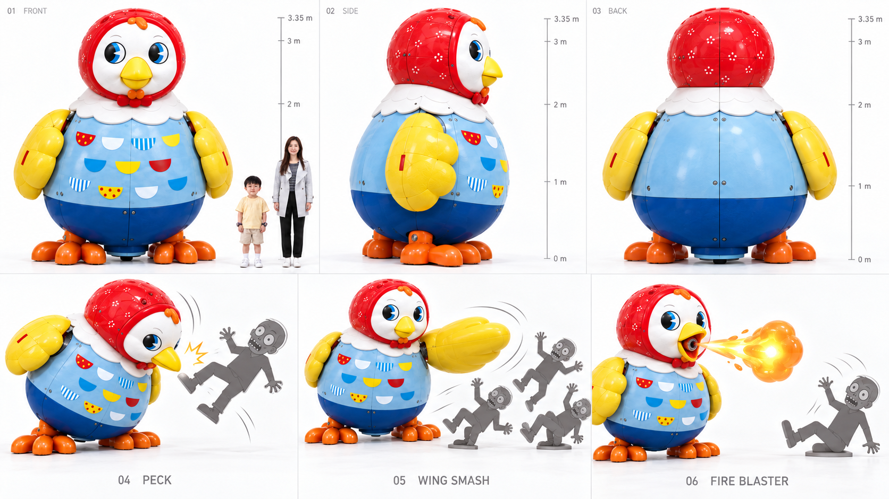
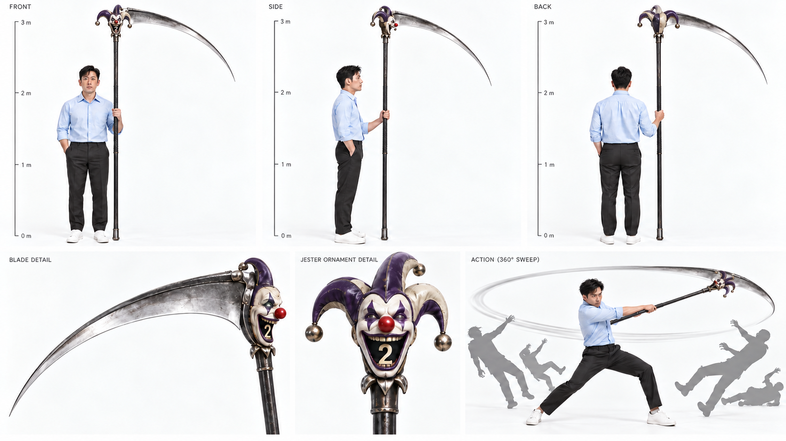
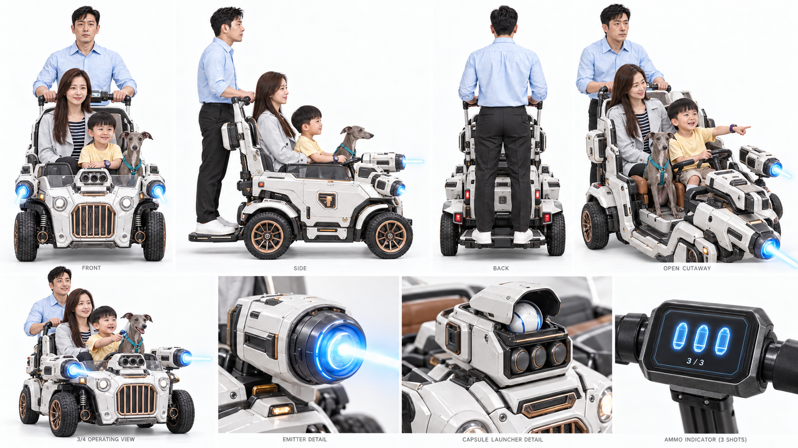
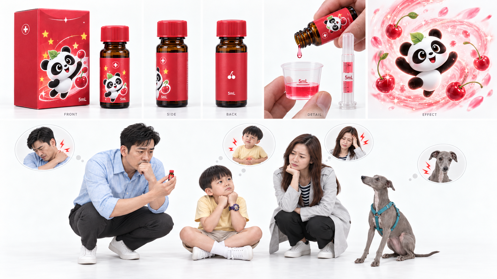
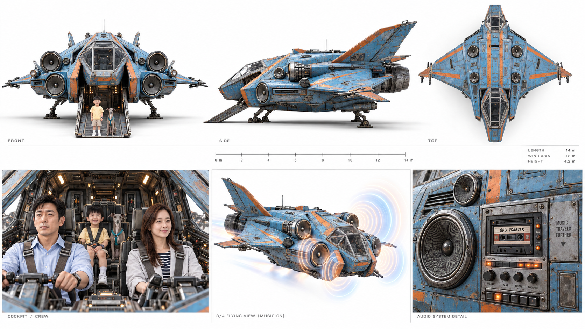
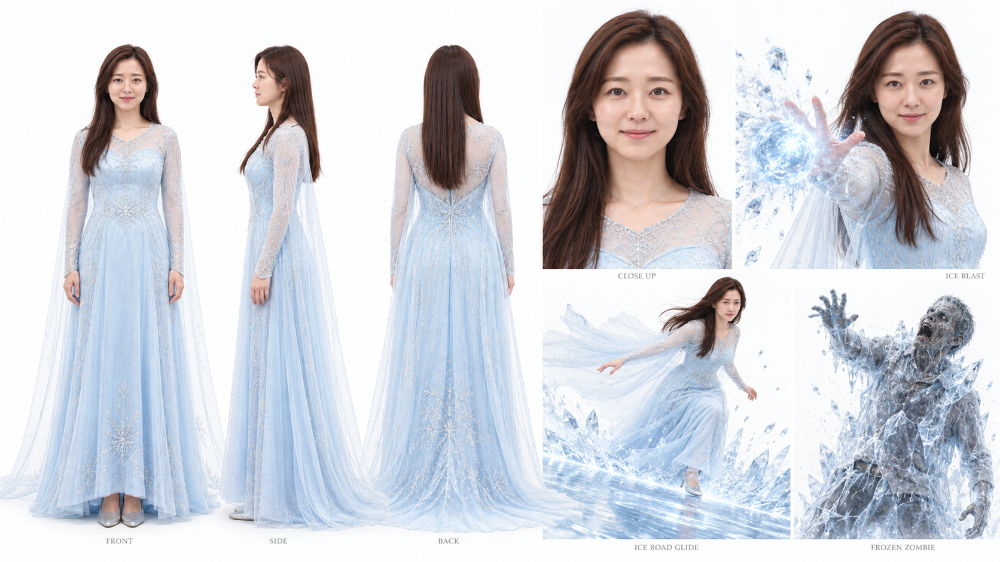
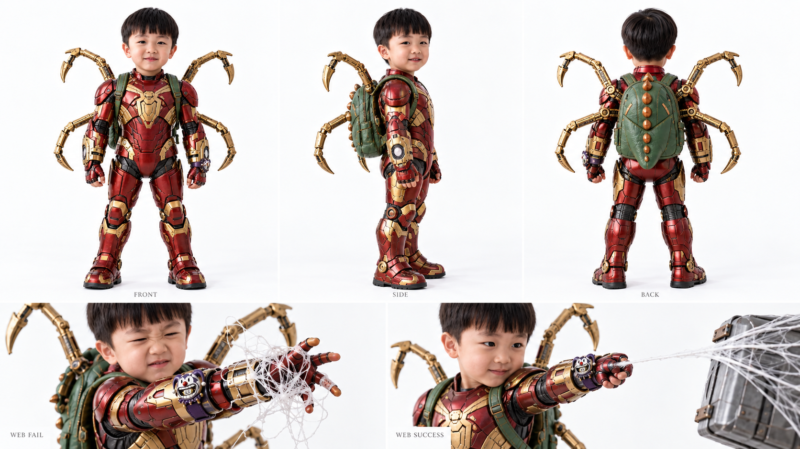
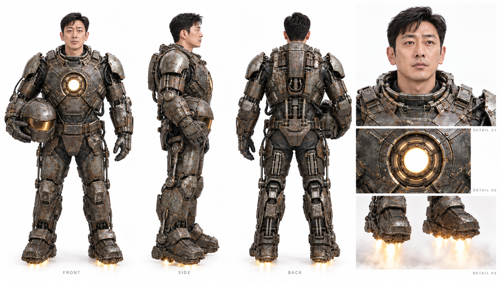
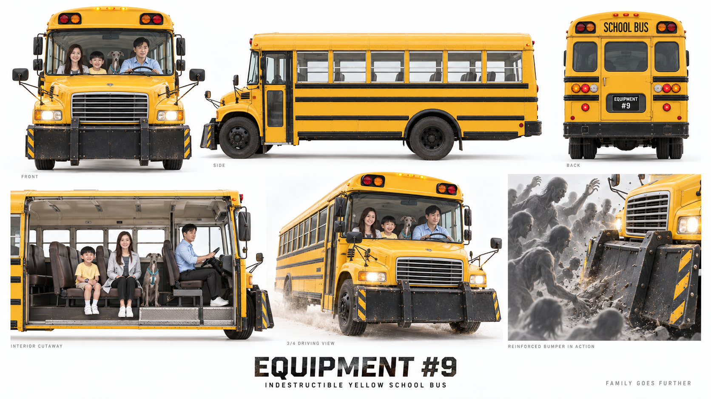
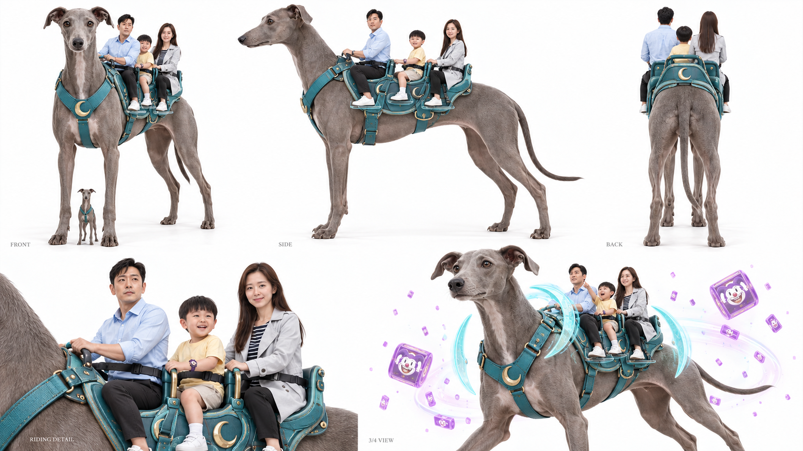

# 좀비 인 동탄 · 무기 소개 영상 콘티 (1–10)

작성 2026-10-11. 무기마다 15초 단독 영상입니다. **0–3초 쾅쾅 인포그래픽 → 3–15초 특징을 보여 주는 상황 예시** 순서입니다. 10편을 이어 붙이면 오프닝 3초를 더해 총 2분 33초입니다. 16:9 기준이며, 9:16 쇼츠는 같은 콘티를 세로로 다시 구도 잡습니다.

오디오 기준: BGM 없음, 효과음만 사용합니다(5번 우주선의 노래는 극 안에서 들리는 오리지널 곡). 장소는 모두 가상 공간 구성입니다. 피·신체 훼손 표현은 쓰지 않습니다.

## 공통 인포그래픽 타이밍 (0–3초)

화면 글자는 번호, 이름, 기술 키워드 3개, 사용자 태그뿐입니다. 배경은 해당 무기 시트 이미지를 어둡게 깔고 무기 고유 색 띠를 씁니다.

| 시점(초) | 박히는 요소 | 연출 | 효과음 |
|---|---|---|---|
| 0.00 | 번호 쾅 | 화이트 플래시 2프레임 + 번호가 3배 크기에서 떨어져 박힘 · 화면 흔들림 | 저음 붐 + 금속 임팩트 |
| 0.45 | 이름 쾅 | 무기 이름이 도장처럼 박힘 · 화면 흔들림 | 붐 |
| 1.00 | 키워드 1 쾅 | 기술 키워드 첫 번째 | 짧은 타격 쾅 |
| 1.40 | 키워드 2 쾅 | 기술 키워드 두 번째 | 쾅 |
| 1.80 | 키워드 3 쾅 | 기술 키워드 세 번째 · 가장 크게 흔들림 | 쾅 (가장 큼) |
| 2.20 | 사용자 태그 | “진 전용”처럼 사용자가 옆에서 밀려 들어옴 | 휙 |
| 2.60–3.00 | 정지 → 하드컷 | 0.3초 정지 후 화이트 플래시로 상황 장면에 하드컷 | 리버스 휙 |

## 오프닝 (0–3초, 묶음 영상만)

진의 보라색 삐에로 시계 빨간 코가 눌리고 슬롯이 돈다. 큰 글씨 **“크레이지 슬롯 무기 도감”** 쾅 → 숫자 1~10이 0.1초씩 빠르게 넘어가다 **“01”**에서 멈추며 첫 무기로 하드컷.

## 01. 거대 꼬꼬맘 · 진



**인포그래픽 (0–3초):** 01 쾅 → 거대 꼬꼬맘 쾅 → 쪼기 쾅 · 날개 치기 쾅 · 파이어블라스터 쾅 → 태그 「진」

**장소:** 동탄호수공원 어린이 놀이터 [가상 공간 구성] · 해 질 녘

**상황:** 좀비 6명이 미끄럼틀 쪽으로 진을 몰아넣는다. 진이 1번을 뽑자 장난감 꼬꼬맘이 3.35m로 커진다.

| 컷 | 시간(초) | 카메라 | 화면 | 효과음 |
|---|---|---|---|---|
| 1 | 03.0–05.5 | 로우 앵글 와이드 · 크레인 업 | 진이 시계 빨간 코를 누르고, 장난감 꼬꼬맘이 부풀어 3.35m로 “쿵” 착지. 진 머리 위로 큰 그림자. | 태엽 감기 → 저음 쿵 |
| 2 | 05.5–08.0 | 미디엄 · 핸드헬드 | 쪼기 3연타(0.5초 간격). 앞의 좀비 3명이 차례로 튕겨 모래밭에 굴러간다. | 플라스틱 탁·탁·탁 + “꼬꼬댁!” |
| 3 | 08.0–10.5 | 와이드 · 휩팬 | 몸을 반대로 비틀었다가 날개 치기. 반경 3m 안의 좀비 3명이 옆으로 날아가 벤치 뒤로 넘어진다. | 바람 휙 → 쿵 |
| 4 | 10.5–13.0 | 정면 로우 앵글 · 푸시 인 | 부리가 활짝 열리고 노즐에서 불꽃 덩어리 3발. 무리 앞 바닥에 맞은 폭풍에 무리가 뒤로 넘어진다. | 펑·펑·펑 → 노즐 칙 |
| 5 | 13.0–15.0 | 클로즈업 → 익스트림 와이드 | “꼬꼬댁!” 소리에 멀리 있던 좀비들이 일제히 고개를 돌린다. 진: “아, 너무 시끄러워….” | 메아리 “꼬꼬댁…” |

**보여 줄 핵심:** 귀여운 장난감이 압도적인 힘을 낸다. 단점(큰 소리)을 마지막 컷에서 웃음으로 보여 준다.

**표현 규칙:** 좀비는 밀려 넘어지거나 날아갈 뿐 화상·피 표현은 쓰지 않는다. 불꽃은 바닥에 맞힌다.

**영상 생성 프롬프트 (상황 12초):**

```
12-second weapon showcase for Crazy Slot item number 1 (거대 꼬꼬맘), matching equipment sheet equipment-01-v6.png exactly. Setting: 동탄호수공원 어린이 놀이터 [가상 공간 구성] · 해 질 녘. Five hard cuts: 1) 로우 앵글 와이드 · 크레인 업: 진이 시계 빨간 코를 누르고, 장난감 꼬꼬맘이 부풀어 3.35m로 “쿵” 착지. 진 머리 위로 큰 그림자. 2) 미디엄 · 핸드헬드: 쪼기 3연타(0.5초 간격). 앞의 좀비 3명이 차례로 튕겨 모래밭에 굴러간다. 3) 와이드 · 휩팬: 몸을 반대로 비틀었다가 날개 치기. 반경 3m 안의 좀비 3명이 옆으로 날아가 벤치 뒤로 넘어진다. 4) 정면 로우 앵글 · 푸시 인: 부리가 활짝 열리고 노즐에서 불꽃 덩어리 3발. 무리 앞 바닥에 맞은 폭풍에 무리가 뒤로 넘어진다. 5) 클로즈업 → 익스트림 와이드: “꼬꼬댁!” 소리에 멀리 있던 좀비들이 일제히 고개를 돌린다. 진: “아, 너무 시끄러워….” Keep existing family faces and costumes (jeremy-sheet-v4.png, lily-sheet-v4.png, jin-sheet-v3.png, luna-sheet.png). Gritty 2004 fast-zombie thriller look, warm sunset key light, teal shadows, 35mm grain, 16:9, family-friendly action, no gore, no blood, zombies are only pushed, knocked down, frozen or held. Korean text and infographic are added in post. Duration: 12 seconds.
```

## 02. 거대 낫 · 제레미 전용



**인포그래픽 (0–3초):** 02 쾅 → 거대 낫 쾅 → 반경 50M 쾅 · 회전 참격 쾅 · 단 1회 쾅 → 태그 「제레미 전용」

**장소:** 동탄역 앞 광장 [가상 공간 구성] · 해 질 녘 역광

**상황:** 가족이 광장 한가운데서 사방으로 포위된다. 진이 2번을 뽑자 제레미 손에 2.6m 낫이 나타난다.

| 컷 | 시간(초) | 카메라 | 화면 | 효과음 |
|---|---|---|---|---|
| 1 | 03.0–05.5 | 로우 앵글 미디엄 | 제레미 손에 낫이 소환된다. 키보다 80cm 큰 낫. 제레미: “엎드려!” 릴리·진·루나가 바닥에 납작 엎드린다. | 금속 울림 + 외침 |
| 2 | 05.5–07.5 | 측면 클로즈업 · 슬로모션 | 낫이 허리 높이로 한 바퀴 원을 그린다. 0.5초 완전 무음. | 정적 |
| 3 | 07.5–10.5 | 탑뷰 · 크레인 업 익스트림 와이드 | 얇은 빛의 원이 제레미를 중심으로 50m까지 퍼져 나간다. | 고음 “찡—” |
| 4 | 10.5–13.5 | 역광 와이드 | 가로등·나무·자동차가 같은 높이에서 미끄러지듯 어긋나며 쓰러진다. 좀비 무리는 역광 실루엣과 먼지 속에 쓰러진다. | 연쇄 쿵·쿵·쿵 |
| 5 | 13.5–15.0 | 아이레벨 미디엄 | 낫이 빛으로 흩어지며 사용 완료. 진이 고개를 들고: “아빠… 우리 머리 위로 지나갔어.” | 빛 흩어짐 쉭 |

**보여 줄 핵심:** “한 번뿐, 하지만 반경 50m 전부.” 정적 → 빛의 원 → 쓰러지는 와이드 순서로 위력을 보여 준다.

**표현 규칙:** 피·단면·신체 훼손은 보여 주지 않는다. 좀비는 실루엣과 먼지로만 처리한다. 가족이 먼저 엎드리는 장면은 반드시 넣는다.

**영상 생성 프롬프트 (상황 12초):**

```
12-second weapon showcase for Crazy Slot item number 2 (거대 낫), matching equipment sheet equipment-02-v6.png exactly. Setting: 동탄역 앞 광장 [가상 공간 구성] · 해 질 녘 역광. Five hard cuts: 1) 로우 앵글 미디엄: 제레미 손에 낫이 소환된다. 키보다 80cm 큰 낫. 제레미: “엎드려!” 릴리·진·루나가 바닥에 납작 엎드린다. 2) 측면 클로즈업 · 슬로모션: 낫이 허리 높이로 한 바퀴 원을 그린다. 0.5초 완전 무음. 3) 탑뷰 · 크레인 업 익스트림 와이드: 얇은 빛의 원이 제레미를 중심으로 50m까지 퍼져 나간다. 4) 역광 와이드: 가로등·나무·자동차가 같은 높이에서 미끄러지듯 어긋나며 쓰러진다. 좀비 무리는 역광 실루엣과 먼지 속에 쓰러진다. 5) 아이레벨 미디엄: 낫이 빛으로 흩어지며 사용 완료. 진이 고개를 들고: “아빠… 우리 머리 위로 지나갔어.” Keep existing family faces and costumes (jeremy-sheet-v4.png, lily-sheet-v4.png, jin-sheet-v3.png, luna-sheet.png). Gritty 2004 fast-zombie thriller look, warm sunset key light, teal shadows, 35mm grain, 16:9, family-friendly action, no gore, no blood, zombies are only pushed, knocked down, frozen or held. Korean text and infographic are added in post. Duration: 12 seconds.
```

## 03. 완전무장 디트로네 · 가족 공동



**인포그래픽 (0–3초):** 03 쾅 → 완전무장 디트로네 쾅 → 광선 쾅 · 캡슐 폭탄 쾅 · 탄약 3 쾅 → 태그 「가족 공동」

**장소:** 라크몽 지하주차장 출구 경사로 [가상 공간 구성]

**상황:** 유모차를 밀고 나가는데 출구를 좀비가 막고 있다. 3번이 나오자 유모차가 소형 장갑차가 된다.

| 컷 | 시간(초) | 카메라 | 화면 | 효과음 |
|---|---|---|---|---|
| 1 | 03.0–05.5 | 와이드 · 오빗 | 유모차에 흰 장갑판이 철컥철컥 붙고 바퀴가 오프로드 타이어로 커진다. 릴리·진 탑승, 제레미는 뒤 발판. | 기계 결합음 ×4 |
| 2 | 05.5–08.0 | 손잡이 화면 인서트 → 정면 미디엄 | 화면에 탄약 3칸. 파란 광선이 출구를 막은 좀비 2명을 밀어낸다. 탄약 3 → 2. | 광선 위잉 |
| 3 | 08.0–10.5 | 하이 앵글 와이드 | 캡슐 폭탄 발사. 빛과 소리가 터지고 무리가 반대편으로 흩어진다. 탄약 2 → 1. | 펑 + 삑삑 |
| 4 | 10.5–13.0 | 로우 앵글 트래킹 | 시속 25km로 경사로를 치고 올라간다. 마지막 1발로 남은 좀비를 밀어낸다. 탄약 1 → 0. | 모터 부웅 |
| 5 | 13.0–15.0 | 인서트 클로즈업 | 손잡이 화면 0칸이 깜박이고 장갑판이 접힌다. 자막: “3번 다음 9번이면… 합체?” | 전원 꺼짐 뚜- |

**보여 줄 핵심:** 남은 탄약 칸을 화면에 계속 보여 줘 “3발이 전부”라는 규칙을 직관적으로 알린다.

**표현 규칙:** 광선과 캡슐은 밀어내기·흩어 놓기 용도로만 보여 준다.

**영상 생성 프롬프트 (상황 12초):**

```
12-second weapon showcase for Crazy Slot item number 3 (완전무장 디트로네), matching equipment sheet equipment-03-v5.png exactly. Setting: 라크몽 지하주차장 출구 경사로 [가상 공간 구성]. Five hard cuts: 1) 와이드 · 오빗: 유모차에 흰 장갑판이 철컥철컥 붙고 바퀴가 오프로드 타이어로 커진다. 릴리·진 탑승, 제레미는 뒤 발판. 2) 손잡이 화면 인서트 → 정면 미디엄: 화면에 탄약 3칸. 파란 광선이 출구를 막은 좀비 2명을 밀어낸다. 탄약 3 → 2. 3) 하이 앵글 와이드: 캡슐 폭탄 발사. 빛과 소리가 터지고 무리가 반대편으로 흩어진다. 탄약 2 → 1. 4) 로우 앵글 트래킹: 시속 25km로 경사로를 치고 올라간다. 마지막 1발로 남은 좀비를 밀어낸다. 탄약 1 → 0. 5) 인서트 클로즈업: 손잡이 화면 0칸이 깜박이고 장갑판이 접힌다. 자막: “3번 다음 9번이면… 합체?” Keep existing family faces and costumes (jeremy-sheet-v4.png, lily-sheet-v4.png, jin-sheet-v3.png, luna-sheet.png). Gritty 2004 fast-zombie thriller look, warm sunset key light, teal shadows, 35mm grain, 16:9, family-friendly action, no gore, no blood, zombies are only pushed, knocked down, frozen or held. Korean text and infographic are added in post. Duration: 12 seconds.
```

## 04. 챔프풍 히어로 시럽 · 가족 공동



**인포그래픽 (0–3초):** 04 쾅 → 챔프풍 히어로 시럽 쾅 → 완전 회복 쾅 · 5mL 쾅 · 단 1명 쾅 → 태그 「가족 공동」

**장소:** 가족 은신처 거실 [가상 공간 구성] · 밤

**상황:** 아빠는 고열, 엄마는 발목을 다쳤다. 4번 시럽이 나왔지만 5mL, 단 한 명분이다.

| 컷 | 시간(초) | 카메라 | 화면 | 효과음 |
|---|---|---|---|---|
| 1 | 03.0–05.0 | 탑뷰 인서트 | 판다와 체리가 그려진 빨간 상자가 테이블에 “톡” 떨어진다. | 종이 상자 톡 |
| 2 | 05.0–07.5 | 익스트림 클로즈업 | 스포이트로 정확히 5mL를 계량한다. 눈금이 5에 딱 멈춘다. | 물방울 똑 |
| 3 | 07.5–10.0 | 교차 클로즈업 2컷 | 진이 열이 나는 아빠와 발목을 감싼 엄마를 번갈아 본다. 엄마: “아빠 먼저.” | 시계 째깍 |
| 4 | 10.0–13.0 | 미디엄 · 푸시 인 | 제레미가 마신다. 체리 향 회오리와 응원하는 판다 그래픽이 돌고, 제레미가 벌떡 일어난다. | 반짝 차임 + 판다 “파이팅!” |
| 5 | 13.0–15.0 | 인서트 | 빈 병 클로즈업. 자막: “단 1명.” 엄마가 웃으며 발목을 다시 묶는다. | 병 내려놓기 탁 |

**보여 줄 핵심:** 능력보다 선택의 고민이 핵심이다. 가족애를 보여 주는 쉬어 가는 회차다.

**표현 규칙:** 실제 제품 포장은 쓰지 않는다. 오리지널 판다·체리 패키지만 쓴다.

**영상 생성 프롬프트 (상황 12초):**

```
12-second weapon showcase for Crazy Slot item number 4 (챔프풍 히어로 시럽), matching equipment sheet equipment-04-v5.png exactly. Setting: 가족 은신처 거실 [가상 공간 구성] · 밤. Five hard cuts: 1) 탑뷰 인서트: 판다와 체리가 그려진 빨간 상자가 테이블에 “톡” 떨어진다. 2) 익스트림 클로즈업: 스포이트로 정확히 5mL를 계량한다. 눈금이 5에 딱 멈춘다. 3) 교차 클로즈업 2컷: 진이 열이 나는 아빠와 발목을 감싼 엄마를 번갈아 본다. 엄마: “아빠 먼저.” 4) 미디엄 · 푸시 인: 제레미가 마신다. 체리 향 회오리와 응원하는 판다 그래픽이 돌고, 제레미가 벌떡 일어난다. 5) 인서트: 빈 병 클로즈업. 자막: “단 1명.” 엄마가 웃으며 발목을 다시 묶는다. Keep existing family faces and costumes (jeremy-sheet-v4.png, lily-sheet-v4.png, jin-sheet-v3.png, luna-sheet.png). Gritty 2004 fast-zombie thriller look, warm sunset key light, teal shadows, 35mm grain, 16:9, family-friendly action, no gore, no blood, zombies are only pushed, knocked down, frozen or held. Korean text and infographic are added in post. Duration: 12 seconds.
```

## 05. 가족 우주선 · 가족 전용



**인포그래픽 (0–3초):** 05 쾅 → 가족 우주선 쾅 → 비행 탈출 쾅 · 80년대 노래 쾅 · 좀비 유인 쾅 → 태그 「가족 전용」

**장소:** 동탄호수공원 잔디광장 [가상 공간 구성] · 해 질 녘

**상황:** 호숫가에 갇힌 가족 앞으로 14m 델타익 셔틀이 내려온다.

| 컷 | 시간(초) | 카메라 | 화면 | 효과음 |
|---|---|---|---|---|
| 1 | 03.0–05.5 | 로우 앵글 익스트림 와이드 | 석양을 가르며 셔틀이 하강하고 착륙 다리 3개가 펴진다. 기수 아래로 램프가 내려온다. | 엔진 굉음 → 착지 쿵 |
| 2 | 05.5–07.5 | 트래킹 미디엄 | 가족과 루나가 램프를 뛰어오른다. 진이 마지막으로 뒤를 돌아본다. | 발소리 탕탕 |
| 3 | 07.5–10.5 | 스피커 클로즈업 → 와이드 | 앞면 스피커 4개가 울리며 80년대풍 신스 노래가 터진다. 좀비 무리가 일제히 고개를 돌려 호수 반대편으로 달린다. | 노래(오리지널 곡) 시작 |
| 4 | 10.5–13.0 | 에어리얼 · 크레인 업 | 셔틀이 이륙해 유인된 무리 위를 낮게 지나간다. | 엔진 상승음 |
| 5 | 13.0–15.0 | 조종석 미디엄 | 노래가 끝나고 셔틀이 착륙해 사용 완료. 진: “한 곡만 더….” | 노래 끝 → 착지 |

**보여 줄 핵심:** “소리에 반응하는 좀비” 규칙을 무기로 바꾸는 회차다. 노래는 극 안에서 들리는 소리로 쓴다.

**표현 규칙:** 노래는 오리지널 곡만 쓴다. 기존 80년대 히트곡 음원은 쓰지 않는다. 별도 BGM은 넣지 않는다.

**영상 생성 프롬프트 (상황 12초):**

```
12-second weapon showcase for Crazy Slot item number 5 (가족 우주선), matching equipment sheet equipment-05-v6.png exactly. Setting: 동탄호수공원 잔디광장 [가상 공간 구성] · 해 질 녘. Five hard cuts: 1) 로우 앵글 익스트림 와이드: 석양을 가르며 셔틀이 하강하고 착륙 다리 3개가 펴진다. 기수 아래로 램프가 내려온다. 2) 트래킹 미디엄: 가족과 루나가 램프를 뛰어오른다. 진이 마지막으로 뒤를 돌아본다. 3) 스피커 클로즈업 → 와이드: 앞면 스피커 4개가 울리며 80년대풍 신스 노래가 터진다. 좀비 무리가 일제히 고개를 돌려 호수 반대편으로 달린다. 4) 에어리얼 · 크레인 업: 셔틀이 이륙해 유인된 무리 위를 낮게 지나간다. 5) 조종석 미디엄: 노래가 끝나고 셔틀이 착륙해 사용 완료. 진: “한 곡만 더….” Keep existing family faces and costumes (jeremy-sheet-v4.png, lily-sheet-v4.png, jin-sheet-v3.png, luna-sheet.png). Gritty 2004 fast-zombie thriller look, warm sunset key light, teal shadows, 35mm grain, 16:9, family-friendly action, no gore, no blood, zombies are only pushed, knocked down, frozen or held. Korean text and infographic are added in post. Duration: 12 seconds.
```

## 06. 얼음 능력 드레스 · 릴리



**인포그래픽 (0–3초):** 06 쾅 → 얼음 능력 드레스 쾅 → 아이스볼 쾅 · 빙판길 쾅 · 얼리기 쾅 → 태그 「릴리」

**장소:** 동탄 센트럴파크 산책로 [가상 공간 구성] · 해 질 녘

**상황:** 릴리와 진이 산책로에서 쫓긴다. 6번이 나오자 릴리의 옷이 얼음빛 드레스로 바뀐다.

| 컷 | 시간(초) | 카메라 | 화면 | 효과음 |
|---|---|---|---|---|
| 1 | 03.0–05.0 | 360도 오빗 미디엄 | 눈꽃이 휘감기며 드레스와 2.2m 망토가 펼쳐진다. | 얼음 결정 쨍 |
| 2 | 05.0–07.5 | 오버숄더 · 크래시 줌 | 지름 20cm 아이스볼이 10m를 날아가 앞의 좀비를 넘어뜨린다. | 휙 → 쩍 |
| 3 | 07.5–10.5 | 로우 앵글 트래킹 | 손바닥을 향한 바닥에 폭 2m 빙판길이 깔리고, 릴리가 진을 안고 미끄러지듯 질주한다. 쫓던 좀비들이 줄줄이 미끄러진다. | 스케이트 쉬익 + 미끄러짐 |
| 4 | 10.5–13.0 | 클로즈업 → 미디엄 | 릴리가 좀비 어깨에 손을 댄다. 화면에 “1… 2”가 뜨고 좀비가 얼음 조각상처럼 멈춘다. | 째깍 2회 → 얼어붙음 쩌적 |
| 5 | 13.0–15.0 | 와이드 | 릴리가 두 손을 내리자 드레스가 눈꽃으로 흩어지며 사용 완료. | 눈꽃 사르륵 |

**보여 줄 핵심:** 세 기술을 공격 → 이동 → 정지 순서로 하나씩 깔끔하게 보여 준다.

**표현 규칙:** 얼린 좀비는 깨뜨리지 않는다. EP.01 본편에는 나오지 않는 무기다.

**영상 생성 프롬프트 (상황 12초):**

```
12-second weapon showcase for Crazy Slot item number 6 (얼음 능력 드레스), matching equipment sheet equipment-06-v5.png exactly. Setting: 동탄 센트럴파크 산책로 [가상 공간 구성] · 해 질 녘. Five hard cuts: 1) 360도 오빗 미디엄: 눈꽃이 휘감기며 드레스와 2.2m 망토가 펼쳐진다. 2) 오버숄더 · 크래시 줌: 지름 20cm 아이스볼이 10m를 날아가 앞의 좀비를 넘어뜨린다. 3) 로우 앵글 트래킹: 손바닥을 향한 바닥에 폭 2m 빙판길이 깔리고, 릴리가 진을 안고 미끄러지듯 질주한다. 쫓던 좀비들이 줄줄이 미끄러진다. 4) 클로즈업 → 미디엄: 릴리가 좀비 어깨에 손을 댄다. 화면에 “1… 2”가 뜨고 좀비가 얼음 조각상처럼 멈춘다. 5) 와이드: 릴리가 두 손을 내리자 드레스가 눈꽃으로 흩어지며 사용 완료. Keep existing family faces and costumes (jeremy-sheet-v4.png, lily-sheet-v4.png, jin-sheet-v3.png, luna-sheet.png). Gritty 2004 fast-zombie thriller look, warm sunset key light, teal shadows, 35mm grain, 16:9, family-friendly action, no gore, no blood, zombies are only pushed, knocked down, frozen or held. Korean text and infographic are added in post. Duration: 12 seconds.
```

## 07. 아이언 스파이더 슈트 · 진 전용



**인포그래픽 (0–3초):** 07 쾅 → 아이언 스파이더 슈트 쾅 → 거미줄 쾅 · 그물 쾅 · 기계 다리 쾅 → 태그 「진 전용」

**장소:** 라크몽 경사로 → 호수 데크 [가상 공간 구성] · 해 질 녘

**상황:** 경사로 위아래로 막힌 엄마와 진. 7번 슈트가 진에게 입혀진다(EP.01 본편 상황 요약).

| 컷 | 시간(초) | 카메라 | 화면 | 효과음 |
|---|---|---|---|---|
| 1 | 03.0–05.0 | 로우 앵글 미디엄 | 빨강·금색 장갑이 진을 감싸고 등딱지 배낭에서 금빛 기계 다리 4개가 펼쳐진다. | 금속 다리 철컥 ×4 |
| 2 | 05.0–07.5 | 클로즈업 → 미디엄 | 서둘러 쏜 거미줄이 엉켜 진 손에 뭉친다. 엄마: “손바닥 펴고, 천천히.” 다시 쏜 줄이 곧게 25m 날아가 가로등에 붙는다. | 엉킴 퓩 → 곧은 슉 |
| 3 | 07.5–10.0 | 와이드 | 통로를 가로지르는 폭 6m 그물. 몰려오던 좀비 무리가 한꺼번에 붙잡힌다. | 그물 팽팽 + 둔탁한 쿵 |
| 4 | 10.0–13.0 | 에어리얼 트래킹 | 줄을 타고 날아오르며 기계 다리로 엄마와 루나를 감싸 안고, 난간을 차서 방향을 바꾼다. | 바람 휭 + 난간 탕 |
| 5 | 13.0–15.0 | 로우 앵글 → 손목 인서트 | 데크에 착지. 슈트가 작은 금속 거미들로 흩어져 보라색 삐에로 시계로 돌아간다. 사용 완료. | 사르르 금속음 |

**보여 줄 핵심:** 처음엔 엉키다 결정적인 순간 성공하는 성장 포인트를 15초 안에 압축한다.

**표현 규칙:** 진의 얼굴은 가리지 않는다. 보라색 삐에로 시계를 손목에 계속 보이게 한다.

**영상 생성 프롬프트 (상황 12초):**

```
12-second weapon showcase for Crazy Slot item number 7 (아이언 스파이더 슈트), matching equipment sheet equipment-07-v5.png exactly. Setting: 라크몽 경사로 → 호수 데크 [가상 공간 구성] · 해 질 녘. Five hard cuts: 1) 로우 앵글 미디엄: 빨강·금색 장갑이 진을 감싸고 등딱지 배낭에서 금빛 기계 다리 4개가 펼쳐진다. 2) 클로즈업 → 미디엄: 서둘러 쏜 거미줄이 엉켜 진 손에 뭉친다. 엄마: “손바닥 펴고, 천천히.” 다시 쏜 줄이 곧게 25m 날아가 가로등에 붙는다. 3) 와이드: 통로를 가로지르는 폭 6m 그물. 몰려오던 좀비 무리가 한꺼번에 붙잡힌다. 4) 에어리얼 트래킹: 줄을 타고 날아오르며 기계 다리로 엄마와 루나를 감싸 안고, 난간을 차서 방향을 바꾼다. 5) 로우 앵글 → 손목 인서트: 데크에 착지. 슈트가 작은 금속 거미들로 흩어져 보라색 삐에로 시계로 돌아간다. 사용 완료. Keep existing family faces and costumes (jeremy-sheet-v4.png, lily-sheet-v4.png, jin-sheet-v3.png, luna-sheet.png). Gritty 2004 fast-zombie thriller look, warm sunset key light, teal shadows, 35mm grain, 16:9, family-friendly action, no gore, no blood, zombies are only pushed, knocked down, frozen or held. Korean text and infographic are added in post. Duration: 12 seconds.
```

## 08. 마크1풍 메카닉 슈트 · 제레미 전용



**인포그래픽 (0–3초):** 08 쾅 → 마크1풍 메카닉 슈트 쾅 → 짧은 비행 쾅 · 화염 분사 쾅 · 30초 쾅 → 태그 「제레미 전용」

**장소:** 동탄 아파트 단지 담장 앞 [가상 공간 구성] · 저녁

**상황:** 높은 담장 앞에서 좀비 무리에게 몰린 가족. 8번이 나오자 진이 아니라 아빠에게 슈트가 입혀진다.

| 컷 | 시간(초) | 카메라 | 화면 | 효과음 |
|---|---|---|---|---|
| 1 | 03.0–05.5 | 로우 앵글 미디엄 → 리액션 클로즈업 | 쇳소리를 내며 걸어 나오는 녹슨 장갑. 헬멧이 열리면 제레미. 진: “그거 내 거였는데!” | 쇳소리 쿵·쿵 |
| 2 | 05.5–08.0 | 와이드 | 팔에서 불꽃을 뿜어 바닥에 불의 벽을 만든다. 좀비들이 뒷걸음질한다. | 화염 화르륵 |
| 3 | 08.0–10.5 | 로우 앵글 · 틸트 업 | 부츠 분사로 10m 뛰어올라 담장을 넘는다. 화면 구석에 30초 타이머. | 분사 쉬익 + 삐삐 |
| 4 | 10.5–13.0 | 와이드 · 핸드헬드 | 서툰 착지. 화단에 쿵 하고 데굴데굴 구른다. | 쿵 → 금속 덜그럭 |
| 5 | 13.0–15.0 | 가슴 클로즈업 | 가슴 에너지 코어가 깜박이다 꺼진다. 사용 완료. 제레미: “…괜찮아. 멋있었지?” | 전원 다운 우웅 |

**보여 줄 핵심:** 강하지만 투박한 슈트, 그리고 아빠가 입어서 생기는 웃음을 함께 보여 준다.

**표현 규칙:** 좀비에게 직접 불을 붙이지 않는다. 불꽃은 바닥과 벽을 막는 데만 쓴다.

**영상 생성 프롬프트 (상황 12초):**

```
12-second weapon showcase for Crazy Slot item number 8 (마크1풍 메카닉 슈트), matching equipment sheet equipment-08-v5.png exactly. Setting: 동탄 아파트 단지 담장 앞 [가상 공간 구성] · 저녁. Five hard cuts: 1) 로우 앵글 미디엄 → 리액션 클로즈업: 쇳소리를 내며 걸어 나오는 녹슨 장갑. 헬멧이 열리면 제레미. 진: “그거 내 거였는데!” 2) 와이드: 팔에서 불꽃을 뿜어 바닥에 불의 벽을 만든다. 좀비들이 뒷걸음질한다. 3) 로우 앵글 · 틸트 업: 부츠 분사로 10m 뛰어올라 담장을 넘는다. 화면 구석에 30초 타이머. 4) 와이드 · 핸드헬드: 서툰 착지. 화단에 쿵 하고 데굴데굴 구른다. 5) 가슴 클로즈업: 가슴 에너지 코어가 깜박이다 꺼진다. 사용 완료. 제레미: “…괜찮아. 멋있었지?” Keep existing family faces and costumes (jeremy-sheet-v4.png, lily-sheet-v4.png, jin-sheet-v3.png, luna-sheet.png). Gritty 2004 fast-zombie thriller look, warm sunset key light, teal shadows, 35mm grain, 16:9, family-friendly action, no gore, no blood, zombies are only pushed, knocked down, frozen or held. Korean text and infographic are added in post. Duration: 12 seconds.
```

## 09. 부서지지 않는 노란 스쿨버스 · 가족



**인포그래픽 (0–3초):** 09 쾅 → 부서지지 않는 노란 스쿨버스 쾅 → 돌파 쾅 · 안 부서짐 쾅 · 합체 쾅 → 태그 「가족」

**장소:** 동탄대로 [가상 공간 구성] · 해 질 녘

**상황:** 버려진 차와 좀비 무리로 큰길이 막혔다. 9번이 나오자 노란 스쿨버스가 나타난다.

| 컷 | 시간(초) | 카메라 | 화면 | 효과음 |
|---|---|---|---|---|
| 1 | 03.0–05.0 | 로우 앵글 정면 | 쟁기형 범퍼의 노랑·검정 줄무늬 클로즈업. 운전석의 제레미가 기어를 넣는다. | 디젤 시동 부릉 |
| 2 | 05.0–08.0 | 트래킹 와이드 | 버스가 버려진 차들과 좀비 무리를 옆으로 밀어내며 돌파한다. 좀비들은 범퍼에 밀려 옆으로 굴러 넘어진다. | 쾅 → 밀리는 금속음 |
| 3 | 08.0–10.5 | 측면 미디엄 → 차체 인서트 | 옆에서 트럭이 들이받아도 차체가 찌그러지지 않는다. 흠집 없는 노란 차체. | 둔탁한 충돌음 땅 |
| 4 | 10.5–13.0 | 하이 앵글 와이드 | 조건부 장면: 직전에 3번이 나왔다면 지붕에 디트로네 포탑이 철컥 결합한다. 화면에 “3 + 9”. | 기계 결합 철컥 |
| 5 | 13.0–15.0 | 정면 미디엄 | 목적지에 도착해 문이 “치익” 열린다. 사용 완료. | 에어 도어 치익 |

**보여 줄 핵심:** “어떤 충돌에도 멀쩡하다”를 한 컷으로 증명하고, 3번과의 합체를 예고한다.

**표현 규칙:** 좀비가 바퀴에 깔리는 장면은 쓰지 않는다. 범퍼에 밀려 옆으로 넘어지는 것까지만 보여 준다.

**영상 생성 프롬프트 (상황 12초):**

```
12-second weapon showcase for Crazy Slot item number 9 (부서지지 않는 노란 스쿨버스), matching equipment sheet equipment-09-v5.png exactly. Setting: 동탄대로 [가상 공간 구성] · 해 질 녘. Five hard cuts: 1) 로우 앵글 정면: 쟁기형 범퍼의 노랑·검정 줄무늬 클로즈업. 운전석의 제레미가 기어를 넣는다. 2) 트래킹 와이드: 버스가 버려진 차들과 좀비 무리를 옆으로 밀어내며 돌파한다. 좀비들은 범퍼에 밀려 옆으로 굴러 넘어진다. 3) 측면 미디엄 → 차체 인서트: 옆에서 트럭이 들이받아도 차체가 찌그러지지 않는다. 흠집 없는 노란 차체. 4) 하이 앵글 와이드: 조건부 장면: 직전에 3번이 나왔다면 지붕에 디트로네 포탑이 철컥 결합한다. 화면에 “3 + 9”. 5) 정면 미디엄: 목적지에 도착해 문이 “치익” 열린다. 사용 완료. Keep existing family faces and costumes (jeremy-sheet-v4.png, lily-sheet-v4.png, jin-sheet-v3.png, luna-sheet.png). Gritty 2004 fast-zombie thriller look, warm sunset key light, teal shadows, 35mm grain, 16:9, family-friendly action, no gore, no blood, zombies are only pushed, knocked down, frozen or held. Korean text and infographic are added in post. Duration: 12 seconds.
```

## 10. 거대 수호견 루나 · 루나 · 가족 탑승



**인포그래픽 (0–3초):** 10 쾅 → 거대 수호견 루나 쾅 → 달 보호막 쾅 · 돌진 쾅 · 탑승 탈출 쾅 → 태그 「루나 · 가족 탑승」

**장소:** 동탄호수공원 데크 [가상 공간 구성] · 달이 뜬 밤

**상황:** 데크 끝에 몰린 가족. 10번이 나오자 루나가 달빛 고리 속에서 어깨 높이 4m로 커진다.

| 컷 | 시간(초) | 카메라 | 화면 | 효과음 |
|---|---|---|---|---|
| 1 | 03.0–05.5 | 로우 앵글 · 크레인 업 | 하네스에서 달빛 고리가 퍼지고 루나가 4m로 거대화한다. 청록 하네스가 3인석 안장이 된다. | 고리 공명음 → 낮은 으르렁 |
| 2 | 05.5–07.5 | 미디엄 | 제레미 앞·진 가운데·릴리 뒤 순서로 탑승. 안전벨트 찰칵. | 찰칵 ×3 |
| 3 | 07.5–10.0 | 익스트림 와이드 탑뷰 | 반경 5m 초승달 보호막이 펼쳐진다. 사방에서 달려든 좀비들이 막에 부딪혀 튕겨 나간다. | 보호막 웅 + 튕김 퉁퉁 |
| 4 | 10.0–13.0 | 로우 앵글 트래킹 | 루나가 몸을 낮춰 돌진하고, 길을 막은 무리를 밀어내며 달린다. | 힘찬 질주음 |
| 5 | 13.0–15.0 | 미디엄 → 클로즈업 | 멈춘 뒤 가족이 모두 내리자 루나가 작아져 진 품에 안긴다. 사용 완료. | 작아짐 퓨웅 + 낑 |

**보여 줄 핵심:** 가족의 반려견이 가장 든든한 수호자가 되는 따뜻한 마무리 회차다.

**표현 규칙:** 루나 얼굴과 접힌 귀, 청록 하네스를 그대로 유지한다. 물거나 다치게 하는 표현은 쓰지 않는다.

**영상 생성 프롬프트 (상황 12초):**

```
12-second weapon showcase for Crazy Slot item number 10 (거대 수호견 루나), matching equipment sheet equipment-10-v5.png exactly. Setting: 동탄호수공원 데크 [가상 공간 구성] · 달이 뜬 밤. Five hard cuts: 1) 로우 앵글 · 크레인 업: 하네스에서 달빛 고리가 퍼지고 루나가 4m로 거대화한다. 청록 하네스가 3인석 안장이 된다. 2) 미디엄: 제레미 앞·진 가운데·릴리 뒤 순서로 탑승. 안전벨트 찰칵. 3) 익스트림 와이드 탑뷰: 반경 5m 초승달 보호막이 펼쳐진다. 사방에서 달려든 좀비들이 막에 부딪혀 튕겨 나간다. 4) 로우 앵글 트래킹: 루나가 몸을 낮춰 돌진하고, 길을 막은 무리를 밀어내며 달린다. 5) 미디엄 → 클로즈업: 멈춘 뒤 가족이 모두 내리자 루나가 작아져 진 품에 안긴다. 사용 완료. Keep existing family faces and costumes (jeremy-sheet-v4.png, lily-sheet-v4.png, jin-sheet-v3.png, luna-sheet.png). Gritty 2004 fast-zombie thriller look, warm sunset key light, teal shadows, 35mm grain, 16:9, family-friendly action, no gore, no blood, zombies are only pushed, knocked down, frozen or held. Korean text and infographic are added in post. Duration: 12 seconds.
```
